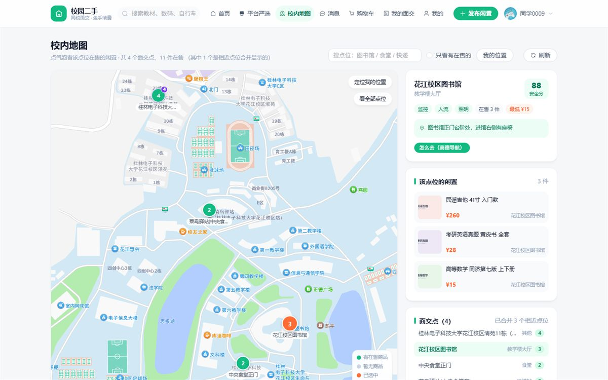
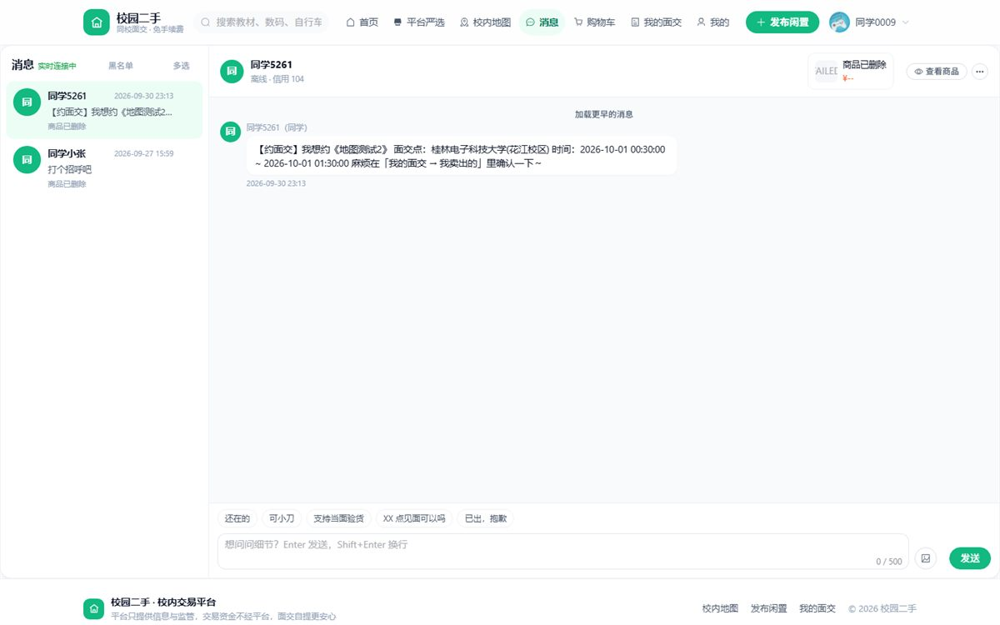
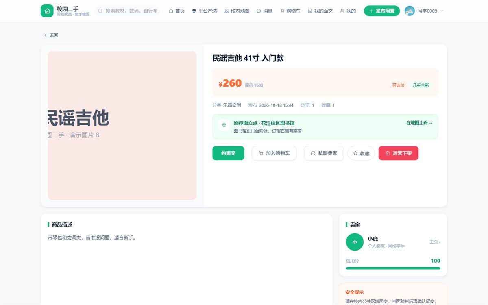
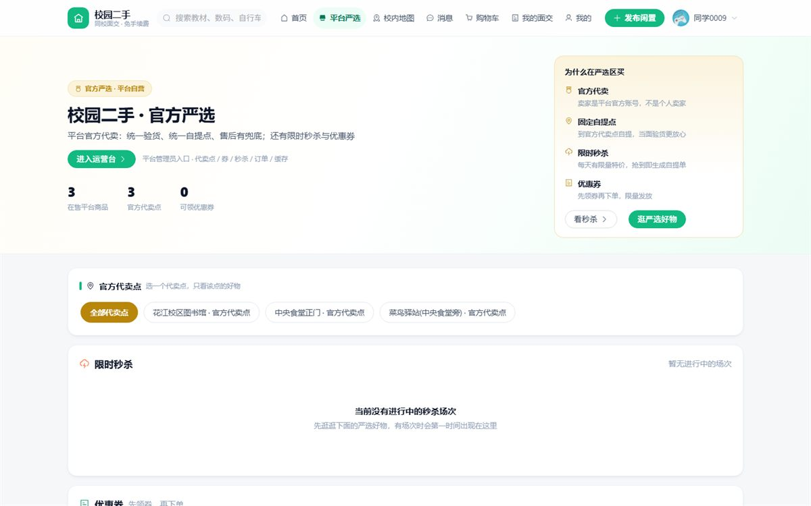
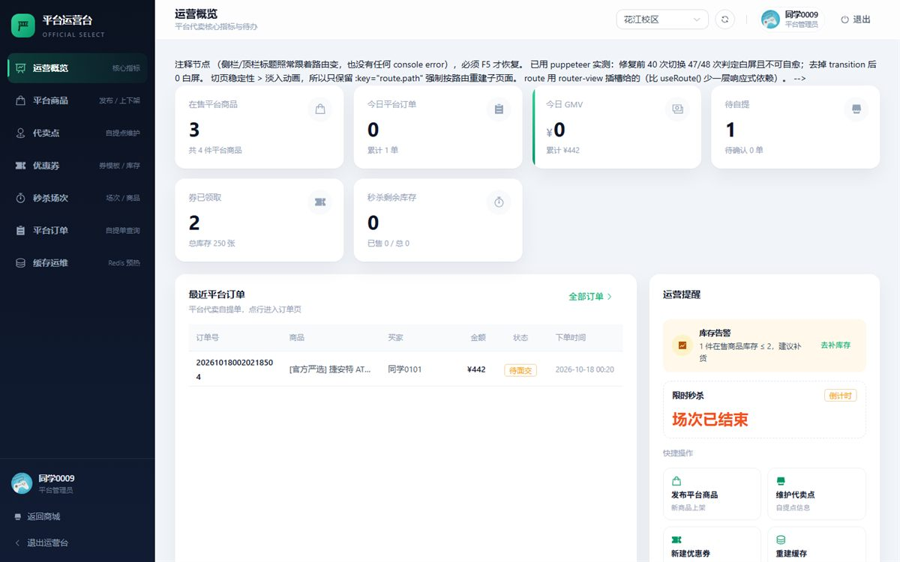
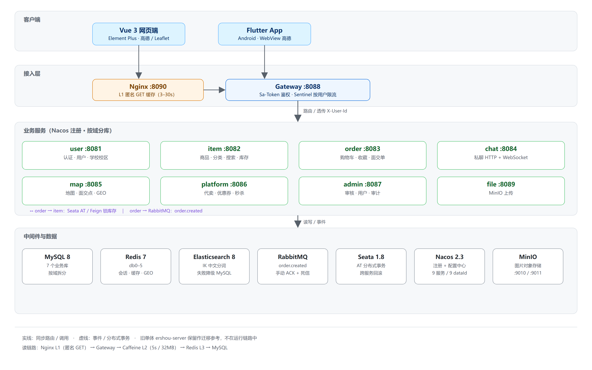
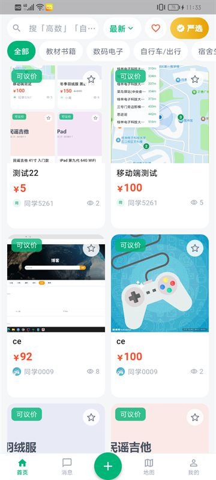
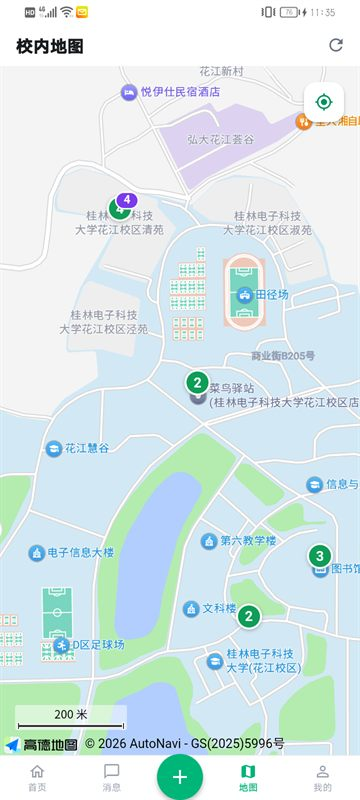
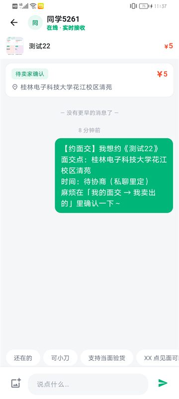
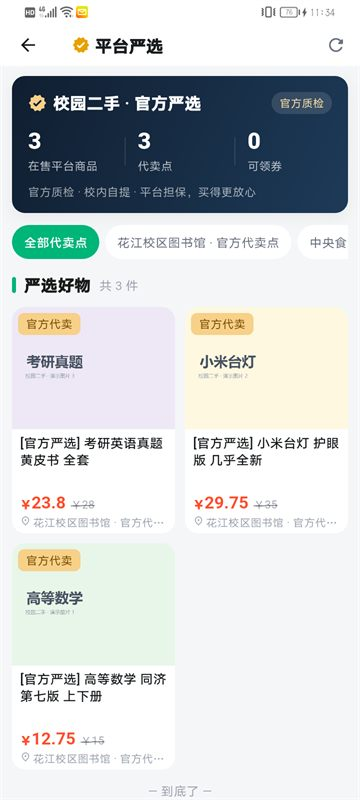

<h1 align="center">校园二手交易平台</h1>

<p align="center">
  面向高校场景的 C2C 二手交易平台：<b>轻注册 + 校内地图面交 + 内容审核</b><br>
  平台只做信息撮合与监管，<b>不介入交易资金</b>（面交线下自行支付）
</p>

<p align="center">
  
  
  
  
  
</p>

<p align="center">
  
  
  
  
  
</p>

<p align="center">
  
  
  
</p>

<p align="center">
  <sub>首页 · 校内地图 · 私聊</sub>
</p>

<p align="center">
  
  
  
</p>

<p align="center">
  <sub>商品详情 · 平台严选 · 平台运营台 &nbsp;|&nbsp; 另有 Flutter App（见 <code>ershou_app/</code>）</sub>
</p>

## 项目亮点

- **全量微服务拆分**：由单体演进为「Gateway + 8 个业务服务」，按域拆成 **7 个独立数据库**，Nacos 注册与配置、OpenFeign 调用、Seata AT 分布式事务、RabbitMQ 事件解耦，网关全链路验收 **8/8 PASS**。
- **统一入口与网关治理**：所有流量经 Gateway（:8088）进入，统一 Sa-Token 鉴权并注入 `X-User-Id`；Sentinel **按用户维度限流**（登录用户按 userId、匿名按 IP，GET 商品接口 QPS=5），超限统一返回 429 JSON。
- **三级缓存**：`Nginx（L1）→ Caffeine（L2）→ Redis（L3）→ MySQL`。Nginx 只缓存匿名 GET（3~30s），Caffeine 每实例 32MB / 5s，写路径通过 Redis Pub/Sub 主动失效；带登录态请求一律 `BYPASS`，避免用户态串缓存。
- **交易一致性**：条件更新 `WHERE stock >= n` 扣库存 + OpenFeign 内部接口锁库存 + Seata AT 全局事务；订单创建事件经 RabbitMQ 异步累加商品销量，不阻塞下单主链路。
- **秒杀与优惠券**：Redis Lua 原子扣减 + Hash 限购 + 5s 限流 + DB 唯一键兜底；5 份库存 5 并发全部成功、第 6 个失败，券不超发。
- **搜索与地理能力**：Elasticsearch 8 + IK 中文分词（异常自动降级 MySQL LIKE）；Redis GEO 提供「校内面交点附近查询」；高德 JS API 真地图与 Leaflet 自绘双模式。
- **内容安全**：禁售词直接拦截、可疑词转人工复核，配合实时上架审核队列（WebSocket 推送），保证每条上架商品都被看过。

## 系统架构

<p align="center">
  
</p>

> 旧单体 `ershou-server/` 保留在仓库作为迁移参考，**网关不再路由到 8080**，所有 `/api/v1/**` 与 `/ws/**` 均由微服务承接。

## 服务与端口

| 服务 | 端口 | 职责 | 数据库 | Redis |
| --- | --- | --- | --- | --- |
| `ershou-cloud-gateway` | **8088** | 路由、Sa-Token 鉴权、Sentinel 限流 | — | db0（会话） |
| `ershou-user-service` | 8081 | 认证、用户、学校校区、黑名单 | `ershou_user` | db1 |
| `ershou-item-service` | 8082 | 商品、分类、搜索、内部库存 | `ershou_item` | db2 |
| `ershou-order-service` | 8083 | 购物车、收藏、面交单、信用分 | `ershou_order` | db3 |
| `ershou-chat-service` | 8084 | 私聊 HTTP + WebSocket | `ershou_chat` | db4 |
| `ershou-map-service` | 8085 | 校内地图、面交点、附近点位 | `ershou_map` | db5 |
| `ershou-platform-service` | 8086 | 平台代卖、优惠券、秒杀、运营台 | `ershou_platform` | db4 |
| `ershou-admin-service` | 8087 | 审核、用户/商品/订单管理、审计 | `ershou_admin` | db0 |
| `ershou-file-service` | 8089 | MinIO 上传与图片处理 | — | — |
| Nginx | 8090 | 匿名读缓存入口（L1） | — | — |
| Nacos / RabbitMQ / Seata / Sentinel | 8848 / 5672·15672 / 8091·7091 / 8858 | 注册配置 / 事件 / 分布式事务 / 限流 | — | — |

## 核心能力

| 角色 | 能力 |
| --- | --- |
| 买家 | 搜索筛选排序、商品详情、收藏与购物车、约面交（意向单）、私聊、信用分与公开主页 |
| 卖家 | 发布 / 编辑 / 下架、接受面交、改地点与时间窗、成交、我的发布与小铺主页 |
| 运营 | 审核工作台、实时上架审核、商品强制下架、封禁 / 信用分调整、操作审计 |
| 平台 | 官方严选（代卖点 / 商品）、优惠券、限时秒杀、平台订单、缓存运维控制台 |

**关键业务链路**

- **面交单**：买家提交意向（不锁库）→ 卖家接受（条件更新锁库，锁到时间窗结束 +2h）→ 买家确认收到 → 卖家成交（商品售出、双方信用 +2）；超时自动释放。
- **私聊**：WebSocket 握手鉴权 + REST 兜底，未读/已读、撤回（2 分钟）、拉黑、消息加密落库，跨实例 Redis Pub/Sub 广播。
- **平台代卖**：平台账号作为卖家，商品标记 `seller_type=2`；秒杀/优惠券走 Lua 原子扣减，平台单复用面交状态机但不锁买家库存。
- **校内地图**：双坐标（GCJ-02 经纬度 + 像素），100 米内点位合并，点开看组内全部商品；附近点位走 Redis GEO，不消耗高德配额。

## 移动端（Flutter）

`ershou_app/` 是 Android 客户端，与网页端共用同一套网关 API（服务器地址填 `host:8088`，单体模式为 `8080`）。

<p align="center">
  
  
  
  
</p>

<p align="center"><sub>首页 · 校内地图 · 私聊 · 平台严选</sub></p>

**连接服务器**

| 方式 | 说明 |
| --- | --- |
| 一键扫描 | UDP 广播（后端 `LanDiscoveryResponder` 监听 48899）→ 网段扫描 → USB 隧道探测 |
| 手动输入 | 填 `IP:8088`，连接前先用 `/api/v1/categories` 校验后端 |
| 扫码 | 支持 `host:port`、`http://host:port`、`{"host":"...","port":...}` |
| 冷启动 | 自动探测上次地址，能通直接进首页 |

校园网存在 AP 隔离时，用 USB 隧道绕过（图片在 9010，也要转发）：

```powershell
adb reverse tcp:8088 tcp:8088
adb reverse tcp:9010 tcp:9010
```

**运行**

```powershell
cd ershou_app
flutter devices
flutter run

# 日常改代码用热重载（r 热重载 / R 热重启）
powershell -ExecutionPolicy Bypass -File .\scripts\dev-run.ps1
```

**已实现**

- 首页双列瀑布流、分类筛选、排序、分页、ES 关键词搜索、下拉刷新
- 商品详情（多图轮播 / 卖家信息 / 建议面交点）、发布与编辑（只提交改动字段）
- 收藏、约面交、我的发布、我的面交、平台严选（秒杀倒计时 / 优惠券）
- **私聊**：全局单例 WebSocket（30s 心跳、75s 判死重连、回前台重连）、撤回、已读回执、`afterId` 断线补拉
- **本地缓存**：sqflite 会话与消息镜像（按 `<origin>|<userId>` 隔离）、商品详情首屏、分类、图片磁盘缓存
- **图片地址重写**：后端返回的 MinIO 地址自动换成当前服务器地址，并保留 9010 端口

**目录**

```
ershou_app/lib/
├─ core/    # 服务器配置 / 局域网发现 / dio / WebSocket / sqflite / 图片缓存
├─ data/    # 模型与 Repository
└─ ui/      # 连接页、登录、首页、详情、发布、消息、地图、我的
```

## 三级缓存与限流

**读链路**

```
浏览器 / App
  └─ Nginx :8090（L1，仅匿名 GET，3–30s）
       └─ Gateway :8088
            └─ Service → Caffeine（L2，5s，32MB/实例）
                 └─ Redis（L3）
                      └─ MySQL
```

| 接口 | Nginx L1 | Caffeine L2 | Redis L3 |
| --- | --- | --- | --- |
| `GET /items`、`GET /search` | 3s | — | — |
| `GET /items/{id}` | 3s | 5s | 10m |
| `GET /categories` | 10s | 5s | 1h |
| `GET /map/**`、`/trade-points` | 5s | 5s | 60s / 10s |
| `GET /platform/shop/**` | 5s | 5s | 按业务 |
| `GET /schools` | 30s | 字典缓存 | 1h |
| 登录、购物车、订单、收藏、聊天、管理后台、`/items/mine`、`/ws/**` | 不缓存 | 不缓存 | 不缓存 |

- 带 `Authorization` / `satoken` Cookie / `X-User-Id` 的请求返回 `X-Cache-Status: BYPASS`，且不写入共享缓存（商品详情会按用户回填 `favorited`）。
- Caffeine 只存原始 JSON，不存对象引用，避免命中后修改 VO 污染缓存；写路径通过 `ershou:cache:evict` 频道主动失效，丢消息由 5s TTL 兜底。
- `local-enabled=false` 可一键回退到 Redis-only；`?nocache=1` 可绕过 L1。

**网关限流**

- 资源：`ershou-item-get`（`GET /api/v1/items/**`）。
- 维度：登录用户 `u:<userId>`、匿名 `ip:<clientIp>`，阈值 **QPS=5**（Nacos `ershou.gateway.item-qps`）。
- 超限：HTTP **429** + `{"code":429,"message":"请求过于频繁，请稍后重试"}`。
- 顺序：`AuthGlobalFilter(-100)` 先注入用户/IP，`SentinelGatewayFilter(-50)` 再按 key 限流。

验收脚本：

```powershell
powershell -ExecutionPolicy Bypass -File .\scripts\verify-three-level-cache.ps1
# Nginx 健康、列表/详情 MISS→HIT→过期、登录态 BYPASS、/items/mine 不命中、Redis TTL
```

## 技术栈

| 层 | 技术 |
| --- | --- |
| 微服务 | Spring Cloud 2023.0.3、Spring Cloud Alibaba 2023.0.3.2、Gateway、OpenFeign、Nacos 2.3.2、Sentinel 1.8.8、Seata 1.8.0、RabbitMQ 3 |
| 后端 | Java 21、Spring Boot 3.3.5、Sa-Token 1.39、MyBatis-Plus 3.5.9、Redisson 3.35、Caffeine |
| 数据 | MySQL 8（7 个业务库）、Redis 7（会话 / 缓存 / GEO / Lua）、Elasticsearch 8.13（IK 分词）、MinIO |
| 边缘 | Nginx 1.27（匿名 GET 缓存 + 反向代理） |
| 网页端 | Vue 3.5、Vite 6、TypeScript、Element Plus、Leaflet / 高德 JS API |
| 移动端 | Flutter（Android，WebView 承载高德 JS API） |
| 工程 | Docker Compose、Nacos 配置中心、PowerShell 一键脚本、headless Chrome / 真机验收 |

## 快速开始

> 环境要求：JDK 21、Maven 3.9+、Docker Desktop、MySQL 8（3306）、Redis（6380）、MinIO（9010/9011）。所有密码在根目录 `.env`（已 gitignore）。

```powershell
# 1) 启动中间件：Nacos / RabbitMQ / Seata / Sentinel / Nginx（5 个容器）
powershell -ExecutionPolicy Bypass -File .\scripts\cloud-up.ps1

# 2) 首次初始化 7 个业务库（幂等）
powershell -ExecutionPolicy Bypass -File .\scripts\run-sql.ps1 -File .\ershou-cloud\sql\init-cloud-databases.sql

# 3) 构建并启动 Gateway + 8 个服务（首次自动打包，自动发布 Nacos 配置）
powershell -ExecutionPolicy Bypass -File .\scripts\start-full-cloud.ps1

# 4) 前端（切到网关 8088）
cd ershou-web
npm run dev -- --mode cloud
```

**验收**

```powershell
# 全链路：登录 → 用户 → 商品 → 下单 → 我的面单 → Seata 回滚 → MQ → 限流 → 文件
powershell -ExecutionPolicy Bypass -File .\scripts\verify-full-split.ps1 -Gateway http://127.0.0.1:8088

# 三级缓存：Nginx L1 / Caffeine L2 / Redis L3
powershell -ExecutionPolicy Bypass -File .\scripts\verify-three-level-cache.ps1

# 端到端演示脚本
powershell -ExecutionPolicy Bypass -File .\scripts\cloud-demo.ps1
```

## 目录结构

```
ershou/
├─ ershou-cloud/              # Spring Cloud 微服务工程（11 模块）
│  ├─ ershou-cloud-gateway/   # :8088 网关：鉴权 / 限流 / 路由
│  ├─ ershou-user-service/    # :8081 认证 / 用户 / 学校校区
│  ├─ ershou-item-service/    # :8082 商品 / 分类 / 搜索 / 内部库存
│  ├─ ershou-order-service/   # :8083 购物车 / 收藏 / 面交单
│  ├─ ershou-chat-service/    # :8084 私聊 HTTP + WebSocket
│  ├─ ershou-map-service/     # :8085 地图 / 面交点 / GEO
│  ├─ ershou-platform-service/# :8086 代卖 / 优惠券 / 秒杀
│  ├─ ershou-admin-service/   # :8087 运营后台
│  ├─ ershou-file-service/    # :8089 MinIO 上传
│  ├─ ershou-cloud-common/    # Result / 异常 / TraceId / 本地缓存
│  ├─ docker/                 # 中间件 + Nginx（含三级缓存配置）
│  ├─ nacos-configs/          # 9 个服务的 Nacos 配置模板
│  └─ sql/                    # 分库建表 + 数据迁移
├─ ershou-server/             # 旧单体（仅作迁移参考，不再路由）
├─ ershou-web/                # Vue 3 网页端
├─ ershou_app/                # Flutter 移动端
├─ sql/                       # 原始建表与业务迁移脚本
├─ scripts/                   # 启动 / 冒烟 / 验收脚本
└─ 智能体团队/                 # 各轮迭代设计、验收与审计报告
```

## 验收结果

| 范围 | 结果 |
| --- | --- |
| 父工程构建 | **11/11 模块 BUILD SUCCESS** |
| 全量微服务链路 | **8/8 服务 PASS**（user/item/order/chat/map/platform/admin/file），9 个服务 Nacos healthy |
| 网关登录链路 | 经 8088 完成登录、`/users/me`、商品、下单、面交单、Seata 回滚、MQ、限流、文件上传全部 `code=0` |
| 平台代卖 | DB **64 PASS**、API **132 PASS**、Redis **36 PASS**、Web **30 PASS** |
| 平台运营台 | API **102 PASS**、Web **115 PASS**（7 页视觉量化 + 权限负向） |
| 移动端严选 | **108 PASS**（Flutter analyze 0 error / test 51 全过 / 真机截图） |
| 私聊 / 运营后台 | 私聊 **72 项断言**、运营后台 **44 项断言**、上架审核 **74 项断言** |

> 验收脚本统一放在 `scripts/`，可重复执行；每轮详细证据见 `智能体团队/` 下对应报告。

## 文档导航

| 文档 | 内容 |
| --- | --- |
| [需求文档](校园二手交易平台需求文档.md) | PRD：校内地图、内容审核、毕业季代卖 |
| [开发文档](开发文档.md) | 架构、分库、缓存、接口、部署与规范 |
| [开发日志](开发日志.md) | 每轮迭代的产出、决策、踩坑与实测（倒序） |
| [功能清单](功能清单.md) | 功能列表与实现状态 |
| [微服务架构](ershou-cloud/docs/architecture.md) | 服务边界、端口矩阵、时序图 |
| [全量拆分说明](ershou-cloud/docs/full-split-summary.md) | 拆分结果、路由表、分库与验收证据 |
| [演示剧本](ershou-cloud/docs/demo-script.md) | 经网关的端到端演示步骤 |
| [迁移路线](ershou-cloud/docs/migration-roadmap.md) | 绞杀者迁移阶段与验收标准 |
| [环境清单](环境检查与安装清单.md) | 本机环境实测与安装步骤 |

## 说明

- `ershou-server/` 是拆分前的单体，保留用于对照迁移过程，**不是运行入口**；生产形态以 `ershou-cloud/` 为准。
- 本地演示数据可通过 `ershou-cloud/sql/` 下的幂等脚本重建；接口鉴权、限流、缓存开关均通过 Nacos 配置管理。
- 项目定位为校园信息撮合平台，交易在线下完成，平台不触碰资金。
