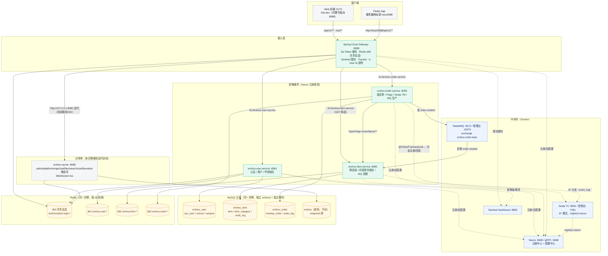
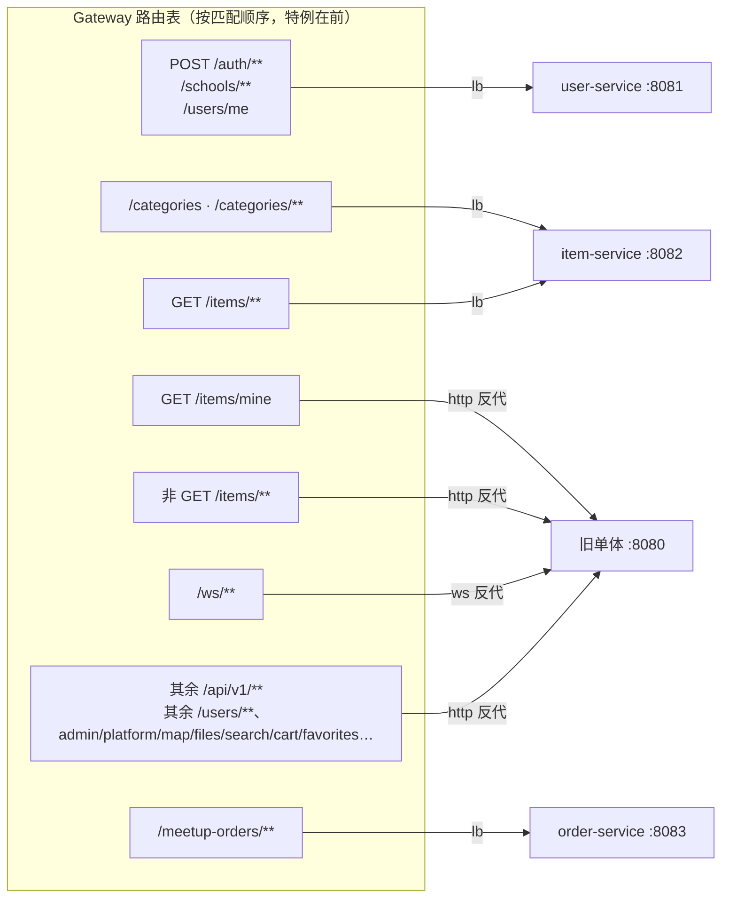
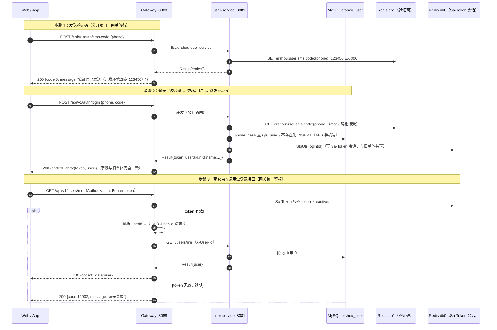
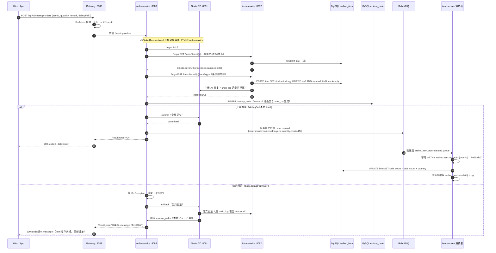

# ershou-cloud 架构说明（Spring Cloud 演示版）

> 版本：v1（2026-10-19）｜维护：`app-member`（T30）
> 对应设计契约：`智能体团队/第5轮-SpringCloud重构-设计.md`
> 本文回答三个问题：**现在长什么样（架构图/端口/版本）**、**每个模块负责什么**、**一次登录/一次下单怎么走（时序图）**。
> 相关文档：[迁移路线图](migration-roadmap.md) · [演示脚本](demo-script.md)（map-member）· [启动手册](../README.md)

---

## 1. 定位与范围

本轮是**可运行、可演示的微服务化切片**，不是一次性全量迁移：

- 采用**绞杀者模式（Strangler Fig）**：已迁移的路径走 `Gateway → 新服务`，**未迁移的路径由 Gateway 原样反代回旧单体 :8080**，因此前端/App 只需改一个 baseURL（端口 8080→8088），功能不中断。
- 已迁移：**认证/用户/学校校区**（user-service）、**商品读**（item-service）、**面交单创建 + 我的面交单**（order-service）。
- 未迁移（本轮仍走旧单体）：admin、platform（平台代卖/运营台）、map、chat/WebSocket、files、search、cart、favorites、商品写路径等 —— 迁移排期见 [migration-roadmap.md](migration-roadmap.md)。
- 中间件全量编排：Nacos（注册+配置）、RabbitMQ（下单事件异步解耦）、Seata AT（分布式事务回滚演示）、Sentinel（网关限流 + Feign 降级）。
- 数据按服务拆库（MySQL 独立 schema + 独立账号）、Redis 按 db 隔离（仅会话 db0 共享），详见 §4。

---

## 2. 架构总览图

**一句话读图**：客户端只认识 8088；网关把「已迁移路径」按服务名负载均衡到 3 个新服务，把「其余路径」反代回 8080 旧单体；order 与 item 之间用 OpenFeign 调内部库存接口，下单事件经 RabbitMQ 异步落到 item 的 `sale_count`；Seata TC 负责跨库回滚；所有服务的登录态共享 Redis db0，业务缓存各用 db1/2/3；三个新库互不 JOIN。

### 2.1 路由与反代关系图（绞杀者视角，按真实 `GatewayRoutesConfig` 声明顺序）

| 路由（按声明顺序匹配） | 目标 | 说明 |
| --- | --- | --- |
| `POST /api/v1/auth/**` | `lb://ershou-user-service` | 发码/登录/登出（公开） |
| `/api/v1/schools/**` | `lb://ershou-user-service` | 学校/校区（公开） |
| `/api/v1/users/me` | `lb://ershou-user-service` | 当前用户（需登录） |
| 其余 `/api/v1/users/**` | 旧单体 8080 | 公开主页/历史接口未迁移 |
| `/api/v1/categories`、`/api/v1/categories/**` | `lb://ershou-item-service` | 分类表在 `ershou_item` 库（与设计 4.1 的差异已报备：user-service 库无 item_category） |
| `GET /api/v1/items/mine` | 旧单体 8080 | 我的发布仍是单体写路径；必须放在 `GET /items/**` 之前，否则 `mine` 会被当 Long 解析 400 |
| `GET /api/v1/items/**` | `lb://ershou-item-service` | 商品列表/详情（读） |
| 非 GET `/api/v1/items/**` | 旧单体 8080 | 发布/编辑/下架等写路径未迁移 |
| `/api/v1/meetup-orders/**` | `lb://ershou-order-service` | 创建面交单 + 我的列表（已迁移） |
| `/ws/**` | `ws://旧单体:8080` | WebSocket 暂留单体 |
| 其余 `/api/v1/**` | 旧单体 8080 | admin/platform/map/files/search/cart/favorites… 绞杀者过渡 |

> 路由定义在 `ershou-cloud-gateway` 的 `GatewayRoutesConfig`（代码里保证特例顺序）；反代地址与限流参数在 Nacos `ershou-gateway.yaml`：`ershou.gateway.legacy-uri`（默认 `http://127.0.0.1:8080`）、`ws-uri`、`item-qps`。
> 关键约束：**路径与字段保持与旧单体完全一致**，Web 只改 Vite 代理端口、App 只改服务器地址，前端**零代码改动**。

---

## 3. 模块职责 / 端口 / 版本

### 3.1 模块职责表

| 模块（目录） | 端口 | 职责（本轮） | 数据 | 不做什么 |
| --- | --- | --- | --- | --- |
| `ershou-cloud-common` | —（jar） | 统一响应 `{code,message,data,traceId}`、异常、TraceId/用户上下文、AES 手机号等公共件 | 无 | 不含业务逻辑 |
| `ershou-cloud-gateway` | **8088** | 统一入口；Sa-Token 反应式鉴权（共享 db0）；Sentinel 限流；路由/反代；`X-User-Id`/TraceId 透传；CORS | Redis db0 | 不查业务库 |
| `ershou-user-service` | **8081** | 短信码（mock 123456）、登录/登出、`/users/me`、学校/校区 | `ershou_user` + Redis db1 | 不签发独立会话体系（复用 Sa-Token） |
| `ershou-item-service` | **8082** | 商品列表/详情（只读 `status=2`）、详情缓存+浏览量、内部库存查询/条件锁定、消费 `order.created` 更新 `sale_count` | `ershou_item` + Redis db2 | 不处理发布/编辑/审核（仍在单体） |
| `ershou-order-service` | **8083** | 创建面交单（Seata AT）、我的面交单（Feign 补商品信息）、事务提交后发 MQ、Feign Sentinel 降级 | `ershou_order` + Redis db3 | 不直接访问 item 库 |
| 旧单体 `ershou-server` | **8080** | 未迁移模块 + WebSocket；数据库 `ershou` 不动 | `ershou` + Redis db0 | 不改代码、不改表结构 |

### 3.2 端口分配

| 服务 / 中间件 | 端口 | 协议/说明 |
| --- | --- | --- |
| `ershou-gateway` | **8088** | HTTP，唯一对外入口（Web/App 只认它） |
| `ershou-user-service` | 8081 | HTTP（内网；也可经网关访问） |
| `ershou-item-service` | 8082 | HTTP（内网；`/inner/**` 仅供 Feign，不经网关） |
| `ershou-order-service` | 8083 | HTTP（内网） |
| 旧单体 `ershou-server` | 8080 | HTTP + WebSocket（网关反代目标） |
| Nacos | **8848** / 9848 | HTTP 控制台/OpenAPI；9848=gRPC（容器 `ershou-nacos`） |
| RabbitMQ | **5672** / 15672 | AMQP；15672 管理台 guest/guest（容器 `ershou-rabbitmq`） |
| Seata Server | **8091** / 7091 | TC；7091 控制台 seata/seata（容器 `ershou-seata`） |
| Sentinel Dashboard | **8858** | 控制台 sentinel/sentinel（容器 `ershou-sentinel`） |
| MySQL（既有） | 3306 | 本机 MySQL 8.0.43（`ershou` 旧库 + 3 个新库） |
| Redis（既有） | **6380** | redis:7-alpine 容器 `ershou-redis`；db0~db3 隔离 |
| MinIO（既有） | 9010 / 9011 | 图片对象存储（演示用；容器 `ershou-minio`） |
| Web 前端 | 5173 | Vite dev（代理可切 8088，见 demo-script） |
| Flutter App | — | 服务器地址填 `<电脑IP或127.0.0.1>:8088`（真机配合 `adb reverse tcp:8088 tcp:8088`） |

### 3.3 版本矩阵

| 组件 | 版本 | 备注 |
| --- | --- | --- |
| Java | **21**（本机 21.0.2） | 与旧单体一致 |
| Spring Boot | **3.3.5** | 与旧单体一致 |
| Spring Cloud | **2023.0.3** | Gateway / OpenFeign / LoadBalancer |
| Spring Cloud Alibaba | **2023.0.3.2** | 注册+配置+Sentinel+Seata；BOM 带入 nacos-client **2.4.2** / sentinel **1.8.8** / seata-client **2.1.0** |
| Sa-Token | **1.39.0** | `sa-token-reactor-spring-boot3-starter` + `sa-token-redis-jackson`（与单体同版本、同 Redis db0、同 token-name → 会话互通） |
| MyBatis-Plus | **3.5.9** | 同旧单体 |
| MySQL | 8.0.43 | 独立 schema + 独立账号 |
| Redis | redis:7-alpine | 既有容器 `ershou-redis`（6380） |
| RabbitMQ | `rabbitmq:3-management` | 容器 `ershou-rabbitmq`；5672/15672（guest/guest） |
| Nacos | `nacos/nacos-server:v2.3.2` | 容器 `ershou-nacos`；单机 8848/9848；`NACOS_AUTH_ENABLE=false`（无鉴权） |
| Seata | Server 镜像 `seataio/seata-server:1.8.0` | 容器 `ershou-seata`；AT 模式，registry=nacos，store=file（演示）；**client 2.1.0（SCA BOM）与 server 1.8.0 的版本对齐待联调确认**，预案：换 `seata-server:2.0.0` 镜像（本机已拉取）或降 client |
| Sentinel | Dashboard **1.8.8**（本地 jar + `eclipse-temurin:17-jre` 自建镜像 `ershou/sentinel-dashboard:1.8.8`） | 容器 `ershou-sentinel`；8858（sentinel/sentinel） |
| Docker | 29.6.1 | Docker Desktop；compose 工程名 `ershou-cloud` |
| Maven | 3.9.9 | 构建 5 个模块 |

---

## 4. 数据隔离（硬约束）

### 4.1 MySQL：按服务分库，禁止跨库 JOIN

| 库（schema） | 账号 | 本轮表 | 服务 |
| --- | --- | --- | --- |
| `ershou_user` | `ershou_user` | `sys_user`、`school`、`campus` | user-service |
| `ershou_item` | `ershou_item` | `item`（新增 `sale_count`）、`item_category`、`undo_log` | item-service |
| `ershou_order` | `ershou_order` | `meetup_order`、`undo_log` | order-service |
| `ershou`（旧库） | `ershou` | 保持原样（快照迁移的**只读源**） | 旧单体 |

- 建库/建账号：`ershou-cloud/sql/init-cloud-databases.sql`（幂等）；数据迁移：`ershou-cloud/sql/migrate-data.ps1`（快照，可重复执行）。
- **跨服务数据只能通过 OpenFeign 获取**（例如 order-service 用 `GET /inner/items/{id}` 补商品标题/封面），不允许直接查别人的库、不允许跨库 JOIN。
- 迁移后：新服务写新库、旧单体写旧库，**两者不自动同步**（演示定位）；生产化一致性策略见 [migration-roadmap.md §4](migration-roadmap.md)。

### 4.2 Redis：按用途分 db，仅会话共享

| 用途 | DB | key 前缀 | 使用方 |
| --- | --- | --- | --- |
| Sa-Token 会话 | **0** | `Authorization:login:*`（Sa-Token 自带） | 网关 + user-service + 旧单体（**必须共享**才有跨端登录态） |
| 验证码/登录限流 | 1 | `ershou:user:` | user-service |
| 商品缓存/浏览量/MQ 幂等 | 2 | `ershou:item:` | item-service |
| 下单幂等/订单号序列 | 3 | `ershou:order:` | order-service |

规则：
1. 每个服务 `spring.data.redis.database` 指向自己的 db；**业务 key 必须带自己的前缀**，禁止裸 key。
2. 除 db0 的 Sa-Token 会话外，**不允许跨服务共用 db/key**。
3. 自检：`docker exec ershou-redis redis-cli -a <密码> --no-auth-warning -n <db> --scan --pattern 'ershou:*'`，各 db 只应出现本服务前缀；db0 只应出现 `Authorization:*`。

> 密码等本地配置见仓库根 `.env`（已 gitignore，文中不展开）；Nacos 配置里的数据源/Redis 参数与 `.env` 保持一致。

---

## 5. 请求链路示例（mermaid 时序图）

### 5.1 登录链路（sms-code → login → /users/me）

要点：
- **token 的存储与校验都在 Redis db0**：旧单体 :8080 签发的 token 也能被网关识别（反之亦然），所以「先登录单体、再访问网关」不会掉登录态。
- user-service 自己不鉴权，只信网关注入的 `X-User-Id`（`/auth/**`、`/schools/**` 公开路由不注入）。
- 接口字段（`token`、`user` 结构、`code` 语义）与旧单体一致 → Web/App 不用改代码。

### 5.2 下单链路（Seata AT + Feign + RabbitMQ）

要点：
- **库存扣减在 item-service 的本地事务里**（条件 UPDATE），由 Seata AT 登记分支；order 侧失败时由 TC 用 `undo_log` 回滚 item 库存。
- `debugFail` 只在演示环境使用：返回失败 + 库存/订单都回滚，是 Seata 生效的直接证据（见 demo-script）。
- **MQ 在事务提交后发送**（`@TransactionalEventListener(AFTER_COMMIT)`），避免「消息发了事务却回滚」；消费端幂等（Redis SETNX）防重复投递。
- 未迁移路径（如 `/api/v1/platform/shop/points`）由网关直接反代 8080，不经过 order/item 服务；这条链路用于验证「功能不中断」。

---

## 6. 关键技术约定（实现时对照）

| 主题 | 约定 |
| --- | --- |
| 统一响应 | `{code, message, data, traceId}`，`code=0` 成功；网关/服务都透传/生成 `traceId` |
| 鉴权 | 网关做 Sa-Token 校验并注入 `X-User-Id`；`/inner/**` 不暴露到网关（仅内网 Feign）；服务间调用不带用户 token 时由网关层保证外部请求已鉴权 |
| 公共头 | `Authorization: Bearer <token>`；`X-User-Id`；`X-Trace-Id`（缺省由网关生成） |
| 限流 | Gateway 对 `GET /api/v1/items/**` 按用户限流：登录用户按 `u:<userId>`、匿名按 `ip:<clientIp>` 分桶，每个 key QPS 值来自 Nacos `ershou.gateway.item-qps`（默认 5）；`SentinelGatewayConfig` 代码加载 ParamFlow 规则，超限返回 429 `{code:429,message:"请求过于频繁，请稍后重试"}`；Dashboard 可视化 |
| 降级 | order-service 的 `ItemClient` 开启 Sentinel（`feign.sentinel.enabled=true`），fallback 返回 `code=90001,"商品服务暂不可用"` |
| 配置 | 各服务本地 `application.yml` 只留端口/服务名/Nacos 地址与 `spring.config.import: optional:nacos:<name>.yaml?group=DEFAULT_GROUP`；数据源/Redis/Rabbit/Seata 全放 Nacos（演示配置中心 + `@RefreshScope` 动态生效） |
| 配置动态 | 改 Nacos 中 `ershou.order.max-qty`（下单数量上限）或 `ershou.item.page-max` 后无需重启即生效 |
| 逆向兼容 | 路径、字段、`code` 语义与旧单体保持一致；Web 改 Vite 代理端口、App 改服务器地址即可 |

---

## 7. 部署/运行视图

**Docker 容器（compose 工程 `ershou-cloud`）**

| 容器名 | 镜像 | 端口 | 说明 |
| --- | --- | --- | --- |
| `ershou-nacos` | nacos/nacos-server:v2.3.2 | 8848/9848 | 注册+配置；standalone；无鉴权 |
| `ershou-rabbitmq` | rabbitmq:3-management | 5672/15672 | guest/guest |
| `ershou-seata` | seataio/seata-server:1.8.0 | 8091/7091 | 配置文件挂载 `docker/seata/application.yml`（Jib 镜像只认 application.yml） |
| `ershou-sentinel` | ershou/sentinel-dashboard:1.8.8（本地 Dockerfile 构建） | 8858 | 本地 jar + temurin |
| `ershou-redis`（既有） | redis:7-alpine | 6380 | 旧项目容器，复用不重建 |
| `ershou-minio`（既有） | minio/minio | 9010/9011 | 旧项目容器，演示图片 |

| 运行单元 | 形态 | 启动方式（详见 [README](../README.md)） |
| --- | --- | --- |
| Nacos / RabbitMQ / Seata / Sentinel / Nginx | Docker 容器 | `docker compose --env-file .env -f ershou-cloud/docker/docker-compose.yml up -d`；Nginx 入口 `http://127.0.0.1:8090`（L1，仅匿名公开 GET） |
| MySQL / Redis / MinIO | 既有容器或本机服务 | 沿用旧项目容器（README 前置检查） |
| gateway / user / item / order | 本地 JVM（`mvn spring-boot:run`，演示） | 首次 `mvn -f ershou-cloud/pom.xml -DskipTests install`，然后各模块目录 `mvn spring-boot:run`（4 个进程） |
| 旧单体 | 本地 JVM | `java -jar ershou-server/target/ershou-server-1.0.0.jar`（反代目标，必须启动） |
| Web | Vite dev | `cd ershou-web; npm run dev`（代理指向 8088） |
| App | 真机 Flutter | 服务器地址 `host:8088`（见 demo-script） |

启动顺序（依赖关系）：**Docker 中间件（compose/`scripts/cloud-up.ps1`）→ MySQL 分库/迁移 → Nacos 配置发布（`scripts/cloud-publish-config.ps1`，cloud-up 默认已调用）→ user/item/order → gateway → 旧单体 8080 → 前端/App → `scripts/cloud-demo.ps1`**。顺序错了会出现的典型问题（Nacos 配置缺失、服务注册不上、反代 502）见 README 常见问题。
> 中间件细节与已知坑（Seata 1.8.0 Jib 镜像配置路径、Sentinel 自建镜像、Seata TC 注册容器 IP 导致宿主机不可达）见 [docker/README.md](../docker/README.md)。

---

## 8. 本轮明确不做（避免误解）

- 不迁移 admin/platform/map/chat/files/search/cart/favorites 等业务（仅反代），排期见路线图。
- 不做生产级高可用：Nacos 单机、Seata `store=file`、无 TLS、无鉴权加固、密码为演示值。
- 不做全量数据同步：迁移是**一次性快照**；新库写入不回写旧库（演示接受，生产方案见路线图 §4）。
- 不引入配置加密/密钥管理、链路追踪后端（仅 TraceId 透传，未接 Zipkin/SkyWalking）。
