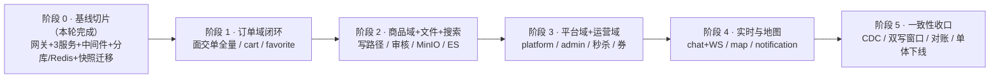

# 迁移路线图与数据一致性策略

> 版本：v1（2026-10-19）｜维护：`app-member`（T30）
> 对应设计契约：`智能体团队/第5轮-SpringCloud重构-设计.md`
> 架构现状见 [architecture.md](architecture.md)；演示步骤见 [demo-script.md](demo-script.md)。
> 本文回答：**本轮迁到哪了**、**剩余模块按什么顺序迁**、**旧库与新库的数据怎么保持一致**。

---

## 1. 现状基线（第 5 轮切片交付后）

### 1.1 已完成迁移（经网关 8088）

| 能力 | 新归属 | 说明 |
| --- | --- | --- |
| 发验证码 / 登录 / 登出 | `user-service` | mock 码 123456；`StpUtil` 写 Redis db0，与旧单体会话互通 |
| `/users/me`、学校、校区 | `user-service` | 数据库 `ershou_user`；字段与旧单体一致 |
| 商品列表 / 详情（读） | `item-service` | 只返回 `status=2`；Redis db2 缓存 + 浏览量 |
| 创建面交单 / 我的面交单 | `order-service` | Seata AT + Feign 扣库存 + RabbitMQ 事件；`ershou_order` |
| 内部库存查询/锁定 | `item-service /inner/**` | 仅供 Feign，不经网关 |

**本轮迁移实测基线**（2026-10-19，`migrate-data.ps1`，日志 `.build/cloud/logs/migrate-data-20261019-132308.log`）：
`sys_user=190 / school=1 / campus=3 / item=17 / item_category=10 / meetup_order=2`，**合计 223 行**，旧库迁移前后行数未变。快照迁移的一次性语义见 §4.1。

### 1.2 仍在旧单体（网关反代 :8080，功能不中断）

旧单体 20 个 Controller 中，**本轮迁移 5 个**（Auth/User/School/Item 读/Order 创建与我的列表），其余按模块留在单体：

| 模块（旧代码） | 接口前缀 | 旧库主要表 |
| --- | --- | --- |
| admin（审核/管理/日志） | `/api/v1/admin/**` | `item_review`、`sys_audit_log`、`report_ticket`、`ai_audit_record` |
| platform（代卖点/券/秒杀/运营台/平台订单） | `/api/v1/platform/**` | `platform_consign_point`、`platform_coupon`、`platform_coupon_user`、`platform_flash_sale`、`platform_flash_sale_item`、`platform_seckill_record` |
| map（地图/点位/高德页面） | `/api/v1/map/**`、`/api/v1/trade-points` | `trade_point`、`campus` |
| chat（会话/消息/撤回/未读/WebSocket） | `/api/v1/chat/**`、`/ws/**` | `chat_session`、`chat_message` |
| file（MinIO 上传/删除） | `/api/v1/files/**` | 无表（对象存储） |
| search（ES 搜索/索引重建） | `/api/v1/search/**` | 无表（ES 索引） |
| cart / favorites（购物车/收藏） | `/api/v1/cart/**`、`/api/v1/favorites/**` | `cart_item`、`favorite`、`favorite_folder` |
| 商品写路径（发布/编辑/下架/重新上架/审核提交） | `POST/PUT/DELETE /api/v1/items/**` | `item`、`item_review` |
| 其他 | 通知/信用分/拉黑/举报 | `notification`、`credit_log`、`user_block`、`report_ticket` |

---

## 2. 迁移原则（所有阶段通用）

1. **绞杀者优先**：先让网关把新路径切走；任何阶段出问题，只改网关路由即可**秒级回滚**到旧单体，不动前端。
2. **数据归属先定，再切读写**：一个模块的写操作必须只有一个"写主"；迁移顺序 = 先切**读**（低风险）→ 再切**写**（高风险）。
3. **接口契约不变**：路径、请求/响应字段、`code` 语义与旧单体一致；前端零改动或只改 baseURL。
4. **跨服务数据用 API/事件，不用 SQL**：禁止跨库 JOIN；Feign 取数据、MQ 传事件。
5. **每阶段可独立验收**：阶段验收点写进本文 §5，未通过不进入下一阶段。
6. **旧单体本轮冻结**：只做反代目标；必要的兼容 bug 需 Lead 批准。
7. **数据迁移可重复**：DDL/迁移脚本幂等；迁移前快照备份；迁移工具不写旧库。

---

## 3. 模块迁移总表

| # | 模块 | 目标服务 | 阶段 | 关键改造点 | 主要风险 |
| --- | --- | --- | --- | --- | --- |
| 1 | 面交单全量（接受/拒绝/取消/改时间地点/完成） | `order-service` | 阶段 1 | 状态机迁移；信用分（完成 +2）拆到 user 或事件；旧表 `meetup_order` 已在 `ershou_order` | 状态机分支多，漏迁移会「半步」；信用分跨库 |
| 2 | 购物车 / 收藏（读+写） | `order-service`（cart）+ `item-service` 或新 `interaction-service`（favorite） | 阶段 1~2 | 拆写主：cart 写 `ershou_order`，favorite 写 `ershou_item`；跨服务聚合列表 | 列表聚合 N+1；两库不同步 |
| 3 | 商品写路径 + 审核 + AI 机审 | `item-service` + `admin-service` | 阶段 2 | 发布/编辑/下架/重上架 + 审核状态机 + 图片（Feign file）；ES/MQ 同步 | 写主切换时的双写窗口；审核一致性 |
| 4 | 文件上传（MinIO） | 新 `file-service` | 阶段 2 | 上传/删除/缩略图/访问 URL 就绪；商品服务只存 URL | 大文件/断点续传；URL 兼容 |
| 5 | 搜索（ES） | 新 `search-service` | 阶段 2 | ES 索引从 item 写事件驱动；全量重建接口；降级 MySQL LIKE | 索引最终一致；重建窗口 |
| 6 | 平台代卖（代卖点/券/秒杀/平台订单） | 新 `platform-service` | 阶段 3 | 迁移 Lua 扣库存/缓存预热/定时任务；券/秒杀写后缓存重建 | 秒杀并发/缓存时序；定时任务重复 |
| 7 | 运营台 / admin | 新 `admin-service` | 阶段 3 | 聚合读（Feign user/item/order/platform）；审核/日志/报表 | 聚合权限模型；跨服务分页 |
| 8 | 聊天 + WebSocket | 新 `chat-service` | 阶段 4 | WS 网关路由（reactive WS）+ MQ/Redis pub-sub 推送；未读/撤回/批量删 | WS 长连接状态；消息顺序/去重 |
| 9 | 地图 / 点位 / 高德降级 | 新 `map-service` | 阶段 4 | 点位聚合/100m 合并/坐标换算/缓存；geo 查询 | 高德配额；坐标精度；缓存 key 设计 |
| 10 | 通知 / 信用分 / 拉黑 / 举报 | `user-service` / 新 `notification-service` | 阶段 4~5 | 事件驱动（MQ）替代同步写；站内信 | 事件丢失；幂等 |
| 11 | 数据一致性收口 + 单体下线 | 基础设施/运维 | 阶段 5 | CDC 全量+增量；双写窗口；对账；灰度切流；只读化 | 数据丢失；回滚演练不足 |

> 说明：模块归属可按团队人力调整（例如 favorite 独立 `interaction-service`）；调整时先定**写主**，再排任务。

---

## 4. 旧库 ↔ 新库数据一致性策略

### 4.1 当前阶段（本轮）：一次性快照迁移

- 工具：`ershou-cloud/sql/migrate-data.ps1`（配合 `init-cloud-databases.sql`）。
- 语义：从旧库 `ershou` **只读**复制 `sys_user / school / campus / item / item_category / meetup_order` 到对应新库；**保留原 id**（前端/关联都用 id）；目标表先 `TRUNCATE/DELETE` 再 `INSERT SELECT`，**可重复执行**。
- 时间点：演示/启动前执行一次，形成**数据快照**。
- 之后：
  - 新服务（user/item 读/order 写）只写新库；
  - 旧单体继续读写旧库（admin/platform/chat…），**不会自动同步到新库**；
  - 因此会出现「旧库改了商品，新库列表看不到」的现象 —— 这是本轮**已知且接受**的演示边界，文档与演示脚本中需明文提示。
- 重新对齐：再次执行迁移脚本（会覆盖新库为旧库当前快照），或按 §4.4 做对账/回灌。

### 4.2 过渡期方案 A（推荐先行）：单写多读 + 读路由

- 每个业务域只允许**一个写主**；其他端只读（通过 API 或视图，不直接写库）。
- 网关/服务层做**读路由**：读已迁移数据走新库；未迁移数据走旧库；需要混合展示时由 BFF/聚合服务拼装（Feign）。
- 优点：无双向同步问题、可随时切回、实现简单。
- 代价：迁移期间功能边界要清晰（某接口只读或只写一处），产品上可能出现「新库改动旧页面看不到」的短暂不一致（用文案/演示说明）。

### 4.3 过渡期方案 B（必要时）：应用层双写

- 写数据库 + 发 MQ 事件（`xxx.changed`），由消费者写另一侧；或双写 + 补偿任务。
- 要求：
  - **幂等**（事件 id/业务唯一键去重，Redis SETNX 或唯一索引）；
  - **顺序**（同一聚合根用业务 id 做分区键，或版本号/last-write-wins）；
  - **补偿**（定时对账 + 差异修复任务）；
  - **可关闭**（双写开关放 Nacos，配置中心动态生效）。
- 适用：仅用于短窗口切流（如商品写从旧库迁到新库的 1~2 个演示周期），不建议长期保留两套写路径。

### 4.4 目标方案：CDC（可持续）

- 用 **Debezium / Canal** 订阅旧库 binlog → 投递到 MQ（RabbitMQ/Kafka）→ 新库消费者做投影（insert/upsert/delete）。
- 方向：迁移期 **旧 → 新** 单向；完全切写后改为 **新 → 旧（只读投影）** 或直接停旧。
- 配套：全量初始化（快照）+ 增量（binlog 位点）衔接；对账任务；DLQ 处理。
- 适合后续真实项目；本轮演示不引入（保持中间件规模可控）。

### 4.5 一致性核对清单（每个迁移表执行）

1. **行数**：`SELECT COUNT(*)` 新旧对比（允许白名单内差异并说明）。
2. **主键/最大 id**：`MAX(id)` 一致；序列/自增起点调整（新库 `AUTO_INCREMENT`）。
3. **关键字段抽样**：金额、状态、时间戳、JSON 字段（`docs`/`images`）抽样比对。
4. **枚举/字典**：状态码、类型值与旧库一致（如 `status=2` 在售语义）。
5. **唯一约束**：手机号 hash、订单号等唯一键在新库有唯一索引。
6. **回滚**：迁移脚本失败可重跑；切换前备份新库（`mysqldump`）。
7. **只读保护**：迁移期间旧库只读（或停写窗口），避免「迁移中又有新写入」。

### 4.6 回滚策略

| 场景 | 回滚动作 |
| --- | --- |
| 新服务异常 / 接口 5xx | 网关路由改回旧单体（改 Nacos 配置或本地配置重启网关） |
| 数据不一致（演示） | 重跑 `migrate-data.ps1` 重建快照；或按核对清单逐表回灌 |
| 分布式事务异常 | 关闭新路径（路由回滚），清理 `undo_log`/半完成单，旧单体继续提供服务 |
| 中间件故障 | 服务本地缓存/降级（Sentinel fallback）；必要时整体回滚旧架构（旧单体+旧库不依赖新中间件） |

---

## 5. 分阶段排期与验收点

> 时间按「演示项目」估算，每阶段 1~3 天；阶段间有依赖，未完成前不进入下一阶段。

### 阶段 0：基线切片（本轮已完成）

- 目标：网关 + 3 服务 + 中间件 + 分库/Redis 隔离 + 快照迁移，演示登录/商品读/下单/Seata 回滚/MQ 解耦/Sentinel 限流/Nacos 动态配置。
- 现状证据：Docker 四容器（ershou-nacos/rabbitmq/seata/sentinel）Up；Nacos 4 个配置 dataId 已发布；新库合计迁移 223 行；网关 8088 路由/反代代码就绪；四服务启动联调中。
- 验收：设计 §7 的 1~12 条（由 QA/Lead 逐条取证，见 demo-script 与验收报告）。

### 阶段 1：订单域闭环（1~2 天）

- 范围：面交单全量（接受/拒绝/取消/改时间地点/完成/信用分）、cart 读写迁移、favorite 读迁移。
- 依赖：`order-service` 内部接口稳定；`meetup_order` 在 `ershou_order`（已就绪）；信用分需要 `user-service` 接口或 MQ 事件。
- 风险：状态机分支多；信用分跨库（建议事件驱动，user-service 消费后加分，幂等）。
- 验收点：
  1. 面交单全流程经 8088：创建 → 卖家接受 → 完成 → 信用分 +2（新库）；
  2. cart 增删改查经网关，数据落 `ershou_order`（或独立库）；
  3. 旧单体对应接口不再被前端调用（网关日志验证 0 命中）。

### 阶段 2：商品域 + 文件 + 搜索（2~3 天）

- 范围：商品发布/编辑/下架/重上架/审核/AI 机审；`file-service`（MinIO）；`search-service`（ES 索引由事件驱动）。
- 依赖：`item-service` 写路径 + 审核状态机；MQ 事件（`item.changed`）；ES/同义词配置；MinIO 既有容器。
- 风险：写主切换的双写窗口；审核/ES 最终一致；图片 URL 兼容旧数据。
- 验收点：
  1. 发布/编辑/下架经网关，`ershou_item.item` 与旧库行数一致（或按写主说明）；
  2. 图片上传经 `file-service`，旧 URL 仍可访问；
  3. 搜索命中/重建/降级均有日志证据；新增商品 3s 内可搜到。

### 阶段 3：平台域 + 运营域（2~3 天）

- 范围：platform（代卖点/券/秒杀/平台订单）、admin（审核/管理/日志/运营台聚合）。
- 依赖：item/order 内部接口 + MQ；秒杀 Lua/缓存预热；运营台权限模型（role_flags）。
- 风险：秒杀并发与缓存时序；定时任务重复执行；跨服务分页/聚合性能。
- 验收点：
  1. 券/秒杀/代卖点经网关全链路通过；Redis 库存 key 重建；
  2. 运营台管理接口（概览/商品/券/场次/订单/缓存）经 admin-service 或 platform-service 返回 200；
  3. 普通用户访问管理接口 403/`10003`。

### 阶段 4：实时与地图（2~3 天）

- 范围：chat（WebSocket/消息/撤回/未读/批量删）、map（点位/聚合/高德降级/缓存）、notification。
- 依赖：Gateway 的 WS 路由（reactive websocket）+ MQ/Redis pub-sub；坐标/GIS 依赖。
- 风险：WS 长连接状态、消息顺序/去重；高德配额；缓存 key 覆盖不全。
- 验收点：
  1. 聊天双向实时（两个客户端），断线重连/补拉/撤回均通过；
  2. 地图点位/聚合/降级页面可用；
  3. `/ws/**` 经网关可连接（或明确仍走 8080 的过渡说明）。

### 阶段 5：一致性收口 + 单体下线（持续）

- 范围：CDC 全量+增量、双写窗口、对账任务、灰度切流（10%→50%→100%）、旧单体只读化。
- 依赖：阶段 1~4 全部完成；监控/对账工具。
- 风险：数据丢失（需双跑对账）、回滚演练不足。
- 验收点：
  1. 新旧库对账 0 差异（行数/关键字段校验和）；
  2. 灰度期间接口错误率/延迟达标；
  3. 旧单体停写后回滚演练成功（30 分钟内可切回）。

---

## 6. 里程碑与设计验收映射

| 设计 §7 验收项 | 由谁/何时 | 备注 |
| --- | --- | --- |
| 1 Docker 四容器 healthy | 本轮 | `docker compose ps` 证据 |
| 2 `mvn package` 成功（5 模块） | 本轮 | 构建日志 |
| 3 4 服务注册 Nacos + 4 个配置 dataId | 本轮 | Nacos OpenAPI 证据 |
| 4 三库表清单/账号独立/迁移行数一致 | 本轮 | SQL 输出 |
| 5 网关链路（登录/商品/下单/我的/反代） | 本轮 | 全程 8088 |
| 6 Seata 回滚（debugFail） | 本轮 | 库存/订单前后对比 |
| 7 RabbitMQ sale_count + 幂等 | 本轮 | 3s 内 + 队列/日志 |
| 8 Sentinel 限流 429 + Dashboard | 本轮 | 并发压测 |
| 9 Nacos 配置动态生效 | 本轮 | 改 `ershou.order.max-qty` |
| 10 前端接网关 build exit 0 | 本轮 | demo-script |
| 11 Redis 隔离扫描 | 本轮 | 各 db 前缀 |
| 12 文档（架构/演示/迁移） | 本轮 | 本文 + architecture + demo-script |

---

## 7. 风险登记（迁移相关）

| 风险 | 影响 | 缓解 |
| --- | --- | --- |
| 迁移后旧库继续写入，新库视图过期 | 演示数据不一致 | 演示前重跑迁移；文档写明；生产走 CDC |
| Seata client 2.1.0（SCA BOM）与 server 1.8.0 版本对齐 | 分布式事务可能报协议/兼容错误 | 联调确认；不兼容则换 `seataio/seata-server:2.0.0` 镜像（本机已拉取）或按设计 §八降级预案 |
| 双写窗口消息丢失/重复 | 数据错乱 | 幂等 + 对账 + 可关闭双写开关（Nacos） |
| 拆库后跨服务查询变多（N+1） | 接口变慢 | 批量内部接口（`/inner/items/batch`）/缓存/聚合层 |
| 秒杀/券缓存与 DB 不一致 | 超卖/少卖 | 写后立即重建 + Lua 原子扣减 + 对账任务 |
| 定时任务迁移后重复执行 | 重复扣减/重复过期 | 任务加分布式锁（Redis）或只在新服务启用 |
| 网关单点 | 演示中断 | 演示级接受；可加第二个实例（Nacos 负载均衡） |
| WS 迁移复杂 | 聊天中断 | 阶段 4 单独排期；过渡期 `/ws/**` 仍走旧单体 |

---

## 8. 明确不纳入迁移（本轮/近期）

- 支付、风控、实名认证等无对应业务代码的模块（如未来新增，按本文原则新建服务）。
- 生产级可观测性（SkyWalking/Zipkin、告警）与 CI/CD —— 仅做 TraceId 透传与手工脚本。
- 全量历史数据实时同步 —— 本轮只做快照；CDC 列为阶段 5 目标。
- 旧单体下线（保留为反代目标，直到阶段 5 切换完成）。

---

## 9. 参考

- 架构与端口/版本：[architecture.md](architecture.md)
- 演示步骤：[demo-script.md](demo-script.md)
- 启动手册：[../README.md](../README.md)
- 设计契约：`智能体团队/第5轮-SpringCloud重构-设计.md`
- 本轮切片验收：`智能体团队/第5轮-SpringCloud重构-验收.md`（QA 产出后补充）
