# 01 · 单体架构与 UML（拆分微服务前）

> 代码位置：`ershou-server`，启动类 `CampusApplication`，端口 **8080**，所有接口前缀 `/api/v1`。
> 本文给出：系统上下文、分层结构、模块依赖、ER 图、核心类图、4 张关键时序图、2 张状态机。照着这些图就能把单体骨架搭出来。

---

## 1. 系统上下文

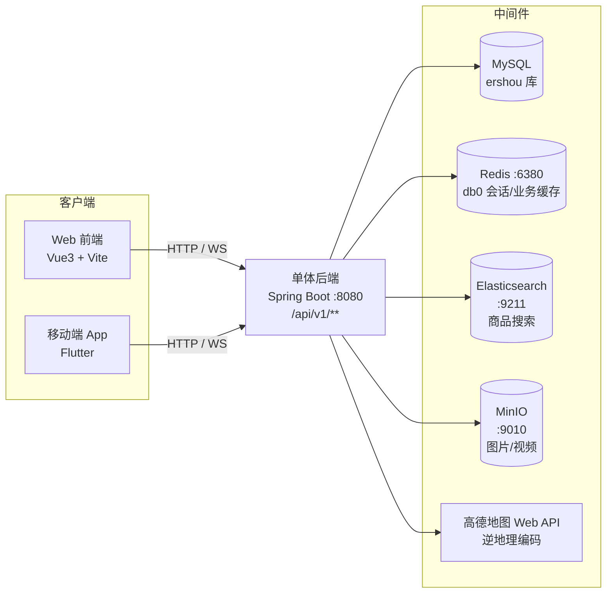

- 单体**一个进程**装下全部业务，WebSocket 长连接也在这一个进程里。
- Redis 同时承担 **Sa-Token 会话**和业务缓存；ES 负责商品搜索；MinIO 负责文件。

---

## 2. 分层结构（每个 module 内部固定六层）

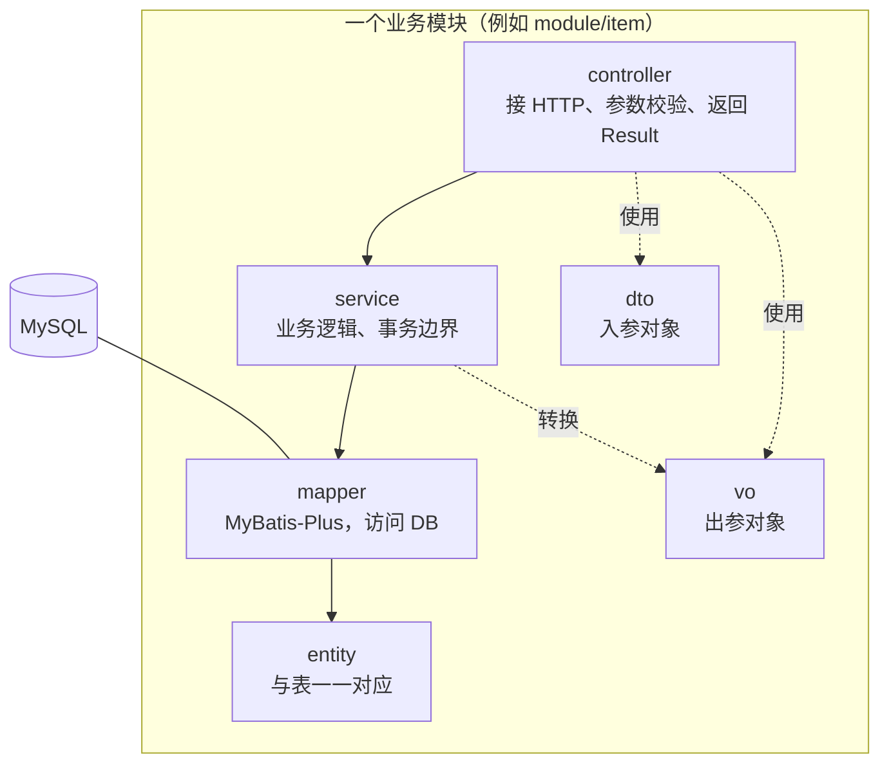

调用链固定是：`Controller → Service → Mapper → Entity/DB`，返回值由 Service 组装成 VO。

### 通用包 `common`

| 子包 | 职责 |
| --- | --- |
| `config` | Sa-Token 拦截器、MyBatis-Plus、WebMvc、dotenv 等配置 |
| `exception` | `BizException`、`GlobalExceptionHandler`（统一转 `Result`） |
| `result` | `Result<T>`、`PageResult<T>`、`ResultCode` 错误码 |
| `filter` | `TraceIdFilter`（MDC 链路 ID） |
| `cache` | `CacheEvictor`、`DictionaryCache`、`JsonCache` |
| `storage` | `FileStorageService`（MinIO / 本地两套实现） |
| `util` | `PhoneCrypto`、`ContentCipher`、`RedisKeys`、`TxHooks` |
| `discovery` | 局域网发现（App 自动找服务器地址） |

---

## 3. 模块依赖（12 个业务模块）

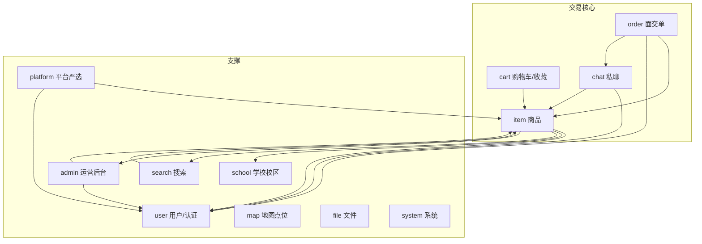

> 单体允许模块间直接 `@Autowired` 调用 Service（例如 `ItemService` 直接注入 `UserService`、`OrderService`）。**这正是拆分微服务后要改成 Feign/事件的地方**。

---

## 4. 核心数据模型（ER 图）

> 完整 DDL 见 [`sql/schema.sql`](../sql/schema.sql) 与 `sql/migration-*.sql`。下面只列主键/外键/核心字段。

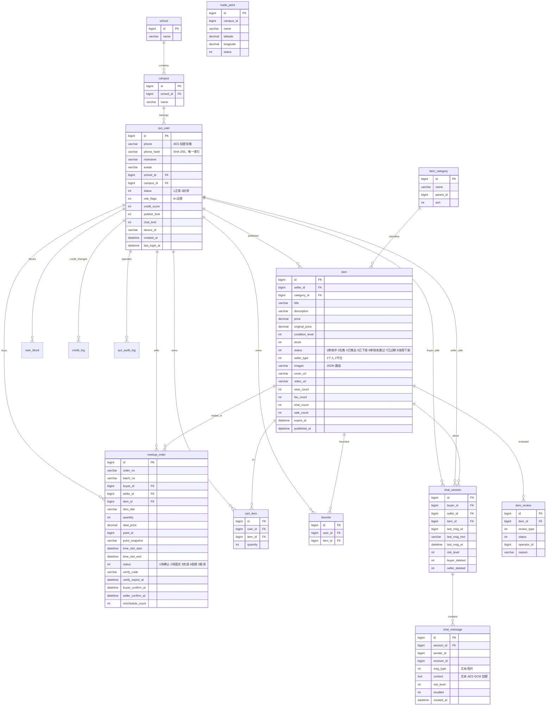

### 平台严选相关表（独立子域）

| 表 | 说明 |
| --- | --- |
| `platform_consign_point` | 平台代卖点/寄卖点 |
| `platform_coupon` | 优惠券模板 |
| `platform_coupon_user` | 用户已领券 |
| `platform_flash_sale` | 秒杀活动 |
| `platform_flash_sale_item` | 秒杀活动商品 |
| `platform_seckill_record` | 抢购记录 |
| `platform_item_row` | 平台商品视图/行对象（非实体表） |

---

## 5. 核心类图（以 item 模块为例，其余模块同构）

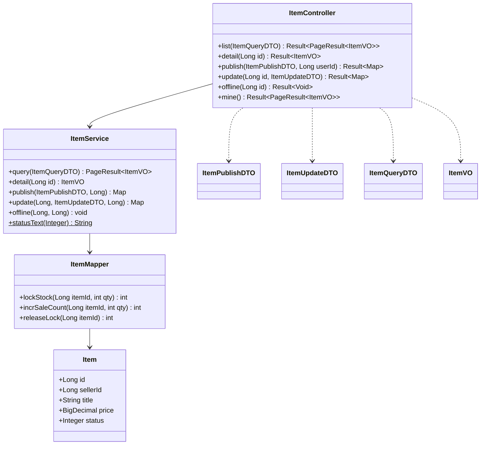

关键点：
- `ItemService.detail` 走 **Redis 缓存**（`CacheEvictor` 在变更后清缓存），`query` 走 **ES 搜索**（索引由 `ItemIndexService` 在事务提交后同步）。
- `ItemMapper.lockStock` 用**单条条件 UPDATE** 扣库存，防超卖。

---

## 6. 关键时序图

### 6.1 手机号验证码登录

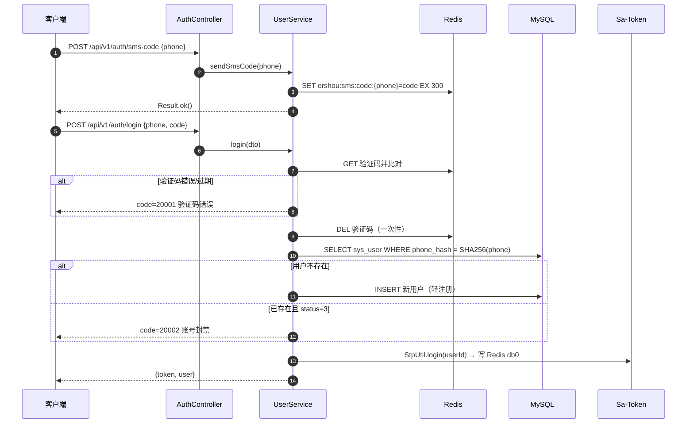

### 6.2 发布商品（机审已移除后的当前逻辑）

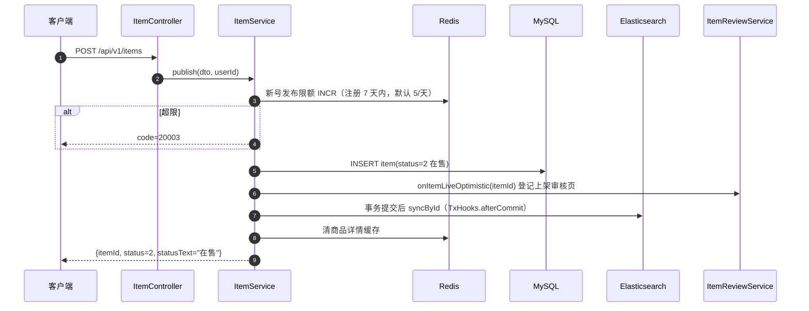

### 6.3 面交下单（状态流转）

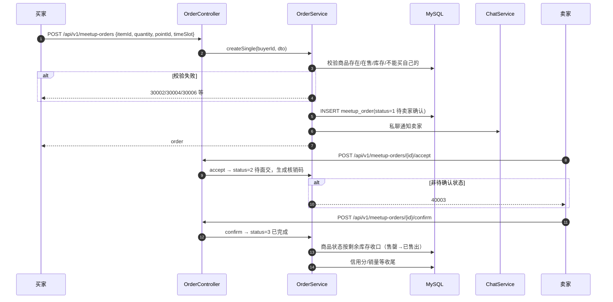

### 6.4 发送聊天消息

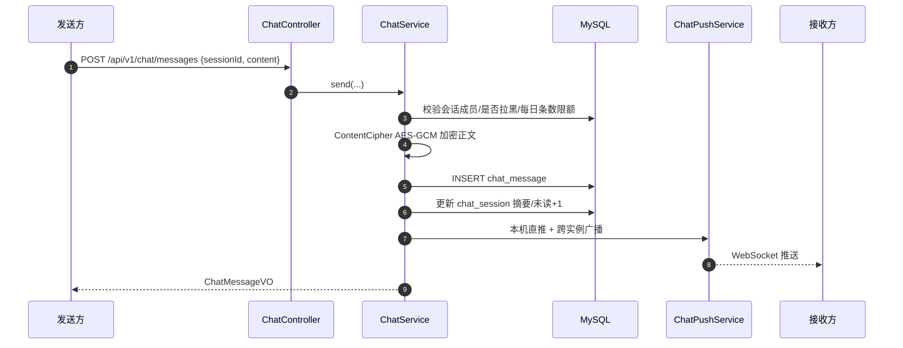

> 说明：机审模块已删除，发送消息不再做关键词拦截，`risk_level` 恒为 0。

---

## 7. 状态机

### 7.1 商品状态（item.status）

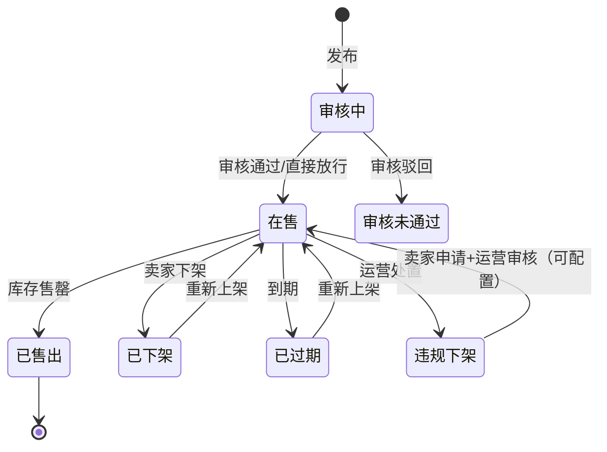

| status | 含义 |
| --- | --- |
| 1 | 审核中 |
| 2 | 在售 |
| 4 | 已售出 |
| 5 | 已下架 |
| 6 | 审核未通过 |
| 7 | 已过期 |
| 8 | 违规下架 |

### 7.2 面交单状态（meetup_order.status）

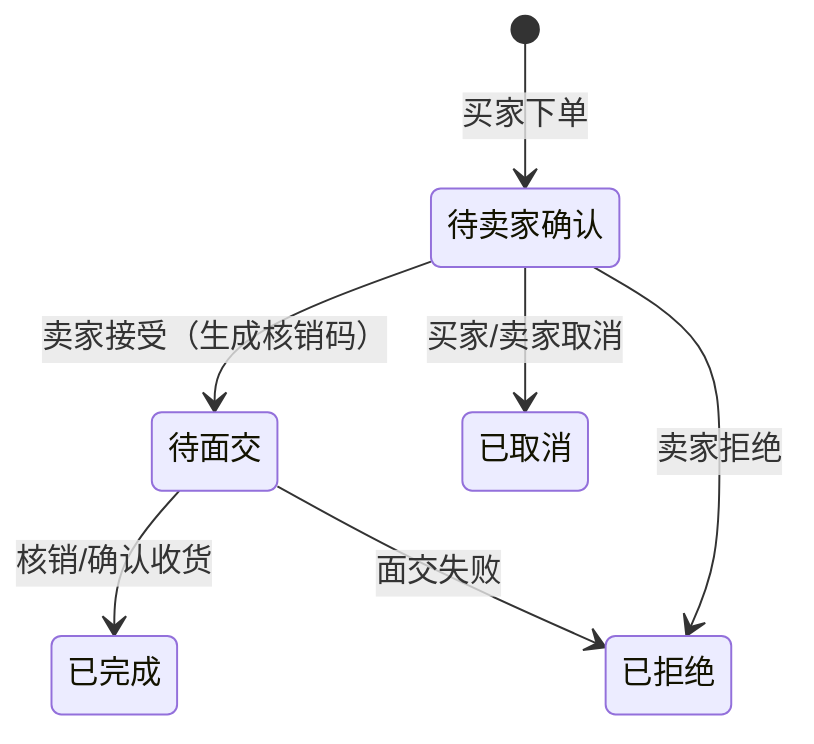

| status | 含义 |
| --- | --- |
| 1 | 待卖家确认 |
| 2 | 待面交 |
| 3 | 已完成 |
| 4 | 已拒绝 |
| 5 | 已取消 |

> `STATUS_ACTIVE = [1, 2]` 表示"进行中"，商品下架/售罄时会批量把进行中的单置为已取消。

---

## 8. 实现顺序建议（单体）

1. `common`：Result / PageResult / ResultCode / BizException / GlobalExceptionHandler / TraceIdFilter / SaTokenConfig。
2. `user` + `school`：登录、当前用户、学校校区。
3. `item` + `item_category`：列表、详情、发布、编辑、下架；接 Redis 缓存 + ES 索引。
4. `cart` + `favorite`。
5. `order`：面交单全流程 + 状态机。
6. `chat`：会话、消息、WebSocket 推送、拉黑、撤回。
7. `map`：点位、逆地理编码。
8. `admin`：审核、管理、上架审核。
9. `platform`：严选、代卖点、优惠券、秒杀。
10. `file`、`search`、`system` 收尾。
