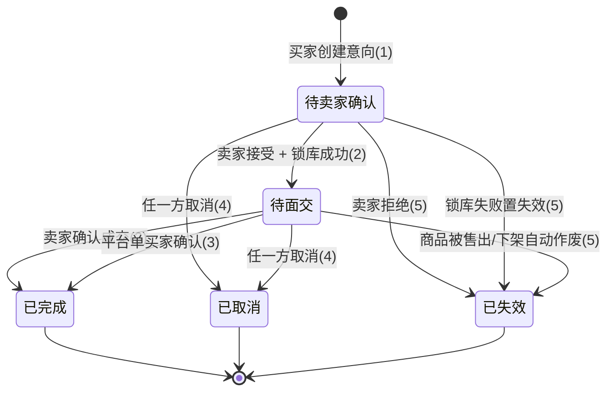

# 04 单体接口 · 订单 / 购物车 / 收藏（meetup-orders / cart / favorites）

> 本文只覆盖 `ershou-server` 单体里的三个模块：面交单（`module/order`）、购物车（`module/cart`）、收藏（`module/cart` 的 Favorite 部分）。
> 所有内容均取自 2026-10-30 的源码快照；与源码不一致处标注「以源码为准」。
> 对应源码：
> - `ershou-server/src/main/java/com/ershou/campus/module/order/**`
> - `ershou-server/src/main/java/com/ershou/campus/module/cart/**`

---

## 一、模块概览

| 项 | 内容 |
| --- | --- |
| 基础路径 | `/api/v1/meetup-orders`、`/api/v1/cart`、`/api/v1/favorites` |
| 鉴权 | Sa-Token（`SaTokenConfig` 拦截 `/api/**`，这三个前缀**不在白名单**）→ **全部接口都需要登录** |
| 角色 | 买家（下单/取消/确认收货）、卖家（接受/拒绝/改点位/确认成交），**没有管理员动作** |
| 涉及表 | `meetup_order`（面交单）、`cart_item`（购物车）、`favorite`（收藏）；另只读 `item` / `trade_point` / `sys_user` / `platform_consign_point` |
| 统一返回 | `Result<T>`：`{code,message,data,traceId}`，成功 `code=0` |
| 分页返回 | `PageResult<T>`：`{total,pageNum,pageSize,records}` |
| 未登录 | `code=10002`（`NOT_LOGIN`，`GlobalExceptionHandler` 捕获 `NotLoginException`） |

**返回结构补充说明（重要）**

`application.yml` 配置了 `spring.jackson.default-property-inclusion: non_null`，所以：

- `Result.ok()`（无返回值接口）系列里 `data` 为 `null` 时，JSON 中**不会出现 `data` 字段**：
  ```json
  {"code":0,"message":"ok","traceId":"a1b2c3"}
  ```
- 实体/VO 里为 `null` 的字段同样会被省略（下文响应示例按"有值"给出）。
- 时间字段类型为 `LocalDateTime`，按 Jackson 默认 ISO-8601 输出（如 `2026-10-30T12:00:00`）。`spring.jackson.date-format` 只作用于 `java.util.Date`；若实际返回带空格格式（`yyyy-MM-dd HH:mm:ss`），**以实际序列化结果为准**。

**面交单的两个特殊卖家类型**

- 个人商品：卖家 = 普通用户，走「买家约 → 卖家接受 → 卖家确认成交」。
- 平台代卖商品：`meetup_order.seller_id` = 平台官方账号（配置 `ershou.platform.seller-id`，默认 `1000`），由 `OrderService#platformBuy` 建单（**不属于本文 17 个接口**，由平台模块的直购/抢购接口调用）。平台单下单即 `status=2`、已写 `seller_confirm_at`，买家的 `confirm` 直接完成。

---

## 二、数据模型简表

### 2.1 `meetup_order`（面交单，核心交易凭证）

| 字段 | 类型 | 说明 |
| --- | --- | --- |
| `id` | BIGINT PK | 自增 |
| `order_no` | VARCHAR(32) | 业务单号，唯一；生成规则 `yyyyMMddHHmmss` + 4 位随机数 |
| `batch_no` | VARCHAR(32) | 合并结算行程号（一次 checkout 的所有单共享），`B` + `yyyyMMddHHmmss` + 3 位随机数 |
| `buyer_id` / `seller_id` | BIGINT | 买家 / 卖家 |
| `item_id` | BIGINT | 商品 |
| `item_title` / `item_cover` | VARCHAR | 下单时商品快照 |
| `quantity` | INT | 数量，默认 1 |
| `deal_price` | DECIMAL(10,2) | 成交价，建单时取 `item.price` |
| `point_id` | BIGINT | 面交点；个人单 = `trade_point.id`，平台单 = `platform_consign_point.id` |
| `point_snapshot` | JSON | 点位快照（name/guideText/safetyScore/lng/lat/coordX/coordY），平台单不写 |
| `time_slot_start` / `time_slot_end` | DATETIME | 时间窗；为空 = 待协商 |
| `status` | TINYINT | 1 待卖家确认 / 2 待面交 / 3 已完成 / 4 已取消 / 5 已失效 / 6 爽约 / 7 纠纷中 |
| `verify_code` / `verify_expire_at` / `verified_at` / `verified_by` | — | **遗留字段**：核销码已从业务中移除，当前流程不再写入（`verifyCode` 仅在实体中保留） |
| `buyer_confirm_at` | DATETIME | 买家点「我收到了」的时间（不推进状态，只留痕） |
| `seller_confirm_at` | DATETIME | 卖家确认成交时间（平台单下单即写） |
| `reschedule_count` | INT | 改点位/改时间次数 |
| `cancel_by` / `cancel_reason` | BIGINT / VARCHAR(255) | 取消/拒绝/失效操作人与原因 |
| `noshow_user_id` | BIGINT | 爽约用户（当前无接口写入） |
| `remark` | VARCHAR(255) | 买家留言；平台单固定写「平台代卖自提单」 |
| `created_at` / `updated_at` | DATETIME | 创建 / 更新时间 |

索引：`uk_order_no`、`idx_order_buyer(buyer_id,status,created_at)`、`idx_order_seller(seller_id,status,created_at)`、`idx_order_item(item_id)`、`idx_order_batch(batch_no)`。

### 2.2 `cart_item`（购物车 = 面交意向清单）

| 字段 | 类型 | 说明 |
| --- | --- | --- |
| `id` | BIGINT PK | 自增 |
| `user_id` | BIGINT | 加购用户 |
| `item_id` | BIGINT | 商品 |
| `seller_id` | BIGINT | 冗余卖家 id，用于按卖家分组 |
| `quantity` | INT | 数量，默认 1（孤品恒为 1） |
| `spec_text` | VARCHAR(64) | 规格/成色备注（当前接口不写） |
| `selected` | TINYINT | 默认 1（当前结算由前端传 `cartIds`，不读该字段） |
| `created_at` / `updated_at` | DATETIME | 时间戳 |

唯一索引 `uk_cart_user_item(user_id,item_id)`（同一用户同一商品只有一行，重复加购是**更新数量**）。

### 2.3 `favorite`（收藏）

| 字段 | 类型 | 说明 |
| --- | --- | --- |
| `id` | BIGINT PK | 自增 |
| `user_id` | BIGINT | 用户 |
| `item_id` | BIGINT | 商品 |
| `folder_id` | BIGINT | 收藏夹分组（当前接口不写，恒 NULL；另有 `favorite_folder` 表未在本模块使用） |
| `created_at` | DATETIME | 收藏时间 |

唯一索引 `uk_fav_user_item(user_id,item_id)`：重复收藏由数据库兜底（`FavoriteService#add` 捕获 `DuplicateKeyException` 后忽略）。

---

## 三、接口清单

| # | 方法 | 路径 | 名称 | 角色 |
| --- | --- | --- | --- | --- |
| 1 | GET | `/api/v1/meetup-orders` | 我的面交单（分页） | 买家/卖家 |
| 2 | GET | `/api/v1/meetup-orders/todo-count` | 我的面交待办数 | 买家/卖家 |
| 3 | POST | `/api/v1/meetup-orders` | 直接约面交（单件） | 买家 |
| 4 | GET | `/api/v1/meetup-orders/{id}` | 面交单详情 | 买家/卖家 |
| 5 | POST | `/api/v1/meetup-orders/{id}/accept` | 卖家接受 | 卖家 |
| 6 | POST | `/api/v1/meetup-orders/{id}/reject` | 卖家拒绝 | 卖家 |
| 7 | POST | `/api/v1/meetup-orders/{id}/cancel` | 取消面交 | 买家/卖家 |
| 8 | PATCH | `/api/v1/meetup-orders/{id}/point` | 改面交地点/时间 | 卖家 |
| 9 | POST | `/api/v1/meetup-orders/{id}/confirm` | 确认成交 / 确认收货 | 卖家/买家 |
| 10 | GET | `/api/v1/cart` | 购物车（按卖家分组） | 登录用户 |
| 11 | POST | `/api/v1/cart` | 加入购物车 | 登录用户 |
| 12 | PATCH | `/api/v1/cart/{cartId}` | 修改购物车数量 | 登录用户 |
| 13 | DELETE | `/api/v1/cart/{cartId}` | 移除购物车条目 | 登录用户 |
| 14 | POST | `/api/v1/cart/checkout` | 购物车合并结算 | 买家 |
| 15 | GET | `/api/v1/favorites` | 我的收藏（分页） | 登录用户 |
| 16 | POST | `/api/v1/favorites/{itemId}` | 收藏 | 登录用户 |
| 17 | DELETE | `/api/v1/favorites/{itemId}` | 取消收藏 | 登录用户 |

> 共 **17 个**接口（面交单 9 + 购物车 5 + 收藏 3）。

---

## 四、面交单接口（`/api/v1/meetup-orders`）

> Controller：`module/order/controller/OrderController.java`；业务：`module/order/service/OrderService.java`。
> 所有接口都从 `StpUtil.getLoginIdAsLong()` 取当前用户，**不接受前端传 userId**。

### 1. 我的面交单（分页）
- **方法与路径**：`GET /api/v1/meetup-orders`
- **鉴权**：需要登录（买家 / 卖家）
- **请求参数**：

  | 位置 | 参数 | 类型 | 必填 | 说明 |
  | --- | --- | --- | --- | --- |
  | query | `role` | string | 否 | 默认 `buyer`；仅当值为 `seller`（忽略大小写）时按 `seller_id` 查，其余任何值都按 `buyer_id` 查 |
  | query | `itemId` | long | 否 | 只看某件商品的单子（私聊窗展示"这单什么状态"用） |
  | query | `status` | int | 否 | 只看某状态（1~7），不校验取值范围 |
  | query | `pageNum` | long | 否 | 默认 1 |
  | query | `pageSize` | long | 否 | 默认 20，服务端做 `Math.min(pageSize,100)` 上限保护 |

- **请求体**（无）：
  ```json
  {}
  ```
- **响应示例**：
  ```json
  {
    "code": 0,
    "message": "ok",
    "data": {
      "total": 2,
      "pageNum": 1,
      "pageSize": 20,
      "records": [
        {
          "id": 1001,
          "orderNo": "202610301200001234",
          "batchNo": "B20261030120000012",
          "itemId": 88,
          "itemTitle": "九成新机械键盘",
          "itemCover": "https://cdn.example.com/item/88.jpg",
          "quantity": 1,
          "dealPrice": 120.00,
          "pointId": 12,
          "pointName": "图书馆东门",
          "pointGuide": "出校门右转 50 米",
          "timeSlotStart": "2026-10-31T15:00:00",
          "timeSlotEnd": "2026-10-31T17:00:00",
          "status": 2,
          "statusText": "待面交",
          "buyerId": 501,
          "buyerName": "小明",
          "sellerId": 601,
          "sellerName": "阿张的小店",
          "remark": "能便宜点吗",
          "createdAt": "2026-10-30T12:00:00",
          "buyerConfirmed": false,
          "sellerConfirmed": true,
          "myRole": "buyer"
        }
      ]
    },
    "traceId": "a1b2c3"
  }
  ```
- **业务规则 / 校验**：
  - 按 `id DESC` 排序。
  - `OrderVO.statusText` 由 `statusText(status)` 映射：`1 待卖家确认 / 2 待面交 / 3 已完成 / 4 已取消 / 5 已失效 / 6 爽约 / 7 纠纷中 / 其它 未知`。
  - `myRole`：当前用户是 `buyer_id` → `buyer`，否则 `seller`。
  - `buyerConfirmed` / `sellerConfirmed` 由 `buyer_confirm_at` / `seller_confirm_at` 是否为 null 推导。
  - `pointName` / `pointGuide`：个人单查 `trade_point`；平台单（`seller_id` = 平台账号）按 `platform_consign_point` 取名（不返回 `pointGuide`）。
  - `buyerName` = 买家昵称；`sellerName` 优先卖家 `shopName`，否则昵称。
- **可能错误码**：`10002` 未登录；`10001` 参数类型错误；`90001` 系统异常。

### 2. 我的面交待办数
- **方法与路径**：`GET /api/v1/meetup-orders/todo-count`
- **鉴权**：需要登录（买家 / 卖家）
- **请求参数**：

  | 位置 | 参数 | 类型 | 必填 | 说明 |
  | --- | --- | --- | --- | --- |
  | header | `Authorization` | string | 是 | `Bearer <token>` |

- **请求体**（无）：
  ```json
  {}
  ```
- **响应示例**：
  ```json
  {"code":0,"message":"ok","data":{"asSeller":3,"asBuyer":1,"total":4},"traceId":"a1b2c3"}
  ```
- **业务规则 / 校验**：
  - `asSeller`：我作为卖家、`status=1`（待我确认）的单数。
  - `asBuyer`：我作为买家、`status=2` 且 `buyer_confirm_at` 为空的单数（等我点「我收到了」）。
  - `total = asSeller + asBuyer`（只算需要我动作的单子，约好还没到点的不算红点）。
- **可能错误码**：`10002`；`90001`。

### 3. 直接约面交（单件）
- **方法与路径**：`POST /api/v1/meetup-orders`
- **鉴权**：需要登录（买家）
- **请求参数**：

  | 位置 | 参数 | 类型 | 必填 | 说明 |
  | --- | --- | --- | --- | --- |
  | body | `itemId` | long | 是 | `@NotNull`，缺省报 `10001`「缺少商品」 |
  | body | `quantity` | int | 否 | 默认 1；`null` 或 `<1` 一律按 1，**不校验库存** |
  | body | `pointId` | long | 否 | **服务端忽略**（面交点取商品自己的 `preferPointId`） |
  | body | `timeSlotStart` | string | 否 | **服务端忽略**（买家不决定时间，建单时恒为 null = 待协商） |
  | body | `timeSlotEnd` | string | 否 | **服务端忽略** |
  | body | `remark` | string | 否 | 买家留言，私聊提醒里带上 |

- **请求体**：
  ```json
  {
    "itemId": 88,
    "quantity": 1,
    "remark": "周末下午都行"
  }
  ```
- **响应示例**：
  ```json
  {
    "code": 0,
    "message": "ok",
    "data": {
      "batchNo": "B20261030120000012",
      "orders": [
        {
          "orderId": 1001,
          "orderNo": "202610301200001234",
          "sellerId": 601,
          "pointName": "图书馆东门"
        }
      ]
    },
    "traceId": "a1b2c3"
  }
  ```
- **业务规则 / 校验**（`OrderService#createSingle` → `doCreate`）：
  - 商品必须存在，否则 `30001`。
  - 商品 `status=4`（已售出）→ `30002`；`status=3`（已锁定）→ `30004`（"商品已被其他同学约走，看看同款？"）；`status` 非 2 → `10001`「商品当前不可约面交」。
  - `item.seller_id == 当前用户` → `10001`「不能约自己发布的商品」。
  - 同一 `(buyer, item)` 已有 `status ∈ {1,2}` 的单 → `40003`「你已经约过这件商品了…」。
  - **不锁库存**：建单只写 `meetup_order`，商品状态不动；库存在卖家 `accept` 时才条件锁定。
  - 面交点 = `item.preferPointId`；若该点已在 `trade_point` 里不存在 → `10001`「面交点不存在」。
  - 时间窗恒为空（源码不调 `validateSlot`，也不解析买家传的时间）。
  - 写入快照：`order_no`、`batch_no`、`buyer_id`、`seller_id`、`item_title`、`item_cover`、`quantity`、`deal_price = item.price`、`point_snapshot`、`status=1`、`reschedule_count=0`。
  - 事务提交后（`TxHooks.afterCommit`）以买家身份给卖家发一条私聊提醒；**发送失败只记日志，不影响建单成功**。
- **可能错误码**：`10001`、`10002`、`30001`、`30002`、`30004`、`40003`、`90001`。

### 4. 面交单详情
- **方法与路径**：`GET /api/v1/meetup-orders/{id}`
- **鉴权**：需要登录（仅买家 / 卖家本人）
- **请求参数**：

  | 位置 | 参数 | 类型 | 必填 | 说明 |
  | --- | --- | --- | --- | --- |
  | path | `id` | long | 是 | 面交单 id |
  | header | `Authorization` | string | 是 | 登录令牌 |

- **请求体**（无）：
  ```json
  {}
  ```
- **响应示例**：
  ```json
  {
    "code": 0,
    "message": "ok",
    "data": {
      "id": 1001,
      "orderNo": "202610301200001234",
      "batchNo": "B20261030120000012",
      "itemId": 88,
      "itemTitle": "九成新机械键盘",
      "quantity": 1,
      "dealPrice": 120.00,
      "pointId": 12,
      "pointName": "图书馆东门",
      "pointGuide": "出校门右转 50 米",
      "status": 2,
      "statusText": "待面交",
      "buyerId": 501,
      "buyerName": "小明",
      "sellerId": 601,
      "sellerName": "阿张的小店",
      "createdAt": "2026-10-30T12:00:00",
      "buyerConfirmed": false,
      "sellerConfirmed": true,
      "myRole": "seller"
    },
    "traceId": "a1b2c3"
  }
  ```
- **业务规则 / 校验**：
  - 单不存在 → `40001`；当前用户既不是买家也不是卖家 → `40002`（先查存在性，再判权限）。
  - VO 组装逻辑与列表接口完全一致（`OrderService#toVO`）。
- **可能错误码**：`10002`、`40001`、`40002`、`90001`。

### 5. 卖家接受
- **方法与路径**：`POST /api/v1/meetup-orders/{id}/accept`
- **鉴权**：需要登录（**仅卖家**）
- **请求参数**：

  | 位置 | 参数 | 类型 | 必填 | 说明 |
  | --- | --- | --- | --- | --- |
  | path | `id` | long | 是 | 面交单 id |

- **请求体**（无）：
  ```json
  {}
  ```
- **响应示例**：
  ```json
  {"code":0,"message":"ok","traceId":"a1b2c3"}
  ```
  （`data` 为 null，按 `non_null` 序列化策略被省略）
- **业务规则 / 校验**：
  - 单不存在 → `40001`；当前用户不是 `seller_id` → `40002`「只有卖家可以确认面交」。
  - 前置状态只能是 `1 待卖家确认`，否则 `40003`。
  - **此时才锁库存**：`ItemMapper#lockStock`（`UPDATE item SET status=3, lock_user_id=?, lock_expire_at=? WHERE id=? AND status=2`）。
    - 锁定到期时间 = `time_slot_end + 2 小时`；无时间窗 = `now + 24 小时`；若算出的时间已早于现在（例如约的时间已过）→ `now + 2 小时`。
    - 影响 0 行（被别人抢锁 / 已售出）→ 先把本单置 `status=5`（独立事务 `OrderStateRecorder#invalidate`，reason「商品已被其他同学约走或已售出」），再抛 `30004`。
  - 成功后本单 `status=2`；同一商品的其他 `status=1` 意向单批量置 `status=5`，`cancel_reason=卖家已把商品确认给其他同学`。
  - 事务提交后：同步 ES（`ItemIndexService#syncById`）、清商品缓存（`CacheEvictor#itemChanged`）、私聊通知买家「面交已确认」，并通知被作废的其他买家。
- **可能错误码**：`10002`、`40001`、`40002`、`40003`、`30004`、`90001`。

### 6. 卖家拒绝
- **方法与路径**：`POST /api/v1/meetup-orders/{id}/reject`
- **鉴权**：需要登录（**仅卖家**）
- **请求参数**：

  | 位置 | 参数 | 类型 | 必填 | 说明 |
  | --- | --- | --- | --- | --- |
  | path | `id` | long | 是 | 面交单 id |
  | body | `reason` | string | 否 | 拒绝原因；为空时写「卖家拒绝了面交」 |
  | body | `code` | string | 否 | `OrderActionDTO` 里的历史字段（核销码），当前**不使用** |

- **请求体**：
  ```json
  {
    "reason": "这两天不在学校"
  }
  ```
  （`@RequestBody(required = false)`，可以不传 body）
- **响应示例**：
  ```json
  {"code":0,"message":"ok","traceId":"a1b2c3"}
  ```
- **业务规则 / 校验**：
  - 单不存在 → `40001`；非卖家 → `40002`；前置状态必须为 `1`，否则 `40003`。
  - 本单置 `status=5`（`STATUS_CANCELLED`），写 `cancel_by`、`cancel_reason`（自定义原因或默认文案）。
  - 释放商品占用 `releaseItemLock`：个人单走 `ItemMapper#releaseLock`（`status=3 → 2`，只回在售）；平台单走 `PlatformTradeMapper#restorePlatformStock`（**还库存** `stock+qty`，`status IN (2,4)` 才回 `2`）。
  - 提交后同步 ES / 清缓存；非平台单私聊通知买家（"这次我没法赴约：原因"）；平台单不通知平台账号。
- **可能错误码**：`10002`、`40001`、`40002`、`40003`、`90001`。

### 7. 取消面交
- **方法与路径**：`POST /api/v1/meetup-orders/{id}/cancel`
- **鉴权**：需要登录（**买家或卖家**均可）
- **请求参数**：

  | 位置 | 参数 | 类型 | 必填 | 说明 |
  | --- | --- | --- | --- | --- |
  | path | `id` | long | 是 | 面交单 id |
  | body | `reason` | string | 否 | 取消原因；为空时写「双方协商取消」 |
  | body | `code` | string | 否 | 未使用 |

- **请求体**：
  ```json
  {
    "reason": "临时有事，改天再约"
  }
  ```
  （可以不传 body）
- **响应示例**：
  ```json
  {"code":0,"message":"ok","traceId":"a1b2c3"}
  ```
- **业务规则 / 校验**：
  - 单不存在 → `40001`；非本单买卖双方 → `40002`。
  - 前置状态只能是 `1` 或 `2`，否则 `40003`。
  - 本单置 `status=4`（`STATUS_REJECTED` 常量），写 `cancel_by`、`cancel_reason`。
  - `releaseItemLock` 同上：个人单回在售（仅当商品处于 `status=3`），平台单还库存。
  - 提交后同步 ES / 清缓存；非平台单私聊通知对方，平台单不通知。
- **可能错误码**：`10002`、`40001`、`40002`、`40003`、`90001`。

### 8. 改面交地点 / 时间
- **方法与路径**：`PATCH /api/v1/meetup-orders/{id}/point`
- **鉴权**：需要登录（**仅卖家**；`OrderService#updatePoint` 服务端强校验，只藏前端按钮挡不住直接调接口）
- **请求参数**：

  | 位置 | 参数 | 类型 | 必填 | 说明 |
  | --- | --- | --- | --- | --- |
  | path | `id` | long | 是 | 面交单 id |
  | body | `pointId` | long | 是 | 新面交点 id；DTO 上没有 `@NotNull`，由 Service 判空后报 `10001`「请选择新的面交点」 |
  | body | `timeSlotStart` | string | 否 | `yyyy-MM-dd HH:mm:ss`；与 `timeSlotEnd` **要么都填、要么都留空**（留空 = 沿用原时间窗） |
  | body | `timeSlotEnd` | string | 否 | 同上 |

- **请求体**：
  ```json
  {
    "pointId": 15,
    "timeSlotStart": "2026-11-01 09:00:00",
    "timeSlotEnd": "2026-11-01 11:00:00"
  }
  ```
  只改地点时：
  ```json
  {"pointId": 15}
  ```
- **响应示例**：
  ```json
  {
    "code": 0,
    "message": "ok",
    "data": {
      "id": 1001,
      "orderNo": "202610301200001234",
      "itemId": 88,
      "itemTitle": "九成新机械键盘",
      "pointId": 15,
      "pointName": "三号宿舍楼下",
      "pointGuide": "快递柜旁边",
      "timeSlotStart": "2026-11-01T09:00:00",
      "timeSlotEnd": "2026-11-01T11:00:00",
      "status": 2,
      "statusText": "待面交",
      "buyerId": 501,
      "sellerId": 601,
      "buyerConfirmed": false,
      "sellerConfirmed": true,
      "myRole": "seller"
    },
    "traceId": "a1b2c3"
  }
  ```
- **业务规则 / 校验**：
  - 单不存在 → `40001`；非卖家 → `40002`「只有卖家能修改面交地点和时间」。
  - 状态只能是 `1` 或 `2`，否则 `40003`「当前状态不能改面交地点」。
  - `pointId` 必填且必须存在于 `trade_point`，否则 `10001`「面交点不存在」。
  - 跨校区拦截：商品有 `campusId` 且点位有 `campusId` 且两者不同 → `10001`「只能选择本校区的面交点」。
  - 传了任一时间字段即视为"改时间窗"，走 `validateSlot`：
    - 只填一边 → `40005`「时间窗要么都填、要么都留空」；
    - 格式非 `yyyy-MM-dd HH:mm:ss` → `40005`；
    - 结束不晚于开始 → `40005`；
    - 单次超过 180 分钟（3 小时）→ `40005`；
    - 开始早于当前时间 1 分钟以上 → `40005`；
    - 开始晚于当前时间 7 天以上 → `40005`。
  - 更新 `point_id`、`point_snapshot`，`reschedule_count = 原值 + 1`；提交后私聊通知买家新的地点/时间；返回最新 `OrderVO`。
- **可能错误码**：`10001`、`10002`、`40001`、`40002`、`40003`、`40005`、`90001`。

### 9. 确认成交 / 确认收货
- **方法与路径**：`POST /api/v1/meetup-orders/{id}/confirm`
- **鉴权**：需要登录（**卖家 → 完成交易；买家 → 记录"我收到了"**；平台单买家确认即完成）
- **请求参数**：

  | 位置 | 参数 | 类型 | 必填 | 说明 |
  | --- | --- | --- | --- | --- |
  | path | `id` | long | 是 | 面交单 id |

- **请求体**（无）：
  ```json
  {}
  ```
- **响应示例**（卖家，个人单）：
  ```json
  {"code":0,"message":"ok","data":{"status":3,"message":"交易已完成，双方信用分 +2"},"traceId":"a1b2c3"}
  ```
  买家点「我收到了」（个人单，仅留痕）：
  ```json
  {"code":0,"message":"ok","data":{"status":2,"message":"已记下「我收到了」，等卖家点「已卖出」交易就完成了"},"traceId":"a1b2c3"}
  ```
  平台代卖单买家确认：
  ```json
  {"code":0,"message":"ok","data":{"status":3,"message":"交易已完成，信用分 +2"},"traceId":"a1b2c3"}
  ```
- **业务规则 / 校验**：
  - 单不存在 → `40001`；既非买家也非卖家 → `40002`；前置状态必须是 `2 待面交`，否则 `40003`「当前状态不能确认成交」。
  - **卖家**（个人单）：`status=3`、写 `seller_confirm_at`；`ItemMapper#markSold`（`status=4, stock=0`，仅 `status IN (2,3)` 生效）；随后 `closeActiveOrders` 把该商品上其他进行中单置 `5`（reason「商品已卖给其他同学，本次约面交自动作废」）；双方 `SysUserMapper#addCredit(+2)`；提交后同步 ES/清缓存、私聊通知买家；返回 `{status:3, message:"交易已完成，双方信用分 +2"}`。
  - **买家 + 个人单**：只写 `buyer_confirm_at`（已写过则跳过），**不推进状态**（否则买家单方面一点就能下架卖家商品）；返回 `{status: 当前状态(2), message:"已记下「我收到了」，等卖家点「已卖出」交易就完成了"}`。
  - **买家 + 平台单**（`seller_id` = 平台账号）：直接完成 —— `status=3`、`buyer_confirm_at=now`、必要时补 `seller_confirm_at`；`PlatformTradeMapper#settlePlatformItem`（按剩余库存收口：`stock>0 → 2`，`stock=0 → 4`，仅 `status IN (2,4)`）；影响 0 行 → `30006`「商品状态已变化，无法完成交易，请刷新后重试」；买家 +2 信用分，**平台账号不加分**；不作废该商品其他单。
  - 核销码已废弃：不再校验 6 位码，`VERIFY_CODE_ERROR(40004)` 保留但本流程不用。
- **可能错误码**：`10002`、`40001`、`40002`、`40003`、`30006`（平台单收口失败）、`90001`。

---

## 五、购物车接口（`/api/v1/cart`）

> Controller：`module/cart/controller/CartController.java`；业务：`module/cart/service/CartService.java`；结算走 `OrderService#checkout`。

### 10. 购物车（按卖家分组）
- **方法与路径**：`GET /api/v1/cart`
- **鉴权**：需要登录（当前用户自己的购物车）
- **请求参数**：

  | 位置 | 参数 | 类型 | 必填 | 说明 |
  | --- | --- | --- | --- | --- |
  | header | `Authorization` | string | 是 | 登录令牌（无其它过滤参数） |

- **请求体**（无）：
  ```json
  {}
  ```
- **响应示例**：
  ```json
  {
    "code": 0,
    "message": "ok",
    "data": [
      {
        "sellerId": 601,
        "sellerName": "阿张的小店",
        "items": [
          {
            "cartId": 3001,
            "itemId": 88,
            "title": "九成新机械键盘",
            "coverUrl": "https://cdn.example.com/item/88.jpg",
            "price": 120.00,
            "quantity": 1,
            "status": 2,
            "statusText": "在售",
            "preferPointId": 12,
            "preferPointName": "图书馆东门"
          }
        ]
      }
    ],
    "traceId": "a1b2c3"
  }
  ```
- **业务规则 / 校验**：
  - 按 `cart_item.id DESC` 取全部记录，再用 `LinkedHashMap` 按 `seller_id` 分组；组顺序 = 首次出现的购物车行顺序，组内行顺序 = id 倒序。
  - `sellerName`：卖家 `shopName` 优先，否则昵称，取不到显示「卖家」。
  - 行里的商品信息实时取 `item`：标题/封面/价格/状态/`statusText`（`ItemService#statusText`）/商品关联点位名。
  - 商品已被删除（`item` 查不到）：该行 `status=4`、`statusText="已失效"`，标题等字段为空。
  - 购物车为空返回 `[]`。
- **可能错误码**：`10002`；`90001`。

### 11. 加入购物车
- **方法与路径**：`POST /api/v1/cart`
- **鉴权**：需要登录（买家；不能加自己发布的商品）
- **请求参数**：

  | 位置 | 参数 | 类型 | 必填 | 说明 |
  | --- | --- | --- | --- | --- |
  | body | `itemId` | long | 是 | 商品 id（Controller 用 `Map` 接收后 `Long.valueOf`，缺省/非法会抛异常 → `90001`） |
  | body | `quantity` | int | 否 | 默认 1；孤品强制 1；超过库存报错 |

- **请求体**：
  ```json
  {
    "itemId": 88,
    "quantity": 1
  }
  ```
- **响应示例**：
  ```json
  {"code":0,"message":"ok","traceId":"a1b2c3"}
  ```
- **业务规则 / 校验**：
  - 加购即按"能否结算"的标准校验一遍（与 `OrderService#doCreate` 同一口径）：
    - 商品不存在 → `30001`；
    - `status=4` 已售出 → `30002`；
    - `status=3` 已锁定 → `30004`「商品已被其他同学约走，看看同款？」；
    - `status` 非 2 → `10001`「商品当前不可约面交」；
    - 自己发布的商品 → `10001`「不能把自己发布的商品加入购物车」。
  - 数量夹取 `clampQuantity`：`null`/`<1` → 1；`is_unique=1` → 恒 1；`stock>0` 且 `qty>stock` → `10001`「库存只剩 X 件」。
  - 同一 `(user,item)` 已存在则**更新数量**（不新增行，靠 `uk_cart_user_item` 唯一约束）；不存在则插入，`selected=1`、`seller_id` 冗余商品卖家。
- **可能错误码**：`10001`、`10002`、`30001`、`30002`、`30004`、`90001`。

### 12. 修改购物车数量
- **方法与路径**：`PATCH /api/v1/cart/{cartId}`
- **鉴权**：需要登录（仅本人记录）
- **请求参数**：

  | 位置 | 参数 | 类型 | 必填 | 说明 |
  | --- | --- | --- | --- | --- |
  | path | `cartId` | long | 是 | 购物车记录 id |
  | body | `quantity` | int | 否 | 默认 1；同样走孤品/库存夹取 |

- **请求体**：
  ```json
  {
    "quantity": 2
  }
  ```
- **响应示例**：
  ```json
  {"code":0,"message":"ok","traceId":"a1b2c3"}
  ```
- **业务规则 / 校验**：
  - 记录不存在或不属于当前用户 → `10001`「购物车记录不存在」（不区分"不存在"与"别人的"，避免探测）。
  - 商品已被删除 → `30001`。
  - 数量夹取规则与加购一致（孤品恒 1、超库存 `10001`）。
- **可能错误码**：`10001`、`10002`、`30001`、`90001`。

### 13. 移除购物车条目
- **方法与路径**：`DELETE /api/v1/cart/{cartId}`
- **鉴权**：需要登录（仅本人记录）
- **请求参数**：

  | 位置 | 参数 | 类型 | 必填 | 说明 |
  | --- | --- | --- | --- | --- |
  | path | `cartId` | long | 是 | 购物车记录 id |

- **请求体**（无）：
  ```json
  {}
  ```
- **响应示例**：
  ```json
  {"code":0,"message":"ok","traceId":"a1b2c3"}
  ```
- **业务规则 / 校验**：
  - **幂等**：记录不存在或不属于当前用户时**直接返回成功**，不报错、不删别人的数据。
- **可能错误码**：`10002`；`90001`。

### 14. 购物车合并结算
- **方法与路径**：`POST /api/v1/cart/checkout`
- **鉴权**：需要登录（买家）
- **请求参数**：

  | 位置 | 参数 | 类型 | 必填 | 说明 |
  | --- | --- | --- | --- | --- |
  | body | `cartIds` | long[] | 是 | `@NotEmpty`，勾选的购物车记录；只处理属于当前用户的行 |
  | body | `pointId` | long | 否 | **服务端忽略**（每件商品用自己的 `preferPointId`） |
  | body | `timeSlotStart` | string | 否 | **服务端忽略**（时间窗留空 = 待协商） |
  | body | `timeSlotEnd` | string | 否 | **服务端忽略** |
  | body | `remark` | string | 否 | 写进本批每张单的 `remark` |

- **请求体**：
  ```json
  {
    "cartIds": [3001, 3002],
    "remark": "周六上午方便"
  }
  ```
- **响应示例**：
  ```json
  {
    "code": 0,
    "message": "ok",
    "data": {
      "batchNo": "B20261030120000012",
      "orders": [
        {"orderId": 1001, "orderNo": "202610301200001234", "sellerId": 601, "pointName": "图书馆东门"},
        {"orderId": 1002, "orderNo": "202610301200001235", "sellerId": 602, "pointName": null}
      ],
      "skipped": [
        {"cartId": 3003, "itemId": 91, "title": "二手台灯", "reason": "商品已被其他同学约走"}
      ]
    },
    "traceId": "a1b2c3"
  }
  ```
- **业务规则 / 校验**：
  - `cartIds` 为空或查不到属于当前用户的行 → `10001`「购物车里没有可结算的商品」。
  - **逐条分流，不再整批回滚**（`unavailableReason`）：
    - 商品不存在 → `商品已不存在`；
    - `status=4` → `商品已售出`；
    - `status=3` → `商品已被其他同学约走`；
    - 非 `status=2` → `商品当前不可约面交`；
    - 自己的商品 → `不能约自己发布的商品`。
  - 不可结算的行放进 `skipped`（含 `cartId/itemId/title/reason`），继续结算其余；**全部不可结算** → `30004`，message 为「勾选的商品都不可面交了（首条原因）」。
  - 源码实现是**每件购物车商品建一张单**（不是按卖家合并），同一个 `batchNo` 串联整批（`genBatchNo`）。
  - 建单走与单件相同的 `doCreate`，因此仍可能抛：`30001/30002/30004/10001`（商品状态在结算瞬间变了）、`10001`（该商品的 `preferPointId` 已不存在）、`40003`（该商品已有进行中单）。
  - 成功建单的购物车行按 `cartId` 批量删除（`CartService#removeByIds`），跳过的不删。
  - 每张单提交后私聊通知对应卖家；`skipped` 不回滚。
- **可能错误码**：`10001`、`10002`、`30001`、`30002`、`30004`、`40003`、`90001`。

---

## 六、收藏接口（`/api/v1/favorites`）

> Controller：`module/cart/controller/FavoriteController.java`；业务：`module/cart/service/FavoriteService.java`。

### 15. 我的收藏（分页）
- **方法与路径**：`GET /api/v1/favorites`
- **鉴权**：需要登录（当前用户）
- **请求参数**：

  | 位置 | 参数 | 类型 | 必填 | 说明 |
  | --- | --- | --- | --- | --- |
  | query | `pageNum` | long | 否 | 默认 1 |
  | query | `pageSize` | long | 否 | 默认 20，服务端 `Math.min(pageSize,100)` |

- **请求体**（无）：
  ```json
  {}
  ```
- **响应示例**：
  ```json
  {
    "code": 0,
    "message": "ok",
    "data": {
      "total": 1,
      "pageNum": 1,
      "pageSize": 20,
      "records": [
        {
          "id": 88,
          "title": "九成新机械键盘",
          "price": 120.00,
          "coverUrl": "https://cdn.example.com/item/88.jpg",
          "status": 2,
          "statusText": "在售",
          "preferPointId": 12,
          "preferPointName": "图书馆东门",
          "favCount": 7,
          "favorited": true,
          "publishedAt": "2026-10-20T10:00:00"
        }
      ]
    },
    "traceId": "a1b2c3"
  }
  ```
- **业务规则 / 校验**：
  - 按 `favorite.id DESC` 分页；取本页的 `itemId` 批量查商品，按收藏顺序组装 `ItemVO`（`ItemService#toVOList`）。
  - 列表里每个 `ItemVO.favorited` 强制置 `true`。
  - 商品已被删除时该条被过滤（`records` 可能少于 `total`，**以源码为准**）。
  - 收藏为空返回 `records=[]` 且 `total` 正常。
- **可能错误码**：`10002`；`90001`。

### 16. 收藏
- **方法与路径**：`POST /api/v1/favorites/{itemId}`
- **鉴权**：需要登录（当前用户）
- **请求参数**：

  | 位置 | 参数 | 类型 | 必填 | 说明 |
  | --- | --- | --- | --- | --- |
  | path | `itemId` | long | 是 | 商品 id |

- **请求体**（无）：
  ```json
  {}
  ```
- **响应示例**：
  ```json
  {"code":0,"message":"ok","traceId":"a1b2c3"}
  ```
- **业务规则 / 校验**：
  - 插入 `favorite(user_id,item_id)`；靠唯一索引 `uk_fav_user_item` 兜底并发，**重复收藏捕获 `DuplicateKeyException` 后静默成功**。
  - 插入成功后 `item.fav_count + 1`（`ItemMapper#addFavCount`），并删除商品详情缓存（`CacheEvictor#item`）。
  - 源码**不校验商品是否存在**（不存在的 itemId 也会写一行 favorite，`fav_count` 更新影响 0 行）；需要更强校验时自行加，以源码为准。
  - 幂等：重复调用不会重复加计数（第二次插入失败即跳过计数）。
- **可能错误码**：`10002`；`90001`。

### 17. 取消收藏
- **方法与路径**：`DELETE /api/v1/favorites/{itemId}`
- **鉴权**：需要登录（当前用户）
- **请求参数**：

  | 位置 | 参数 | 类型 | 必填 | 说明 |
  | --- | --- | --- | --- | --- |
  | path | `itemId` | long | 是 | 商品 id |

- **请求体**（无）：
  ```json
  {}
  ```
- **响应示例**：
  ```json
  {"code":0,"message":"ok","traceId":"a1b2c3"}
  ```
- **业务规则 / 校验**：
  - 按 `(user_id,item_id)` 删除；**幂等**，未收藏过也返回成功。
  - 仅当实际删除行数 > 0 时：`item.fav_count - 1`（SQL 用 `GREATEST(fav_count-1,0)` 防负），并清商品详情缓存。
- **可能错误码**：`10002`；`90001`。

---

## 七、面交单状态机

### 7.1 状态取值

> 注意：源码里**常量名与文案是交叉的**，实现时不要按常量名的字面意思理解。
> `STATUS_REJECTED = 4`，但 `statusText(4) = "已取消"`；`STATUS_CANCELLED = 5`，但 `statusText(5) = "已失效"`。
> `reject` 动作写 **5**，`cancel` 动作写 **4**（见 `OrderService#reject/#cancel`），与 `schema.sql` 的列注释一致：`4=已取消 5=已失效`。

| status | `statusText` | 含义 | 谁会进入该状态 |
| --- | --- | --- | --- |
| 1 | 待卖家确认 | 买家已提交约面交意向（未锁库） | `POST /meetup-orders`、`POST /cart/checkout` 建单 |
| 2 | 待面交 | 卖家已接受，商品已被条件锁定 | `accept`；平台单 `platformBuy` 直接进 2 |
| 3 | 已完成 | 成交完成，商品标记已售出 | 卖家 `confirm`；平台单买家 `confirm` |
| 4 | 已取消 | 双方协商取消 | `cancel` |
| 5 | 已失效 | 卖家拒绝 / 商品被别人拿走 / 商品不可交易自动作废 | `reject`；`accept` 锁库失败（独立事务）；`accept` 作废同商品其他待确认单；`confirm` 成交后 `closeActiveOrders`；商品下架/售出触发的 `closeActiveOrders` |
| 6 | 爽约 | 枚举与文案存在，**当前无接口写入**（`noshow_user_id` 同样无写入） | — |
| 7 | 纠纷中 | 枚举与文案存在，**当前无接口写入** | — |

`STATUS_ACTIVE = [1, 2]`：所有「进行中」判断（重复下单拦截、批量作废、待办统计）都用这两个状态。

### 7.2 动作 → 允许的前置状态

| 动作 | 接口 | 操作者 | 允许前置状态 | 结果状态 | 商品副作用 |
| --- | --- | --- | --- | --- | --- |
| 创建意向 | `POST /meetup-orders` / `POST /cart/checkout` | 买家 | 商品 `status=2`，且该买家对该商品无 1/2 状态单 | → 1 | 无（不锁库） |
| 卖家接受 | `POST /{id}/accept` | 卖家 | 1 | → 2 | `status=2→3` 条件锁库（锁到时间窗结束+2h / 24h）；同商品其他 1 单 → 5 |
| 卖家拒绝 | `POST /{id}/reject` | 卖家 | 1 | → 5 | 释放：个人单 `3→2`；平台单还库存 |
| 取消 | `POST /{id}/cancel` | 买家或卖家 | 1 或 2 | → 4 | 同上 |
| 改点位/时间 | `PATCH /{id}/point` | 卖家 | 1 或 2 | 不变 | 无 |
| 卖家确认成交 | `POST /{id}/confirm`（seller） | 卖家 | 2 | → 3 | `markSold`（`status=4, stock=0`）；同商品其他 1/2 单 → 5；双方信用分 +2 |
| 买家确认收货 | `POST /{id}/confirm`（buyer，个人单） | 买家 | 2 | 仍 2 | 只写 `buyer_confirm_at` |
| 买家确认收货 | `POST /{id}/confirm`（buyer，平台单） | 买家 | 2 | → 3 | `settlePlatformItem`（按剩余库存回 2 或置 4）；买家信用分 +2 |

### 7.3 状态流转图（Mermaid）



---

## 八、实现清单

### 8.1 需要实现的类

| 层 | 类 | 职责要点 |
| --- | --- | --- |
| Controller | `OrderController` | 9 个接口；全部从 `StpUtil.getLoginIdAsLong()` 取用户；`reject/cancel` 的 body 设为 `required=false` |
| Controller | `CartController` | 5 个接口；`add/update` 用 `Map<String,Object>` 接收 body（无 `@Valid`）；`checkout` 用 `CheckoutDTO` |
| Controller | `FavoriteController` | 3 个接口；`{itemId}` 走 path |
| Service | `OrderService` | `createSingle`、`checkout`、`doCreate`、`page`、`todoCount`、`detail`、`accept`、`reject`、`cancel`、`updatePoint`、`confirm`、`completePlatformOrder`、`closeActiveOrders`、`releaseItemLock`、`validateSlot`、`toVO`、`statusText`、`orderBrief`、`notifyPeer` |
| Service | `OrderStateRecorder` | `@Transactional(propagation = REQUIRES_NEW)` 的 `invalidate`：锁库失败时把单置 5 并留痕，**不随主事务回滚** |
| Service | `CartService` | `add/update/delete/listGrouped/clampQuantity/rawByIds/removeByIds` |
| Service | `FavoriteService` | `add/remove/page/isFavorited`（`isFavorited` 供商品详情复用） |
| DTO | `CreateOrderDTO` | `itemId(@NotNull)`、`quantity`、`pointId`、`timeSlotStart/End`、`remark` |
| DTO | `CheckoutDTO` | `cartIds(@NotEmpty)`、`pointId`、`timeSlotStart/End`、`remark` |
| DTO | `OrderActionDTO` | `reason`、`code`（未使用） |
| DTO | `UpdatePointDTO` | `pointId`、`timeSlotStart/End` |
| VO | `OrderVO` | 见第二节；额外包含 `statusText`、`pointName/pointGuide`、`buyerConfirmed/sellerConfirmed`、`myRole`、`cancelReason` |
| VO | `CartVO` | `sellerId/sellerName/items[]`；行字段 `cartId/itemId/title/coverUrl/price/quantity/status/statusText/preferPointId/preferPointName` |
| Entity | `MeetupOrder` | `@TableName("meetup_order")`，见 2.1 |
| Entity | `CartItem` | `@TableName("cart_item")`，见 2.2 |
| Entity | `Favorite` | `@TableName("favorite")`，见 2.3 |
| Mapper | `MeetupOrderMapper` / `CartItemMapper` / `FavoriteMapper` | 均只继承 `BaseMapper`，无自定义 SQL |
| Mapper | `PlatformTradeMapper` | `selectSellerType`、`selectPlatformPointName`、`decrementPlatformStock`、`settlePlatformItem`、`restorePlatformStock`（平台单相关，个人流程取消/拒绝会用到 `restorePlatformStock`） |
| 公共 | `Result<T>` / `PageResult<T>` / `ResultCode` | 见 README；`PageResult` 字段是 `records` |
| 公共 | `BizException` + `GlobalExceptionHandler` | 业务错误以 `Result.fail(code,message)` 返回（HTTP 仍是 200） |
| 公共 | `TxHooks.afterCommit` | 事务提交后执行 ES 同步 / 清缓存 / 私聊提醒 |
| 公共 | `CacheEvictor` | `itemChanged(itemId)`（商品状态/库存变化）、`item(itemId)`（收藏数变化） |

### 8.2 依赖的外部能力（都要能编译通过）

| 依赖 | 用到的能力 | 用在哪 |
| --- | --- | --- |
| `ItemMapper` | `selectById`、`lockStock`（`status=2→3` 条件更新）、`releaseLock`（`status=3→2`）、`markSold`（`status=4, stock=0`）、`addFavCount`（`GREATEST` 防负）、`selectBatchIds` | 面交单 / 购物车 / 收藏 |
| `ItemService` | `statusText(status)`、`toVOList(List<Item>)` | 购物车行文案、收藏列表 |
| `ItemIndexService` | `syncById(itemId)` | accept/reject/cancel/confirm 后同步 ES |
| `TradePointService` | `getById`、`mapByIds` | 点位存在性校验、点位名、快照、购物车分组点位名 |
| `UserService` | `mapByIds`（买家/卖家昵称） | `OrderVO` 组装、购物车卖家名 |
| `SysUserMapper` | `addCredit(userId, delta)`（先算等级再改分数，`GREATEST` 防负） | 成交后买家/卖家各 +2；平台账号不加分 |
| `ChatService` | `openSession(buyerId, itemId)`（恒以买家为发起方，避免撞 `70001` `CHAT_SELF`）、`send(senderId, sessionId, MSG_TEXT=1, text, null)` | 所有状态变化提醒；**失败只记日志** |
| `CartService` | `rawByIds`、`removeByIds` | 结算取行 / 删行 |
| `ObjectMapper` | 序列化点位快照 `point_snapshot` | `snapshot(point)` |
| `StringRedisTemplate` | 注入但当前流程未直接使用（以源码为准） | — |
| `PlatformTradeMapper` | 平台单卖家标识 / 回滚库存 / 收口 | 判断 `isPlatformOrder` 后的分支 |

### 8.3 实现顺序建议

1. 建三张表 + 实体/Mapper（注意 `cart_item` 与 `favorite` 的唯一索引，是重复数据处理的关键）。
2. 实现 `CartService` + `CartController`（加购校验与 `OrderService#doCreate` 同一口径，建议抽公共判断）。
3. 实现 `FavoriteService` + `FavoriteController`（`DuplicateKeyException` 必须捕获）。
4. 实现 `OrderService` 的建单与查询（`createSingle`、`checkout`、`page`、`todoCount`、`detail`、`toVO`）。
5. 实现状态流转（`accept`→`OrderStateRecorder`→`reject`/`cancel`→`updatePoint`→`confirm`），每一步都记得 `TxHooks.afterCommit` 做 ES/缓存/私聊（私聊必须吞异常）。
6. 补 `platformBuy` / `completePlatformOrder` / `restorePlatformStock` 的平台单分支，保证平台商品与个人商品共用同一套状态机。
7. 最后对照第七节状态机表逐条回归：每个动作的错误前置状态都必须返回 `40003`（权限 `40002`、单不存在 `40001`）。

### 8.4 关键实现陷阱

- `reject` 写 `status=5`、`cancel` 写 `status=4`，常量的命名与文案请照抄源码，别"顺手修正"。
- 买家建单**不锁库存**，锁库只发生在 `accept`；锁过期依赖定时任务释放 `status=3`。
- 买家 `confirm` 在个人单里**不能推进状态**，否则买家单方面就能把卖家商品下架。
- `accept` 锁库失败必须用**独立事务**置失效（`OrderStateRecorder`），否则抛 `30004` 会把留痕一起回滚。
- 所有私聊提醒都是"尽力而为"，异常必须吞掉，不能让交易动作失败。
- 平台单的 `point_id` 属于 `platform_consign_point`，不能拿 `trade_point` 解释（否则会显示成同 id 的无关点位）。
