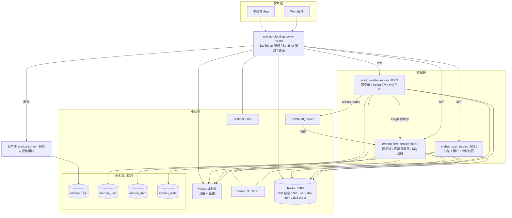
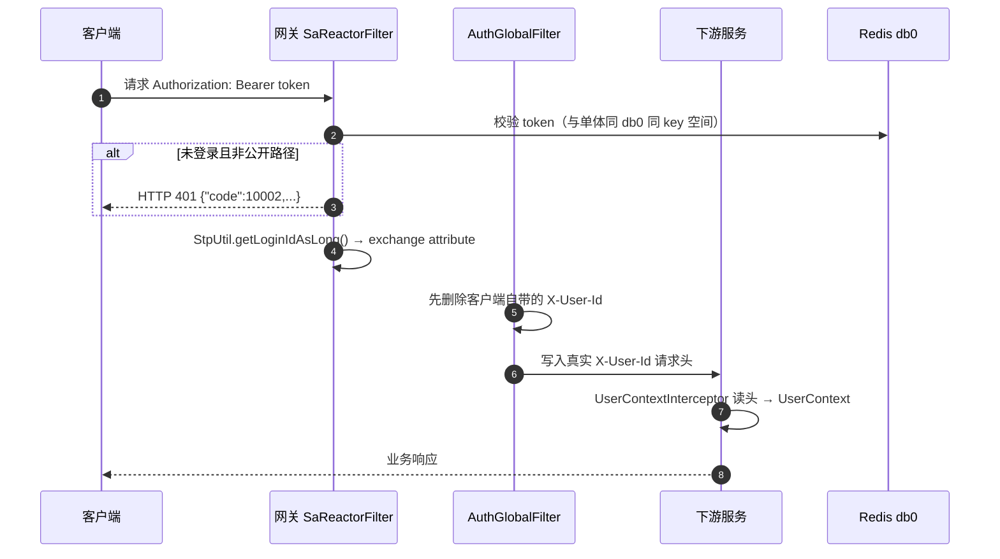
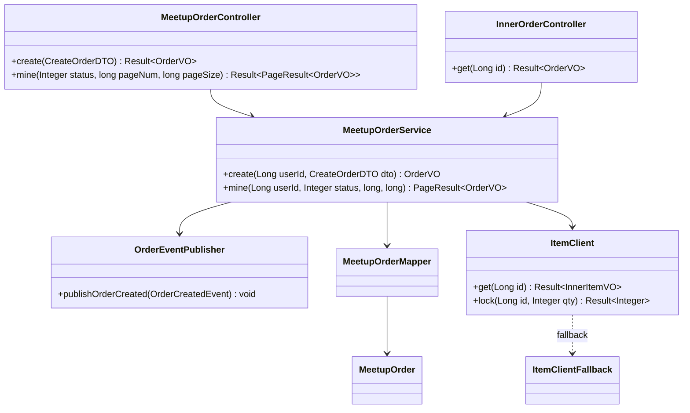
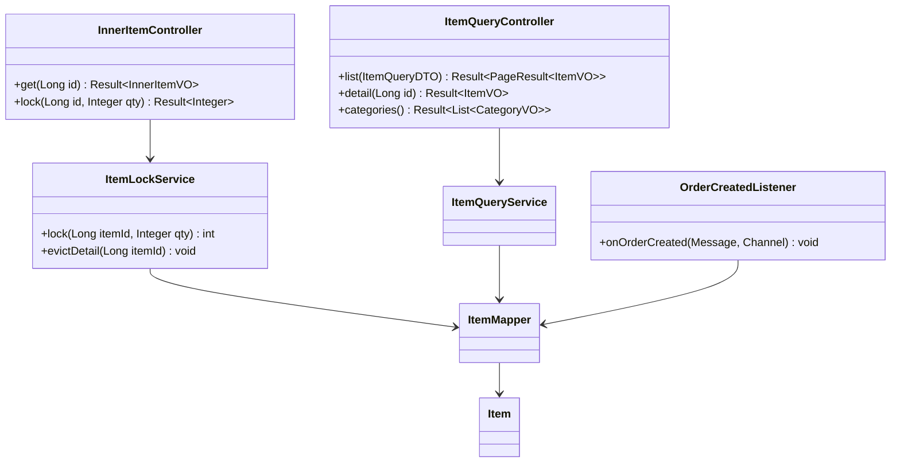
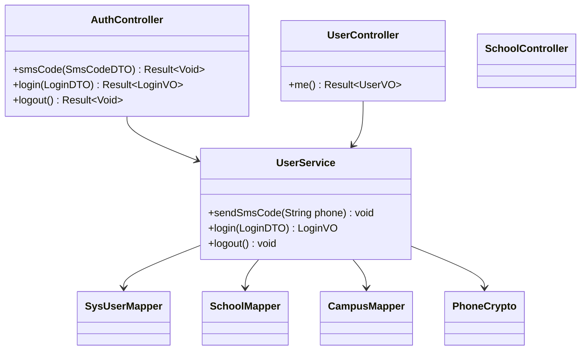
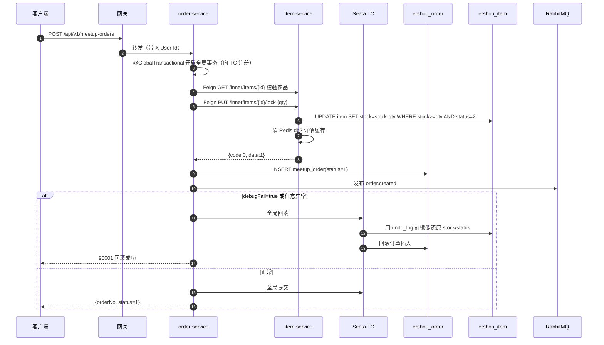
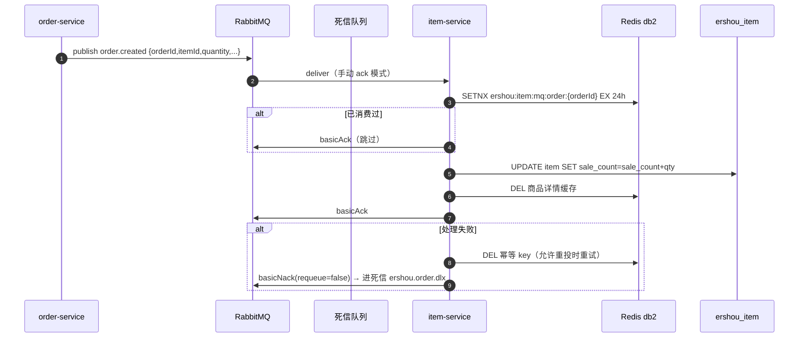
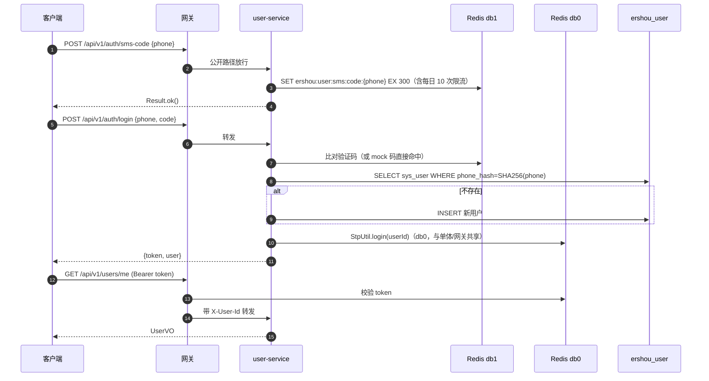

# 09 · 微服务架构与 UML（拆分后）

> 代码位置：`ershou-cloud`。定位是**绞杀者模式的渐进式迁移切片**：已迁移路径走新服务，未迁移路径由网关反代回旧单体 `:8080`，前端只改 baseURL 端口即可。
>
> 端口：网关 **8088**｜user **8081**｜item **8082**｜order **8083**｜旧单体 **8080**。

---

## 1. 部署架构

---

## 2. 网关路由表（[GatewayRoutesConfig.java](../ershou-cloud/ershou-cloud-gateway/src/main/java/com/ershou/cloud/gateway/config/GatewayRoutesConfig.java)）

按**声明顺序**匹配，特例必须放在通配之前。

| 顺序 | 路由 ID | 匹配 | 目标 |
| --- | --- | --- | --- |
| 1 | ershou-user-auth | `/api/v1/auth/**` | `lb://ershou-user-service` |
| 2 | ershou-user-schools | `/api/v1/schools/**` | `lb://ershou-user-service` |
| 3 | ershou-user-me | `/api/v1/users/me` | `lb://ershou-user-service` |
| 4 | ershou-user-legacy | `/api/v1/users/**` | 旧单体 `8080` |
| 5 | ershou-item-categories | `/api/v1/categories`、`/api/v1/categories/**` | `lb://ershou-item-service` |
| 6 | ershou-item-mine | `GET /api/v1/items/mine` | 旧单体 `8080` |
| 7 | ershou-item-get | `GET /api/v1/items/**` | `lb://ershou-item-service` |
| 8 | ershou-item-write | `/api/v1/items/**`（非 GET） | 旧单体 `8080` |
| 9 | ershou-order-meetup | `/api/v1/meetup-orders/**` | `lb://ershou-order-service` |
| 10 | ershou-legacy-ws | `/ws/**` | `ws://127.0.0.1:8080` |
| 11 | ershou-legacy-api | `/api/v1/**`（兜底） | 旧单体 `8080` |

> 已知缺口：order-service 只实现了 `POST /meetup-orders`（创建）和 `GET /meetup-orders/mine`；而路由把整个 `/meetup-orders/**` 都转给 order-service，所以 `/{id}`、`/{id}/accept`、`/todo-count` 等经网关会 **404**。实现时可补齐这些路由，或把它们显式反代回单体。

---

## 3. 鉴权与身份透传

要点：
- 网关用 `SaReactorFilter`（**WebFilter 阶段**）做鉴权，因为 Reactor 下 `SaTokenContext` 是 ThreadLocal，GlobalFilter 里不能直接调 `StpUtil`。
- `AuthGlobalFilter`（GlobalFilter，order=-100）只负责把 userId 写成 `X-User-Id`，并**清除客户端伪造的同名头**。
- 下游服务通过 common 的 `UserContextInterceptor` 读 `X-User-Id`，业务代码用 `UserContext.requireUserId()`。

公开路径规则见 [PublicPaths.java](../ershou-cloud/ershou-cloud-gateway/src/main/java/com/ershou/cloud/gateway/config/PublicPaths.java)：`/auth/**`、GET 的 schools/categories/map/trade-points/platform/shop/search status/商品读/用户主页、`/actuator/health`、`/ws/**`、OPTIONS。

---

## 4. 数据隔离

| 服务 | MySQL 库 | Redis db | 业务 key 前缀 |
| --- | --- | --- | --- |
| gateway | 无 | db0 | 会话 `Authorization:*` |
| user-service | `ershou_user` | db0（Sa-Token 会话）+ db1（验证码/限流） | `ershou:user:` |
| item-service | `ershou_item` | db2 | `ershou:item:` |
| order-service | `ershou_order` | db3 | `ershou:order:` |
| 旧单体 | `ershou` | db0 | 原有 key |

> user-service 同时需要 db0 和 db1：业务验证码按设计落 db1，而 Sa-Token 会话必须落 db0 才能与其他服务互通，所以 [SaTokenRedisConfig.java](../ershou-cloud/ershou-user-service/src/main/java/com/ershou/cloud/user/config/SaTokenRedisConfig.java) 单独建了一个指向 db0 的连接工厂。

---

## 5. 关键类图

### 5.1 order-service（事务编排方）

`MeetupOrderService.create` 标注 `@GlobalTransactional(name="create-meetup-order")`：
1. 校验商品（Feign `GET /inner/items/{id}`）
2. Feign `PUT /inner/items/{id}/lock` 条件扣库存（item 本地事务注册为 AT 分支）
3. 插入面交单（本服务本地事务，AT 分支）
4. 发布 `order.created` 事件
5. `debugFail=true` 时抛异常 → **全局回滚**

### 5.2 item-service

- `ItemLockService.lock`：单条**条件 UPDATE** 扣库存（`where stock >= qty and status=2`），返回 1/0，不抛异常，便于 Feign 判空；方法带 `@Transactional` 以参与 Seata AT。
- `OrderCreatedListener`：手动 ack + 死信队列 + Redis SETNX 幂等。

### 5.3 user-service

---

## 6. 关键时序图

### 6.1 下单：Seata AT 全局事务

### 6.2 RabbitMQ：下单事件 → 销量累加

### 6.3 登录（经网关）

---

## 7. 端口与配置

| 端口 | 服务 | 说明 |
| --- | --- | --- |
| 8088 | gateway | 唯一对外入口 |
| 8081 | user-service | 认证/用户/学校 |
| 8082 | item-service | 商品读 + `/inner/**` |
| 8083 | order-service | 面交单 + Seata TM + MQ 生产 |
| 8080 | 旧单体 | 未迁移路径反代目标 + WebSocket |
| 8848 / 9848 | Nacos | 注册 + 配置 |
| 5672 / 15672 | RabbitMQ | AMQP / 管理台 |
| 8091 / 7091 | Seata | TC / 控制台 |
| 8858 | Sentinel | Dashboard |
| 6380 | Redis | db0–db3 |
| 3306 | MySQL | `ershou` + `ershou_user/item/order` |

**配置来源**：每个服务本地 `application.yml` 只留端口/服务名/Nacos 地址，数据源/Redis/RabbitMQ/Seata 全部从 Nacos 拉（4 个 dataId：`ershou-gateway.yaml`、`ershou-user-service.yaml`、`ershou-item-service.yaml`、`ershou-order-service.yaml`，见 `ershou-cloud/nacos-configs/`）。

---

## 8. 已知取舍（实现时照做即可，也可改进）

| 项 | 现状 |
| --- | --- |
| 新旧库同步 | **一次性快照迁移**，之后旧单体写旧库、新服务写新库，不自动同步 |
| Seata 版本 | client 2.1.0 / server 1.8.0，存在兼容风险 |
| Seata 容器 IP | TC 在 Nacos 注册的是 Docker 内网 IP，宿主机客户端可能连不上 |
| 迁移范围 | 仅认证、商品读、下单；商品写、聊天、购物车、运营、平台仍在单体 |
| 会话 | 全部服务共享 Redis db0，单点登录态 |
| 降级 | order→item 的 Feign 配了 Sentinel fallback，item 不可用时返回"商品服务暂不可用" |
