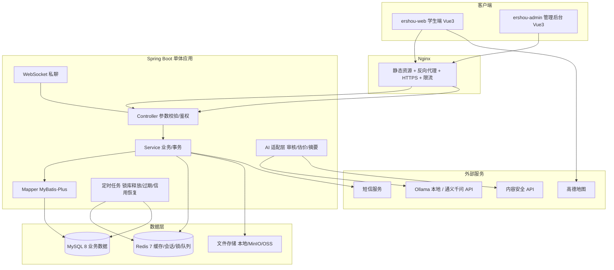

# 校园二手交易平台 · 开发文档

| 项目 | 内容 |
| --- | --- |
| 文档版本 | V1.0（开发基线）+ **2026-09-30 地图模块修订** |
| 技术栈 | Spring Boot 3 + Vue 3 + Element Plus + MySQL 8 + Redis 7 + Elasticsearch 8 + **高德 JS API 2.0** |
| 关联文档 | 《校园二手交易平台需求文档.md》、《环境检查与安装清单.md》、**《开发日志.md》**、`sql/schema.sql` |
| 目标读者 | 后端、前端、测试、运维 |
| 阅读顺序 | 第 1-2 章了解全局 → 第 3 章看工程结构 → 第 10 章跑起来 → 第 7 章照着实现核心业务 |

> 当前代码规模（2026-09-30 实测）：后端 **141 个 Java 文件 / 71 个接口**；前端 `ershou-web/src` 下 **27 个 .vue + 29 个 .ts**（18 个页面）。


## 1. 技术选型与版本矩阵

### 1.1 后端

| 层次 | 技术 | 版本 | 选型理由 |
| --- | --- | --- | --- |
| 运行时 | JDK | **21 (LTS)** | 本机已有；Spring Boot 3.x 要求 17+ |
| 框架 | Spring Boot | **3.3.5** | 与 JDK 21 / Spring 6.1 匹配，生态最稳 |
| Web | Spring MVC + Validation | 随 Boot | REST 接口 + JSR-303 参数校验 |
| ORM | **MyBatis-Plus** | 3.5.9（spring-boot3-starter） | 单表 CRUD 免写、分页插件开箱即用，比 JPA 更可控 |
| 数据库 | MySQL | **8.0.36** | 本机已装；支持 JSON 字段、ngram 中文全文索引 |
| 连接池 | HikariCP | 随 Boot | 默认够用，调优只改 maximum-pool-size |
| 缓存 | Redis | **7.2** | 本机未装 → docker-compose 一键起 |
| 搜索 | **Elasticsearch** | 8.13.4（spring-boot-starter-data-elasticsearch） | 中文分词（IK / smartcn，未装则自动退化为内置 ngram）、关键词高亮、相关性排序；ES 不可用时自动降级 MySQL LIKE，见 5.3.1 |
| 分布式锁 | **DB 条件更新 + Redis SETNX** | — | 锁库用 `UPDATE ... WHERE status = 2`（影响行数 0 即被抢），缓存/索引重建用 `SETNX` 轻量锁。**项目没有引入 Redisson**（2026-10-13 核实：pom 无依赖、代码零 import、本地仓库无 `org/redisson`） |
| 认证鉴权 | **Sa-Token** | 1.39.0 | 注解式鉴权 + Redis 会话，比 Spring Security 少 70% 配置 |
| 定时任务 | Spring @Scheduled + ShedLock | 6.x / 5.16 | 锁库过期释放、商品过期、信用分恢复；多实例只跑一次 |
| 实时通信 | Spring WebSocket (STOMP) | 随 Boot | 私聊推送；多实例用 Redis Pub/Sub 广播 |
| 接口文档 | springdoc-openapi | 2.6.0 | 自动生成 Swagger UI |
| 对象转换 | MapStruct | 1.6.3 | Entity ↔ DTO/VO 编译期生成，零反射 |
| 工具库 | Hutool | 5.8.32 | 加密、日期、脱敏 |
| 简化代码 | Lombok | 1.18.34 | @Data / @Builder |
| AI 接入 | Spring AI（OpenAI 兼容）或 RestClient | 1.0.0-M6 | 兼容本地 Ollama 与云端 API，便于切换 |
| 对象存储 | **MinIO**（minio-java） | 8.5.12 | 商品图片/头像存储；本机已有镜像；**存储桶由后端启动时自建**，无需 mc 镜像 |
| 图片处理 | Thumbnailator | 0.4.20 | 上传即压缩、生成缩略图 |
| 监控 | Actuator + Micrometer | 随 Boot | 健康检查、指标 |
| 构建 | Maven + **mvnw** | 3.9.x | 本机无全局 mvn，用项目自带 wrapper 免安装 |
| 容器 | Docker Compose | 本机已有 | 一键起 MySQL + Redis，环境一致 |

**刻意不选的技术（避免过度设计）**

| 不选 | 原因 |
| --- | --- |
| Spring Cloud / 微服务 | 单体足够支撑单校到 50 校规模，拆分带来分布式事务与运维成本 |
| Spring Security | 认证逻辑简单（手机号 + 角色），Sa-Token 更轻、中文文档友好 |
| JPA / Hibernate | 地图聚合、统计看板等复杂查询用 SQL 更直观可控 |
| 消息队列 MQ | Redis List/Stream 可承担异步审核与通知队列 |
| XXL-Job | 定时任务简单，@Scheduled + ShedLock 即可 |

### 1.2 前端

| 层次 | 技术 | 版本 | 说明 |
| --- | --- | --- | --- |
| 运行时 | Node.js | **24.11.1**（本机已有） | Vite 6 要求 ≥ 18 |
| 框架 | **Vue 3** | 3.5.x | Composition API + script setup |
| 构建 | **Vite** | 6.x | 秒级冷启动、HMR |
| 语言 | TypeScript | 5.6.x | 接口类型约束，减少联调事故 |
| UI | **Element Plus** | 2.8.x | 指定组件库，**面向 PC**（见环境清单 4.5） |
| 状态 | Pinia | 2.2.x | 模块化 store |
| 路由 | Vue Router | 4.4.x | 动态路由 + 守卫做权限 |
| 请求 | Axios | 1.7.x | 统一封装：token 注入、错误提示、刷新 |
| 图表 | ECharts | 5.5.x | 管理后台数据看板 |
| **地图** | **高德 JS API 2.0**（主力，`map_type=2`）<br>Leaflet 1.9（自绘平面图，`map_type=1`） | — | 高德用于有经纬度的校区：真底图 + 定位 + 米制距离 + 逆地理编码 + URI 导航；Leaflet `CRS.Simple` 保留给没有底图的校区（像素坐标）。两者对外 props/events 一致 |
| 样式 | Sass + Element Plus 主题变量 | — | 统一设计变量 |
| 工程化 | unplugin-auto-import / unplugin-vue-components | 最新 | Element Plus 按需引入，减小包体 |
| 规范 | ESLint 9 + Prettier 3 + vue-tsc | — | 提交前校验 |

### 1.3 前端工程拆分

| 工程 | 目录 | 使用者 | 说明 |
| --- | --- | --- | --- |
| 学生端 | **ershou-web** | 学生买家/卖家 | 首页信息流、校内地图、搜索、商品详情、私聊、购物车、面交单、我的 |
| 管理后台 | **ershou-admin** | 运营/审核/客服 | 审核工作台、用户管理、点位管理、举报仲裁、代卖管理、数据看板 |

> 两个工程共用一套 UI 与请求封装，可抽 ershou-ui（可选，初期直接复制更快）。

---

## 2. 系统架构

### 2.1 总体架构



### 2.2 架构风格：模块化单体（Modular Monolith）

按业务域分包，域之间**只通过 Service 接口调用，不跨域直接操作对方 Mapper**。既保留单体部署的简单，又保留将来拆分的可能。

| 域模块 | 职责 | 对应 PRD |
| --- | --- | --- |
| user | 轻注册登录、学校/校区、身份徽章、信用分、设备风控 | 5.1 / 5.6 |
| item | 商品发布、分类、成色、库存锁、有效期 | 5.2 / 5.3 |
| map | 校内地图底图、面交点、聚合、导航指引 | 5.4 |
| chat | 私聊会话、消息、风控拦截 | 5.5 |
| cart | 收藏、购物车、合并面交行程 | 5.7 / 5.8 |
| order | 面交单、确认、爽约、纠纷 | 5.9 |
| consign | 代卖委托、质检、上架、结算（毕业季） | 5.10 |
| review | 双向评价、信用流水 | 5.11 |
| ai | 机审、风控、估价、文案、仲裁摘要 | 5.14 |
| admin | 审核工作台、处置、审计日志、看板 | 5.15 |
| common | 统一响应、异常、拦截器、工具、配置 | — |

### 2.3 部署拓扑

| 环境 | 组成 | 说明 |
| --- | --- | --- |
| 开发 | IDEA + Vite dev server + Docker(MySQL/Redis) | 前端 5173 代理到后端 8080 |
| 测试 | 单机：Nginx + 后端 jar + MySQL + Redis | 与生产同构，供验收 |
| 生产 | Nginx（HTTPS + 静态资源）→ 后端 jar（可 2 实例）→ MySQL 主从/云数据库 + Redis + 对象存储 | 后端无状态，会话在 Redis，可水平扩 |

### 2.4 关键决策记录（ADR 摘要）

| 编号 | 决策 | 备选 | 理由 |
| --- | --- | --- | --- |
| ADR-01 | 无实名，手机号为唯一身份锚点 | 学号/身份证/人脸 | PRD BR-01；降低注册门槛，风控交给设备指纹 + 新号限额 + 信用分 |
| ADR-02 | 资金不落平台，面交线下支付 | 平台代收 + 担保交易 | 规避支付牌照/二清风险，平台只做信息撮合与凭证 |
| ADR-03 | 地图双坐标系（自绘像素 + 经纬度） | 只用经纬度 | 大量校园无精细 POI，自绘底图 + 像素坐标覆盖更广。**2026-09-30 复盘**：真实场景里高德底图比自己画平面图更省事也更准，主力已切到高德（`map_type=2` + GCJ-02），自绘降级为"没有底图时的兜底" |
| ADR-04 | 锁库用 Redis + DB 乐观锁双保险 | 只用 Redis | Redis 兜并发，DB version + 条件更新兜一致性，避免超卖 |
| ADR-05 | 机审同步 + 异步双通道 | 全异步 | 高置信违规要"秒拦"体验，低置信转人工异步处理 |
| ADR-06 | WebSocket 用 Redis Pub/Sub 广播 | 单机内存会话 | 生产需支持多实例 |
| ADR-07 | 前端两套工程（web / admin） | 单工程分路由 | 权限、菜单、包体差异大，分开更清晰 |

---

## 3. 工程结构

### 3.1 仓库目录

```text
ershou/
├─ 校园二手交易平台需求文档.md      # PRD
├─ 开发文档.md                      # 本文档
├─ 环境检查与安装清单.md
├─ .env / .env.example              # 本地密钥（.env 不提交）/ 模板
├─ .gitignore
├─ docker-compose.yml               # MySQL 8 + Redis 7
├─ sql/
│  ├─ schema.sql                    # 建库建表 + 初始化数据
│  └─ upgrade/                      # 版本升级脚本 V1.0.1__xxx.sql
├─ scripts/
│  └─ check-env.ps1                 # 环境自检
├─ ershou-server/                   # Spring Boot 后端（Maven 单模块）
├─ ershou-web/                      # 学生端 Vue3
└─ ershou-admin/                    # 管理后台 Vue3
```

### 3.2 后端包结构

```text
ershou-server/src/main/java/com/ershou/campus/
├─ CampusApplication.java
├─ common/
│  ├─ result/        Result  PageResult  ResultCode
│  ├─ exception/     BizException  GlobalExceptionHandler
│  ├─ config/        MybatisPlusConfig  SaTokenConfig  WebMvcConfig
│  │                 DotenvEnvironmentPostProcessor（启动自动读项目根 .env）
│  ├─ cache/         JsonCache（读缓存+三类防护）  DictionaryCache  CacheEvictor  CacheProperties
│  ├─ discovery/     LanDiscoveryResponder（UDP 48899 应答，手机一键扫描）
│  ├─ filter/        TraceIdFilter
│  ├─ storage/       FileStorageService  MinioFileStorageService  LocalFileStorageService  StorageProperties
│  ├─ interceptor/   AuthInterceptor  RateLimitInterceptor  TraceIdFilter
│  ├─ util/          EncryptUtil(手机号AES)  GeoUtil  IdGenUtil  SensitiveUtil
│  ├─ storage/       FileStorageService(接口)  LocalFileStorage  MinioFileStorage
│  ├─ enums/         ItemStatus  OrderStatus  ReportType  AuditDecision
│  └─ constant/      RedisKeys  ErrorMsg  BizConst
├─ module/
│  ├─ user/          controller  service(impl)  mapper  entity  dto  vo
│  ├─ item/          （同上分层）
│  ├─ map/  chat/  cart/  order/  consign/  review/  ai/  admin/
└─ resources/
   ├─ application.yml / application-dev.yml / application-prod.yml
   ├─ mapper/**/*.xml               # 复杂 SQL（地图聚合、统计）
   └─ prompt/                       # AI 提示词模板（审核/估价/摘要）
```

**分层约束（Code Review 必查）**

1. Controller 只做参数校验 + 调 Service + 组装 VO，**禁止写业务判断**；
2. Service 内禁止出现 HttpServletRequest/Response；
3. Mapper 只做数据访问，**禁止写业务分支**；复杂 SQL 写 XML，不做字符串拼接；
4. 跨模块调用只能走对方 Service 接口；
5. Entity 不出 Controller（必须转 VO），避免把 risk_score、phone 暴露给前端。

### 3.3 前端工程结构（以 ershou-web 为例）

```text
ershou-web/
├─ index.html
├─ vite.config.ts          # 别名 @、proxy /api -> 8080、按需引入插件、envDir: '..'（读仓库根 .env）
├─ tsconfig.json
└─ src/
   ├─ main.ts  App.vue
   ├─ api/                # 接口层：auth.ts item.ts map.ts order.ts chat.ts cart.ts admin.ts
   ├─ utils/
   │  ├─ request.ts       # Axios 封装（token、错误提示、401 跳登录）
   │  ├─ amap.ts          # 高德 JS API 2.0 加载器 + 逆地理编码 + URI 导航（详见 9.4）
   │  └─ pointMerge.ts    # 面交点 100 米内合并（仅展示层，详见 7.3）
   ├─ composables/
   │  └─ useTradePoints.ts # 面交点选项（含"我提交的点位"合并、pointsVersion 版本号）
   ├─ stores/             # Pinia：user.ts cart.ts chat.ts meetup.ts
   ├─ router/             # index.ts（含 requiresAuth / requiresAdmin 守卫）
   ├─ layouts/            # DefaultLayout.vue（顶栏 + 页脚）/ AdminShell.vue
   ├─ components/
   │  ├─ CampusMap.vue         # Leaflet CRS.Simple 自绘平面图（map_type=1）
   │  ├─ AmapCampusMap.vue     # 高德真地图（map_type=2，当前主力）
   │  ├─ PointPickerDialog.vue # 地图选点新增面交点（发布页 / 私聊页复用）
   │  ├─ MeetupBookingDialog.vue # 约面交弹窗（单品直约 / 购物车合并共用）
   │  └─ ImageUploader.vue
   ├─ views/
   │  ├─ MapView.vue HomeView.vue ItemDetailView.vue PublishView.vue
   │  ├─ CartView.vue OrdersView.vue ChatView.vue ProfileView.vue
   │  └─ admin/           # AdminShell 下的概览 / 审核 / 商品 / 用户 / 日志
   └─ styles/             # variables.scss reset.scss
```

---

## 4. 后端开发规范

### 4.1 统一响应体

```java
public class Result<T> {
    private int code;        // 0=成功，非0=业务错误码
    private String message;
    private T data;
    private String traceId;  // 链路追踪，排查线上问题

    public static <T> Result<T> ok(T data) { ... }
    public static <T> Result<T> fail(ResultCode rc) { ... }
}
```

分页统一返回：total / pageNum / pageSize / records。

### 4.2 错误码分段

| 段位 | 含义 | 示例 |
| --- | --- | --- |
| 0 | 成功 | — |
| 10xxx | 通用/参数 | 10001 参数校验失败、10002 未登录、10003 无权限、10004 请求过于频繁 |
| 20xxx | 用户/账号 | 20001 验证码错误、20002 账号被封禁、20003 今日发布已达上限、20004 信用分不足 |
| 30xxx | 商品 | 30001 商品不存在、30002 商品已售出、30003 商品审核中、30004 库存被锁定 |
| 40xxx | 交易 | 40001 面交单不存在、40002 无权操作该面交单（含"只有卖家能改面交地点"）、40003 状态不允许此操作（含"已经约过这件商品"）、40004 时间窗不合法 |
| 50xxx | 审核/风控 | 50001 内容违规、50002 触发风控拦截 |
| 70xxx | 私聊 | 70001 不能和自己私聊、70002 会话不存在或无权访问、70003 今日私聊已达上限（限额默认关闭，通常不会出现）、70004 消息内容不合法、70005 消息发送失败 |
| 90xxx | 系统 | 90001 系统异常、90002 依赖服务不可用（Redis/短信/AI） |

### 4.3 参数校验

- DTO 上用 @NotNull / @NotBlank / @Size / @Min / @Pattern，Controller 参数加 @Validated；
- 业务级校验写在 Service，抛 BizException(ResultCode.XXX)；
- 全局异常处理器兜底：BizException → 对应码；MethodArgumentNotValidException → 10001 并拼接首个字段错误；其他 → 90001（日志 ERROR + traceId，**不把堆栈返回前端**）。

### 4.4 鉴权设计（Sa-Token）

```text
登录流程：手机号 + 验证码(Redis校验) → 创建/查询用户 → StpUtil.login(userId)
Token 存 Redis：ershou:auth:token:{userId}   TTL 7 天（滑动续期）
鉴权注解：@SaCheckLogin（需登录）/ @SaCheckRole("admin")（运营）
免登录白名单：/api/v1/auth/**、GET /api/v1/items、/api/v1/map/**、/api/v1/trade-points/**、/api/v1/schools/**
```

要点

1. 验证码 TTL 5 分钟，同手机号 60 秒内只能发一次，每日上限 10 次；
2. 手机号 **AES 加密存储**，另存 phone_hash（SHA256）做唯一索引与查询，避免明文入库；
3. 运营接口统一 /api/v1/admin/**，加 @SaCheckRole("admin") + 操作审计日志；
4. 敏感操作（改价、封禁、判罚）二次校验，sys_audit_log 记录前后值。

### 4.5 日志规范

| 级别 | 使用场景 |
| --- | --- |
| ERROR | 系统异常、依赖调用失败（含堆栈） |
| WARN | 业务异常、风控拦截、降级触发 |
| INFO | 关键状态变更（下单、接受、成交、审核结论、处罚） |
| DEBUG | 开发调试，生产关闭 |

- 每个请求生成 traceId（TraceIdFilter 写入 MDC），响应体与日志都带；
- **日志中禁止打印**：手机号明文、token、验证码、聊天内容全文；
- 业务日志统一格式：[模块][动作][业务ID][结果]。

### 4.6 事务与并发规范

1. 事务只加在 Service 的**写方法**上，@Transactional(rollbackFor = Exception.class)；
2. 事务内**禁止**远程调用（HTTP/短信/AI）、发消息、长耗时操作 —— 放事务提交后（事件监听）；
3. 锁顺序统一：**先 Redis 锁 → 再 DB 更新 → version 乐观锁**，失败即抛业务异常；
4. 所有"读-判断-写"的并发场景（锁库、状态流转、库存扣减）必须有 DB 层兜底（唯一索引或 WHERE status = ? 条件更新），不能只信 Redis；
5. 批量操作分批提交（每 500 条），避免大事务锁表。

### 4.7 缓存使用规约

| 规约 | 说明 |
| --- | --- |
| 只缓存热点读 | 商品详情、点位列表、用户主页、首页第一页 |
| 缓存必须有过期时间 | 禁止永久 key（配置类除外） |
| 先更新 DB 再删缓存 | 不用"更新缓存"，避免并发写脏 |
| Key 带版本前缀 | 结构变更时改前缀即可整体失效 |
| 大对象拆分 | 列表只缓存 ID 列表，详情单独缓存 |
| 空值也缓存 | 防穿透，TTL 60 秒 |

### 4.8 文件上传规范（MinIO 对象存储）

**统一入口**：前端只调用 `POST /api/v1/files/upload?biz=item`（multipart），后端完成校验 → 压缩 → 机审 → 上传 MinIO，返回公开 URL。**不让前端直连 MinIO**，好处是压缩、校验、鉴黄、权限都在后端一处收口（预签名直传留作 P2 优化）。

| 项 | 规范 |
| --- | --- |
| 对象 Key | `{biz}/{yyyy}/{MM}/{uuid}.{ext}`，例如 `item/2026/09/8f2c1a....jpg`；biz 取值：item / avatar / chat / consign / report |
| 大小与格式 | 单图 ≤ 5MB；jpg / png / webp；同时校验 MIME 与文件头（防改扩展名） |
| 压缩 | 长边 > 1280px 则等比压缩，质量 0.8（Thumbnailator）；同时生成 300px 缩略图用于列表 |
| 桶与权限 | 单一桶 `ershou`，策略 **public-read**（匿名只读、写需密钥）；启动时自动建桶并设置策略 |
| 访问 URL | `ershou.storage.public-base-url` + key；开发为 `http://localhost:9010/ershou/...`，生产换成 CDN/域名 |
| 删除 | 业务删除不立即删对象，延迟 7 天由定时任务清理（纠纷取证需要） |
| 机审 | 上传成功后**异步**触发图片机审；命中违规则关联内容下架 + 通知 |
| 安全 | 文件名一律 UUID（防路径穿越）；限制并发上传数；对同一用户做上传频率限流 |
| 降级 | MinIO 不可用时 `mode=local` 落到本地磁盘 + `/static/**` 映射，业务无感 |

---

## 5. 数据库设计

### 5.1 设计约定

| 约定 | 说明 |
| --- | --- |
| 命名 | 表名/字段小写下划线；不使用 MySQL 保留字（已避开 read/order/rank/condition/key） |
| 主键 | id BIGINT AUTO_INCREMENT；对外用业务号 order_no |
| 时间 | created_at / updated_at 默认 CURRENT_TIMESTAMP；业务时间用 DATETIME |
| 金额 | DECIMAL(10,2)，**禁止 float/double** |
| 布尔 | TINYINT(1)，0/1 |
| 状态 | TINYINT + 代码枚举，字典见 5.4 |
| 扩展字段 | JSON 类型（images、safe_tags、evidence、quality_report） |
| 软删除 | 业务表用 status 标记，不做物理删除；日志表只增不改 |
| 索引 | 建在区分度高 + 查询必带的列；组合索引遵循最左前缀 |
| 字符集 | utf8mb4 / utf8mb4_general_ci |

### 5.2 表清单（21 张，DDL 见 sql/schema.sql）

| # | 表名 | 用途 | 关键说明 |
| --- | --- | --- | --- |
| 1 | school | 学校 | 一个平台多学校 |
| 2 | campus | 校区 | 决定地图底图与可见范围 |
| 3 | trade_point | **校内面交点** | 双坐标（像素/经纬度）+ 安全分 + 合并组 |
| 4 | sys_user | 用户（轻注册） | 无实名/学籍字段；phone 加密 + phone_hash 唯一 |
| 5 | item_category | 分类 | 支持按学校定制 |
| 6 | item | 商品 | 状态机 + 锁库 + 乐观锁 version |
| 7 | favorite_folder | 收藏夹分组 | — |
| 8 | favorite | 收藏 | 唯一键 (user_id, item_id) |
| 9 | cart_item | 购物车 | 冗余 seller_id 便于按卖家分组 |
| 10 | meetup_order | **面交单** | 点位快照、双向确认、batch_no 合并行程、reschedule_count（改了几次地点）。核销码已于 2026-09 删除 |
| 11 | chat_session | 会话 | user_a < user_b 保证唯一 |
| 12 | chat_message | 消息 | risk_level / blocked 记录风控 |
| 13 | review | 双向评价 | 盲评：双方评完或 7 天可见 |
| 14 | credit_log | 信用流水 | 每次变动留痕，可追溯 |
| 15 | report_ticket | 举报/仲裁工单 | 含 AI 摘要与建议 |
| 16 | consign_order | 代卖委托单（预留） | 质检报告、结算、未售出处置 |
| 17 | ai_audit_record | AI 审核记录 | 模型版本、置信度、决策、申诉状态 |
| 18 | notification | 消息通知 | 站内信/Push/短信统一表 |
| 19 | sys_audit_log | 运营审计 | 前后值 JSON，合规必备 |
| 21 | user_block | 用户拉黑 | 单向存储、双向生效：拉黑后双方不可私聊（PRD FR-UP-04） |
| 20 | （预留） | — | 支付、跑腿、租赁等后续版本 |

### 5.3 关键索引说明

| 索引 | 解决的查询 |
| --- | --- |
| idx_item_campus_status (campus_id, status, published_at) | 首页信息流、同校列表 |
| idx_item_lock (status, lock_expire_at) | 定时任务扫描过期锁库 |
| idx_item_expire (status, expire_at) | 定时任务每小时扫描到期商品（见 7.10） |
| ft_item_title (title, description) WITH PARSER ngram | MySQL 兜底检索（Elasticsearch 不可用时的 `LIKE` 降级路径，同时保证存量数据可查） |
| idx_point_campus_status (campus_id, status) | 地图加载某校区点位 |
| idx_order_buyer / idx_order_seller | 我的面交单列表 |
| idx_order_slot (status, time_slot_start) | 面交提醒定时任务 |
| uk_fav_user_item / uk_cart_user_item | 防重复收藏/加购（并发兜底） |
| idx_msg_session (session_id, id) | 聊天记录游标翻页 |
| idx_report_status (status, created_at) | 审核/仲裁工作台队列 |

#### 5.3.1 商品搜索（Elasticsearch）

| 项 | 说明 |
| --- | --- |
| 索引 | `ershou_item`（1 分片 0 副本，开发环境够用） |
| 走 ES 的条件 | `GET /api/v1/items` **带 keyword** 时走 ES；不带 keyword 的列表浏览仍走 MySQL（`idx_item_campus_status`），所以 ES 挂掉也不影响"逛商品" |
| 中文分词 | 建索引时按 `ik_max_word` → `smartcn` → 内置 `ngram`(1~2 gram) 依次探测，装了什么用什么的；`docker/es/Dockerfile` 默认构建带 IK 的 ES 镜像（三级兜底，任何一级都能跑） |
| 简称/别名 | 两级配合：① `docker/es/custom.dic` = IK 扩展词典(ext_dict)，把「高数」「电驴」「一卡通」等切成**整体词**；② `docker/es/synonyms.txt` = 查询期 `synonym_graph` 同义词表，实现「高数 ⇄ 高等数学」双向召回。建索引日志会显示方案 `ik_max_word+syn` |
| 同义词热更新 | 同义词表声明了 `updateable: true`，改完执行 `POST /ershou_item/_reload_search_analyzers` 立即生效（不重启、不重建索引）；新增**词**本身则要加进 `custom.dic` 并重启 ES |
| 坑位提醒 | 同义词每个条目必须是**一个词**：简称不先写进 `custom.dic` 的话 IK 会切成「高\|数」，规则永不命中；多词短语（如「平板电脑」）会被再分词，把子词带进查询造成过度扩展 |
| 检索 | `multi_match`：`title^3`、`categoryName^2`、`description`；`filter` 恒定 `status=2`，另加 categoryId / campusId / sellerId 等值过滤 |
| 排序 | 有关键词：`_score desc` → `publishedAt desc` → `id desc`；`price_asc` / `price_desc` 时价格优先 |
| 高亮 | title / description 返回 `<em>` 片段（`encoder: html`，原文已转义，前端可安全 `v-html`） |
| 结果回填 | ES 只返回命中 id 与高亮，商品字段仍回 MySQL 取最新值，避免索引与库字段漂移 |
| 一致性 | ① 业务写路径（发布/下架/锁库/释放/售出/过期）`afterCommit` 按 id 重新入索引；② 每 2 分钟按 `updated_at > 水位` 增量兜底（水位存 Redis）；③ `POST /search/reindex` 管理员全量重建；④ 启动时索引不存在或为空自动全量重建 |
| 降级 | ES 不可用时 15 秒熔断窗口内直接走 MySQL `LIKE '%kw%'`（`ershou.search.fallback-to-db=true`）；深分页超过 `max_result_window=10000` 也回落 MySQL，且不计入故障 |
| 配置 | `ershou.search.*`（开关、索引名、cron、批量、熔断时长）+ `spring.elasticsearch.uris`（**默认 `http://127.0.0.1:9211`**，见下方端口说明） |
| 排查 | `GET /api/v1/search/status` 看 esAvailable / indexExists / docCount / onSaleCount / watermark；DSL 在 debug 日志中以 `[search][es] DSL` 输出 |
| 两个计数的区别 | `docCount` = 索引里**全部**文档（含已售出/下架/过期，设计如此：状态流转只 upsert 不删文档）；`onSaleCount`/重建返回的 `visible` = **在售**（status=2），即公开检索实际能看到多少条。**"重建有没有生效"要看后者**，它和搜索页的 `total` 完全一致 |

> ⚠️ **ES 端口为什么是 9211 而不是 9210**（2026-10-10 排查出来的环境冲突，务必别再改回去）：
> `[::]:9210` 被 WSL 里的 `wsl-bootstrap` 占着，Windows 侧 `127.0.0.1:9210` 还被 QQ 占了。
> 于是访问 9210 拿到的是**别的服务**的响应（一个 JWT 错误 `{"errCode":4001,"port":9210}`），
> **真实 ES 从头到尾没被访问到** → `POST /search/reindex` 稳定返回 `90001`，
> 看起来像代码 bug，其实代码完全正常。换到 9211（已确认 Windows 与 WSL 两侧空闲）后一切正常。
>
> 教训：遇到"某个接口稳定报通用错误、错误信息毫无指向性"，**先核实依赖服务是否真在它该在的端口上**，
> 再去怀疑自己的代码。`curl http://127.0.0.1:<port>/` 应该返回 ES 的欢迎 JSON，不是别的东西。

### 5.4 状态字典

**item.status**

| 值 | 含义 | 值 | 含义 |
| --- | --- | --- | --- |
| 0 | 草稿 | 5 | 已下架 |
| 1 | 审核中 | 6 | 审核驳回 |
| 2 | 在售 | 7 | 已过期 |
| 3 | 已锁定 | 8 | 违规下架 |
| 4 | 已售出 | | |

**商品有效期与"不可交易 ⇒ 挂单作废"（2026-10-02）**

- 有效期 **7 天**（`ershou.item.valid-days`），发布时写 `expire_at = now + 7d`；重新上架会重算并刷新 `published_at`
- 历史坑：`ItemService` 里是 `DEFAULT_HOURS_VALID = 60 * 24`，名字是"小时"却用 `plusMinutes(...)` —— 商品实际只挂 **24 小时**，而注释/文档一直写 60 天
- 到期口径「未售出就下架」：`status IN (1,2,3,6)` 且 `expire_at < NOW()` → 7 已过期；4/5/7/8 是终态不动
- 到期属于「商品变得不可交易」的一种，必须和成交/强制下架/卖家下架一样调用 `OrderService#closeActiveOrders`，否则「已锁定(3) 的商品到期」会留下永久卡死的「待面交」单（锁只在 `status=3` 时才释放）
- 卖家可在「我的发布」对 **5 已下架 / 7 已过期** 一键重新上架（`POST /items/{id}/relist`）；4 已售出、6 审核未通过、8 违规下架都不允许

**meetup_order.status**

| 值 | 含义 | 值 | 含义 |
| --- | --- | --- | --- |
| 1 | 待卖家确认 | 5 | 已失效 |
| 2 | 待面交 | 6 | 爽约 |
| 3 | 已完成 | 7 | 纠纷中 |
| 4 | 已取消 | | |

- report_ticket.status：1 待受理 / 2 处理中 / 3 已判定 / 4 申诉中 / 5 已结案
- consign_order.status：1 待收件 / 2 质检中 / 3 已上架 / 4 已售出 / 5 已结算 / 6 已拒收 / 7 已到期 / 8 退回中 / 9 已捐赠
- ai_audit_record.decision：1 放行 / 2 拦截 / 3 转人工

---

## 6. Redis 设计

### 6.1 Key 命名规范

```text
格式：ershou:{模块}:{业务}:{标识}
要求：全小写；冒号分隔；禁止无 TTL 的业务 key；禁止超大 value（>10KB 拆开）
```

### 6.2 Key 明细

| Key 模式 | 结构 | TTL | 用途 |
| --- | --- | --- | --- |
| ershou:auth:token:{userId} | String | 7 天（滑动） | 登录态（Sa-Token） |
| ershou:sms:code:{phone} | String | 5 分钟 | 短信验证码 |
| ershou:sms:limit:{phone}:{yyyyMMdd} | 计数 | 当日 | 每日发送上限 10 次 |
| ershou:limit:post:{userId}:{yyyyMMdd} | 计数 | 当日 | **新号限额：每日发布 ≤5 件** |
| ershou:limit:chat:{userId}:{yyyyMMdd} | 计数 | 当日 | 新号限额：每日私聊 ≤20 条 —— **默认关闭**（`ershou.chat.daily-limit-enabled=false`），校园场景太容易误伤 |
| ershou:item:detail:{itemId} | String(JSON) | 10 分钟 | 商品详情缓存 |
| ershou:item:null:{itemId} | String | 60 秒 | 空值缓存，防穿透 |
| ershou:item:view:{itemId} | 计数 | 1 小时 | 浏览量增量，定时回写 DB |
| ershou:item:lock:{itemId} | String(userId) | 与时间窗对齐 | **锁库（BR-03）**，同时 DB 写 lock_user_id/lock_expire_at。买家提交意向**不锁**，卖家接受时才锁（锁到时间窗结束 +2h，没填时间窗锁 24h） |
| ~~ershou:lock:item:{itemId}~~ | — | — | **已废弃**（2026-10-13 核实）：锁库实际走 **DB 条件更新** `UPDATE item SET status=3 ... WHERE id=? AND status=2`（影响行数 0 即被他人抢走），不依赖 Redis 锁。`RedisKeys.itemLock()` 保留着定义但**已无任何调用** |
| ershou:map:points:{campusId}:v{ver} | String(JSON) | 30 分钟 | 校区点位 + 在售数/最低价，版本号整体失效。**含 0 商品的点位**（发布页/私聊选点要能选到刚建的点） |
| **ershou:map:points:{campusId}:items:v{ver}** | String(JSON) | 30 分钟 | 同上但**只含有商品的点位**（地图展示用）。⚠️ 两种可见性必须**两个 key**：地图只画有商品的点位、发布页要保留空点位，共用一份缓存必然有一边是错的 |
| **ershou:map:geo:{campusId}:v{ver}** | **ZSet(GEO)** | **6 小时** | **"附近点位"检索（已接入）**，member = pointId；与地图缓存同一版本号，写点位即整体失效并按 DB 重建 |
| ershou:map:geo:rebuild:{campusId} | String | 30 秒 | GEO 索引重建锁，避免热点时刻并发全量重建 |
| ershou:map:hot:{campusId} | ZSet | 1 天 | 热门点位排行（**规划中，未接入**） |
| ershou:cart:{userId} | Hash | 7 天 | 购物车快照（DB 为准） |
| ~~ershou:meetup:code:{orderId}~~ | — | — | **已废弃**：6 位核销码 2026-09 删除，不再使用 |
| ershou:chat:unread:{userId} | Hash | 7 天 | 未读数 |
| ershou:chat:online:{userId} | String | 5 分钟 | 在线心跳 |
| ershou:chat:channel:msg | Pub/Sub | — | 多实例消息广播 |
| ershou:risk:device:{deviceId} | Set(userId) | 7 天 | 同设备账号数（马甲号识别） |
| ershou:risk:user:{userId} | 分数 | 1 天 | 风险分缓存 |
| ershou:item:index:watermark | String(epoch ms) | 常驻 | 商品搜索索引增量同步水位（见 5.4） |
| ershou:search:hot:{campusId} | ZSet | 1 天 | 热搜词（规划中，暂未实现） |
| ershou:idem:{key} | String | 10 分钟 | 幂等键（防重复提交） |
| ershou:ai:queue:audit | List | — | 异步机审队列 |
| ershou:notify:queue | List | — | 通知发送队列 |

#### 6.2.1 落地状态（本轮迭代）

实现集中在 `common/cache/`：`JsonCache`（JSON 读写 + 空值缓存 + TTL 抖动 + 重建锁）、`CacheEvictor`（失效统一出口）、`DictionaryCache`（字典 MGET）、`CacheProperties`（`ershou.cache.*`，`enabled=false` 一键回滚）。

| Key | TTL | 状态 |
| --- | --- | --- |
| ershou:item:detail:{itemId} | 10 分钟（±10% 抖动） | ✅ 已实现 |
| ershou:item:null:{itemId} | 60 秒 | ✅ 已实现（防穿透） |
| ershou:item:view:{itemId} + ershou:item:view:dirty | 2 小时 / 常驻 Set | ✅ 已实现，每 10 分钟批量回写 |
| ershou:map:points:{campusId}:v{ver} + ershou:map:points:ver | 30 分钟 / 常驻 | ✅ 已实现（版本号整体失效，不用 KEYS） |
| ershou:dict:{category\|point\|school\|campus}:{id} | 1 小时 | ✅ 已实现（MGET 消列表页 N+1） |
| ershou:admin:dashboard | 30 秒 | ✅ 已实现 |
| ershou:chat:unread:{userId} / ershou:chat:online:{userId} / ershou:chat:channel:msg / ershou:limit:chat:{userId}:{yyyyMMdd} | 7 天 / 90 秒 / — / 当日 | ✅ 已实现（私聊，见 7.6） |
| ershou:auth:token / sms:code / sms:limit / limit:post / meetup:code / item:index:watermark | 见上表 | ✅ 本轮之前已实现 |
| ~~Redisson 锁（`ershou:lock:item` / `order` / `credit`）~~ | — | ❌ **不做了**（2026-10-13 核实）：锁库已由 DB 条件更新实现（影响行数 0 即被抢），比引入 Redisson 更简单可靠；项目也从未引入该依赖 |
| `ershou:search:hot` 热搜、`ershou:idem` 幂等、`ershou:ai:queue:audit`、`ershou:notify:queue`、`ershou:risk:*`、ShedLock 多实例防重 | — | ⬜ 仍按原计划待实现 |

> 浏览量为什么不再同步 UPDATE：`item.updated_at` 是 `ON UPDATE CURRENT_TIMESTAMP`，而 ES 增量同步按 `updated_at > 水位` 拉数据（5.3.1）——每看一次商品就刷一次 updated_at，会让同一批热门商品被反复重推索引。改成 Redis 计数 + 批量回写后，热点行不再反复加锁，索引同步也不再被浏览量污染。
>
> 失效统一走 `TxHooks.afterCommit`（4.7 规约：先更新 DB 再删缓存）。地图缓存用版本号而非逐个 DELETE，避免 KEYS/SCAN 与"删一半又被并发回填"的竞态。

### 6.3 缓存三大问题应对

> **2026-10-13 按实测口径重写**。原表格写的是"Redisson 分布式锁重建" ——
> 项目里**没有引入 Redisson**，实现是 `JsonCache` 里的 `SETNX` 轻量锁 + 轮询等待。
> 文档描述一个没实现的方案比不写更糟（会让人以为"击穿已经交给 Redisson 了"）。
> 断言与数据见 `scripts/audit-cache.mjs`（13 项，可重复执行）。

| 问题 | 场景 | 实际方案 | 实测 |
| --- | --- | --- | --- |
| **穿透** | 查询不存在的商品 ID 被刷 | 空值哨兵（值就是字符串 `null`）+ 60s TTL；`detail()` 里**先查哨兵再走 getOrLoad**（不存在的 id 连重建锁都不用抢） | 不存在的 id 打 21 次，DB SELECT 只多 2 条 |
| **击穿** | 热点 key 失效瞬间大量请求打 DB | `JsonCache.getOrLoad`：`SETNX` 重建锁（TTL 5s，只作崩溃兜底）→ 拿到锁的请求**持锁回源**；没拿到的**轮询等待**（间隔 `rebuildWaitMillis`，上限 `maxRebuildWaitMillis`），只有"锁已释放但仍无数据"才自己回源 | 50 并发打刚失效的热点 key：**DB SELECT +4**、总耗时 128ms（修复前：回源约 50 次、509ms） |
| **雪崩** | 大量 key 同时过期 | 所有写缓存统一走 `JsonCache.jitter()`（+0~10% 随机）；地图点位用**版本号整体失效**（不做批量 DELETE，无 KEYS/SCAN） | 商品详情 TTL 实测 612s、字典 3785s、地图点位 1763s —— 都不是死板的整数 |

**两条容易写错的实现细节**（都在 `JsonCache` 里注释了）：

1. **锁必须持有到回源结束**。曾经的写法是"抢到锁 → 立刻进 try，`loader.get()` 在锁外"，
   加上"抢不到只睡一次 80ms 就去自己查库"，结果**只要回源比那一次等待慢，
   所有等待者都会各自回源** —— 锁只削了并发峰值，等于没防住。
2. **命中缓存后不能再回写缓存**。`ItemService.detail()` 会在返回前对 VO 就地写入
   `favorited`（用户维度）和叠加后的 `viewCount`。命中路径改的是本次反序列化的副本、
   且之后不回写，所以安全；**一旦有人加了 `cache.set` 回写，就会把某个用户的收藏态写进共享缓存**。

**缓存覆盖范围**（只有这些，别以为到处都有缓存）：商品详情 / 地图点位（两种可见性两个 key）/
分类·学校·校区·点位字典 / 运营概览。列表、搜索、聊天**不缓存**，直接查库（ES 或 MySQL）。

### 6.4 分布式锁使用场景

| 场景 | 锁 Key | 说明 |
| --- | --- | --- |
| 下单锁库 | ershou:lock:item:{itemId} | 保证同一孤品只有一次成功锁定 |
| 面交单状态变更 | DB 条件更新（`WHERE status = ?`） | 防重复 accept / confirm，不再用 Redis 锁 |
| 定时任务 | ShedLock 表 | 多实例只执行一次 |
| 信用分变更 | ershou:lock:credit:{userId} | 防并发改分导致流水与总分不一致 |

### 6.5 内存与运维

- 开发：maxmemory 256mb，maxmemory-policy allkeys-lru；
- 生产：1 万 DAU → 1-2GB 足够；
- 开启 AOF（appendonly yes）+ 每日 RDB 备份；
- 监控：内存使用率、命中率（目标 ≥ 90%）、慢查询、连接数。

---

## 7. 核心业务实现方案

### 7.1 登录注册（轻注册，无实名）

```text
POST /api/v1/auth/sms-code   { phone }                       → 写 ershou:sms:code:{phone}
POST /api/v1/auth/login      { phone, code, schoolId, campusId }
   1) 校验验证码（Redis，比对后立即删除）
   2) phone_hash 查用户：不存在则创建（默认信用分 100、新号限额 5 件/20 条）
   3) 记录 device_id → ershou:risk:device:{deviceId} SADD userId，SCARD > 3 标记风险
   4) StpUtil.login(userId) → 返回 token + 用户信息
GET  /api/v1/users/me
PATCH /api/v1/users/me       { nickname?, avatar?, schoolId?, campusId?, shopName?, shopIntro? }
```

- 新号限额在**发布/私聊接口**里用 Redis 计数器校验：INCR 后 EXPIRE 到当天 23:59:59，超限抛 20003；
- 7 天后或信用分 ≥ 90 时，把 sys_user.publish_limit / chat_limit 调整为正常值（定时任务 + 信用变更时同步）。

**编辑资料**（学生端「我的 → 编辑资料」，前端 `ProfileEditDialog.vue`）：

| 点 | 实现 |
| --- | --- |
| 局部更新 | `UserProfileUpdateDTO` 字段全可选：**只更新传了的字段**（null = 不改）。用 `update wrapper` 而不是 `updateById`，后者会把 null 字段整段忽略、清不掉头像/小铺名（同 7.12 的 `ban_until`）；头像、小铺名、小铺简介传空串即清空 |
| 内容审核 | 昵称、小铺名过一遍 `ContentAuditService`（scene=`profile`，复用商品那套关键词表）：命中禁售词直接 50001 拦截，可疑词只记日志不挡用户 |
| 学校 / 校区 | 必须存在且 `status=1`；换学校时前端必填新校区，后端再校验一次"校区属于该校"，只换学校不换校区（原校区不属新校）直接 10001。校区只影响新发布商品的 `item.campus_id`，历史商品不动 |
| 头像地址 | 只接受上传接口产出的地址（`/static/**` 或 `http(s)://`），其余一律 10001，避免把外链塞进头像 |
| 不改的东西 | 手机号是登录凭证（AES 密文 + `phone_hash` 唯一索引），不开放修改；PRD BR-08 不收集真实姓名，所以"改姓名"就是改昵称 |
| 前端 | 弹窗里也提供 `el-upload`（`biz=avatar`）单图上传，成功后仅回填表单，点保存才落库；`stores/user.updateProfile` 用返回的完整资料覆盖 `profile` 并同步 `userInfo` 概要，顶栏昵称/头像即时生效 |

### 7.2 商品发布与 AI 审核（ADR-05：同步 + 异步双通道）

```text
POST /api/v1/items
 ① 参数校验 + 新号限额校验 + 违禁词快速命中（本地词库，毫秒级）
 ② 同步调用 AI 文本审核（超时 1.5s，超时降级为"转人工"而不是阻塞）
 ③ 命中高置信违规（score ≥ 0.9）→ 直接拒绝：item.status = 6，写 ai_audit_record(decision=2)
 ④ 通过 → item.status = 2 在售；中置信（0.6-0.9）→ status = 1 审核中 + 入人工队列
 ⑤ 图片异步审核：入 ershou:ai:queue:audit，消费者逐张审；命中违规则整条商品下架 + 通知
 ⑥ 所有人审结论落 sys_audit_log，用户可在"我的-审核记录"查看理由并发起申诉
```

```java
// 审核结果统一封装，便于换供应商
public interface ContentAuditService {
    AuditResult auditText(String text, AuditScene scene);    // ITEM_TITLE/ITEM_DESC/CHAT/REPORT
    AuditResult auditImage(String imageUrl, AuditScene scene);
}
public record AuditResult(Decision decision, double score, List<String> labels, String reason) {}
```

**降级策略**：AI 服务不可用 → 所有内容转"审核中"，人工队列兜底，**绝不默认放行**。

### 7.3 校内地图（PRD 5.4 的实现要点）

> 2026-09-30 大改：地图从"纯 Leaflet 自绘"升级为**双模式**，主力是**高德真地图**。
> 下面的坐标系、合并、清理、缓存失效四条都是这一轮定下来的。

**双坐标系**：`campus.map_type = 1` 用自绘底图（`coord_x`/`coord_y` 为图片像素坐标）；`= 2` 用高德（`lng`/`lat`，**GCJ-02**）。前端按 map_type 切换组件，业务表两边字段都存、互不影响。

**点位显示坐标的优先级**：`trade_point.lng/lat`（高德坐标拾取器采集的真实 GCJ-02）→ 否则按 `campus.map_config.center` 把像素坐标线性换算（`lngPerPixel`/`latPerPixel`，缺省时用 `campusSizeMeters` 推算）。所以老数据不采集也能先显示，采集后自动变精确。

**GCJ-02 是硬约束（实测数据，别照抄网上的"50~200 米"）**

高德用火星坐标（GCJ-02），浏览器 GPS / OSM / 腾讯是 WGS-84，百度是 BD-09，入库统一 GCJ-02。

⚠️ **2026-09-30 实测更正**：网上普遍说"国内 WGS-84 与 GCJ-02 相差 50~200 米"，
但拿高德自己的 `AMap.convertFrom` 做参照实测，**桂林这一带的偏移是 475~567 米**：

| 样本 | 偏移（高德 convertFrom） | 版本 |
| --- | --- | --- |
| 花江校区图书馆 | 566 米 | 490 米（本地公式兜底） |
| 中央食堂 | 567 米 | 491 米 |
| 金鸡岭校区 | 562 米 | 483 米 |
| 桂林市中心 | 559 米 | 475 米 |

两条结论：
1. **不转换 = 蓝点画到半公里外**，地图上算的距离全错。这个 bug 实际发生过（`AmapCampusMap.locate()` 早期直接画 WGS-84）。
2. **生产路径优先调 `AMap.convertFrom`**（高德的偏移数据是权威的，而且它可能调整），
   本地公式（`utils/coord.ts`）只作兜底——两者实测恒定差约 200 米，不能当权威用。
   转换是 JS API 本地能力，**不消耗配额**。

**地图配置格式**（`campus.map_config`，见 `sql/migration-amap.sql` / `migration-guet.sql`）：

```json
{
  "center": { "lng": 110.416819, "lat": 25.311724 },
  "zoom": 15,
  "pixelBounds": { "width": 800, "height": 600 },
  "campusSizeMeters": 1500,
  "source": "amap"
}
```

**点位聚合（地图气泡）**

```java
// 只 select 三列（不 select *），配合 (campus_id, status) 索引，几万件在售也是几十毫秒
SELECT id, prefer_point_id, price FROM item
WHERE campus_id = ? AND status IN (0,1,2,3) AND prefer_point_id IS NOT NULL;
// 再在 Java 里 groupingBy(preferPointId) 数数量 + 取最低价
```

**为什么是 `status IN (0,1,2,3)` 而不是 `= 2`**：把口径定为"**还有戏的商品**"（草稿/审核中/在售/已锁定）。只看 status=2 时，"审核中"的商品业务上明明占着这个点位、气泡却显示 0，用户会以为点位是空的。已售出(4)/已下架(5)/过期(7)/违规(8)/驳回(6) 属终结态，不计。

**点位合并（仅展示层，`ershou-web/src/utils/pointMerge.ts` 与 `ershou_app/lib/core/utils/point_merge.dart`）**

- **距离不足 100 米**的点位在地图气泡、侧栏列表、发布页/约面交下拉里**合并成一条**（名称带「（N 个点位）」，气泡右上角紫色 N 角标）；
- 点开详情列出组内**每个精确点位**（商品详情、面交单永远显示精确地址）；
- 合并**不落库**：商品/面交单引用的 `pointId` 始终是最初那条真实记录；
- 没有经纬度的点位（纯像素校区）**不参与合并**——拿像素当米算会错误合并；
- **点合并气泡时，商品列表必须按「组内全部点位」查，不能只查代表点**（见下）。

> ⚠️ **2026-10-10 修的真实 bug**：移动端点合并气泡时只按**代表点**的 id 查商品，
> 于是气泡标着"N 个点位"、小窗里却只有代表点那 1 件 —— 用户原话"合并点只能看到一个商品"。
>
> - 后端：`ItemQueryDTO` 增加 `preferPointIds`（逗号分隔，一次 `IN` 查询，**上限 50**），
>   `ItemService.pageFromDb` 里 `w.in(Item::getPreferPointId, ids)`；
> - 移动端：`MapPoint.itemQueryPointIds()`（命名方法而非页面里的三元表达式，
>   这样能被单元测试钉住）返回**组内全部 id**，用 `preferPointIds` 查；
> - 网页端本来就是对的（`MapView.vue` 的 `selectedGroupIds`），只有移动端漏了。
>
> 两端的合并规则是**两份实现**（TS 与 Dart），改一边务必同步另一边。

**空点位清理（`TradePointService.cleanupEmptyPoints()`）**

规则：点位上**没有任何"还有戏"的商品**，且点位**创建超过 7 天**，才删除。定时任务每天 03:10；运营可手动 `POST /api/v1/admin/trade-points/cleanup-empty`。

- 不用"在售"一条标准：商品**审核中**就把点位删了，审核通过后 `prefer_point_id` 会指向一个不存在的点位，商品详情直接空白；
- 7 天宽限期：刚新增的点位可能过一会儿才挂商品，建完立刻删会让人以为"新增失败"；
- 删完必须 `evictor.bumpMapVersion()`。

**面交点推荐算法（发起面交时给 Top5）**

```text
score = 0.5 * 距离分 + 0.3 * 安全分 + 0.2 * 热度分
  距离分 = 1 - (点到参考点距离 / 800)      // 参考点 = 商品绑定的面交点
  安全分 = safety_score / 100
  热度分 = min(item_count / 20, 1)
强制规则：22:00-06:00 只返回 safety_score >= 85 的点位
```

> 说明：推荐算法的距离用度数近似（MVP 取舍）。**"附近点位"已改用 Redis GEO**，见下。

**"附近点位"：Redis GEO（已接入，0 高德配额）**

"我附近有哪些面交点"是本平台最自然的需求之一，所以**刻意不让它依赖高德周边搜索**
（个人认证的基础搜索只有 5000 次/月）。整条链路一次高德调用都没有：

| 环节 | 实现 | 高德配额 |
| --- | --- | --- |
| 拿我的位置 | 浏览器 `navigator.geolocation`（原始 WGS-84） | 0 |
| 坐标转换 | `AMap.convertFrom`（失败退回本地公式 `utils/coord.ts`） | 0（JS API 本地能力） |
| 半径检索 | **Redis GEO**：`GEOSEARCH ... FROMLONLAT lng lat BYRADIUS r m ASC COUNT n WITHDIST` | 0 |
| 点位详情 | MySQL `trade_point`（**权威数据仍在库里**，GEO 只是索引） | — |

```java
// PointGeoIndex：索引 key 带版本号，与地图缓存同一套失效机制
String key = RedisKeys.mapGeo(campusId, evictor.mapVersion());   // ershou:map:geo:{campusId}:v{ver}
var results = redis.opsForGeo().search(
        key,
        GeoReference.fromCoordinate(lng, lat),
        new Distance(radius, Metrics.NEUTRAL),
        RedisGeoCommands.GeoSearchCommandArgs.newGeoSearchArgs()
                .includeDistance().sortAscending().limit(limit));
```

设计要点：

1. **只索引有经纬度的点位**：自绘底图校区（`map_type=1`）的 `coord_x/coord_y` 是图片像素，
   不是地理坐标，塞进 GEO 算出来的是错的；
2. **失效不做精细维护**：key 里带版本号，写点位时 `CacheEvictor.pointChanged()` 自增版本号，
   旧索引立刻不可达、按 TTL 自然过期，下次查询按 DB 重建——不需要处理"删了一半"的中间状态；
3. **重建加 30 秒短锁**：热点时刻只让一个实例读全表，其余请求本次放弃（下一次就命中了）；
4. **可见性规则与地图一致**：`source=3`（高德搜索落库、还没挂商品）的点位不出现在附近列表；
5. 接口：`GET /api/v1/trade-points/nearby?campusId=&lng=&lat=&radius=&limit=`，
   半径夹在 [50, 5000] 米、条数 ≤50（防滥用）。

**选点的三级查找（省搜索配额）**

用户在选点弹窗里点「在高德上核对这个名字」时，按这个顺序找，**只有第 4 步消耗配额**：

| 顺序 | 来源 | 配额 | 说明 |
| --- | --- | --- | --- |
| 1 | **MySQL 点位库** | 0 | 别人建过、自己建过、或之前搜过已落库（`source=3`）的直接命中 |
| 2 | 本地缓存 localStorage | 0 | 30 天 / 按校区隔离 / 200 条 LRU；命中时**补写回数据库**，让下一轮重新"数据库优先" |
| 3 | 本次选点已识别的候选 | 0 | `AMap.Geocoder` 那次调用返回的 POI 里过滤同名的 |
| 4 | 高德 `AMap.PlaceSearch` | **1 次** | 只在用户主动点击时调；用户点选后**立刻落库**（`source=3`），以后全员免费 |

**"点地图"是唯一按次花钱的动作**：`AMap.Geocoder` 逆地理编码属于基础 LBS（15 万/月），
所以弹窗里加了**坐标级缓存**（保留 5 位小数 ≈ 1 米），同一位置反复点只算一次；
而"点候选地点切换"是纯前端状态更新（POI 坐标在那一次调用里已经一起返回），**0 消耗**。

**搜到的地点落库（`trade_point.source = 3`）**

`source`：`1=官方 2=用户提交 3=高德搜索落库`。

- `POST /api/v1/trade-points/search-hit`：**先按"校区 + 名称"查库**，已有就复用（并把当前用户记成创建者，
  保证他在"我的点位"里能选到），**不重复插、也不再调高德**——这就是"先数据库、后高德"的落点；
- **不会把地图刷屏**：地图/下拉/附近列表只显示 `官方 ∪ 用户提交 ∪ (搜索落库 且 已挂商品)`；
- **会被回收**：空点位清理任务（每天 03:10，7 天宽限）会把一直没挂商品的搜索落库点位删掉；
- 安全分给 30（用户自建 40），避免它被面交点推荐算法优先推荐。

**"附近的商品"判定半径**（地图页）：跟着校区尺度走，`min(max(campusSizeMeters / 4, 120), 500)` 米。写死 300 米在 1500 米的校区上几乎等于"全校区"，在小校区又太远。

**缓存的三个陷阱（都踩过）**

| 陷阱 | 现象 | 处理 |
| --- | --- | --- |
| 地图点位列表带版本号缓存（30 分钟） | 新增/删除点位后前端看不到，或看到**幽灵点位** | 任何写 `trade_point` 的路径都要 `evictor.pointChanged(id)`；用 SQL 直接改库时要手动 `INCR ershou:map:points:ver` |
| 校区/学校字典缓存（1 小时） | SQL 改了 `campus.map_type`，接口仍返回旧的 `mapType` | 删 `ershou:dict:campus:{id}`、`ershou:dict:school:{id}` |
| 前端 vite 模块缓存 | 改动共享模块（如 `api/map.ts`）后页面报 `does not provide an export named ...`，或点导航没反应 | 删 `node_modules/.vite` + 重启 dev server + 浏览器 `Ctrl+Shift+R` |

**职责边界（产品明确要求）**

- 地图页**只负责"看"**：看全部面交点、看某件商品的位置、导航过去；**没有**新增点位入口；
- **新增面交点只在发布/交易流程里做**：发布页「地图上新增地点」、私聊页改面交地址；
- 从商品详情带 `?itemId=` 进地图页时，**只显示这件商品所在的那一个点位**（红色气泡 + 呼吸圈），顶部提示条可一键「显示全部点位」。

**免审核**：用户自定义点位 `audit_status` 直接置 1，创建即可被买卖双方看到；**不做任何同名合并**——早期"同名点位直接复用"会让用户在发布页选的新地址被悄悄吞掉（见 `scripts/verify-no-merge.ps1`）。

**地图上只画"有商品"的点位**（2026-10-01 产品规则）：

| 场景 | 数据来源 | 空点位（0 商品） |
| --- | --- | --- |
| 地图（找货） | `GET /map/points` → `onlyWithItems=true` | **不画** |
| 发布页 / 私聊选点 | `GET /trade-points` | **保留**，否则用户刚建的点在发布时选不到 |
| 我的附近 | `GET /trade-points/nearby` | 只返回有商品的（与地图口径一致） |

两者结果不同，所以后端用**两个缓存 key**（见 6.2）；共用一份缓存必然有一边是错的。

**移动端地图**：不用原生地图 SDK，而是 **WebView 承载后端下发的页面**
（`GET /api/v1/map/amap-html`）——这样 JS API key 只存在服务端、也不用为 App 申请 Android key。
页面通过 `FlutterBridge` 回传 `ready / select / pick`，Flutter 侧用 `runJavaScript` 调
`__ershouCenter / __ershouLocate / __ershouFocus / __ershouPickMark`。

| 坑 | 说明 |
| --- | --- |
| 自定义 marker 点不动 | AMap 给 marker 外层设了 `pointer-events:none`，content 必须自己写 `pointer-events:auto`；容器还要给定尺寸（0×0 收不到触摸） |
| 选点时不打标记 | 页面 `map.on('click')` 只 post 了坐标、没画标记 → 补橙色水滴针：`anchor:'bottom-center'` 让针尖对准坐标、`pointer-events:none` 免得挡住后续点击 |
| 合并数据没传进页面 | `_createWebView()` 早于 `_loadPoints()` → 拼 URL 时分组还是空的；改成先拉点位再建 WebView |
| 气泡被文字撑成长条 | 改用固定直径圆形 + 单独一层的名称标签（绝对定位，不参与气泡布局） |
| 合并气泡点开只有 1 件商品 | 只按**代表点**查商品的锅，见 7.3「点位合并」下的说明 —— 改用 `preferPointIds` 查整组 |
| 页面上的"选点针"和 App 内选点不一致 | 两端**同一套后端下发的 HTML**，所以画法必须照抄（26×36 水滴针 + `bottom-center` 锚点），Web 端用 `pickPinId` 单独渲染 |

**移动端地图页的浮层（`ui/widgets/` 下两个独立组件，都有 widget 测试）**

| 组件 | 职责 | 关键约定 |
| --- | --- | --- |
| `MapNearbyWindow` | 左上角「我附近」点位列表 | **必须能折叠**：列表条数取决于周围有多少点位（实测能到 12 条），展开时几乎盖住整张地图。高度封顶 `kMaxHeight=210`（超出内部滚动）+ 点标题栏折叠成小胶囊；折叠状态落盘（`ershou.ui.` 前缀），重进地图保持收起 |
| `MapPointItemsWindow` | 点气泡后的商品小窗 | 高度是**互相引用的常量**（卡高 118 = 76+5+14+2+21；窗口 134 = 118+8×2），改一个不会算漏；标题与价格行显式定高，避免系统字号一变就溢出 |

> 为什么抽成组件：这两处的尺寸/交互问题（`BOTTOM OVERFLOWED BY 3.0 PIXELS`、"窗口无法缩小"）
> 都只能靠**真实布局**才能发现，抽出来就能用 `flutter test` 直接钉住，不必每次上真机点。

### 7.4 约面交与面交单全流程（2026-09 重做）

**为什么重做**：旧设计把「预约时间 + 锁库存 + 核销码验身 + 双向确认」四件事捆在一起，实测有三个硬伤：

| 旧行为 | 后果 |
| --- | --- |
| 买家一提交就锁库 30 分钟，而预约最长 7 天 | 定时任务只认 `lock_expire_at`，30 分钟后把商品放回在售；卖家**已接受**的单子还挂着，第二个买家却能再下一单 —— 同一件商品两张活跃单（实测复现） |
| 核销码有效期 = 时间窗结束 + 2h | 迟到、改期就"核销码已过期"，这张单**永远完不成**，只能取消重约；而且 `confirm` 本来就不校验 `verified_at`，核销码只是个带坑的仪式 |
| 卖家 2 小时不确认就作废 | 晚上 11 点约、第二天早上看就是"已失效"；且没有任何通知渠道，卖家不点开"我的面交"根本不知道有人约 |

**现在的流程**（约面交 = 一张意向单，不是锁库单）：

```text
① 提交意向：POST /api/v1/meetup-orders（单品）或 /cart/checkout（合并，按卖家拆单）
   - 校验：商品在售(2)、非自己发布、**同一买家对同一商品没有进行中的单**
   - 面交点与时间窗由**卖家**确定（见下方"买家只提意向"），买家传了也会被忽略
   - 不锁库、不生成核销码；order_no = yyyyMMddHHmmss + 4 位随机
   - 事务提交后自动给卖家发一条私聊（openSession + send，best-effort，失败只记日志）
② 卖家接受：POST /{id}/accept —— 这时才锁库
   - lockStock(itemId, buyerId, 时间窗结束 + 2h；没填时间窗锁 24h)
   - 锁不到（已被别人约走 / 已售出）→ 该单置失效(5) + 30004
     ⚠️ 置失效走 OrderStateRecorder（REQUIRES_NEW），否则会被紧随其后的异常一起回滚
   - 同一商品其他"待确认"意向一并置失效，避免卖家看到一堆点不动的单子
   - 拒绝 → 5；买家可随时 cancel → 4
③ 见面验货 → 成交：POST /{id}/confirm
   - 卖家调用 = 完成：status=3 + 商品置已售出(4) + 双方信用分 +2
   - 买家调用 = 只写 buyer_confirm_at 留痕（不推进状态）：否则买家点一下就能把卖家的商品下架
④ 超时（ScheduledTasks）
   - 每分钟：锁过期的商品回到在售，**同时把它上面挂着的"待面交"单置失效**
   - 每 5 分钟：卖家 48 小时没确认的意向单置失效（不锁库，无需释放商品）
⑤ 已删除：6 位核销码与 POST /{id}/verify
```

**通知与红点**（2026-09 补：之前"被拒绝""被接受"都没有任何提示）：

| 时机 | 谁收到 | 内容 |
| --- | --- | --- |
| 买家提交意向 | 卖家 | 【约面交】商品 + 点位/时间（待协商时写明）+ 买家留言 |
| 卖家接受 | 买家 | 【面交已确认】点位/时间 + "商品给你留着了" |
| 卖家接受时其他意向被作废 | 其他买家 | 【约面交】"卖家已经确认给其他同学了" |
| 卖家拒绝 | 买家 | 【约面交】抱歉 + **拒绝原因** |
| 任一方取消 | 对方 | 【约面交】已取消 + 取消原因 |
| 卖家点已卖出 | 买家 | 【交易完成】+ 信用分 +2 |

发送统一走 `notifyPeer(order, actorId, text)`：会话一律以**买家**为发起方 `openSession`（买家永远不是该商品的卖家，才不会撞 70001），再以**实际操作人**的身份 `send`；全部挂在 `TxHooks.afterCommit` 上、异常只记日志。

**待办红点**：`GET /meetup-orders/todo-count` → `{asSeller, asBuyer, total}`，只算<b>需要我动作</b>的单子（卖家=待确认(1)，买家=卖家已接受(2)但我还没点"我收到了"）；前端 `stores/meetup.ts` 挂在顶部布局上 **30 秒轮询**，交易动作后立即刷新。

**私聊窗里的交易卡片**：`ChatView` 用 `GET /meetup-orders?role=&itemId=&status=` 查当前会话对应的进行中单据，直接把状态与下一步动作摆出来 —— 卖家在聊天里就能「接受并锁定商品」/「拒绝」/「已卖出」，买家能「我收到了」；「约面交」按钮改为就地弹出 `MeetupBookingDialog`（原先只是跳回商品页，等于没作用）。

**买家只提意向，面交地点与时间由卖家定**（2026-10-01 产品规则）：

| 项 | 规则 | 实现 |
| --- | --- | --- |
| 买家侧表单 | 弹窗只有「留言」，面交点 / 时间窗两行改成说明文字（由卖家确定） | `MeetupBookingDialog.vue` |
| 服务端兜底 | **忽略** 请求里的 `pointId` / `timeSlotStart` / `timeSlotEnd`；面交点改用**商品自己关联的点位**（`item.prefer_point_id`，卖家发布时选的），时间窗留空 = 待协商 | `OrderService.createSingle` / `checkout` → `buyerSidePoint(item)` |
| 为什么服务端也要管 | 前端不传只是第一层；直接调接口同样不能替卖家做决定。购物车多件商品**各用各自的点位**，所以按件取而不是取请求参数 | 同上 |
| 谁能改 | 只有卖家：`PATCH /{id}/point` 强校验 `sellerId`（40002），状态限 1/2；可同时改地点与时间窗，只传地点不会清掉已有时间 | `OrderService.updatePoint` |
| 卖家入口 | 「我的面交 → 我卖的」订单卡「改面交地点」→ 选点位 + 选时间窗（移动端）；网页端私聊交易卡片同一入口 | `MeetupOrdersPage._changeMeetup` / `ChatView` |

**同一买家对同一商品只能有一张进行中的单**（2026-10-01 补）：

```text
校验位置：OrderService.doCreate（单品直约与购物车结算都走它，绕不过去）
条件：buyer_id = 我 AND item_id = 这件 AND status IN (1 待确认, 2 待面交)
命中 → 40003「你已经约过这件商品了，等卖家确认就行（想改细节去私聊）」

为什么必须有：以前没有这道校验，买家可以反复点「约面交」刷出一堆重复单，
卖家那边看到 N 条一模一样的申请，接受哪条都别扭（前端按钮置灰只是体验，守规矩靠后端）
```

前端配合：详情页加载后查一次"我在这件商品上有没有进行中的单"（`GET /meetup-orders?role=buyer&itemId=&status=`），
有就把按钮**灰掉并改文案** —— 状态 1 显示「已约，等卖家确认」、状态 2 显示「已约好，待面交」；
下单成功后立即刷新状态。判定逻辑抽成纯函数 `bookButtonState()`（`item_detail_page.dart` 类外），便于直接覆盖测试。

**状态机约束**（写在 Service 层，禁止前端传 status）：

| 当前状态 | 允许的操作 |
| --- | --- |
| 1 待卖家确认 | accept(卖家，锁库) / reject(卖家) / cancel(买家) |
| 2 待面交 | confirm(卖家=成交；买家=留痕) / cancel(双方) |
| 3 已完成 | 只读（评价未实现） |
| 4 已取消 / 5 已失效 | 只读 |

**不变量：商品不可交易 ⇒ 它的进行中面交单一律作废**（`OrderService#closeActiveOrders`）。

以前只有两条路会收掉别人的单 ——「卖家接受某一单」和「锁过期定时任务」—— 商品**自己**变得不可交易时一张都不收。其中最狠的是「已锁库(3)的商品被下架」：锁只在 `status=3` 时才会被释放（`ItemMapper#releaseLock`），商品一旦变成 5（已下架）或 8（违规下架）就永远等不到释放，那张「待面交」单会**永久卡住**，买家顶栏红点永远不消，而且两个定时任务都不会碰它（锁过期任务只捞 `status=3` 的商品，48 小时任务只管 `status=1`）。

现在三个入口统一收口：

| 商品变为 | 入口 | 作废范围 |
| --- | --- | --- |
| 4 已售出 | `OrderService#confirm` | 该商品上其余 `status in (1,2)` 的单 |
| 8 违规下架 | `AdminItemService#forceOffline` | 同上 |
| 5 已下架（卖家自己下架） | `ItemService#offline` | 同上 |

作废时写 `cancel_reason`（买家可见的说明）并逐单私聊告知对方；`confirm` 里本单此时已是 3，不会被误伤。

原因同时随 `OrderVO.cancelReason` 下发，「我的面交」卡片（Web + 移动端）在终态单上直接展示，不用翻私聊记录。各场景文案：

| 场景 | 文案 |
| --- | --- |
| 商品成交（`confirm`） | 商品已卖给其他同学，本次约面交自动作废 |
| 运营强制下架（`forceOffline`） | 商品已被平台下架，本次约面交自动作废 |
| 卖家自己下架（`offline`） | 商品已被卖家下架，本次约面交自动作废 |
| 卖家接受了别人（`accept`，原有） | 卖家已把商品确认给其他同学 |

面交单状态的颜色只有一个来源：`utils/format` 的 `ORDER_STATUS` / `orderStatusTagTypeByCode`（后台与学生端共用）。
以前学生端按 `statusText` 关键字猜色，`已失效` 匹配不上任何关键字就落到默认的 `primary` —— 而 primary 是品牌绿，作废的单子看起来像好消息。

**前端**：`MeetupBookingDialog.vue`（单品/合并共用）只留「留言」—— 面交点与时间窗由卖家定；
`OrdersView.vue` 的动作按钮一律按 `status` 码判断（原先按 statusText 关键字，
文案一改就集体失效）。

> 状态常量：`OrderService` 里定义了 `STATUS_PENDING/WAITING/DONE/REJECTED/CANCELLED`，
> 不要再用裸数字 1/2/3/4/5（这个文件里状态判断很多，裸数字改一处很容易漏）。

### 7.5 购物车合并面交（PRD 5.8）

```text
POST /api/v1/cart/checkout  { cartIds: [...], remark }
 1) rawByIds 只取当前用户勾选的 cart_item
 2) 预处理：逐个查商品状态，分流成 ok / skipped
    - 能约的照常建单（每件一张，按卖家只是共用 batch_no）
    - 不能约的**不报错**，收集成 skipped: [{cartId,itemId,title,reason}]
    - 全部不可约才抛 30004
 3) 面交点按**每件商品自己关联的点位**取，时间窗留空 = 待协商（买家不决定这两项）
 4) 建完删掉已结算的 cart_item；返回 { batchNo, orders: [...], skipped: [...] }
 5) 单品直约走 POST /api/v1/meetup-orders，结构一致（同一份 orderBrief）
```

**为什么改成"分流"**：以前是边建单边校验，任一商品不可约就抛异常 → **整批回滚**。
用户看到的是"商品已被其他同学约走"，然后**一件都结算不了**（实测 2 张单变 0 张），
而且说不清是哪件坏了。现在好的先成交、坏的逐条回报，前端弹窗列出「哪件 + 为什么」，
坏条目留在购物车里由用户自己删（也可重试）。

**加购即校验**（2026-10-01 补）：以前 `add` 只挡"已售出"，于是**已锁定 / 自己的商品 / 超库存数量**
都能加进来，前端显示成可结算、到结算才失败。现在加购就按结算的同一套口径校验，
数量做夹取（孤品恒 1、其余夹在 `[1, 库存]`，超库存直接报"库存只剩 N 件"）。

**前端流程（2026-09 两轮改造）**：

| 点 | 实现 |
| --- | --- |
| 默认勾选 | 首次加载 / 新加入的**在售(2)**条目自动勾选 —— 原先 `selectedIds` 恒为空，点「一键合并面交」只弹一句"请先勾选"，弹窗根本打不开，面交等于走不通 |
| 不可面交条目 | 已锁定(3) / 已售出(4) / 已下架(5) 条目标灰 + 禁用勾选 + 显示状态标签；点整行也能勾选（原先只有一个小方框） |
| 结算入口 | 一件没勾时点「合并面交」→ 自动勾选全部可面交条目再开弹窗；全不可面交才提示具体原因 |
| 单品直约 | 商品详情页「约面交」直接调 `POST /meetup-orders` 并跳「我的面交」（原先只是加购物车再跳转，用户还得自己勾选、找结算入口） |
| 弹窗复用 | 单品 / 合并共用 `components/MeetupBookingDialog.vue`；面交点默认取卖家推荐点位并显示指引文案 |
| 地点 / 时间可留空 | 两者都是**可选**字段：留空 = 待协商，双方在私聊里定（表单里没有必填星号，日期选择器可清空） |
| 时间窗 | 想先约个时间就填：默认"1 小时后 ~ 2 小时后"（整/半点对齐），前端按后端同一套规则校验（不早于当前、≤3 小时、≤7 天）并禁用超期日期，避免填完才吃 40005 |
| 自我交易 | `doCreate` 拦截 `buyerId == item.sellerId`（10001 不能约自己发布的商品） |
| 下拉可输入 | 全部字典下拉（分类 / 面交点 / 学校 / 校区 / 运营筛选）加 `filterable` 支持输入搜索；面交点下拉底部有"没有合适的地点？在地图上选一个真实地址"入口（`PointPickerDialog` → `POST /trade-points`，**免审核、创建即可选**）；下拉里的点位已按 100 米合并（`utils/pointMerge.ts`） |

### 7.6 私聊（WebSocket + 风控）

```text
连接：ws://host/ws/chat?token=xxx
  - HandshakeInterceptor 校验 token → 绑定 userId 到 session
  - 发送消息：客户端 → 服务端 → ① 新号限额校验 ② 文本机审(同步) ③ 落库 ④ 更新会话与未读
  - 命中高危（诈骗/引流）→ 不入库给对方，返回 50002 + 风险提示文案，记 ai_audit_record
  - 推送：本机 session 直推；跨实例通过 Redis Pub/Sub(ershou:chat:channel:msg) 广播
```

要点：消息落库成功才回 ACK；客户端本地消息状态（发送中/已送达/已读）；离线期间的消息用"未读数 + 拉取最近 N 条"补偿，不做复杂离线队列。

**落地实现（本轮）**：`module/chat/`（entity / mapper / service / ws / controller）+ 前端 `stores/chat.ts` + `views/ChatView.vue`，`scripts/chat-smoke-test.ps1` 38 项断言。

| 项 | 实现说明 |
| --- | --- |
| 协议 | **原生 WebSocket + JSON 文本帧**，不是 STOMP。理由：前端零依赖（浏览器 WebSocket API 直接用），本项目的推送只有"点对点单频道"，用不上 broker 的订阅/目的地语义。帧类型：`ready / ack / message / read / error / pong`；`/ws/**` 不在 SaTokenConfig 的 `/api/**` 拦截范围内，因此由 `ChatHandshakeInterceptor` 自己用 `StpUtil.getLoginIdByToken` 校验 |
| 发送链路 | ① 消息校验（限额可选，见下）② 文本机审（`ContentAuditService`，scene=chat）③ AES-GCM 加密落库 ④ 会话摘要 + 未读 +1 ⑤ 推送；任一步失败都不回 ACK |
| 新号限额 | `ershou:limit:chat:{userId}:{yyyyMMdd}`（到期当天 23:59:59），**默认关闭**：`ershou.chat.daily-limit-enabled=false`。校园场景"注册 7 天内每天 20 条"太容易误伤（正常砍价来回几句就见底），代码与配置保留、需要时可开 |
| 实时性的三道防线 | ① 推送**绝不静默丢弃**：本地列表还没加载时先补历史再合并（原 `appendMessage` 里 `if (!list) return` 会把落在"历史还在路上"窗口里的消息扔掉）；② 心跳带**看门狗**：超 2 个周期没收到 `pong` 判定假死并主动断开重连（TCP 层"连着"但僵死时 `onclose` 不触发）；③ 断线**可见**：聊天窗顶部有提示条，不让用户靠"刷新才看到"察觉 |
| 重连必须自愈 | `connect()` 里 socket 不在 `OPEN` 态就丢弃重建，且**每次重连重置退避计数**。原来的写法只判 `if (!getToken() \|\| socket) return`，看门狗置空 socket 后没重置 `retries`，于是"连上→断→重试 5 次耗尽→永久不再重连"，只能刷新页面 |
| 消息归一化 | 历史接口 / WS `message` / WS `ack` / `recall` 四条路进来的消息都过 `normalizeMessage()` 补字段（尤其 `createdAt`）。**渲染路径上的取值一律要兜底**：`canRecall` 里 `msg.createdAt.replace(...)` 少一个守卫，就会在模板渲染时抛错，而 Vue 渲染是"一抛全停"（渲染 effect 被 `stop()`，组件再也不重渲染）—— 表现是「按 Enter 发不出去 + 输入框不清空 + 按钮永久 loading」 |
| 风控留痕 | 高危消息用 **REQUIRES_NEW 独立事务**写入（`ChatRiskRecorder`）：外层 send 抛 50002 会回滚，普通写法会把证据一起回滚掉；拦截的消息 `blocked=1`，只有发送方能在自己会话里看到 |
| 未读数 | **DB 权威**（`chat_session.unread_a/unread_b` 条件自增）+ Redis Hash `ershou:chat:unread:{userId}` 作为顶栏红点的快速路径。⚠️ 读缓存时必须用 DB 的会话集合**校验并清理僵尸字段**：被删会话会在 Hash 里留下残留，导致未读只增不减（实测"角标一直显示 11、库里其实是 0"） |
| 在线状态 | `ershou:chat:online:{userId}`（TTL 90 秒），连接建立与客户端 30 秒心跳时刷新；断线不主动删 key，让 TTL 自然过期 |
| 多实例 | `ershou:chat:channel:msg` Pub/Sub 广播，消息里带 `instanceId` 跳过回声（本机已直推过一次） |
| 双方身份 | 会话与消息都带角色：`myRole/peerRole` 由**来源商品的 sellerId** 反推（我买/我卖），会话列表显示"我买/我卖"、气泡上方显示"昵称（卖家）"、聊天窗顶部标明"我是买家/卖家"——否则同一笔交易里根本分不清谁在跟谁说话 |
| 撤回 | `POST /chat/messages/{id}/recall`：仅发送方、限时 `ershou.chat.recall-window`（默认 2 分钟）、幂等；撤回后**双方都不再下发原文**（避免"撤回了个寂寞"），会话预览同步改「[已撤回]」，并通过 WS `recall` 帧让对端实时消失 |
| 拉黑 | 新表 `user_block`（单向存储、双向生效）：任一方拉黑 → 双方都发不出（70006）、也不能新建会话；会话 VO 带 `blockedByMe/blockedByPeer/canSend`，聊天窗顶部红条提示并禁用输入；接口 `POST/DELETE /users/{id}/block` + `GET /users/blocks` |
| 用户主页 | `GET /users/{id}/profile`（**公开**，SaTokenConfig 单独放行）：昵称/头像/信用/徽章/学校校区/加入时间/在售数 + 与查看者的拉黑关系；**刻意不复用 UserVO**，那份带脱敏手机号；前端 `/user/{id}` 页可私聊、可拉黑，商品详情的卖家卡片也链到这里 |
| 前端 | WS 优先发送、断开回落 REST（`POST /chat/messages`）；`sending → ack` 替换本地消息、`error` 标失败；连接挂在 DefaultLayout 上，切页面不断线 |
| WS 帧格式 | **扁平**：`{type:'send', sessionId, msgType, content, clientMsgId}` —— `sessionId` 必须在顶层。套一层 `data` 会让服务端 `node.path("sessionId")` 读成 0 → `70002 会话不存在`（写探针时踩过） |
| 排查工具 | `probe-ws.mjs`（能不能连：Vite 代理 5173 与后端 8080 各测一遍）/ `probe-ws-realtime.mjs`（A 发 B 收，验投递）/ `probe-web-realtime.mjs`（真浏览器看 DOM 有没有自动更新）/ `probe-chat-enter.mjs`（Enter 发送与按钮状态）/ `probe-chat-errors.mjs`（页面报错 + 输入框存活）/ `probe-ws-blocked-notice.mjs`（断线提示是否出现） |
| 未做 | 离线 Push（APNs/FCM）、语音/位置/面交单卡片消息、"谁可以私聊我"隐私设置、客服介入会话（P1）、拉黑后商品互不可见（PRD FR-UP-04 的商品侧，需列表与 ES 两条路都过滤） |

### 7.7 信用分（BR-07）

```text
触发方式：领域事件（面交完成、评价提交、举报成立、爽约判定）→ 异步监听器扣/加分
实现要点：
 - 锁 ershou:lock:credit:{userId} 防并发
 - 同一事务内：UPDATE sys_user SET credit_score = credit_score + ? WHERE id = ? AND credit_score + ? >= 0
             + INSERT credit_log(change_value, before_score, after_score, reason, biz_type, biz_id)
 - 阈值动作：< 60 置 status=2 限权（禁发布/私聊）；连续 30 天无违规由定时任务每日 +1 恢复（上限 100）
 - 每日加分上限用 Redis 计数器控制（好评 +1，日上限 3）
```

### 7.8 举报与 AI 仲裁助手

```text
POST /api/v1/reports { targetType, targetId, reportType, description, images }
 1) 落库 status=1，按类型定 SLA（诈骗/人身安全 2 小时，其他 24 小时）
 2) 异步聚合证据：商品快照 + 该面交单相关的聊天记录(近 100 条) + 位置/设备信息
 3) 调 LLM 生成 ai_summary（时间线 + 争议焦点 + 证据清单）与 ai_suggest（责任倾向，仅参考）
 4) 运营在后台判定 → decision + penalty → 触发信用分与限权 → 通知双方（可申诉一次）
 5) 全流程写 sys_audit_log，处置记录留存 ≥ 3 年（BR-12）
```

**提示词模板**放在 resources/prompt/report-summary.txt，禁止把用户手机号等敏感信息写入提示词。

### 7.9 代卖（毕业季预留，V1.2 实现）

流程见 PRD 4.4。开发要点：

1. 委托单状态机（1→9）与面交单解耦，代卖上架后复用 item 表（新增标记来源 consign_order_id）；
2. **结算边界**：V1.2 采用"买家线下直付委托人 + 平台收佣金"轻模式，平台不代收代付；若改为平台代收，必须接持牌支付 + 资金存管（PRD 11.3）；
3. 质检报告 quality_report 为 JSON：{外观:[imgs], 功能:[imgs], 序列号, 瑕疵说明, 质检结论}；
4. 到期未售出由定时任务触发处置流程，处置结果留凭证。

### 7.10 定时任务清单

`ershou-server/src/main/java/com/ershou/campus/module/system/task/ScheduledTasks.java`

| 任务 | 频率 | 说明 |
| --- | --- | --- |
| 释放过期锁库 | 每分钟 | `status=3` 且 `lock_expire_at < NOW()` → 回到在售 2；同一商品上"待面交"的单子一并置失效 |
| 面交单超时失效 | 每 5 分钟 | `status=1` 且创建超 **48 小时** → 5 已失效（提交意向不锁库，挂着没副作用，所以比原来的 2 小时宽松） |
| 商品到期下架 | 每小时 :30 | `status IN (1,2,3,6)`（还想卖、还没卖成）且 `expire_at < NOW()` → 7 已过期，并 `closeActiveOrders` 作废挂单。有效期 **7 天**（`ershou.item.valid-days`），cron 可用 `ershou.item.expire-cron` 覆盖（验收脚本就是把它压到 10 秒来真跑一遍） |
| **清理空面交点** | 每日 03:10 | 点位上没有任何"还有戏"（0/1/2/3）的商品、且创建超 7 天 → 删除（见 7.3）。运营也可手动 `POST /api/v1/admin/trade-points/cleanup-empty` |
| 浏览量回写 | 每 10 分钟 | Redis 计数批量写回 `item.view_count`（先写库成功再扣 Redis，失败下轮重试） |

> 规划中（未实现）：面交提醒推送、自动确认成交、盲评到期公开、信用分恢复、代卖到期处置 —— 这些依赖通知中心 / 评价模块，属后续版本。
> 多实例部署时需换 ShedLock 或 XXL-Job，浏览量回写尤其要防重复执行。

### 7.11 MinIO 文件存储实现

**设计要点**：接口抽象 + 配置切换；后端代理上传；启动自建桶（不依赖 `minio/mc` 镜像）。

```java
public interface FileStorageService {
    /** 上传并返回可公开访问的 URL */
    String upload(MultipartFile file, String biz);
    void delete(String key);
}
```

```java
@Slf4j
@Service
@ConditionalOnProperty(name = "ershou.storage.mode", havingValue = "minio")
public class MinioFileStorageService implements FileStorageService {

    private final MinioClient client;
    private final StorageProperties props;

    /** 启动时自动建桶 + 设置 public-read 策略，无需手工操作控制台 */
    @PostConstruct
    public void init() throws Exception {
        String bucket = props.getBucket();
        if (!client.bucketExists(BucketExistsArgs.builder().bucket(bucket).build())) {
            client.makeBucket(MakeBucketArgs.builder().bucket(bucket).build());
            String policy = """
                {"Version":"2012-10-17","Statement":[{"Effect":"Allow","Principal":{"AWS":["*"]},
                 "Action":["s3:GetObject"],"Resource":["arn:aws:s3:::%s/*"]}]}""".formatted(bucket);
            client.setBucketPolicy(SetBucketPolicyArgs.builder().bucket(bucket).config(policy).build());
            log.info("minio bucket [{}] created", bucket);
        }
    }

    @Override
    public String upload(MultipartFile file, String biz) {
        // 1) 校验大小/格式/文件头  2) 压缩到长边 1280 + 生成缩略图
        String key = biz + "/" + LocalDate.now().format(DateTimeFormatter.ofPattern("yyyy/MM"))
                   + "/" + UUID.randomUUID() + ".jpg";
        try (InputStream in = compress(file)) {
            client.putObject(PutObjectArgs.builder()
                .bucket(props.getBucket()).object(key)
                .stream(in, -1, 10 * 1024 * 1024)   // partSize -1 表示自动分片
                .contentType("image/jpeg").build());
        } catch (Exception e) {
            throw new BizException(ResultCode.STORAGE_ERROR, e);   // 90xxx
        }
        return props.getPublicBaseUrl() + "/" + key;
    }
}
```

**依赖（pom.xml）**

```xml
<dependency>
  <groupId>io.minio</groupId>
  <artifactId>minio</artifactId>
  <version>8.5.12</version>
</dependency>
<dependency>
  <groupId>net.coobird</groupId>
  <artifactId>thumbnailator</artifactId>
  <version>0.4.20</version>
</dependency>
```

**本机联调**：MinIO 控制台 `http://localhost:9011`（ershou / ershou123456）→ 上传一张商品图 → 桶 `ershou` 下出现 `item/2026/09/xxx.jpg` → 浏览器直接打开该 URL 能看到图，即链路打通。

### 7.12 运营后台（审核工作台）

AI 机审（7.2）只做"禁售直接拦截 + 可疑转人工"，转人工的商品 `item.status=1`，需要人工出口，统一收敛到运营后台。

> **用户自定义点位不再走审核**（2026-09-30 产品决定）：建点即 `audit_status=1`，买卖双方立刻可见。点位 tab 保留，用途从"审核队列"变成**事后追溯与下架违规点位**——下架出口由 `POST /admin/points/{id}/status`（`status=0` 停用 / `1` 恢复）提供，停用即刻从地图消失（`TradePointService.listByCampus` 只取 `status=1`），恢复同理。

**权限**：`AdminAuthService` 判定 `sys_user.role_flags & 8`（`ershou.admin.role-flag`，默认 8）或命中 `ershou.admin.user-ids` 白名单。Sa-Token 只负责登录，运营身份在每个 Controller 方法内校验（`requireAdminId()`），失败返回 `10003`。`/search/reindex` 复用同一判定，替换了原先散落在 `SearchProperties` 里的管理员白名单字段。

**审核队列与状态机**：`item.status` 1 审核中 → 通过 2 在售 / 驳回 6 审核未通过（写 `reject_code` + `audit_reason`）；违规在售商品可强制下架 → 8 违规下架。所有流转都用条件更新（`WHERE status=1`）兜底并发，影响行数为 0 即提示"已被其他运营处理"。状态变更后 `afterCommit` 同步 ES 索引。

**驳回原因模板**：`AuditReasons` 内置 item / point 两套（code + label），接口 `GET /admin/audit/reject-reasons` 下发，支持追加补充说明；后续可迁移到后台配置（PRD FR-ADM-04）。

**用户与信用**：封禁 / 解封 / 限权（`ban_until` 用 update wrapper 显式置空），信用分人工调整限 ±100，写入 `credit_log`（`operator_id` 留痕）并同步重算 `credit_level`。顺带修正 `SysUserMapper.addCredit` 的赋值顺序问题（MySQL 单表 UPDATE 从左到右取值，原写法 `credit_level` 用了叠加两次的分数）。

**审计**：`AuditLogService` 把每次写操作落 `sys_audit_log`（module / action / target / before / after / ip），审计失败只告警、不影响主流程。这里同时是后台写操作的统一出口：写成功后 `TxHooks.afterCommit` 删掉概览统计缓存（`ershou:admin:dashboard`，30 秒 TTL），否则运营审核完商品，侧栏待办角标最多 30 秒不更新。

**概览统计**：`AdminOverviewService` 共 14 个 `count(*)`（商品 5 + 点位 2 + 用户 2 + 面交单 5），套 30 秒读缓存。面交单口径：`activeOrders` = 1,2 / `doneOrders` = 3 / `riskOrders` = 6,7 / `todayOrders` 按 `created_at` 当天。

**接口清单（18 个）**：

| 方法 | 路径 | 说明 |
| --- | --- | --- |
| GET | `/admin/dashboard` | 待办与总量统计（含面交单与已下架点位） |
| GET | `/admin/audit/items` | 商品审核队列（默认 status=1，按提交先后） |
| POST | `/admin/audit/items/{id}/approve` | 审核通过 |
| POST | `/admin/audit/items/{id}/reject` | 审核驳回（reasonCode + reason） |
| POST | `/admin/audit/items/batch` | 批量通过 / 驳回，逐条返回失败原因 |
| GET | `/admin/audit/reject-reasons` | 驳回原因模板（scope=item 或 point） |
| GET | `/admin/audit/points` | 点位列表：`auditStatus` 默认 0（**传负数 = 不限审核状态**，因为免审核后待审队列通常为空）、`status` 筛地图启用状态（1 启用 / 0 已下架） |
| POST | `/admin/audit/points/{id}/approve` | 点位通过（可校正 safetyScore / guideText）；仅待审的历史数据可流转 |
| POST | `/admin/audit/points/{id}/reject` | 点位驳回；仅待审的历史数据可流转 |
| POST | `/admin/points/{id}/status` | **启用 / 停用（下架）点位**：`{status:0\|1, reason}`，停用必须填原因，立即失效地图缓存 |
| GET | `/admin/items` | 商品管理（全部状态，支持 status / keyword / sellerId） |
| POST | `/admin/items/{id}/offline` | 强制下架（违规处置）。**运营也可以在任意商品详情页直接触发**（原因必填），不必先回后台列表找 id |
| — | `POST /items/{id}/offline` | 卖家下架自己的商品；同样支持从商品详情页直接操作 |
| GET | `/admin/orders` | 面交单查询（status / buyerId / sellerId / **keyword 命中单号或商品标题**） |
| GET | `/admin/users` | 用户列表（昵称 / 店铺 / 手机号） |
| POST | `/admin/users/{id}/status` | 封禁 / 解封 / 限权 |
| POST | `/admin/users/{id}/credit` | 信用分调整 |
| GET | `/admin/audit-logs` | 操作审计日志（module / operatorId / **action / startTime / endTime**；时间支持 `yyyy-MM-dd`、`yyyy-MM-dd HH:mm:ss` 与 ISO，只给日期时结束日补到 23:59:59，脏参数忽略而不是报错） |
| POST | `/admin/trade-points/cleanup-empty` | 清理无商品的面交点（定时任务外的手动入口） |

---

## 8. 接口规范

### 8.1 URL 与请求约定

| 约定 | 说明 |
| --- | --- |
| 前缀 | /api/v1（版本化，便于将来兼容） |
| 资源 | 名词复数、小写中划线：/meetup-orders、/trade-points、/chat-sessions |
| 方法 | GET 查询 / POST 新增 / PUT 全量改 / PATCH 局部改 / DELETE 删除 |
| 鉴权 | Header Authorization: Bearer {token} |
| 幂等 | 写接口支持 Idempotency-Key 请求头 |
| 分页 | pageNum（从 1 开始）+ pageSize（默认 20，最大 100）；列表类另返回 hasNext |
| 时间 | ISO8601 字符串 yyyy-MM-dd HH:mm:ss（后端统一 Asia/Shanghai） |
| 金额 | 字符串形式返回（避免 JS 精度问题）："12.50" |

### 8.2 关键接口示例

**① 短信验证码**

```json
POST /api/v1/auth/sms-code
{ "phone": "13800000000" }

{ "code": 0, "message": "ok", "data": null, "traceId": "a1b2c3" }
```

**② 登录**

```json
POST /api/v1/auth/login
{ "phone": "13800000000", "code": "123456", "schoolId": 1, "campusId": 1 }

{
  "code": 0, "message": "ok", "traceId": "a1b2c3",
  "data": {
    "token": "xxxxx",
    "user": { "id": 1001, "nickname": "小明", "avatar": null, "campusName": "主校区",
              "creditScore": 100, "identityFlag": 0, "newUser": true }
  }
}
```

**③ 发布商品**

```json
POST /api/v1/items
{
  "title": "高数教材 同济第七版 九成新",
  "description": "只用了一学期，无笔记无划线",
  "categoryId": 1, "conditionLevel": 2,
  "price": "15.00", "originalPrice": "45.00", "negotiable": 1,
  "stock": 1, "isUnique": 1,
  "images": ["https://cdn/xx1.jpg", "https://cdn/xx2.jpg"],
  "preferPointId": 3
}

{ "code": 0, "data": { "itemId": 5001, "status": 2, "statusText": "在售" } }
// 若命中中置信：{ "code": 0, "data": { "itemId": 5001, "status": 1, "statusText": "审核中" } }
// 若命中违规：{ "code": 50001, "message": "内容涉嫌违规：管制刀具", "data": { "appealable": true } }
```

**④ 地图聚合（学生端核心接口）**

```json
GET /api/v1/map/points?campusId=2

{
  "code": 0,
  "data": {
    "mapType": 2,
    "mapConfig": {
      "center": { "lng": 110.416819, "lat": 25.311724 },
      "zoom": 15,
      "pixelBounds": { "width": 800, "height": 600 },
      "campusSizeMeters": 1500,
      "source": "amap"
    },
    "points": [
      { "id": 2, "name": "中央食堂正门", "type": 2,
        "coordX": null, "coordY": null,
        "lng": 110.417475, "lat": 25.312275,
        "safetyScore": 82, "safeTags": ["人流","照明"],
        "availablePeriod": ["07:00-21:00"],
        "auditStatus": 1,
        "itemCount": 2, "minPrice": 35.00,
        "guideText": "中央食堂正门台阶处，紧邻超市" }
    ]
  }
}
```

> `itemCount` 的口径是"**还有戏的商品**"（`item.status IN (0,1,2,3)`：草稿/审核中/在售/已锁定），不是只数在售。
> 前端拿到 `points` 后还会做**100 米合并**（`utils/pointMerge.ts`）再画到地图上——合并只在前端，接口返回的始终是真实点位。
> `mapType=2` 时用 `lng/lat`；`mapType=1` 时才用 `coordX/coordY`（图片像素）。

**④-2 新增面交点（发布页 / 私聊改地址）**

```json
POST /api/v1/trade-points
{ "campusId": 2, "name": "花江校区图书馆东侧", "lng": 110.418900, "lat": 25.313400,
  "pointType": 5, "guideText": "图书馆东侧台阶" }

{ "code": 0, "data": { "id": 910016, "name": "花江校区图书馆东侧", "type": 5,
                        "lng": 110.4189, "lat": 25.3134, "auditStatus": 1,
                        "safetyScore": 40, "itemCount": 0, "guideText": "图书馆东侧台阶" } }
```

> 免审核、同名不合并；`pointType` 不传默认 9（其他）。自绘底图校区改传 `coordX/coordY`。
> `source` 字段：`1=官方 2=用户提交 3=高德搜索落库`（前端据此区分"搜出来的地名"）。

**④-2b 我附近的点位（Redis GEO，0 高德配额）**

```json
GET /api/v1/trade-points/nearby?campusId=2&lng=110.418835&lat=25.313315&radius=800&limit=12

{ "code": 0, "data": [
    { "id": 1, "name": "花江校区图书馆", "pointType": 5,
      "lng": 110.418835, "lat": 25.313315,
      "guideText": "图书馆正门台阶", "source": 1,
      "distanceMeters": 0 },
    { "id": 2, "name": "中央食堂正门", "pointType": 2,
      "lng": 110.417475, "lat": 25.312275,
      "guideText": "中央食堂正门台阶处", "source": 1,
      "distanceMeters": 178 } ] }
```

> `lng/lat` 必须是 **GCJ-02**：浏览器定位给的是 WGS-84，前端先用
> `gpsToGcj02()`（优先 `AMap.convertFrom`）转过再传，否则会偏半公里（见 7.3 实测表）。
> `distanceMeters` 由 Redis `GEOSEARCH ... WITHDIST` 直接给出，不用后端再算。
> 半径夹在 [50, 5000] 米、条数 ≤50；`source=3` 且没挂商品的点位不会出现在结果里。

**④-3 改面交地点（私聊页）**

```json
PATCH /api/v1/meetup-orders/38/point
{ "pointId": 910016 }                       // 可选带 timeSlotStart / timeSlotEnd 一起改时间

{ "code": 0, "data": { "id": 38, "pointId": 910016, "pointName": "花江校区图书馆东侧",
                        "pointGuide": "图书馆东侧台阶", "status": 2, "myRole": "buyer" } }
```

> 仅状态 1（待卖家确认）/ 2（待面交）可改；买卖双方都能改；只能选本校区点位；
> 改完自动给对方发一条私聊："【面交地点已更新】…"，`meetup_order.reschedule_count` +1。

**⑤ 点位推荐**

```json
GET /api/v1/trade-points/recommend?campusId=1&itemId=5001&lng=&lat=

{ "code": 0, "data": [ { "id": 3, "name": "3号宿舍楼下快递站", "distanceMeters": 180,
                          "safetyScore": 78, "reason": "离买卖双方都近" } ] }
```

**⑥ 创建面交单（提交意向）**

```json
POST /api/v1/meetup-orders
Headers: Idempotency-Key: 8f2c...
{
  "itemId": 5001, "quantity": 1,
  "remark": "我下午都有空，你定地点就行"
}
// 注意：**不要传 pointId / timeSlotStart / timeSlotEnd** ——
// 买家只提意向，面交地点与时间由卖家定；传了服务端也会忽略（见 7.4）

{ "code": 0, "data": { "batchNo": "B20261001143000123",
                        "orders": [ { "orderId": 9001, "orderNo": "202610011430001234",
                                      "sellerId": 12, "pointName": "中央食堂正门" } ] } }
// 已经约过同一件：{ "code": 40003, "message": "你已经约过这件商品了，等卖家确认就行（想改细节去私聊）" }
// 商品不可约：    { "code": 30004, "message": "商品已被其他同学约走，看看同款？" }
```

**⑦ 确认成交**

```json
POST /api/v1/meetup-orders/9001/confirm
→ { "code": 0, "data": { "status": 3, "message": "面交已完成，快去评价吧" } }
// 卖家调用 = 完成（商品置已售出、双方信用分 +2）；买家调用 = 只写 buyer_confirm_at 留痕
// 已删除：6 位核销码与 POST /{id}/verify（迟到/改期就过期，这张单永远完不成）
```

**⑧ 发送消息**

```json
POST /api/v1/chat/messages
{ "sessionId": 3001, "msgType": 1, "content": "明天下午三点可以在快递站见面吗？" }

{ "code": 0, "data": { "msgId": 88001, "createdAt": "2026-09-20 21:03:11" } }
// 风控拦截：{ "code": 50002, "message": "该消息涉嫌引导站外转账，已拦截。请勿脱离平台交易。",
//             "data": { "riskTip": "遇到要求先转账/垫付的，一律拒绝并举报" } }
```

### 8.3 接口清单（MVP 范围）

| 模块 | 接口 |
| --- | --- |
| 认证 | POST /auth/sms-code、POST /auth/login、GET /users/me、PATCH /users/me、POST /schools/apply |
| 商品 | GET /items、POST /items、GET /items/{id}、PUT /items/{id}、GET /items/mine、POST /items/{id}/offline（卖家下架自己的）、**POST /items/{id}/relist**（已下架 / 已过期 → 重挂满 7 天，不重过机审、不占发布额度）、GET /categories<br>注：这里原来写的是 `PATCH /items/{id}`、`POST /items/{id}/renew`，两个都不存在（编辑用的是 PUT，续期实现为 relist） |
| 搜索 | **GET /items?keyword=**（ES 检索，带 `highlightTitle`/`highlightDescription` 高亮）、GET /search/status（索引状态，公开只读）、POST /search/reindex（管理员全量重建）。热搜 /search/hot、联想 /search/suggest 仍为规划 |
| 地图 | GET /campuses、GET /map/points?campusId=、GET /trade-points?campusId=、GET /trade-points/recommend、**GET /trade-points/nearby**（Redis GEO 附近点位，0 高德配额）、**POST /trade-points**（新增点位，支持 `lng/lat` 或 `coordX/coordY`，免审核、同名不合并）、POST /trade-points/suggest、**POST /trade-points/search-hit**（高德搜索结果落库，`source=3`，同名幂等）、GET /trade-points/my-points?campusId=（我提交的点位） |
| 收藏 | POST /favorites/{itemId}、DELETE /favorites/{itemId}、GET /favorites |
| 购物车 | GET /cart、POST /cart、PATCH /cart/{cartId}、DELETE /cart/{cartId}、POST /cart/checkout（合并结算，返回 `{batchNo, orders, skipped}`；加购即校验商品状态与库存） |
| 面交 | POST /meetup-orders（提交意向；同买家+同商品只能有一张进行中的单）、GET /meetup-orders（可按 role/itemId/status 过滤）、GET /meetup-orders/{id}、POST /meetup-orders/{id}/accept、/reject、/cancel、/confirm、GET /meetup-orders/todo-count、**PATCH /meetup-orders/{id}/point**（改面交地点与时间，**只有卖家**，状态限 1/2，改完私聊通知对方） |
| 私聊 | GET /chat/sessions、GET /chat/sessions/{id}/messages、POST /chat/messages、POST /chat/messages/{id}/recall、POST /chat/sessions/{id}/read、GET /chat/unread、GET /chat/quick-replies、WS /ws/chat |
| 评价 | POST /meetup-orders/{id}/reviews、GET /users/{id}/reviews、GET /users/{id}/credit-logs |
| 举报 | POST /reports、GET /reports/{id}、POST /reports/{id}/appeal |
| 后台 | GET /admin/dashboard、/admin/audit/items（+approve/reject/batch/reject-reasons）、/admin/audit/points（+approve/reject）、**POST /admin/points/{id}/status**（下架/恢复面交点）、/admin/items（+offline）、/admin/orders、/admin/users（+status/credit）、/admin/audit-logs、**POST /admin/trade-points/cleanup-empty**（清理空面交点） |

---

## 9. 前端开发规范

### 9.1 Axios 封装要点

```ts
// utils/request.ts
const service = axios.create({ baseURL: import.meta.env.VITE_API_BASE, timeout: 15000 })

service.interceptors.request.use(cfg => {
  const token = useUserStore().token
  if (token) cfg.headers.Authorization = 'Bearer ' + token
  return cfg
})

service.interceptors.response.use(
  res => {
    const { code, message, data } = res.data
    if (code === 0) return data
    if (code === 10002) { useUserStore().logout(); router.push('/login') }
    ElMessage.error(message)          // 统一错误提示
    return Promise.reject(new BizError(code, message))
  },
  err => { ElMessage.error('网络异常，请稍后重试'); return Promise.reject(err) }
)
```

### 9.2 Pinia 模块

| store | 状态 | 关键 action |
| --- | --- | --- |
| user | token、profile、creditScore | login、logout、fetchProfile |
| cart | items、groupBySeller、totalPrice | add、remove、checkout |
| map | campusId、mapConfig、points、selectedPoint | loadPoints、pickPoint |
| chat | sessions、currentSession、messages、unread | openSession、send、onMessage |

### 9.2.1 商品编辑：一个弹窗，两处共用（`ItemEditDialog.vue`）

**背景**：编辑功能原本**只写在「我的发布」页里**。卖家在自己商品的详情页看完想改个价，
得先退回列表再点编辑。2026-10-10 补上详情页入口时，**没有复制一份表单**，
而是把弹窗抽成组件，两处共用：

| 入口 | 触发 | 保存后 |
| --- | --- | --- |
| 商品详情页 | 卖家本人可见「修改商品」按钮 | `loadItem()` 重新拉详情（标题/价格/状态都可能变） |
| 我的发布 | 列表行「编辑」 | `loadItems()` 重新拉列表 |

**字段与后端 `ItemUpdateDTO` 对齐**（全字段可选，只提交真正改过的项）：
标题 / 描述 / 分类 / 成色 / 价格 / 原价 / 可议价 / 库存 / 图片 / 面交点。

**两条容易做错的约定**：

1. **可编辑范围以后端为准，不要自己发明限制**。
   后端 `ItemService.update` 只拦一种状态：`status == 4`（已售出）。
   第一版前端写成白名单 `[1,2,3,5,6,7]` —— 既漏了 0(草稿)/8(违规下架)，又**没排除已售出**，
   结果已售出的商品还能点「修改商品」、点下去才被后端拒绝。
2. **改标题/描述/图片会重新过内容审核**：命中禁售词直接拦下（`50001`），
   可疑词打回「审核中」（商品暂时从在售列表消失）。这一点必须在弹窗里明说，
   否则卖家会以为"改个名字怎么东西没了"。

> 图片字段用 `ImageUploader`（和发布页同一个），面交点下拉用 `useTradePoints()` 的
> **`options`（100 米合并后的）**而不是 `points` —— 与发布页保持同一口径。

### 9.3 路由与权限

- 学生端：底部 Tab 路由（首页 / **地图** / 消息 / 购物车 / 我的）+ 二级页；未登录可浏览，触发发布/私聊/加购时弹出登录；
- 管理后台：登录后拉取角色 → 动态注册路由（meta.roles）；无权限菜单不渲染，路由守卫二次校验。

### 9.4 地图组件（双模式：高德真地图为主，Leaflet 自绘兜底）

**组件契约：两个组件对外完全一致**，业务代码（`MapView` / `PublishView` / `PointPickerDialog`）按 `campus.map_type` 切换，不用改一行逻辑。

| props / events | 说明 |
| --- | --- |
| `points` | 要画的点位（**已经过 100 米合并**，见 7.3） |
| `mapConfig` | 校区底图配置（center / zoom / pixelBounds / campusSizeMeters） |
| `selectedId` | 当前选中点位 |
| `highlightPointId` | 要红色高亮+呼吸圈的点位（商品定位用） |
| `groupCounts` | 点位 id → 合并组内个数（在气泡右上角画 N 角标）。**两个组件都实现**（曾只有高德版有，属契约不一致，已补齐） |
| `showFitButton` | 是否显示地图上的「看全部点位」浮动按钮 |
| `v-model:pickable` | 选点模式（点地图 → `@pick`） |
| `@select` / `@pick` | 选中点位 / 取到坐标；**高德模式下 `pick` 的 `coordX/coordY` 装的是 lng/lat**（沿用旧字段名，调用方要按地图类型分流） |

**高德侧关键实现（`AmapCampusMap.vue` + `utils/amap.ts`）**

```ts
// utils/amap.ts：不引入 npm 包，动态插 loader.js
window._AMapSecurityConfig = { securityJsCode: AMAP_SECURITY_CODE }   // 必须先挂，否则 INVALID_USER_SCODE
await AMapLoader.load({ key: AMAP_JS_KEY, version: '2.0', plugins: ['AMap.Scale', 'AMap.ToolBar', 'AMap.Geolocation'] })
```

```ts
// 点位标记：自定义 DOM + 点击 emit('select')
const marker = new AMap.Marker({
  position: [lng, lat],
  content: bubbleHtml(point),   // 数字气泡 + 名称标签 +（合并组时）紫色 N 角标
  anchor: 'center',
  clickable: true,              // 自定义 DOM 必须显式开启，否则收不到 click
})
marker.on('click', () => emit('select', point))
```

要点与坑：

1. **marker 必须按 id 索引**（`Map<String, Marker>`）。早期用数组下标，点位里只要有坐标缺失就会错位；且选中时要"只改内容 + 层级"，不能清空重画（点位多时会明显顿）。
2. **`marker.on('click')` 一旦漏掉，气泡就完全点不动**（踩过一次回归：重构 `renderMarkers()` 时把它删了）。
3. 视野：多点用 `setFitView`；**单点必须用 `setZoomAndCenter(配置 zoom)`**，否则 `setFitView([单点])` 会顶到最大级别、周围一圈全糊。
4. 缩放控件与自绘 UI 会打架：`AMap.ToolBar` 放 `top: 96px, right: 14px`，图例放右下角但字号缩小；页面的浮动按钮（定位/看全部点位/新增）统一 `top: 12/52/92px, right: 12px`。
5. **定位**：先试浏览器 `navigator.geolocation`（**不消耗配额**），失败再退到 `AMap.Geolocation` 插件；
   蓝点 + 精度圈画在地图上，坐标**只在前端内存使用、不上传后端**（PRD FR-MAP-14）。
   ⚠️ **浏览器定位必须转坐标系**：它给的是 WGS-84，高德底图是 GCJ-02，桂林一带差约 **490 米**——
   早期直接画导致蓝点在半公里外（已修）。高德插件那条路本身返回 GCJ-02，不用转。
6. **逆地理编码（选点后识别地名）**：`AMap.Geocoder.getAddress` + `extensions: 'all'` + `radius: 500`，
   一次返回周边所有 POI（实测每个点能返回 **31 个**候选）。**不要只取第一个**：最近的那个经常错得离谱
   （点图书馆门口，最近的是"特来电充电站"6 米，图书馆在 32 米）。所以：
   - 弹窗把候选**列出来让用户挑**，并可一键把坐标挪到高德认定的那个 POI 位置；
   - 结果按**坐标缓存**（5 位小数 ≈ 1 米）：同一位置反复点只调一次，这是唯一按次花钱的动作；
   - 「点候选切换」是纯前端状态更新（坐标在那次调用里已一起返回），**0 消耗**。
7. 导航：`utils/amap.ts` 的 `amapWalkingUri(lng, lat, { name })` →
   `https://uri.amap.com/navigation?to=lng,lat,name&mode=walk&coordinate=gaode&src=ershou`
   纯链接跳转，**不消耗任何接口配额**，也不用在地图里叠路线图层。
8. 配额红线：基础地图定位 150 万次/月、基础 LBS 15 万次/月，但**基础搜索只有 5000 次/月**——
   所以搜索走"数据库 → 本地缓存 → 高德"三级（见 7.3），"附近点位"走 Redis GEO（0 消耗），
   只有"点地图那一下"的逆地理编码和"新名字的首次搜索"会花钱。

**Leaflet 侧（`CampusMap.vue`，map_type=1 的校区）**

```ts
const map = L.map(el.value, { crs: L.CRS.Simple, minZoom: -4, maxZoom: 2, zoomSnap: 0.25 })
L.imageOverlay(config.imgUrl, [[0, 0], [config.height, config.width]]).addTo(map)  // 无底图则画 CSS 网格 + 虚线边界
map.on('click', (e) => emit('pick', { coordX: e.latlng.lng, coordY: e.latlng.lat }))  // CRS.Simple 下 lat=Y, lng=X
```

**点位合并与展示层过滤（`MapView.vue`）**

```ts
const pointGroups = computed(() => groupPointsByDistance(visiblePoints.value, 100))   // 100 米内合并
const mapPoints   = computed(() => pointGroups.value.map((g) => mergedPointOf(g)))    // 送去地图的是合并后的
const groupCounts = computed(() => /* rep.id -> 组内个数 */)
// 选中合并组时，商品列表按「组内全部点位 id」过滤；但 selectedPoint 存的仍是真实点位
```

筛选链：`points`（接口全量）→ `visiblePoints`（焦点模式只留商品那个点 / 搜索 / 只看有在售）→ `pointGroups`（100 米合并）→ `mapPoints`（送去画）。**地图与列表共用同一条链**，保证"搜出来的点"和"图上标出来的点"始终一致。

**验证方式（重要）**：这个 SPA 用 `--dump-dom` **读不到渲染结果**（各路由都返回同样的空壳），判断"页面是否正常"要靠 `npm run build`、模块 HTTP 200、后端接口断言，或截图。详见仓库 `开发日志.md` 的踩坑一节。

**导航红点规则**（2026-10-01 统一）：

| 红点 | 什么时候显示 | 数据源 |
| --- | --- | --- |
| 购物车件数 | 件数 > 0 **且不在购物车页**（`activeMenu !== '/cart'`） | `stores/cart.ts`，加购/移除/结算后立即 refresh |
| 我的面交待办 | 待办 > 0 **且不在我的面交页** | `stores/meetup.ts`，30 秒轮询 + 交易动作后立即刷新 |
| 消息未读 | 未读 > 0，**任何页面都显示**（一个会话已读不代表别的会话没新消息） | `stores/chat.ts` |

规则的理由：前两个数字是"提醒你去那一页处理"，人已经站在那一页了还顶着气泡很怪。
「我的面交」页内两个 tab 也各带待办数字（`asBuyer` / `asSeller`），与导航红点同一份数据。

### 9.5 聊天组件要点

- 会话列表（最近消息 + 未读数）与聊天窗左列表右对话（PC 端）；消息按 msgId 游标分页加载历史；
- 消息发送：先插入本地"发送中"占位 → 收到 ACK 后替换为真实 msgId 与时间；失败可重发；
- **Enter 发送**：`@keydown.enter.exact.prevent="submit"`（Shift+Enter 换行）。注意 `submit()` 里
  `sending` 必须在 `finally` 里复位 —— 一旦中途抛错，按钮会永久 loading 卡死；
- **渲染路径上的取值必须兜底**：`canRecall` 里 `msg.createdAt.replace(...)` 少一个守卫就会让
  整棵子树停止更新（Vue 渲染"一抛全停"），表现为"Enter 发不出去 + 输入框不清空 + 按钮卡住"。
  消息入口统一过 `normalizeMessage()`（见 7.6）；
- **断线要可见**：聊天窗顶部提示条 + 侧栏「实时连接中 / 连接中断」；心跳带看门狗（见 7.6）；
- 商品卡片/面交单卡片用自定义消息类型渲染；点卡片可跳详情；
- WebSocket 断线重连（指数退避，最多 5 次）+ 重连后拉取未读。

### 9.6 命名与风格

| 类型 | 规范 | 示例 |
| --- | --- | --- |
| 组件文件 | PascalCase | ItemCard.vue |
| 组合式函数 | useXxx | useWebSocket.ts |
| 变量/方法 | camelCase | itemList、loadPoints |
| 常量 | UPPER_SNAKE | ORDER_STATUS_MAP |
| 接口类型 | I + 名词 或 名词 + VO | IItemDetailVO |
| 样式 | 组件内 scoped，公共变量放 variables.scss | — |

---

## 10. 环境搭建与本地启动

### 10.1 前置依赖

见《环境检查与安装清单.md》。**依赖容器是手动启动的**（`restart: "no"`），每次开机后先跑一次：

```powershell
# ① 启动依赖（Redis@6380 + MinIO@9010/9011，自动载入 .env 并等待 healthy）
.\scripts\dev-up.ps1

# ② 停止依赖（保留数据卷）
.\scripts\dev-down.ps1

# ③ 环境自检
powershell -ExecutionPolicy Bypass -File .\scripts\check-env.ps1
```

> 本机已就绪：MySQL 服务 `MySQL`（3306）已启动、库 `ershou` 已建好 19 张表、专用账号 `ershou` 与 `.env` 均已配好。

### 10.2 后端配置文件（application-dev.yml）

```yaml
server:
  port: 8080
spring:
  datasource:
    driver-class-name: com.mysql.cj.jdbc.Driver
    url: jdbc:mysql://127.0.0.1:3306/ershou?useUnicode=true&characterEncoding=utf8&serverTimezone=Asia/Shanghai&useSSL=false&allowPublicKeyRetrieval=true
    username: ${MYSQL_USER:ershou}
    password: ${MYSQL_PASSWORD}          # 禁止写明文！见 10.5 密钥与配置管理
    hikari:
      maximum-pool-size: 20
      minimum-idle: 5
  data:
    redis:
      host: 127.0.0.1
      port: 6380              # 本项目独立容器，避开青光眼项目占用的 6379（docker compose up -d redis）
      password: ${REDIS_PASSWORD}          # 禁止写明文！见 10.5 密钥与配置管理
      database: 0             # 独立实例用 0 即可；若改用共享实例(6379)请填 1 并同步密码
      lettuce:
        pool: { max-active: 16, max-idle: 8, min-idle: 2 }
  servlet:
    multipart: { max-file-size: 5MB, max-request-size: 30MB }
mybatis-plus:
  mapper-locations: classpath*:mapper/**/*.xml
  configuration:
    map-underscore-to-camel-case: true
    log-impl: org.apache.ibatis.logging.stdout.StdOutImpl   # 生产改为 slf4j
sa-token:
  token-name: Authorization
  timeout: 604800
  is-read-header: true
  token-style: uuid
ershou:
  storage:                      # 图片对象存储：docker compose up -d minio
    mode: minio                 # minio / local（无 Docker 时降级到本地磁盘）
    endpoint: http://127.0.0.1:9010
    access-key: ${MINIO_ROOT_USER:ershou}
    secret-key: ${MINIO_ROOT_PASSWORD}   # 禁止写明文！见 10.5 密钥与配置管理
    bucket: ershou              # 后端启动时自动创建并设为 public-read
    public-base-url: http://127.0.0.1:9010/ershou   # 生产改成 https://cdn.xxx.com/ershou
    max-size-mb: 5
    image-max-edge: 1280        # 长边超过则压缩
  upload:                       # 仅 mode=local 时生效
    local-path: ./upload/
    url-prefix: http://127.0.0.1:8080/static/
  ai:
    provider: ollama            # ollama / dashscope
    base-url: http://127.0.0.1:11434
    model: qwen2.5:7b
    audit-threshold:
      block: 0.9
      review: 0.6
  sms:
    mock: true                  # 开发环境验证码固定 123456，不真发短信
```

### 10.3 启动顺序与验证

```powershell
# 后端（IDEA 直接运行 CampusApplication，或命令行）
cd ershou-server
.\mvnw.cmd clean spring-boot:run          # 首次会自动下载依赖，约 3-10 分钟

# 前端
cd ershou-web
npm install                                 # 或 pnpm install
npm run dev                                 # http://localhost:5173
```

```ts
// ershou-web/vite.config.ts 代理配置（解决跨域）
server: {
  port: 5173,
  proxy: { '/api': { target: 'http://127.0.0.1:8080', changeOrigin: true } }
}
```

### 10.4 联调验证清单（开发完成后逐条打勾）

| # | 验证项 | 期望结果 |
| --- | --- | --- |
| 1 | GET /actuator/health | status = UP（含 db 与 redis 组件） |
| 2 | 发送验证码 + 登录 | 返回 token；Redis 出现 ershou:auth:token:{userId} |
| 3 | 发布含"管制刀具"的商品 | 返回 50001，ai_audit_record 落库 |
| 4 | 发布正常商品 | status=2 在售，首页列表可见 |
| 5 | 地图 Tab | 返回 mapConfig 与点位气泡（含 itemCount） |
| 6 | 发起面交 | 生成意向单（status=1，**不锁库**）；重复提交同一商品返回 40003 |
| 7 | 卖家接受 | 这时才锁库，item.status 变 3；同一商品其他待确认意向一并置失效 |
| 8 | 卖家点成交 | 订单完成（status=3）；信用分 +2 且 credit_log 有流水；该商品上其他进行中的单一并作废 |
| 8.1 | 运营强制下架 / 卖家自己下架 | 商品变 8/5，挂在上面的 `status in (1,2)` 单全部作废并私聊告知（含"已锁库时被下架"这个原本会永久卡死的场景） |
| 9 | 发送诈骗话术消息 | 返回 50002 被拦截 |
| 10 | 收藏/加购并发重复点击 | 唯一索引兜底，不产生重复数据 |
| 11 | 后台审核队列 | 能看到转人工内容并处置，审计日志有记录 |
| 12 | 上传商品图片 | 返回 MinIO 直链（http://localhost:9010/ershou/item/...），浏览器能打开；控制台能看到对象 |
| 13 | 停掉 MinIO 容器再上传 | 服务不报 500，返回 90xxx 业务错误并给出友好提示（降级/容错生效） |

### 10.5 密钥与配置管理（重要）

**结论：密码写进 yaml 确实不好，但只写个 `.env` 也不够 —— Spring Boot 不会自动读 `.env`（这点和 Node/Vite 不同）。**

| 文件 | 提交 Git？ | 作用 |
| --- | --- | --- |
| `.env` | ❌ 不提交（已在 .gitignore） | 本地密钥唯一来源；**docker compose 会自动读取**；Spring Boot 由下面三种方式取用；**前端经 vite `envDir: '..'` 也读它** |
| `.env.example` | ✅ 提交 | 模板，只放键名与占位符，新人 `copy .env.example .env` 即可 |
| `application-dev.yml` | ✅ 提交 | 只用占位符，**不含任何明文密码** |
| `application-local.yml` | ❌ 不提交 | 本地私有覆盖，最省心的方案 |
| 生产环境 | — | 一律走操作系统 / 容器环境变量，yaml 里不出现明文 |

**前端密钥的额外约束（2026-09-30 踩过）**

高德的 JS API key 与安全密钥放在同一个 `.env` 里，但**变量名必须带 `VITE_` 前缀**：

```ini
VITE_AMAP_JS_KEY=...            # vite 只把 VITE_ 前缀的变量注入浏览器
VITE_AMAP_JS_SECURITY_CODE=...  # 同页面的安全密钥，2021-12-02 后创建的 key 强制要求
```

写成 `AMAP_JS_KEY` 时 `import.meta.env.VITE_AMAP_JS_KEY` 是 `undefined`，前端会**静默退回自绘平面图、一个错都不报**（排查方法：`loadEnv('development', '<仓库根>', 'VITE_')` 看返回几个变量；或 `curl http://localhost:5173/@vite/client` 看有没有你的变量）。

改完 `.env` **必须重启 dev server**（vite 只在启动时读环境文件）。

**两类 key 不要混用**：JS API key 给前端显示地图，Web 服务 key（IP 白名单）给后端调逆地理/路径规划。**不要拿 `restapi.amap.com/v3/security/check` 去验证 JS API key** —— 那个接口是给 Web 服务 key 做数字签名的，JS API key 打过去必然返回 `USERKEY_PLAT_NOMATCH`，会得出"key 平台选错了"的错误结论。

**为什么不直接写 yaml**：resources 下的 yaml 会被打进 jar 并提交进 Git 历史，密码一旦入库很难彻底清除（要改写历史），换密码得改代码重新发版，还容易把生产密码误提交。分离之后，轮换密码只改环境变量。

**把密钥喂给 Spring Boot 的三种方式（选一）**

① `application-local.yml` —— 推荐，零插件。在 `ershou-server/src/main/resources/application-local.yml`（已被 .gitignore 忽略）里写：

```yaml
spring:
  datasource:
    password: 你的 MySQL 密码
  data:
    redis:
      password: 你的 Redis 密码
ershou:
  storage:
    secret-key: 你的 MinIO 密码
```

IDEA 运行配置里 Active profiles 填 `dev,local`；命令行用 `--spring.profiles.active=dev,local`。

② IDEA 环境变量：Run/Debug Configurations → Environment variables，填 `MYSQL_PASSWORD=...;REDIS_PASSWORD=...;MINIO_ROOT_PASSWORD=...`（存在 .idea 里，不随仓库走）

③ 系统 / 容器环境变量（生产唯一推荐）：``$env:MYSQL_PASSWORD="..."; .\mvnw.cmd spring-boot:run``；docker 用 `-e MYSQL_PASSWORD=...`；K8s 用 Secret

**配置优先级**：命令行参数 > 环境变量 > `application-{profile}.yml` > `application.yml`，所以 local profile 会覆盖 dev 里的占位。

**三条纪律**

1. 提交前自查有没有明文密码：

```powershell
git grep -nEi "password[ ]*[:=][ ]*[^$]" -- "*.yml" "*.yaml"
```

2. 密码只在一处维护（`.env`），其他文件全部引用；
3. 开发与生产用不同密码 —— 你本机多个项目共用同一个密码，本地无妨，**上线必须换**。

> 本机已按此方案配好：`.env`（真实密码，已 gitignore）、`.env.example`（模板）、`docker-compose.yml` 已改为读取环境变量。

---

## 11. 构建、部署与运维

### 11.1 后端打包

```powershell
cd ershou-server
.\mvnw.cmd clean package -DskipTests -Pprod
java -jar target/ershou-server-1.0.0.jar --spring.profiles.active=prod
```

### 11.2 前端打包

```powershell
cd ershou-web   && npm run build      # 产物 dist/
cd ershou-admin && npm run build
```

### 11.3 Nginx 配置示例

```nginx
server {
  listen 443 ssl http2;
  server_name ershou.example.com;
  ssl_certificate     /etc/nginx/ssl/ershou.crt;
  ssl_certificate_key /etc/nginx/ssl/ershou.key;

  # 学生端
  location / {
    root /var/www/ershou-web;
    try_files $uri $uri/ /index.html;
  }
  # 管理后台
  location /admin/ {
    alias /var/www/ershou-admin/;
    try_files $uri $uri/ /admin/index.html;
  }
  # 后端接口
  location /api/ {
    proxy_pass http://127.0.0.1:8080;
    proxy_set_header Host $host;
    proxy_set_header X-Real-IP $remote_addr;
    proxy_set_header X-Forwarded-For $proxy_add_x_forwarded_for;
  }
  # WebSocket
  location /ws/ {
    proxy_pass http://127.0.0.1:8080;
    proxy_http_version 1.1;
    proxy_set_header Upgrade $http_upgrade;
    proxy_set_header Connection "upgrade";
    proxy_read_timeout 300s;
  }
  # 图片：反代到 MinIO（生产建议直接换成 CDN 或 MinIO 集群域名）
  location /files/ {
    proxy_pass http://127.0.0.1:9010/ershou/;
    proxy_set_header Host $host;
    expires 7d;
  }
  # 兼容：storage.mode=local 时的本地文件访问
  location /static/ { alias /opt/ershou/upload/; expires 7d; }

  client_max_body_size 30m;
  limit_req_zone $binary_remote_addr zone=api:10m rate=20r/s;
  location /api/v1/auth/sms-code { limit_req zone=api burst=5 nodelay; }
}
```

### 11.4 后端 Dockerfile（可选）

```dockerfile
FROM eclipse-temurin:21-jre
WORKDIR /app
COPY target/ershou-server-1.0.0.jar app.jar
ENV TZ=Asia/Shanghai JAVA_OPTS="-Xms512m -Xmx1024m -XX:+UseG1GC"
EXPOSE 8080
ENTRYPOINT ["sh", "-c", "java $JAVA_OPTS -jar app.jar --spring.profiles.active=prod"]
```

### 11.5 生产环境安全清单

| 项 | 要求 |
| --- | --- |
| 配置 | 密码/密钥用环境变量注入，**禁止提交到 Git**（.gitignore 排除 application-prod.yml） |
| 数据库 | 不用 root；只给必要权限；开启慢查询日志；每日备份 |
| Redis | 设置密码 + bind 内网 + 禁用 FLUSHALL/CONFIG 等高危命令 |
| 接口 | 全站 HTTPS；短信/登录接口限流；Swagger 生产环境关闭 |
| 后台 | 运营账号独立、强密码、操作审计；建议加 IP 白名单 |
| 日志 | 分级切割（按天 + 100MB），保留 30 天；不含敏感信息 |
| 备份 | MySQL 每日全量 + binlog；Redis RDB 每日；上传文件同步备份 |

---

## 12. 测试与质量

### 12.1 单元测试重点（JUnit 5 + Mockito）

| 测试对象 | 用例要点 |
| --- | --- |
| 面交单状态机 | 合法流转通过、非法流转抛 40002（覆盖全部状态组合） |
| 锁库逻辑 | 同一商品两次下单只成功一次；锁库过期后可再次下单 |
| 信用分 | 加分上限、扣分不低于 0、< 60 触发限权、流水与总分一致 |
| 时间窗校验 | 过去时间、超 3 小时、22:00 后非安全点位 → 40004 |
| 购物车合并 | 跨卖家拆单、**部分商品不可面交时只跳过它、其余照常建单**、加购即校验（已锁定/自己的/超库存都拒）、数量夹取（孤品恒 1） |
| 约面交防重 | 同买家+同商品第二次提交 → 40003；卖家拒绝后可重新约；状态 2 时仍拦；购物车结算绕不过去 |
| 买家不决定面交点/时间 | 请求里传了 `pointId`/`timeSlot*` → 服务端忽略；面交点取商品自己的 `prefer_point_id`、时间窗为空 |
| AI 审核分流 | 0.95 → 拦截；0.7 → 转人工；0.3 → 放行；服务超时 → 转人工 |

### 12.2 并发与接口测试

- **锁库并发**：JMeter 100 线程同时下单同一孤品 → 成功 1 笔，其余返回 30004，DB 无脏数据；
- **重复提交**：同一 Idempotency-Key 连续发 5 次 → 只生成 1 张面交单；
  另见 `verify-book-once.ps1`：连点 4 次「约面交」库里仍只有 1 张进行中的单；
- **接口回归**：Apifox 建集合，覆盖 8.3 全部接口，纳入提测清单；
- **压测**：核心接口（首页列表、商品详情、地图聚合）P95 目标 < 500ms（NFR-01）。

### 12.2.1 回归脚本清单（`scripts/`，改对应模块就跑一遍）

> **完整清单以 `scripts/` 目录为准**（当前共 **43 个**验收/冒烟脚本）。
> 下表只列**最近两轮新增、以及改了就容易踩坑**的那些 —— 全量列出会迅速过时，
> 反而让人以为"就这些"。新增脚本时请顺手在这里补一行。

| 脚本 | 覆盖 | 断言数 |
| --- | --- | --- |
| `verify-item-edit.mjs` | **网页端商品编辑**（属主可见性、字段回显、改价/改标题后接口与页面双确认、我的发布页共用同一弹窗、已售出不可编辑） | 20 |
| `verify-blocklist.mjs` | 网页端黑名单（接口带昵称、空状态、双向拉黑标记、真实解除、两个入口） | 23 |
| `verify-pick-pin.mjs` | 地图选点针（真的开弹窗、真的点地图、读计算样式，确认没画成数字气泡） | 11 |
| `verify-profile-page.mjs` | 个人中心（**空数据 + 有数据两种状态**） | 20 |
| `verify-merged-point-e2e.mjs` | **合并点位能看到组内全部商品**（自造数据 + 基线对比，跑完清理） | 4 |
| `verify-merged-point-items.mjs` | 合并点位接口层（`preferPointIds` 与单点查询对比、上限截断） | 5 |
| `verify-admin-console.mjs` | 运营控制台（导航、角标、概览、各管理页） | 65 |
| `verify-admin-review.mjs` | 上架审核页（队列、去重、已审核气泡、批量） | 30 |
| `verify-admin-toast.mjs` | 管理台操作气泡（`showTip` 的强制关闭） | 7 |
| `verify-amap-mobile-page.mjs` | 移动端地图页（key 注入、气泡、选点打标、桥接） | 16 |
| `verify-chat-batch-delete.mjs` | 聊天批量删除（**真实鼠标点击**，不用 `el.click()`） | 14 |
| `admin-smoke-test.ps1` / `review-smoke-test.ps1` / `chat-batch-delete-test.ps1` | 后台 / 上架审核 / 聊天批量删除的接口冒烟 | 44 / 74 / 34 |

**数据恢复**：`restore-demo-data.ps1`（干跑默认；加 `-Apply` 才改）。
把到期自动下架的演示商品重新上架、清掉验收脚本残留的测试商品、重建索引。
演示商品默认只挂 7 天，**过了一周首页会空**（这是功能正常），这时跑它即可。

**前端（Flutter）**：`flutter test` 当前 **51 项**，其中本轮新增三组：
`map_nearby_window_test.dart`（"我附近"折叠与高度上限，7 项）、
`item_feed_stale_refresh_test.dart`（首页按需补拉的"新鲜期"语义，6 项）、
`point_merge_item_query_test.dart`（合并点位该查哪些点位，4 项）。

**踩过两次的坑**：① 断言写死"环境初始状态"（例如"组内原本没商品"），
数据一变就假失败 —— 改成**先记基线、只断言增量**；
② 用裸 SQL 改状态前**要先删 Redis 缓存**（商品详情缓存 10 分钟，
失效只挂在后端写路径的 `afterCommit` 上），否则接口读到旧值、断言失败会指向无辜的前端。

### 12.3 前端检查

```bash
npm run lint          # ESLint
npm run type-check    # vue-tsc 类型检查
npm run build         # 构建必须无 error
```

移动端：`flutter analyze` 必须 0 error（改完 `item_detail_page.dart` 这类大文件尤其要跑）。

### 12.4 提测清单（每次提测必须附）

1. 本次改动的接口清单 + 自测结果截图；
2. 数据库变更（如有）与升级脚本路径；
3. 已知问题与未完成项；
4. 影响范围说明（哪些旧功能可能被影响）。

---

## 13. 编码规范与 Git 工作流

### 13.1 命名规范

| 类型 | 规范 | 示例 |
| --- | --- | --- |
| 类 | PascalCase | MeetupOrderService |
| 方法/变量 | camelCase | createMeetupOrder |
| 常量 | UPPER_SNAKE | MAX_LOCK_MINUTES |
| 数据库表/字段 | lower_snake | meetup_order、prefer_point_id |
| 布尔字段 | is_ / has_ 前缀 | is_unique、is_read |
| 枚举 | 大写下划线 | OrderStatus.WAIT_SELLER_CONFIRM |

### 13.2 分支模型（简化 Git Flow）

```text
main        生产分支，只接受 release/hotfix 合并，每次合并打 tag（v1.0.0）
develop     开发主干，功能分支合并到此
feature/*   功能分支：feature/map-point（从 develop 拉，完成后 PR 回 develop）
fix/*       缺陷修复
hotfix/*    线上紧急修复（从 main 拉，合并回 main + develop）
```

### 13.3 提交信息规范（Conventional Commits）

```text
feat(map): 新增用户自定义面交点提交与审核
fix(order): 修复锁库超时未释放导致的商品不可售
docs(dev): 补充 Redis key 说明
refactor(item): 抽取商品状态机校验
test(order): 补充约面交防重用例
chore(deps): 升级 mybatis-plus 到 3.5.9
```

### 13.4 Code Review 清单

- [ ] 分层是否越界（Controller 写业务、Mapper 写分支）
- [ ] 是否有未处理的事务边界（远程调用在事务内）
- [ ] 并发场景是否有 DB 层兜底（唯一索引/条件更新）
- [ ] 是否有敏感信息写日志或返回前端（手机号、risk_score）
- [ ] 新接口是否有参数校验与权限注解
- [ ] 新增 SQL 是否有对应索引；是否可能全表扫描
- [ ] 异常是否被吞掉（catch 后必须记录或转换）
- [ ] 是否有硬编码配置（阈值、URL、密钥）

### 13.5 数据库变更流程

1. 在 sql/upgrade/ 下新增脚本，命名 V{版本}__{说明}.sql（如 V1.0.1__add_consign_table.sql）；
2. 脚本必须**可重复执行**（IF NOT EXISTS / 判断后再改），并包含回滚说明注释；
3. 与应用代码同一次提交，评审时一并检查；
4. 生产执行前先备份，执行后校验行数与关键字段。

---

## 14. MVP 任务拆解与 8 周排期

> 假设：1-2 名后端 + 1-2 名前端 + 1 名测试（可兼任）。目标是在**开学季前**上线 MVP（PRD 第 13 章）。

| 周次 | 后端 | 前端 | 交付物 |
| --- | --- | --- | --- |
| W1 | 工程脚手架、统一响应/异常、Sa-Token 接入、MySQL/Redis 配置、schema.sql 落地 | 两套工程脚手架、路由/请求封装、UI 规范、登录页 | 可运行骨架 + 登录打通 |
| W2 | 轻注册登录、短信（mock）、学校/校区、用户主页、设备风控与新号限额 | 登录、我的、设置页、用户主页 | 账号模块闭环 |
| W3 | 商品发布 + AI 文本机审（同步）+ 图片异步队列、分类/成色 | 发布页（多图上传）、商品详情页 | 发布→浏览闭环 |
| W4 | 首页信息流、搜索筛选、收藏、购物车（基础） | 首页、搜索页、收藏页、购物车页 | 逛→选闭环 |
| W5 | **地图模块**：底图配置、点位 CRUD、聚合查询、点位推荐、空点位清理 | **地图 Tab**（高德真地图 + 100 米点位合并 + 商品定位 + 导航）、地点化发布、私聊改面交地址 | 校内地图可用（核心）**已于 2026-09-30 落地** |
| W6 | 面交单全流程 + 卖家接受时锁库 + 定时任务（失效/释放） | 面交预约页、面交单列表/详情、一键求助 | 交易闭环 |
| W7 | 私聊 WebSocket + 聊天风控、举报工单、通知中心 | 消息列表、聊天窗、举报入口 | 沟通与治理闭环 |
| W8 | 运营后台接口（审核台/用户/点位/举报）、看板、压测与修复 | 管理后台页面（审核台、点位管理、举报处理） | **MVP 提测与上线** |
| V1.1 | 信用分与评价、降价提醒、行程视图、AI 定价/文案、商家店铺 | 评价、卖家工作台、商家店铺页 | 信任与效率增强 |
| V1.2 | 代卖模块（毕业季前） | 代卖委托页、代卖专区、代卖员端 | 毕业季承接能力 |

**关键前置依赖（需在对应周次前完成）**

| 依赖 | 截止 | 责任方 |
| --- | --- | --- |
| 校园底图图片 + 初始点位清单（≥20 个） | W4 末 | 运营/校方 |
| AI 审核方案确定（本地 Ollama 或云端 API） | W3 初 | 技术负责人 |
| 短信通道（或开发期用 mock） | W2 初 | 技术负责人 |
| 学校合作协议（点位与宣传授权） | 上线前 | 商务/校方 |

---

## 15. 风险与待确认

| # | 风险/待确认 | 影响 | 应对 |
| --- | --- | --- | --- |
| 1 | Redis 未安装，环境未就绪 | 阻塞开发 | 按《环境检查与安装清单》3.1 处理（Docker 最省事） |
| 2 | Java 8 与 21 共存导致编译期"类文件版本"错误 | 编译失败 | 调整 PATH 顺序，IDEA 与 mvnw 统一用 21（清单 4.1） |
| 3 | 两套 MySQL（8.0 服务版 + 9.6 便携版）抢 3306 | 连错库 | 只保留一套；Docker 方案映射 3307 |
| 4 | Element Plus 是 PC 组件库 | 移动端体验差 | 本期做 PC Web；后续移动端换 Vant，接口不变 |
| 5 | 无实名 → 马甲号与诈骗风险 | 治理成本上升 | 设备指纹 + 新号限额 + 信用分 + 黑名单（ADR-01） |
| 6 | AI 审核自建 vs 采购未定 | 影响 W3 进度 | 开发期用 Ollama 本地模型跑通链路，上线前评估云端 API |
| 7 | 地图底图版权与点位授权 | 合规风险 | 用自绘示意图 + 校方授权；不直接截取第三方地图 |
| 7b | MinIO 与青光眼项目端口冲突（9000/9001） | 容器起不来 | 本项目固定用 9010/9011；不复用对方的 MinIO 实例 |
| 8 | 代卖若改为平台代收货款 | 合规（二清） | 必须走持牌支付 + 资金存管，法务前置评审（PRD 11.3） |
| 9 | 单机部署下的容量风险（开学季峰值） | 上线即宕机 | 提前压测 5 倍 QPS；Nginx 限流 + 服务降级开关（关推荐保核心） |
| 10 | 前端 Node 24 过新，个别依赖可能不兼容 | 构建报错 | 锁定 package.json 版本；必要时用 nvm 切到 Node 20 LTS |

