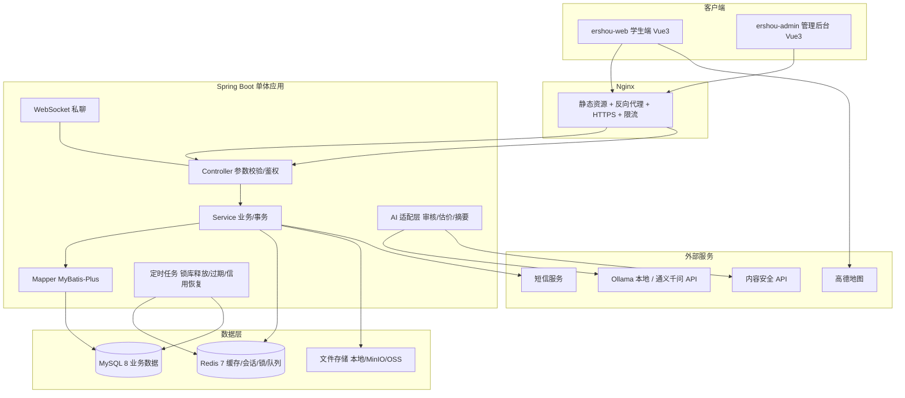

# 校园二手交易平台 · 开发文档

| 项目 | 内容 |
| --- | --- |
| 文档版本 | V1.0（开发基线） |
| 技术栈 | Spring Boot 3 + Vue 3 + Element Plus + MySQL 8 + Redis 7 |
| 关联文档 | 《校园二手交易平台需求文档.md》、《环境检查与安装清单.md》、`sql/schema.sql` |
| 目标读者 | 后端、前端、测试、运维 |
| 阅读顺序 | 第 1-2 章了解全局 → 第 3 章看工程结构 → 第 10 章跑起来 → 第 7 章照着实现核心业务 |


## 1. 技术选型与版本矩阵

### 1.1 后端

| 层次 | 技术 | 版本 | 选型理由 |
| --- | --- | --- | --- |
| 运行时 | JDK | **21 (LTS)** | 本机已有；Spring Boot 3.x 要求 17+ |
| 框架 | Spring Boot | **3.3.5** | 与 JDK 21 / Spring 6.1 匹配，生态最稳 |
| Web | Spring MVC + Validation | 随 Boot | REST 接口 + JSR-303 参数校验 |
| ORM | **MyBatis-Plus** | 3.5.9（spring-boot3-starter） | 单表 CRUD 免写、分页插件开箱即用，比 JPA 更可控 |
| 数据库 | MySQL | **8.0.36** | 本机已装；支持 JSON 字段、ngram 中文全文索引 |
| 连接池 | HikariCP | 随 Boot | 默认够用，调优只改 maximum-pool-size |
| 缓存 | Redis | **7.2** | 本机未装 → docker-compose 一键起 |
| 分布式锁 | **Redisson** | 3.35.0 | 锁库、定时任务防重；比手写 SETNX 安全（看门狗续期） |
| 认证鉴权 | **Sa-Token** | 1.39.0 | 注解式鉴权 + Redis 会话，比 Spring Security 少 70% 配置 |
| 定时任务 | Spring @Scheduled + ShedLock | 6.x / 5.16 | 锁库过期释放、商品过期、信用分恢复；多实例只跑一次 |
| 实时通信 | Spring WebSocket (STOMP) | 随 Boot | 私聊推送；多实例用 Redis Pub/Sub 广播 |
| 接口文档 | springdoc-openapi | 2.6.0 | 自动生成 Swagger UI |
| 对象转换 | MapStruct | 1.6.3 | Entity ↔ DTO/VO 编译期生成，零反射 |
| 工具库 | Hutool | 5.8.32 | 加密、日期、脱敏 |
| 简化代码 | Lombok | 1.18.34 | @Data / @Builder |
| AI 接入 | Spring AI（OpenAI 兼容）或 RestClient | 1.0.0-M6 | 兼容本地 Ollama 与云端 API，便于切换 |
| 对象存储 | **MinIO**（minio-java） | 8.5.12 | 商品图片/头像存储；本机已有镜像；**存储桶由后端启动时自建**，无需 mc 镜像 |
| 图片处理 | Thumbnailator | 0.4.20 | 上传即压缩、生成缩略图 |
| 监控 | Actuator + Micrometer | 随 Boot | 健康检查、指标 |
| 构建 | Maven + **mvnw** | 3.9.x | 本机无全局 mvn，用项目自带 wrapper 免安装 |
| 容器 | Docker Compose | 本机已有 | 一键起 MySQL + Redis，环境一致 |

**刻意不选的技术（避免过度设计）**

| 不选 | 原因 |
| --- | --- |
| Spring Cloud / 微服务 | 单体足够支撑单校到 50 校规模，拆分带来分布式事务与运维成本 |
| Spring Security | 认证逻辑简单（手机号 + 角色），Sa-Token 更轻、中文文档友好 |
| JPA / Hibernate | 地图聚合、统计看板等复杂查询用 SQL 更直观可控 |
| Elasticsearch | 校园商品十万级，MySQL 全文索引 + LIKE 足够 |
| 消息队列 MQ | Redis List/Stream 可承担异步审核与通知队列 |
| XXL-Job | 定时任务简单，@Scheduled + ShedLock 即可 |

### 1.2 前端

| 层次 | 技术 | 版本 | 说明 |
| --- | --- | --- | --- |
| 运行时 | Node.js | **24.11.1**（本机已有） | Vite 6 要求 ≥ 18 |
| 框架 | **Vue 3** | 3.5.x | Composition API + script setup |
| 构建 | **Vite** | 6.x | 秒级冷启动、HMR |
| 语言 | TypeScript | 5.6.x | 接口类型约束，减少联调事故 |
| UI | **Element Plus** | 2.8.x | 指定组件库，**面向 PC**（见环境清单 4.5） |
| 状态 | Pinia | 2.2.x | 模块化 store |
| 路由 | Vue Router | 4.4.x | 动态路由 + 守卫做权限 |
| 请求 | Axios | 1.7.x | 统一封装：token 注入、错误提示、刷新 |
| 图表 | ECharts | 5.5.x | 管理后台数据看板 |
| **地图** | **Leaflet 1.9 + 高德 JS API 2.0** | — | 自绘校园平面图用 Leaflet 的 CRS.Simple；有经纬度的校区用高德 |
| 样式 | Sass + Element Plus 主题变量 | — | 统一设计变量 |
| 工程化 | unplugin-auto-import / unplugin-vue-components | 最新 | Element Plus 按需引入，减小包体 |
| 规范 | ESLint 9 + Prettier 3 + vue-tsc | — | 提交前校验 |

### 1.3 前端工程拆分

| 工程 | 目录 | 使用者 | 说明 |
| --- | --- | --- | --- |
| 学生端 | **ershou-web** | 学生买家/卖家 | 首页信息流、校内地图、搜索、商品详情、私聊、购物车、面交单、我的 |
| 管理后台 | **ershou-admin** | 运营/审核/客服 | 审核工作台、用户管理、点位管理、举报仲裁、代卖管理、数据看板 |

> 两个工程共用一套 UI 与请求封装，可抽 ershou-ui（可选，初期直接复制更快）。

---

## 2. 系统架构

### 2.1 总体架构



### 2.2 架构风格：模块化单体（Modular Monolith）

按业务域分包，域之间**只通过 Service 接口调用，不跨域直接操作对方 Mapper**。既保留单体部署的简单，又保留将来拆分的可能。

| 域模块 | 职责 | 对应 PRD |
| --- | --- | --- |
| user | 轻注册登录、学校/校区、身份徽章、信用分、设备风控 | 5.1 / 5.6 |
| item | 商品发布、分类、成色、库存锁、有效期 | 5.2 / 5.3 |
| map | 校内地图底图、面交点、聚合、导航指引 | 5.4 |
| chat | 私聊会话、消息、风控拦截 | 5.5 |
| cart | 收藏、购物车、合并面交行程 | 5.7 / 5.8 |
| order | 面交单、核销、确认、爽约、纠纷 | 5.9 |
| consign | 代卖委托、质检、上架、结算（毕业季） | 5.10 |
| review | 双向评价、信用流水 | 5.11 |
| ai | 机审、风控、估价、文案、仲裁摘要 | 5.14 |
| admin | 审核工作台、处置、审计日志、看板 | 5.15 |
| common | 统一响应、异常、拦截器、工具、配置 | — |

### 2.3 部署拓扑

| 环境 | 组成 | 说明 |
| --- | --- | --- |
| 开发 | IDEA + Vite dev server + Docker(MySQL/Redis) | 前端 5173 代理到后端 8080 |
| 测试 | 单机：Nginx + 后端 jar + MySQL + Redis | 与生产同构，供验收 |
| 生产 | Nginx（HTTPS + 静态资源）→ 后端 jar（可 2 实例）→ MySQL 主从/云数据库 + Redis + 对象存储 | 后端无状态，会话在 Redis，可水平扩 |

### 2.4 关键决策记录（ADR 摘要）

| 编号 | 决策 | 备选 | 理由 |
| --- | --- | --- | --- |
| ADR-01 | 无实名，手机号为唯一身份锚点 | 学号/身份证/人脸 | PRD BR-01；降低注册门槛，风控交给设备指纹 + 新号限额 + 信用分 |
| ADR-02 | 资金不落平台，面交线下支付 | 平台代收 + 担保交易 | 规避支付牌照/二清风险，平台只做信息撮合与凭证 |
| ADR-03 | 地图双坐标系（自绘像素 + 经纬度） | 只用经纬度 | 大量校园无精细 POI，自绘底图 + 像素坐标覆盖更广 |
| ADR-04 | 锁库用 Redis + DB 乐观锁双保险 | 只用 Redis | Redis 兜并发，DB version + 条件更新兜一致性，避免超卖 |
| ADR-05 | 机审同步 + 异步双通道 | 全异步 | 高置信违规要"秒拦"体验，低置信转人工异步处理 |
| ADR-06 | WebSocket 用 Redis Pub/Sub 广播 | 单机内存会话 | 生产需支持多实例 |
| ADR-07 | 前端两套工程（web / admin） | 单工程分路由 | 权限、菜单、包体差异大，分开更清晰 |

---

## 3. 工程结构

### 3.1 仓库目录

```text
ershou/
├─ 校园二手交易平台需求文档.md      # PRD
├─ 开发文档.md                      # 本文档
├─ 环境检查与安装清单.md
├─ .env / .env.example              # 本地密钥（.env 不提交）/ 模板
├─ .gitignore
├─ docker-compose.yml               # MySQL 8 + Redis 7
├─ sql/
│  ├─ schema.sql                    # 建库建表 + 初始化数据
│  └─ upgrade/                      # 版本升级脚本 V1.0.1__xxx.sql
├─ scripts/
│  └─ check-env.ps1                 # 环境自检
├─ ershou-server/                   # Spring Boot 后端（Maven 单模块）
├─ ershou-web/                      # 学生端 Vue3
└─ ershou-admin/                    # 管理后台 Vue3
```

### 3.2 后端包结构

```text
ershou-server/src/main/java/com/ershou/campus/
├─ CampusApplication.java
├─ common/
│  ├─ result/        Result  PageResult  ResultCode
│  ├─ exception/     BizException  GlobalExceptionHandler
│  ├─ config/        MybatisPlusConfig  RedisConfig  RedissonConfig  SaTokenConfig
│  │                 WebMvcConfig  WebSocketConfig  OpenApiConfig  AsyncConfig
│  ├─ interceptor/   AuthInterceptor  RateLimitInterceptor  TraceIdFilter
│  ├─ util/          EncryptUtil(手机号AES)  GeoUtil  IdGenUtil  SensitiveUtil
│  ├─ storage/       FileStorageService(接口)  LocalFileStorage  MinioFileStorage
│  ├─ enums/         ItemStatus  OrderStatus  ReportType  AuditDecision
│  └─ constant/      RedisKeys  ErrorMsg  BizConst
├─ module/
│  ├─ user/          controller  service(impl)  mapper  entity  dto  vo
│  ├─ item/          （同上分层）
│  ├─ map/  chat/  cart/  order/  consign/  review/  ai/  admin/
└─ resources/
   ├─ application.yml / application-dev.yml / application-prod.yml
   ├─ mapper/**/*.xml               # 复杂 SQL（地图聚合、统计）
   └─ prompt/                       # AI 提示词模板（审核/估价/摘要）
```

**分层约束（Code Review 必查）**

1. Controller 只做参数校验 + 调 Service + 组装 VO，**禁止写业务判断**；
2. Service 内禁止出现 HttpServletRequest/Response；
3. Mapper 只做数据访问，**禁止写业务分支**；复杂 SQL 写 XML，不做字符串拼接；
4. 跨模块调用只能走对方 Service 接口；
5. Entity 不出 Controller（必须转 VO），避免把 risk_score、phone 暴露给前端。

### 3.3 前端工程结构（以 ershou-web 为例）

```text
ershou-web/
├─ index.html
├─ vite.config.ts          # 别名 @、proxy /api -> 8080、按需引入插件
├─ tsconfig.json
├─ .env.development / .env.production
└─ src/
   ├─ main.ts  App.vue
   ├─ api/                # 接口层：auth.ts item.ts map.ts order.ts chat.ts
   ├─ utils/request.ts    # Axios 封装（token、错误提示、刷新、重试）
   ├─ stores/             # Pinia：user.ts cart.ts chat.ts map.ts
   ├─ router/             # index.ts + guard.ts
   ├─ layouts/            # 底部 Tab 布局 / 后台侧边栏布局
   ├─ components/
   │  ├─ map/             # CampusMap.vue（Leaflet 自绘） PointPicker.vue
   │  ├─ chat/            # ChatWindow.vue MessageItem.vue
   │  ├─ item/            # ItemCard.vue ItemForm.vue
   │  └─ common/          # EmptyState.vue ImageUploader.vue
   ├─ views/
   │  ├─ home/ map/ search/ item/ chat/ cart/ order/ user/ consign/
   └─ styles/             # variables.scss reset.scss
```

---

## 4. 后端开发规范

### 4.1 统一响应体

```java
public class Result<T> {
    private int code;        // 0=成功，非0=业务错误码
    private String message;
    private T data;
    private String traceId;  // 链路追踪，排查线上问题

    public static <T> Result<T> ok(T data) { ... }
    public static <T> Result<T> fail(ResultCode rc) { ... }
}
```

分页统一返回：total / pageNum / pageSize / records。

### 4.2 错误码分段

| 段位 | 含义 | 示例 |
| --- | --- | --- |
| 0 | 成功 | — |
| 10xxx | 通用/参数 | 10001 参数校验失败、10002 未登录、10003 无权限、10004 请求过于频繁 |
| 20xxx | 用户/账号 | 20001 验证码错误、20002 账号被封禁、20003 今日发布已达上限、20004 信用分不足 |
| 30xxx | 商品 | 30001 商品不存在、30002 商品已售出、30003 商品审核中、30004 库存被锁定 |
| 40xxx | 交易 | 40001 无权操作该面交单、40002 状态不允许此操作、40003 核销码错误或过期、40004 时间窗不合法 |
| 50xxx | 审核/风控 | 50001 内容违规、50002 触发风控拦截 |
| 90xxx | 系统 | 90001 系统异常、90002 依赖服务不可用（Redis/短信/AI） |

### 4.3 参数校验

- DTO 上用 @NotNull / @NotBlank / @Size / @Min / @Pattern，Controller 参数加 @Validated；
- 业务级校验写在 Service，抛 BizException(ResultCode.XXX)；
- 全局异常处理器兜底：BizException → 对应码；MethodArgumentNotValidException → 10001 并拼接首个字段错误；其他 → 90001（日志 ERROR + traceId，**不把堆栈返回前端**）。

### 4.4 鉴权设计（Sa-Token）

```text
登录流程：手机号 + 验证码(Redis校验) → 创建/查询用户 → StpUtil.login(userId)
Token 存 Redis：ershou:auth:token:{userId}   TTL 7 天（滑动续期）
鉴权注解：@SaCheckLogin（需登录）/ @SaCheckRole("admin")（运营）
免登录白名单：/api/v1/auth/**、GET /api/v1/items、/api/v1/map/**、/api/v1/schools/**
```

要点

1. 验证码 TTL 5 分钟，同手机号 60 秒内只能发一次，每日上限 10 次；
2. 手机号 **AES 加密存储**，另存 phone_hash（SHA256）做唯一索引与查询，避免明文入库；
3. 运营接口统一 /api/v1/admin/**，加 @SaCheckRole("admin") + 操作审计日志；
4. 敏感操作（改价、封禁、判罚）二次校验，sys_audit_log 记录前后值。

### 4.5 日志规范

| 级别 | 使用场景 |
| --- | --- |
| ERROR | 系统异常、依赖调用失败（含堆栈） |
| WARN | 业务异常、风控拦截、降级触发 |
| INFO | 关键状态变更（下单、核销、审核结论、处罚） |
| DEBUG | 开发调试，生产关闭 |

- 每个请求生成 traceId（TraceIdFilter 写入 MDC），响应体与日志都带；
- **日志中禁止打印**：手机号明文、token、验证码、聊天内容全文；
- 业务日志统一格式：[模块][动作][业务ID][结果]。

### 4.6 事务与并发规范

1. 事务只加在 Service 的**写方法**上，@Transactional(rollbackFor = Exception.class)；
2. 事务内**禁止**远程调用（HTTP/短信/AI）、发消息、长耗时操作 —— 放事务提交后（事件监听）；
3. 锁顺序统一：**先 Redis 锁 → 再 DB 更新 → version 乐观锁**，失败即抛业务异常；
4. 所有"读-判断-写"的并发场景（锁库、核销、库存扣减）必须有 DB 层兜底（唯一索引或 WHERE status = ? 条件更新），不能只信 Redis；
5. 批量操作分批提交（每 500 条），避免大事务锁表。

### 4.7 缓存使用规约

| 规约 | 说明 |
| --- | --- |
| 只缓存热点读 | 商品详情、点位列表、用户主页、首页第一页 |
| 缓存必须有过期时间 | 禁止永久 key（配置类除外） |
| 先更新 DB 再删缓存 | 不用"更新缓存"，避免并发写脏 |
| Key 带版本前缀 | 结构变更时改前缀即可整体失效 |
| 大对象拆分 | 列表只缓存 ID 列表，详情单独缓存 |
| 空值也缓存 | 防穿透，TTL 60 秒 |

### 4.8 文件上传规范（MinIO 对象存储）

**统一入口**：前端只调用 `POST /api/v1/files/upload?biz=item`（multipart），后端完成校验 → 压缩 → 机审 → 上传 MinIO，返回公开 URL。**不让前端直连 MinIO**，好处是压缩、校验、鉴黄、权限都在后端一处收口（预签名直传留作 P2 优化）。

| 项 | 规范 |
| --- | --- |
| 对象 Key | `{biz}/{yyyy}/{MM}/{uuid}.{ext}`，例如 `item/2026/09/8f2c1a....jpg`；biz 取值：item / avatar / chat / consign / report |
| 大小与格式 | 单图 ≤ 5MB；jpg / png / webp；同时校验 MIME 与文件头（防改扩展名） |
| 压缩 | 长边 > 1280px 则等比压缩，质量 0.8（Thumbnailator）；同时生成 300px 缩略图用于列表 |
| 桶与权限 | 单一桶 `ershou`，策略 **public-read**（匿名只读、写需密钥）；启动时自动建桶并设置策略 |
| 访问 URL | `ershou.storage.public-base-url` + key；开发为 `http://localhost:9010/ershou/...`，生产换成 CDN/域名 |
| 删除 | 业务删除不立即删对象，延迟 7 天由定时任务清理（纠纷取证需要） |
| 机审 | 上传成功后**异步**触发图片机审；命中违规则关联内容下架 + 通知 |
| 安全 | 文件名一律 UUID（防路径穿越）；限制并发上传数；对同一用户做上传频率限流 |
| 降级 | MinIO 不可用时 `mode=local` 落到本地磁盘 + `/static/**` 映射，业务无感 |

---

## 5. 数据库设计

### 5.1 设计约定

| 约定 | 说明 |
| --- | --- |
| 命名 | 表名/字段小写下划线；不使用 MySQL 保留字（已避开 read/order/rank/condition/key） |
| 主键 | id BIGINT AUTO_INCREMENT；对外用业务号 order_no |
| 时间 | created_at / updated_at 默认 CURRENT_TIMESTAMP；业务时间用 DATETIME |
| 金额 | DECIMAL(10,2)，**禁止 float/double** |
| 布尔 | TINYINT(1)，0/1 |
| 状态 | TINYINT + 代码枚举，字典见 5.4 |
| 扩展字段 | JSON 类型（images、safe_tags、evidence、quality_report） |
| 软删除 | 业务表用 status 标记，不做物理删除；日志表只增不改 |
| 索引 | 建在区分度高 + 查询必带的列；组合索引遵循最左前缀 |
| 字符集 | utf8mb4 / utf8mb4_general_ci |

### 5.2 表清单（20 张，DDL 见 sql/schema.sql）

| # | 表名 | 用途 | 关键说明 |
| --- | --- | --- | --- |
| 1 | school | 学校 | 一个平台多学校 |
| 2 | campus | 校区 | 决定地图底图与可见范围 |
| 3 | trade_point | **校内面交点** | 双坐标（像素/经纬度）+ 安全分 + 合并组 |
| 4 | sys_user | 用户（轻注册） | 无实名/学籍字段；phone 加密 + phone_hash 唯一 |
| 5 | item_category | 分类 | 支持按学校定制 |
| 6 | item | 商品 | 状态机 + 锁库 + 乐观锁 version |
| 7 | favorite_folder | 收藏夹分组 | — |
| 8 | favorite | 收藏 | 唯一键 (user_id, item_id) |
| 9 | cart_item | 购物车 | 冗余 seller_id 便于按卖家分组 |
| 10 | meetup_order | **面交单** | 核销码、双向确认、点位快照、batch_no 合并行程 |
| 11 | chat_session | 会话 | user_a < user_b 保证唯一 |
| 12 | chat_message | 消息 | risk_level / blocked 记录风控 |
| 13 | review | 双向评价 | 盲评：双方评完或 7 天可见 |
| 14 | credit_log | 信用流水 | 每次变动留痕，可追溯 |
| 15 | report_ticket | 举报/仲裁工单 | 含 AI 摘要与建议 |
| 16 | consign_order | 代卖委托单（预留） | 质检报告、结算、未售出处置 |
| 17 | ai_audit_record | AI 审核记录 | 模型版本、置信度、决策、申诉状态 |
| 18 | notification | 消息通知 | 站内信/Push/短信统一表 |
| 19 | sys_audit_log | 运营审计 | 前后值 JSON，合规必备 |
| 20 | （预留） | — | 支付、跑腿、租赁等后续版本 |

### 5.3 关键索引说明

| 索引 | 解决的查询 |
| --- | --- |
| idx_item_campus_status (campus_id, status, published_at) | 首页信息流、同校列表 |
| idx_item_lock (status, lock_expire_at) | 定时任务扫描过期锁库 |
| ft_item_title (title, description) WITH PARSER ngram | 中文全文检索 |
| idx_point_campus_status (campus_id, status) | 地图加载某校区点位 |
| idx_order_buyer / idx_order_seller | 我的面交单列表 |
| idx_order_slot (status, time_slot_start) | 面交提醒定时任务 |
| uk_fav_user_item / uk_cart_user_item | 防重复收藏/加购（并发兜底） |
| idx_msg_session (session_id, id) | 聊天记录游标翻页 |
| idx_report_status (status, created_at) | 审核/仲裁工作台队列 |

### 5.4 状态字典

**item.status**

| 值 | 含义 | 值 | 含义 |
| --- | --- | --- | --- |
| 0 | 草稿 | 5 | 已下架 |
| 1 | 审核中 | 6 | 审核驳回 |
| 2 | 在售 | 7 | 已过期 |
| 3 | 已锁定 | 8 | 违规下架 |
| 4 | 已售出 | | |

**meetup_order.status**

| 值 | 含义 | 值 | 含义 |
| --- | --- | --- | --- |
| 1 | 待卖家确认 | 5 | 已失效 |
| 2 | 待面交 | 6 | 爽约 |
| 3 | 已完成 | 7 | 纠纷中 |
| 4 | 已取消 | | |

- report_ticket.status：1 待受理 / 2 处理中 / 3 已判定 / 4 申诉中 / 5 已结案
- consign_order.status：1 待收件 / 2 质检中 / 3 已上架 / 4 已售出 / 5 已结算 / 6 已拒收 / 7 已到期 / 8 退回中 / 9 已捐赠
- ai_audit_record.decision：1 放行 / 2 拦截 / 3 转人工

---

## 6. Redis 设计

### 6.1 Key 命名规范

```text
格式：ershou:{模块}:{业务}:{标识}
要求：全小写；冒号分隔；禁止无 TTL 的业务 key；禁止超大 value（>10KB 拆开）
```

### 6.2 Key 明细

| Key 模式 | 结构 | TTL | 用途 |
| --- | --- | --- | --- |
| ershou:auth:token:{userId} | String | 7 天（滑动） | 登录态（Sa-Token） |
| ershou:sms:code:{phone} | String | 5 分钟 | 短信验证码 |
| ershou:sms:limit:{phone}:{yyyyMMdd} | 计数 | 当日 | 每日发送上限 10 次 |
| ershou:limit:post:{userId}:{yyyyMMdd} | 计数 | 当日 | **新号限额：每日发布 ≤5 件** |
| ershou:limit:chat:{userId}:{yyyyMMdd} | 计数 | 当日 | **新号限额：每日私聊 ≤20 条** |
| ershou:item:detail:{itemId} | String(JSON) | 10 分钟 | 商品详情缓存 |
| ershou:item:null:{itemId} | String | 60 秒 | 空值缓存，防穿透 |
| ershou:item:view:{itemId} | 计数 | 1 小时 | 浏览量增量，定时回写 DB |
| ershou:item:lock:{itemId} | String(userId) | 30 分钟 | **锁库（BR-03）**，同时 DB 写 lock_user_id/lock_expire_at |
| ershou:lock:item:{itemId} | Redisson 锁 | 自动续期 | 下单/核销互斥锁 |
| ershou:map:points:{campusId} | String(JSON) | 1 小时 | 校区点位列表缓存 |
| ershou:map:geo:{campusId} | ZSet(GEO) | 配置类 | 经纬度校区"附近点位"检索 |
| ershou:map:hot:{campusId} | ZSet | 1 天 | 热门点位排行 |
| ershou:cart:{userId} | Hash | 7 天 | 购物车快照（DB 为准） |
| ershou:meetup:code:{orderId} | String(code) | 至时间窗 +2h | 核销码校验 |
| ershou:chat:unread:{userId} | Hash | 7 天 | 未读数 |
| ershou:chat:online:{userId} | String | 5 分钟 | 在线心跳 |
| ershou:chat:channel:msg | Pub/Sub | — | 多实例消息广播 |
| ershou:risk:device:{deviceId} | Set(userId) | 7 天 | 同设备账号数（马甲号识别） |
| ershou:risk:user:{userId} | 分数 | 1 天 | 风险分缓存 |
| ershou:search:hot:{campusId} | ZSet | 1 天 | 热搜词 |
| ershou:idem:{key} | String | 10 分钟 | 幂等键（防重复提交） |
| ershou:ai:queue:audit | List | — | 异步机审队列 |
| ershou:notify:queue | List | — | 通知发送队列 |

### 6.3 缓存三大问题应对

| 问题 | 场景 | 方案 |
| --- | --- | --- |
| 穿透 | 查询不存在的商品 ID 被刷 | 空值缓存 60 秒 + 参数格式校验 + 接口限流 |
| 击穿 | 热门商品缓存过期瞬间大量请求打 DB | Redisson 分布式锁重建，只放一个请求到 DB |
| 雪崩 | 大量 key 同时过期 | TTL 加随机抖动（±10%）；基础数据由后台主动刷新 |

### 6.4 分布式锁使用场景

| 场景 | 锁 Key | 说明 |
| --- | --- | --- |
| 下单锁库 | ershou:lock:item:{itemId} | 保证同一孤品只有一次成功锁定 |
| 核销 | ershou:lock:order:{orderId} | 防核销码重复使用 |
| 定时任务 | ShedLock 表 | 多实例只执行一次 |
| 信用分变更 | ershou:lock:credit:{userId} | 防并发改分导致流水与总分不一致 |

### 6.5 内存与运维

- 开发：maxmemory 256mb，maxmemory-policy allkeys-lru；
- 生产：1 万 DAU → 1-2GB 足够；
- 开启 AOF（appendonly yes）+ 每日 RDB 备份；
- 监控：内存使用率、命中率（目标 ≥ 90%）、慢查询、连接数。

---

## 7. 核心业务实现方案

### 7.1 登录注册（轻注册，无实名）

```text
POST /api/v1/auth/sms-code   { phone }                       → 写 ershou:sms:code:{phone}
POST /api/v1/auth/login      { phone, code, schoolId, campusId }
   1) 校验验证码（Redis，比对后立即删除）
   2) phone_hash 查用户：不存在则创建（默认信用分 100、新号限额 5 件/20 条）
   3) 记录 device_id → ershou:risk:device:{deviceId} SADD userId，SCARD > 3 标记风险
   4) StpUtil.login(userId) → 返回 token + 用户信息
GET  /api/v1/users/me
```

- 新号限额在**发布/私聊接口**里用 Redis 计数器校验：INCR 后 EXPIRE 到当天 23:59:59，超限抛 20003；
- 7 天后或信用分 ≥ 90 时，把 sys_user.publish_limit / chat_limit 调整为正常值（定时任务 + 信用变更时同步）。

### 7.2 商品发布与 AI 审核（ADR-05：同步 + 异步双通道）

```text
POST /api/v1/items
 ① 参数校验 + 新号限额校验 + 违禁词快速命中（本地词库，毫秒级）
 ② 同步调用 AI 文本审核（超时 1.5s，超时降级为"转人工"而不是阻塞）
 ③ 命中高置信违规（score ≥ 0.9）→ 直接拒绝：item.status = 6，写 ai_audit_record(decision=2)
 ④ 通过 → item.status = 2 在售；中置信（0.6-0.9）→ status = 1 审核中 + 入人工队列
 ⑤ 图片异步审核：入 ershou:ai:queue:audit，消费者逐张审；命中违规则整条商品下架 + 通知
 ⑥ 所有人审结论落 sys_audit_log，用户可在"我的-审核记录"查看理由并发起申诉
```

```java
// 审核结果统一封装，便于换供应商
public interface ContentAuditService {
    AuditResult auditText(String text, AuditScene scene);    // ITEM_TITLE/ITEM_DESC/CHAT/REPORT
    AuditResult auditImage(String imageUrl, AuditScene scene);
}
public record AuditResult(Decision decision, double score, List<String> labels, String reason) {}
```

**降级策略**：AI 服务不可用 → 所有内容转"审核中"，人工队列兜底，**绝不默认放行**。

### 7.3 校内地图（PRD 5.4 的实现要点）

**双坐标系**：campus.map_type = 1 用自绘底图（coord_x / coord_y 为图片像素坐标）；= 2 用第三方地图（lng / lat）。前端组件按 map_type 切换渲染方式，业务表字段两者都存，互不影响。

**点位聚合（按区域统计在售商品）**

```sql
-- 以点位为单位统计在售商品数（地图气泡）
SELECT p.id, p.name, p.coord_x, p.coord_y, p.lng, p.lat, p.safety_score,
       COUNT(i.id) AS item_count, MIN(i.price) AS min_price
FROM trade_point p
LEFT JOIN item i ON i.prefer_point_id = p.id AND i.status = 2
WHERE p.campus_id = #{campusId} AND p.status = 1 AND p.audit_status = 1
GROUP BY p.id
ORDER BY item_count DESC, p.safety_score DESC;
```

**面交点推荐算法（发起面交时给 Top5）**

```text
score = 0.5 * 距离分 + 0.3 * 安全分 + 0.2 * 热度分
  距离分 = 1 - (点到买卖双方加权距离 / 校区最大距离)   // 买家权重 0.6，卖家 0.4
  安全分 = safety_score / 100
  热度分 = min(deal_count / 50, 1)
强制规则：22:00-06:00 只返回 safety_score >= 85 的点位；距离 > 2km 的点位不返回
```

**"附近点位"**（经纬度校区，Redis GEO）：
`GEOADD ershou:map:geo:{campusId} lng lat pointId` + `GEOSEARCH ... BYRADIUS 500 m ASC`，缓存未命中时回源 DB 并重建。

### 7.4 面交单全流程

```text
① 创建：POST /api/v1/meetup-orders
   - 幂等：请求头 Idempotency-Key → ershou:idem:{key}
   - Redisson 锁 ershou:lock:item:{itemId}
   - 条件更新锁库（DB 兜底，防超卖）：
     UPDATE item SET status=3, lock_user_id=#{buyerId},
            lock_expire_at=DATE_ADD(NOW(), INTERVAL 30 MINUTE), version=version+1
     WHERE id=#{itemId} AND status=2 AND version=#{version}
   - 影响行数 = 0 → 抛 30002/30004（已售出 / 被他人锁定）
   - 生成 order_no（yyyyMMdd + 雪花后 6 位）、核销码（随机 6 位，存 Redis + DB）
② 卖家确认：2 小时内 ACCEPT / RESCHEDULE（≤2 次）/ REJECT，超时定时任务置为失效(5)并释放锁库
③ 核销：POST /meetup-orders/{id}/verify { code }
   - 锁 ershou:lock:order:{orderId}；校验核销码与有效期；置 verified_at
   - 同一订单核销码只能用一次（DB 条件更新：WHERE status=2 AND verified_at IS NULL）
④ 双方确认：buyer_confirm_at / seller_confirm_at 都非空 → status=3 完成
   - 一方确认后 24 小时未确认 → 定时任务自动完成并记 WARN 日志（可申诉）
   - 商品置为已售出(4)、孤品下架、写信用分 +2、发评价提醒
⑤ 爽约：到点后 30 分钟可标记 NOSHOW，双方举证，运营在工单中裁决
```

**状态机约束**（必须写在 Service 层，禁止前端传 status）：

| 当前状态 | 允许的操作 |
| --- | --- |
| 1 待卖家确认 | accept / reject / cancel(买家) |
| 2 待面交 | reschedule(≤2) / verify / confirm / cancel / noshow / report |
| 3 已完成 | review（7 天内） |
| 4/5/6/7 | 只读（纠纷中可被运营改判） |

### 7.5 购物车合并面交（PRD 5.8）

```text
POST /api/v1/cart/checkout  { itemIds: [...], pointId, timeSlotStart, timeSlotEnd }
 1) 按 seller_id 分组（SQL: SELECT ... WHERE user_id=? AND item_id IN (...) ORDER BY seller_id）
 2) 生成 batch_no（同一行程号），每个卖家生成 1 张面交单，逐张执行 7.4 的锁库逻辑
 3) 任一商品锁库失败：全部回滚（同一事务 + 补偿释放已锁商品），返回 30004 并列出冲突商品
 4) 返回：{ batchNo, orders: [ {sellerId, orderId, pointName} ], route: [点位顺序] }
 5) 多点位路线：按 coord 做贪心最近邻排序（点位数 ≤ 5，无需复杂算法）
```

### 7.6 私聊（WebSocket + 风控）

```text
连接：ws://host/ws/chat?token=xxx
  - HandshakeInterceptor 校验 token → 绑定 userId 到 session
  - 发送消息：客户端 → 服务端 → ① 新号限额校验 ② 文本机审(同步) ③ 落库 ④ 更新会话与未读
  - 命中高危（诈骗/引流）→ 不入库给对方，返回 50002 + 风险提示文案，记 ai_audit_record
  - 推送：本机 session 直推；跨实例通过 Redis Pub/Sub(ershou:chat:channel:msg) 广播
```

要点：消息落库成功才回 ACK；客户端本地消息状态（发送中/已送达/已读）；离线期间的消息用"未读数 + 拉取最近 N 条"补偿，不做复杂离线队列。

### 7.7 信用分（BR-07）

```text
触发方式：领域事件（面交完成、评价提交、举报成立、爽约判定）→ 异步监听器扣/加分
实现要点：
 - 锁 ershou:lock:credit:{userId} 防并发
 - 同一事务内：UPDATE sys_user SET credit_score = credit_score + ? WHERE id = ? AND credit_score + ? >= 0
             + INSERT credit_log(change_value, before_score, after_score, reason, biz_type, biz_id)
 - 阈值动作：< 60 置 status=2 限权（禁发布/私聊）；连续 30 天无违规由定时任务每日 +1 恢复（上限 100）
 - 每日加分上限用 Redis 计数器控制（好评 +1，日上限 3）
```

### 7.8 举报与 AI 仲裁助手

```text
POST /api/v1/reports { targetType, targetId, reportType, description, images }
 1) 落库 status=1，按类型定 SLA（诈骗/人身安全 2 小时，其他 24 小时）
 2) 异步聚合证据：商品快照 + 该面交单相关的聊天记录(近 100 条) + 核销记录 + 位置/设备信息
 3) 调 LLM 生成 ai_summary（时间线 + 争议焦点 + 证据清单）与 ai_suggest（责任倾向，仅参考）
 4) 运营在后台判定 → decision + penalty → 触发信用分与限权 → 通知双方（可申诉一次）
 5) 全流程写 sys_audit_log，处置记录留存 ≥ 3 年（BR-12）
```

**提示词模板**放在 resources/prompt/report-summary.txt，禁止把用户手机号等敏感信息写入提示词。

### 7.9 代卖（毕业季预留，V1.2 实现）

流程见 PRD 4.4。开发要点：

1. 委托单状态机（1→9）与面交单解耦，代卖上架后复用 item 表（新增标记来源 consign_order_id）；
2. **结算边界**：V1.2 采用"买家线下直付委托人 + 平台收佣金"轻模式，平台不代收代付；若改为平台代收，必须接持牌支付 + 资金存管（PRD 11.3）；
3. 质检报告 quality_report 为 JSON：{外观:[imgs], 功能:[imgs], 序列号, 瑕疵说明, 质检结论}；
4. 到期未售出由定时任务触发处置流程，处置结果留凭证。

### 7.10 定时任务清单

| 任务 | 频率 | 说明 |
| --- | --- | --- |
| 释放过期锁库 | 每分钟 | status=3 且 lock_expire_at < NOW() → 回到在售 2 |
| 面交单超时失效 | 每 5 分钟 | status=1 且创建超 2 小时 → 5 已失效 |
| 面交提醒 | 每 5 分钟 | 时间窗前 1 小时/30 分钟推送 |
| 自动确认成交 | 每小时 | 单方确认超 24 小时 → 完成 |
| 商品过期 | 每日 03:00 | expire_at < NOW() → 7 已过期（提前 3 天提醒续期） |
| 盲评到期公开 | 每日 03:10 | 评价超 7 天未互评 → 互相可见 |
| 信用分恢复 | 每日 04:00 | 30 天无违规 +1（上限 100） |
| 浏览量回写 | 每 10 分钟 | Redis 计数批量写回 item.view_count |
| 代卖到期处置 | 每日 05:00 | consign 7 已到期 → 按 unsold_policy 执行 |

### 7.11 MinIO 文件存储实现

**设计要点**：接口抽象 + 配置切换；后端代理上传；启动自建桶（不依赖 `minio/mc` 镜像）。

```java
public interface FileStorageService {
    /** 上传并返回可公开访问的 URL */
    String upload(MultipartFile file, String biz);
    void delete(String key);
}
```

```java
@Slf4j
@Service
@ConditionalOnProperty(name = "ershou.storage.mode", havingValue = "minio")
public class MinioFileStorageService implements FileStorageService {

    private final MinioClient client;
    private final StorageProperties props;

    /** 启动时自动建桶 + 设置 public-read 策略，无需手工操作控制台 */
    @PostConstruct
    public void init() throws Exception {
        String bucket = props.getBucket();
        if (!client.bucketExists(BucketExistsArgs.builder().bucket(bucket).build())) {
            client.makeBucket(MakeBucketArgs.builder().bucket(bucket).build());
            String policy = """
                {"Version":"2012-10-17","Statement":[{"Effect":"Allow","Principal":{"AWS":["*"]},
                 "Action":["s3:GetObject"],"Resource":["arn:aws:s3:::%s/*"]}]}""".formatted(bucket);
            client.setBucketPolicy(SetBucketPolicyArgs.builder().bucket(bucket).config(policy).build());
            log.info("minio bucket [{}] created", bucket);
        }
    }

    @Override
    public String upload(MultipartFile file, String biz) {
        // 1) 校验大小/格式/文件头  2) 压缩到长边 1280 + 生成缩略图
        String key = biz + "/" + LocalDate.now().format(DateTimeFormatter.ofPattern("yyyy/MM"))
                   + "/" + UUID.randomUUID() + ".jpg";
        try (InputStream in = compress(file)) {
            client.putObject(PutObjectArgs.builder()
                .bucket(props.getBucket()).object(key)
                .stream(in, -1, 10 * 1024 * 1024)   // partSize -1 表示自动分片
                .contentType("image/jpeg").build());
        } catch (Exception e) {
            throw new BizException(ResultCode.STORAGE_ERROR, e);   // 90xxx
        }
        return props.getPublicBaseUrl() + "/" + key;
    }
}
```

**依赖（pom.xml）**

```xml
<dependency>
  <groupId>io.minio</groupId>
  <artifactId>minio</artifactId>
  <version>8.5.12</version>
</dependency>
<dependency>
  <groupId>net.coobird</groupId>
  <artifactId>thumbnailator</artifactId>
  <version>0.4.20</version>
</dependency>
```

**本机联调**：MinIO 控制台 `http://localhost:9011`（ershou / ershou123456）→ 上传一张商品图 → 桶 `ershou` 下出现 `item/2026/09/xxx.jpg` → 浏览器直接打开该 URL 能看到图，即链路打通。

---

## 8. 接口规范

### 8.1 URL 与请求约定

| 约定 | 说明 |
| --- | --- |
| 前缀 | /api/v1（版本化，便于将来兼容） |
| 资源 | 名词复数、小写中划线：/meetup-orders、/trade-points、/chat-sessions |
| 方法 | GET 查询 / POST 新增 / PUT 全量改 / PATCH 局部改 / DELETE 删除 |
| 鉴权 | Header Authorization: Bearer {token} |
| 幂等 | 写接口支持 Idempotency-Key 请求头 |
| 分页 | pageNum（从 1 开始）+ pageSize（默认 20，最大 100）；列表类另返回 hasNext |
| 时间 | ISO8601 字符串 yyyy-MM-dd HH:mm:ss（后端统一 Asia/Shanghai） |
| 金额 | 字符串形式返回（避免 JS 精度问题）："12.50" |

### 8.2 关键接口示例

**① 短信验证码**

```json
POST /api/v1/auth/sms-code
{ "phone": "13800000000" }

{ "code": 0, "message": "ok", "data": null, "traceId": "a1b2c3" }
```

**② 登录**

```json
POST /api/v1/auth/login
{ "phone": "13800000000", "code": "123456", "schoolId": 1, "campusId": 1 }

{
  "code": 0, "message": "ok", "traceId": "a1b2c3",
  "data": {
    "token": "xxxxx",
    "user": { "id": 1001, "nickname": "小明", "avatar": null, "campusName": "主校区",
              "creditScore": 100, "identityFlag": 0, "newUser": true }
  }
}
```

**③ 发布商品**

```json
POST /api/v1/items
{
  "title": "高数教材 同济第七版 九成新",
  "description": "只用了一学期，无笔记无划线",
  "categoryId": 1, "conditionLevel": 2,
  "price": "15.00", "originalPrice": "45.00", "negotiable": 1,
  "stock": 1, "isUnique": 1,
  "images": ["https://cdn/xx1.jpg", "https://cdn/xx2.jpg"],
  "preferPointId": 3
}

{ "code": 0, "data": { "itemId": 5001, "status": 2, "statusText": "在售" } }
// 若命中中置信：{ "code": 0, "data": { "itemId": 5001, "status": 1, "statusText": "审核中" } }
// 若命中违规：{ "code": 50001, "message": "内容涉嫌违规：管制刀具", "data": { "appealable": true } }
```

**④ 地图聚合（学生端核心接口）**

```json
GET /api/v1/map/points?campusId=1&keyword=&onlyOfficial=false

{
  "code": 0,
  "data": {
    "mapType": 1,
    "mapConfig": { "imgUrl": "https://cdn/campus1.png", "width": 1000, "height": 800 },
    "points": [
      { "id": 3, "name": "3号宿舍楼下快递站", "coordX": 610, "coordY": 540,
        "type": 4, "safetyScore": 78, "safeTags": ["监控","人流"],
        "itemCount": 12, "minPrice": "5.00", "guideText": "3号楼一层快递柜旁" }
    ]
  }
}
```

**⑤ 点位推荐**

```json
GET /api/v1/trade-points/recommend?campusId=1&itemId=5001&lng=&lat=

{ "code": 0, "data": [ { "id": 3, "name": "3号宿舍楼下快递站", "distanceMeters": 180,
                          "safetyScore": 78, "reason": "离买卖双方都近" } ] }
```

**⑥ 创建面交单**

```json
POST /api/v1/meetup-orders
Headers: Idempotency-Key: 8f2c...
{
  "itemId": 5001, "quantity": 1,
  "pointId": 3, "timeSlotStart": "2026-09-21 18:00:00", "timeSlotEnd": "2026-09-21 20:00:00",
  "remark": "我穿黑色外套"
}

{ "code": 0, "data": { "orderId": 9001, "orderNo": "20260921000001",
                        "status": 1, "lockExpireAt": "2026-09-21 17:30:00" } }
// 冲突：{ "code": 30004, "message": "该商品刚被他人锁定，看看同款？",
//         "data": { "similarItemIds": [5012, 5033] } }
```

**⑦ 核销与确认**

```json
POST /api/v1/meetup-orders/9001/verify   { "code": "483920" }
→ { "code": 0, "data": { "verifiedAt": "2026-09-21 18:12:03", "needConfirm": true } }

POST /api/v1/meetup-orders/9001/confirm
→ { "code": 0, "data": { "status": 3, "message": "面交已完成，快去评价吧" } }
```

**⑧ 发送消息**

```json
POST /api/v1/chat/messages
{ "sessionId": 3001, "msgType": 1, "content": "明天下午三点可以在快递站见面吗？" }

{ "code": 0, "data": { "msgId": 88001, "createdAt": "2026-09-20 21:03:11" } }
// 风控拦截：{ "code": 50002, "message": "该消息涉嫌引导站外转账，已拦截。请勿脱离平台交易。",
//             "data": { "riskTip": "遇到要求先转账/垫付的，一律拒绝并举报" } }
```

### 8.3 接口清单（MVP 范围）

| 模块 | 接口 |
| --- | --- |
| 认证 | POST /auth/sms-code、POST /auth/login、GET /users/me、PATCH /users/me、POST /schools/apply |
| 商品 | GET /items、POST /items、GET /items/{id}、PATCH /items/{id}、POST /items/{id}/offline、POST /items/{id}/renew、GET /categories |
| 搜索 | GET /search、GET /search/hot、GET /search/suggest |
| 地图 | GET /campuses、GET /map/points、GET /map/point/{id}、GET /trade-points/recommend、POST /trade-points/suggest、GET /trade-points/mine |
| 收藏 | POST /items/{id}/favorite、DELETE /items/{id}/favorite、GET /favorites、POST /favorites/folders |
| 购物车 | GET /cart、POST /cart/items、PATCH /cart/items/{id}、DELETE /cart/items/{id}、POST /cart/checkout |
| 面交 | POST /meetup-orders、GET /meetup-orders、GET /meetup-orders/{id}、POST /meetup-orders/{id}/accept、/reject、/reschedule、/cancel、/verify、/confirm、/noshow、/sos |
| 私聊 | GET /chat/sessions、GET /chat/sessions/{id}/messages、POST /chat/messages、POST /chat/sessions/{id}/read、WS /ws/chat |
| 评价 | POST /meetup-orders/{id}/reviews、GET /users/{id}/reviews、GET /users/{id}/credit-logs |
| 举报 | POST /reports、GET /reports/{id}、POST /reports/{id}/appeal |
| 后台 | /admin/audits、/admin/users、/admin/items、/admin/trade-points、/admin/reports、/admin/dashboard、/admin/audit-logs |

---

## 9. 前端开发规范

### 9.1 Axios 封装要点

```ts
// utils/request.ts
const service = axios.create({ baseURL: import.meta.env.VITE_API_BASE, timeout: 15000 })

service.interceptors.request.use(cfg => {
  const token = useUserStore().token
  if (token) cfg.headers.Authorization = 'Bearer ' + token
  return cfg
})

service.interceptors.response.use(
  res => {
    const { code, message, data } = res.data
    if (code === 0) return data
    if (code === 10002) { useUserStore().logout(); router.push('/login') }
    ElMessage.error(message)          // 统一错误提示
    return Promise.reject(new BizError(code, message))
  },
  err => { ElMessage.error('网络异常，请稍后重试'); return Promise.reject(err) }
)
```

### 9.2 Pinia 模块

| store | 状态 | 关键 action |
| --- | --- | --- |
| user | token、profile、creditScore | login、logout、fetchProfile |
| cart | items、groupBySeller、totalPrice | add、remove、checkout |
| map | campusId、mapConfig、points、selectedPoint | loadPoints、pickPoint |
| chat | sessions、currentSession、messages、unread | openSession、send、onMessage |

### 9.3 路由与权限

- 学生端：底部 Tab 路由（首页 / **地图** / 消息 / 购物车 / 我的）+ 二级页；未登录可浏览，触发发布/私聊/加购时弹出登录；
- 管理后台：登录后拉取角色 → 动态注册路由（meta.roles）；无权限菜单不渲染，路由守卫二次校验。

### 9.4 地图组件（校内自绘底图，Leaflet CRS.Simple）

```ts
// components/map/CampusMap.vue 关键代码
import L from 'leaflet'
import 'leaflet/dist/leaflet.css'

const map = L.map(el.value, {
  crs: L.CRS.Simple,          // 关键：像素坐标系，不做地理投影
  minZoom: -2, maxZoom: 2,
  zoomControl: false
})
const bounds: L.LatLngBoundsExpression = [[0, 0], [config.height, config.width]]
L.imageOverlay(config.imgUrl, bounds).addTo(map)
map.fitBounds(bounds)

// 点位 marker（用 divIcon 显示"数字气泡"，避免默认图标 404）
const icon = L.divIcon({ className: 'point-bubble', html: '<b>' + p.itemCount + '</b>' })

// 长按新增点位
map.on('contextmenu', (e: L.LeafletMouseEvent) => {
  const y = e.latlng.lat, x = e.latlng.lng     // 注意 Leaflet 的 lat=Y, lng=X
  emit('pick', { coordX: Math.round(x), coordY: Math.round(y) })
})
```

> 第三方地图校区（mapType=2）改为初始化高德 AMap，点位用 lng/lat；组件对外暴露同一套 props/events，业务代码无感切换。

### 9.5 聊天组件要点

- 会话列表（最近消息 + 未读数）与聊天窗左列表右对话（PC 端）；消息按 msgId 游标分页加载历史；
- 消息发送：先插入本地"发送中"占位 → 收到 ACK 后替换为真实 msgId 与时间；失败可重发；
- 商品卡片/面交单卡片用自定义消息类型渲染；点卡片可跳详情；
- WebSocket 断线重连（指数退避，最多 5 次）+ 重连后拉取未读。

### 9.6 命名与风格

| 类型 | 规范 | 示例 |
| --- | --- | --- |
| 组件文件 | PascalCase | ItemCard.vue |
| 组合式函数 | useXxx | useWebSocket.ts |
| 变量/方法 | camelCase | itemList、loadPoints |
| 常量 | UPPER_SNAKE | ORDER_STATUS_MAP |
| 接口类型 | I + 名词 或 名词 + VO | IItemDetailVO |
| 样式 | 组件内 scoped，公共变量放 variables.scss | — |

---

## 10. 环境搭建与本地启动

### 10.1 前置依赖

见《环境检查与安装清单.md》。核心三步：

```powershell
# ① 起 MySQL + Redis（Docker）
docker compose up -d

# ② 建库建表
mysql -h 127.0.0.1 -P 3306 -u root -p < sql/schema.sql

# ③ 自检
powershell -ExecutionPolicy Bypass -File .\scripts\check-env.ps1
```

### 10.2 后端配置文件（application-dev.yml）

```yaml
server:
  port: 8080
spring:
  datasource:
    driver-class-name: com.mysql.cj.jdbc.Driver
    url: jdbc:mysql://127.0.0.1:3306/ershou?useUnicode=true&characterEncoding=utf8&serverTimezone=Asia/Shanghai&useSSL=false&allowPublicKeyRetrieval=true
    username: ${MYSQL_USER:ershou}
    password: ${MYSQL_PASSWORD}          # 禁止写明文！见 10.5 密钥与配置管理
    hikari:
      maximum-pool-size: 20
      minimum-idle: 5
  data:
    redis:
      host: 127.0.0.1
      port: 6380              # 本项目独立容器，避开青光眼项目占用的 6379（docker compose up -d redis）
      password: ${REDIS_PASSWORD}          # 禁止写明文！见 10.5 密钥与配置管理
      database: 0             # 独立实例用 0 即可；若改用共享实例(6379)请填 1 并同步密码
      lettuce:
        pool: { max-active: 16, max-idle: 8, min-idle: 2 }
  servlet:
    multipart: { max-file-size: 5MB, max-request-size: 30MB }
mybatis-plus:
  mapper-locations: classpath*:mapper/**/*.xml
  configuration:
    map-underscore-to-camel-case: true
    log-impl: org.apache.ibatis.logging.stdout.StdOutImpl   # 生产改为 slf4j
sa-token:
  token-name: Authorization
  timeout: 604800
  is-read-header: true
  token-style: uuid
ershou:
  storage:                      # 图片对象存储：docker compose up -d minio
    mode: minio                 # minio / local（无 Docker 时降级到本地磁盘）
    endpoint: http://127.0.0.1:9010
    access-key: ${MINIO_ROOT_USER:ershou}
    secret-key: ${MINIO_ROOT_PASSWORD}   # 禁止写明文！见 10.5 密钥与配置管理
    bucket: ershou              # 后端启动时自动创建并设为 public-read
    public-base-url: http://127.0.0.1:9010/ershou   # 生产改成 https://cdn.xxx.com/ershou
    max-size-mb: 5
    image-max-edge: 1280        # 长边超过则压缩
  upload:                       # 仅 mode=local 时生效
    local-path: ./upload/
    url-prefix: http://127.0.0.1:8080/static/
  ai:
    provider: ollama            # ollama / dashscope
    base-url: http://127.0.0.1:11434
    model: qwen2.5:7b
    audit-threshold:
      block: 0.9
      review: 0.6
  sms:
    mock: true                  # 开发环境验证码固定 123456，不真发短信
```

### 10.3 启动顺序与验证

```powershell
# 后端（IDEA 直接运行 CampusApplication，或命令行）
cd ershou-server
.\mvnw.cmd clean spring-boot:run          # 首次会自动下载依赖，约 3-10 分钟

# 前端
cd ershou-web
npm install                                 # 或 pnpm install
npm run dev                                 # http://localhost:5173
```

```ts
// ershou-web/vite.config.ts 代理配置（解决跨域）
server: {
  port: 5173,
  proxy: { '/api': { target: 'http://127.0.0.1:8080', changeOrigin: true } }
}
```

### 10.4 联调验证清单（开发完成后逐条打勾）

| # | 验证项 | 期望结果 |
| --- | --- | --- |
| 1 | GET /actuator/health | status = UP（含 db 与 redis 组件） |
| 2 | 发送验证码 + 登录 | 返回 token；Redis 出现 ershou:auth:token:{userId} |
| 3 | 发布含"管制刀具"的商品 | 返回 50001，ai_audit_record 落库 |
| 4 | 发布正常商品 | status=2 在售，首页列表可见 |
| 5 | 地图 Tab | 返回 mapConfig 与点位气泡（含 itemCount） |
| 6 | 发起面交 | 生成订单 + 核销码；item.status 变 3 |
| 7 | 30 分钟后未确认 | 定时任务释放锁库，item 回到 2 |
| 8 | 核销 + 双方确认 | 订单完成；信用分 +2 且 credit_log 有流水 |
| 9 | 发送诈骗话术消息 | 返回 50002 被拦截 |
| 10 | 收藏/加购并发重复点击 | 唯一索引兜底，不产生重复数据 |
| 11 | 后台审核队列 | 能看到转人工内容并处置，审计日志有记录 |
| 12 | 上传商品图片 | 返回 MinIO 直链（http://localhost:9010/ershou/item/...），浏览器能打开；控制台能看到对象 |
| 13 | 停掉 MinIO 容器再上传 | 服务不报 500，返回 90xxx 业务错误并给出友好提示（降级/容错生效） |

### 10.5 密钥与配置管理（重要）

**结论：密码写进 yaml 确实不好，但只写个 `.env` 也不够 —— Spring Boot 不会自动读 `.env`（这点和 Node/Vite 不同）。**

| 文件 | 提交 Git？ | 作用 |
| --- | --- | --- |
| `.env` | ❌ 不提交（已在 .gitignore） | 本地密钥唯一来源；**docker compose 会自动读取**；Spring Boot 由下面三种方式取用 |
| `.env.example` | ✅ 提交 | 模板，只放键名与占位符，新人 `copy .env.example .env` 即可 |
| `application-dev.yml` | ✅ 提交 | 只用占位符，**不含任何明文密码** |
| `application-local.yml` | ❌ 不提交 | 本地私有覆盖，最省心的方案 |
| 生产环境 | — | 一律走操作系统 / 容器环境变量，yaml 里不出现明文 |

**为什么不直接写 yaml**：resources 下的 yaml 会被打进 jar 并提交进 Git 历史，密码一旦入库很难彻底清除（要改写历史），换密码得改代码重新发版，还容易把生产密码误提交。分离之后，轮换密码只改环境变量。

**把密钥喂给 Spring Boot 的三种方式（选一）**

① `application-local.yml` —— 推荐，零插件。在 `ershou-server/src/main/resources/application-local.yml`（已被 .gitignore 忽略）里写：

```yaml
spring:
  datasource:
    password: 你的 MySQL 密码
  data:
    redis:
      password: 你的 Redis 密码
ershou:
  storage:
    secret-key: 你的 MinIO 密码
```

IDEA 运行配置里 Active profiles 填 `dev,local`；命令行用 `--spring.profiles.active=dev,local`。

② IDEA 环境变量：Run/Debug Configurations → Environment variables，填 `MYSQL_PASSWORD=...;REDIS_PASSWORD=...;MINIO_ROOT_PASSWORD=...`（存在 .idea 里，不随仓库走）

③ 系统 / 容器环境变量（生产唯一推荐）：``$env:MYSQL_PASSWORD="..."; .\mvnw.cmd spring-boot:run``；docker 用 `-e MYSQL_PASSWORD=...`；K8s 用 Secret

**配置优先级**：命令行参数 > 环境变量 > `application-{profile}.yml` > `application.yml`，所以 local profile 会覆盖 dev 里的占位。

**三条纪律**

1. 提交前自查有没有明文密码：

```powershell
git grep -nEi "password[ ]*[:=][ ]*[^$]" -- "*.yml" "*.yaml"
```

2. 密码只在一处维护（`.env`），其他文件全部引用；
3. 开发与生产用不同密码 —— 你本机多个项目共用同一个密码，本地无妨，**上线必须换**。

> 本机已按此方案配好：`.env`（真实密码，已 gitignore）、`.env.example`（模板）、`docker-compose.yml` 已改为读取环境变量。

---

## 11. 构建、部署与运维

### 11.1 后端打包

```powershell
cd ershou-server
.\mvnw.cmd clean package -DskipTests -Pprod
java -jar target/ershou-server-1.0.0.jar --spring.profiles.active=prod
```

### 11.2 前端打包

```powershell
cd ershou-web   && npm run build      # 产物 dist/
cd ershou-admin && npm run build
```

### 11.3 Nginx 配置示例

```nginx
server {
  listen 443 ssl http2;
  server_name ershou.example.com;
  ssl_certificate     /etc/nginx/ssl/ershou.crt;
  ssl_certificate_key /etc/nginx/ssl/ershou.key;

  # 学生端
  location / {
    root /var/www/ershou-web;
    try_files $uri $uri/ /index.html;
  }
  # 管理后台
  location /admin/ {
    alias /var/www/ershou-admin/;
    try_files $uri $uri/ /admin/index.html;
  }
  # 后端接口
  location /api/ {
    proxy_pass http://127.0.0.1:8080;
    proxy_set_header Host $host;
    proxy_set_header X-Real-IP $remote_addr;
    proxy_set_header X-Forwarded-For $proxy_add_x_forwarded_for;
  }
  # WebSocket
  location /ws/ {
    proxy_pass http://127.0.0.1:8080;
    proxy_http_version 1.1;
    proxy_set_header Upgrade $http_upgrade;
    proxy_set_header Connection "upgrade";
    proxy_read_timeout 300s;
  }
  # 图片：反代到 MinIO（生产建议直接换成 CDN 或 MinIO 集群域名）
  location /files/ {
    proxy_pass http://127.0.0.1:9010/ershou/;
    proxy_set_header Host $host;
    expires 7d;
  }
  # 兼容：storage.mode=local 时的本地文件访问
  location /static/ { alias /opt/ershou/upload/; expires 7d; }

  client_max_body_size 30m;
  limit_req_zone $binary_remote_addr zone=api:10m rate=20r/s;
  location /api/v1/auth/sms-code { limit_req zone=api burst=5 nodelay; }
}
```

### 11.4 后端 Dockerfile（可选）

```dockerfile
FROM eclipse-temurin:21-jre
WORKDIR /app
COPY target/ershou-server-1.0.0.jar app.jar
ENV TZ=Asia/Shanghai JAVA_OPTS="-Xms512m -Xmx1024m -XX:+UseG1GC"
EXPOSE 8080
ENTRYPOINT ["sh", "-c", "java $JAVA_OPTS -jar app.jar --spring.profiles.active=prod"]
```

### 11.5 生产环境安全清单

| 项 | 要求 |
| --- | --- |
| 配置 | 密码/密钥用环境变量注入，**禁止提交到 Git**（.gitignore 排除 application-prod.yml） |
| 数据库 | 不用 root；只给必要权限；开启慢查询日志；每日备份 |
| Redis | 设置密码 + bind 内网 + 禁用 FLUSHALL/CONFIG 等高危命令 |
| 接口 | 全站 HTTPS；短信/登录接口限流；Swagger 生产环境关闭 |
| 后台 | 运营账号独立、强密码、操作审计；建议加 IP 白名单 |
| 日志 | 分级切割（按天 + 100MB），保留 30 天；不含敏感信息 |
| 备份 | MySQL 每日全量 + binlog；Redis RDB 每日；上传文件同步备份 |

---

## 12. 测试与质量

### 12.1 单元测试重点（JUnit 5 + Mockito）

| 测试对象 | 用例要点 |
| --- | --- |
| 面交单状态机 | 合法流转通过、非法流转抛 40002（覆盖全部状态组合） |
| 锁库逻辑 | 同一商品两次下单只成功一次；锁库过期后可再次下单 |
| 信用分 | 加分上限、扣分不低于 0、< 60 触发限权、流水与总分一致 |
| 时间窗校验 | 过去时间、超 3 小时、22:00 后非安全点位 → 40004 |
| 购物车合并 | 同卖家合并为 1 单、跨卖家拆单、部分锁库失败整体回滚 |
| AI 审核分流 | 0.95 → 拦截；0.7 → 转人工；0.3 → 放行；服务超时 → 转人工 |

### 12.2 并发与接口测试

- **锁库并发**：JMeter 100 线程同时下单同一孤品 → 成功 1 笔，其余返回 30004，DB 无脏数据；
- **重复提交**：同一 Idempotency-Key 连续发 5 次 → 只生成 1 张面交单；
- **接口回归**：Apifox 建集合，覆盖 8.3 全部接口，纳入提测清单；
- **压测**：核心接口（首页列表、商品详情、地图聚合）P95 目标 < 500ms（NFR-01）。

### 12.3 前端检查

```bash
npm run lint          # ESLint
npm run type-check    # vue-tsc 类型检查
npm run build         # 构建必须无 error
```

### 12.4 提测清单（每次提测必须附）

1. 本次改动的接口清单 + 自测结果截图；
2. 数据库变更（如有）与升级脚本路径；
3. 已知问题与未完成项；
4. 影响范围说明（哪些旧功能可能被影响）。

---

## 13. 编码规范与 Git 工作流

### 13.1 命名规范

| 类型 | 规范 | 示例 |
| --- | --- | --- |
| 类 | PascalCase | MeetupOrderService |
| 方法/变量 | camelCase | createMeetupOrder |
| 常量 | UPPER_SNAKE | MAX_LOCK_MINUTES |
| 数据库表/字段 | lower_snake | meetup_order、verify_code |
| 布尔字段 | is_ / has_ 前缀 | is_unique、is_read |
| 枚举 | 大写下划线 | OrderStatus.WAIT_SELLER_CONFIRM |

### 13.2 分支模型（简化 Git Flow）

```text
main        生产分支，只接受 release/hotfix 合并，每次合并打 tag（v1.0.0）
develop     开发主干，功能分支合并到此
feature/*   功能分支：feature/map-point（从 develop 拉，完成后 PR 回 develop）
fix/*       缺陷修复
hotfix/*    线上紧急修复（从 main 拉，合并回 main + develop）
```

### 13.3 提交信息规范（Conventional Commits）

```text
feat(map): 新增用户自定义面交点提交与审核
fix(order): 修复锁库超时未释放导致的商品不可售
docs(dev): 补充 Redis key 说明
refactor(item): 抽取商品状态机校验
test(order): 补充核销码重复使用用例
chore(deps): 升级 mybatis-plus 到 3.5.9
```

### 13.4 Code Review 清单

- [ ] 分层是否越界（Controller 写业务、Mapper 写分支）
- [ ] 是否有未处理的事务边界（远程调用在事务内）
- [ ] 并发场景是否有 DB 层兜底（唯一索引/条件更新）
- [ ] 是否有敏感信息写日志或返回前端（手机号、risk_score）
- [ ] 新接口是否有参数校验与权限注解
- [ ] 新增 SQL 是否有对应索引；是否可能全表扫描
- [ ] 异常是否被吞掉（catch 后必须记录或转换）
- [ ] 是否有硬编码配置（阈值、URL、密钥）

### 13.5 数据库变更流程

1. 在 sql/upgrade/ 下新增脚本，命名 V{版本}__{说明}.sql（如 V1.0.1__add_consign_table.sql）；
2. 脚本必须**可重复执行**（IF NOT EXISTS / 判断后再改），并包含回滚说明注释；
3. 与应用代码同一次提交，评审时一并检查；
4. 生产执行前先备份，执行后校验行数与关键字段。

---

## 14. MVP 任务拆解与 8 周排期

> 假设：1-2 名后端 + 1-2 名前端 + 1 名测试（可兼任）。目标是在**开学季前**上线 MVP（PRD 第 13 章）。

| 周次 | 后端 | 前端 | 交付物 |
| --- | --- | --- | --- |
| W1 | 工程脚手架、统一响应/异常、Sa-Token 接入、MySQL/Redis 配置、schema.sql 落地 | 两套工程脚手架、路由/请求封装、UI 规范、登录页 | 可运行骨架 + 登录打通 |
| W2 | 轻注册登录、短信（mock）、学校/校区、用户主页、设备风控与新号限额 | 登录、我的、设置页、用户主页 | 账号模块闭环 |
| W3 | 商品发布 + AI 文本机审（同步）+ 图片异步队列、分类/成色 | 发布页（多图上传）、商品详情页 | 发布→浏览闭环 |
| W4 | 首页信息流、搜索筛选、收藏、购物车（基础） | 首页、搜索页、收藏页、购物车页 | 逛→选闭环 |
| W5 | **地图模块**：底图配置、点位 CRUD/审核、聚合查询、点位推荐 | **地图 Tab**（Leaflet 自绘 + 气泡 + 选点）、地点化发布 | 校内地图可用（核心） |
| W6 | 面交单全流程 + 锁库 + 核销 + 定时任务（失效/释放） | 面交预约页、面交单列表/详情、核销页、一键求助 | 交易闭环 |
| W7 | 私聊 WebSocket + 聊天风控、举报工单、通知中心 | 消息列表、聊天窗、举报入口 | 沟通与治理闭环 |
| W8 | 运营后台接口（审核台/用户/点位/举报）、看板、压测与修复 | 管理后台页面（审核台、点位管理、举报处理） | **MVP 提测与上线** |
| V1.1 | 信用分与评价、降价提醒、行程视图、AI 定价/文案、商家店铺 | 评价、卖家工作台、商家店铺页 | 信任与效率增强 |
| V1.2 | 代卖模块（毕业季前） | 代卖委托页、代卖专区、代卖员端 | 毕业季承接能力 |

**关键前置依赖（需在对应周次前完成）**

| 依赖 | 截止 | 责任方 |
| --- | --- | --- |
| 校园底图图片 + 初始点位清单（≥20 个） | W4 末 | 运营/校方 |
| AI 审核方案确定（本地 Ollama 或云端 API） | W3 初 | 技术负责人 |
| 短信通道（或开发期用 mock） | W2 初 | 技术负责人 |
| 学校合作协议（点位与宣传授权） | 上线前 | 商务/校方 |

---

## 15. 风险与待确认

| # | 风险/待确认 | 影响 | 应对 |
| --- | --- | --- | --- |
| 1 | Redis 未安装，环境未就绪 | 阻塞开发 | 按《环境检查与安装清单》3.1 处理（Docker 最省事） |
| 2 | Java 8 与 21 共存导致编译期"类文件版本"错误 | 编译失败 | 调整 PATH 顺序，IDEA 与 mvnw 统一用 21（清单 4.1） |
| 3 | 两套 MySQL（8.0 服务版 + 9.6 便携版）抢 3306 | 连错库 | 只保留一套；Docker 方案映射 3307 |
| 4 | Element Plus 是 PC 组件库 | 移动端体验差 | 本期做 PC Web；后续移动端换 Vant，接口不变 |
| 5 | 无实名 → 马甲号与诈骗风险 | 治理成本上升 | 设备指纹 + 新号限额 + 信用分 + 黑名单（ADR-01） |
| 6 | AI 审核自建 vs 采购未定 | 影响 W3 进度 | 开发期用 Ollama 本地模型跑通链路，上线前评估云端 API |
| 7 | 地图底图版权与点位授权 | 合规风险 | 用自绘示意图 + 校方授权；不直接截取第三方地图 |
| 7b | MinIO 与青光眼项目端口冲突（9000/9001） | 容器起不来 | 本项目固定用 9010/9011；不复用对方的 MinIO 实例 |
| 8 | 代卖若改为平台代收货款 | 合规（二清） | 必须走持牌支付 + 资金存管，法务前置评审（PRD 11.3） |
| 9 | 单机部署下的容量风险（开学季峰值） | 上线即宕机 | 提前压测 5 倍 QPS；Nginx 限流 + 服务降级开关（关推荐保核心） |
| 10 | 前端 Node 24 过新，个别依赖可能不兼容 | 构建报错 | 锁定 package.json 版本；必要时用 nvm 切到 Node 20 LTS |

