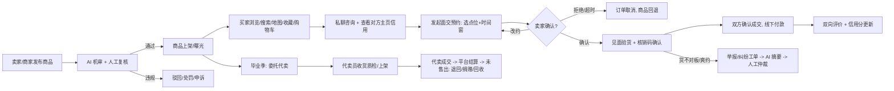
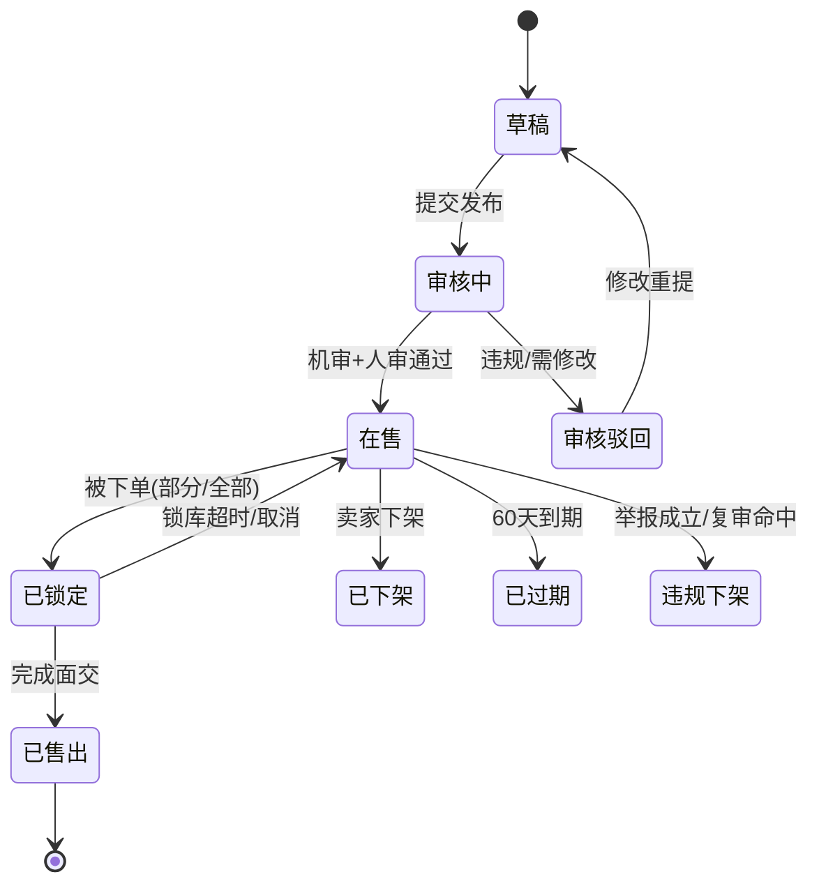
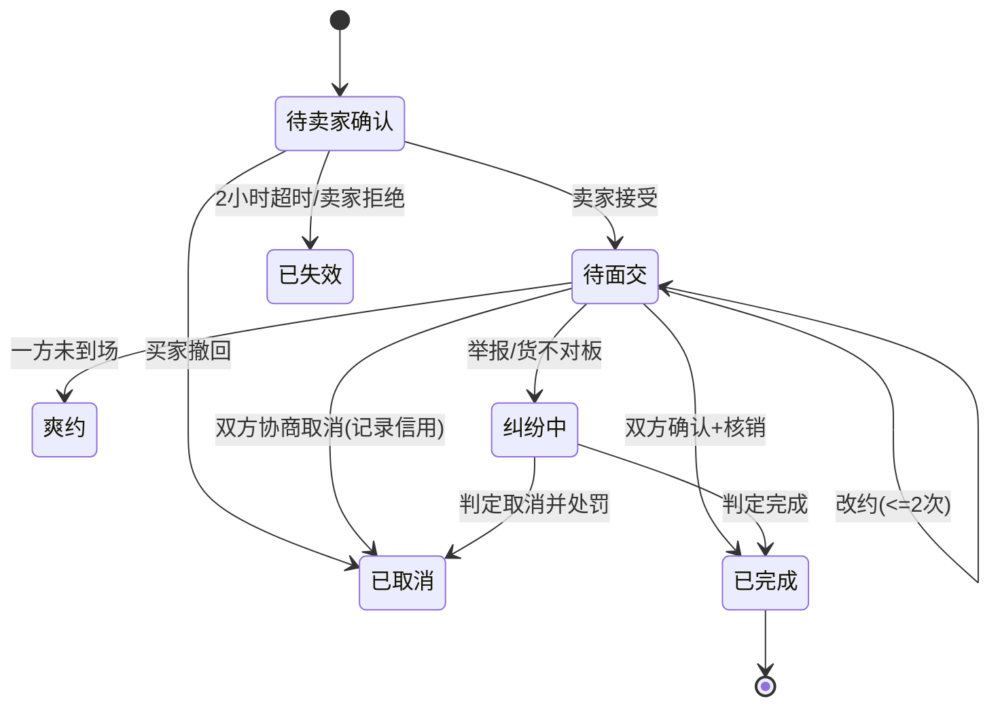
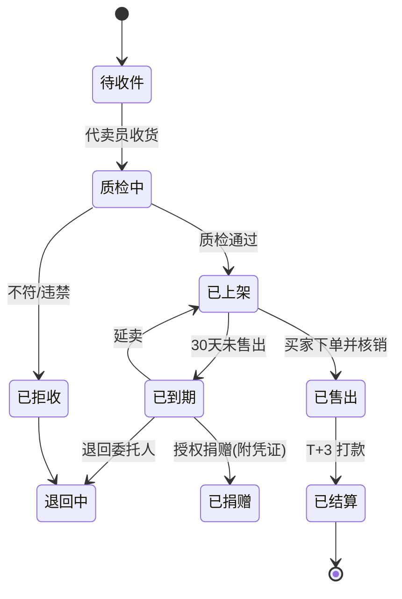
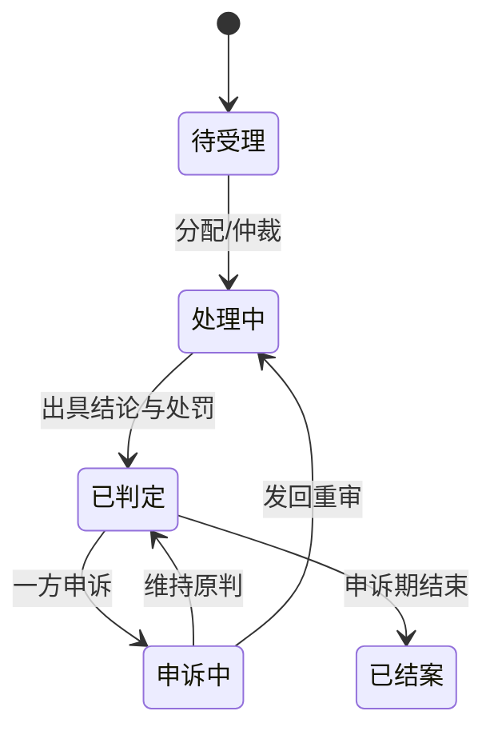
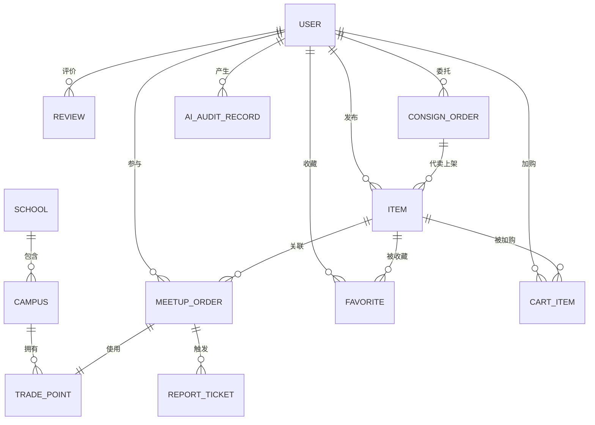

# 校园二手交易平台 需求文档（PRD）

| 项目 | 内容 |
| --- | --- |
| 文档名称 | 校园二手交易平台产品需求文档 |
| 文档版本 | V1.0（评审稿） |
| 编制日期 | 2026-09-20 |
| 文档状态 | 待评审 |
| 适用范围 | 校园二手交易平台（移动端 App / 小程序 + Web 运营管理后台） |
| 目标读者 | 产品、UI/UX、研发、测试、运营、法务合规 |

---

## 0. 修订记录

| 版本 | 日期 | 修订人 | 修订说明 |
| --- | --- | --- | --- |
| V1.0 | 2026-09-20 | 产品 | 首版：明确"面交为主 + 平台只做监管与信息撮合"的定位，覆盖校园地图面交点、私聊、用户主页、收藏、购物车、AI 审核与管理、毕业季代卖（预留） |

---

## 1. 文档说明

### 1.1 编写目的

本文档定义校园二手交易平台的产品定位、用户角色、业务流程、功能需求（含验收要点）、数据模型、接口与非功能需求，作为设计、开发、测试与运营评审的统一依据。

### 1.2 需求优先级定义

| 优先级 | 含义 | 排期建议 |
| --- | --- | --- |
| **P0** | MVP 必须，缺失则核心闭环不成立 | 第一期上线 |
| **P1** | 首个正式版本应具备，影响体验或合规 | 第二期 |
| **P2** | 增强 / 前瞻能力，本期只做接口与数据预留 | 后续迭代 |

### 1.3 术语表

| 术语 | 说明 |
| --- | --- |
| 面交 | 买卖双方在校内约定地点线下当面查看、当面付款、当面交付 |
| 面交点 | 地图上的一个可交易位置（官方推荐点 或 用户自定义点） |
| 面交单 | 一次面交撮合记录（商品 + 双方 + 地点 + 时间窗 + 核销码） |
| 核销码 | 面交完成时由买卖双方扫码/输码确认的短码，用于生成履约凭证 |
| 轻注册 | 仅手机号验证码注册 + 自选学校/校区，**不做实名与学籍核验**，不采集身份证/学号/人脸（BR-01） |
| 孤品 | 库存唯一、售出即下架的商品（学生二手物品的绝大多数） |
| 代卖（寄卖） | 用户把物品委托平台/校园代卖员代管代售，成交后结算货款 |
| 代卖员 | 平台授权、负责代卖物品接收、质检、面交交付的学生兼职或校园代理 |
| 机审 | AI 自动审核（文本 / 图片 / 视频 / 行为） |
| 人审 | 人工审核与复核 |
| 二清 | 平台代收代付交易资金形成的资金池风险，属支付合规红线 |

### 1.4 需求编号规范

FR-模块缩写-序号（如 FR-MAP-03）；业务规则 BR-序号；非功能需求 NFR-序号；验收标准 AC-序号。

---

## 2. 项目背景与定位

### 2.1 背景与痛点

**需求侧（学生买家）**

1. 二手需求高度集中在**开学季**（入学购置、宿舍置换）与**学期末 / 毕业季**（清仓、离校搬家），短期爆发、周期性极强。
2. 现有渠道为 QQ 群、微信群、朋友圈、贴吧、表白墙：信息刷屏、**无法检索**、帖子易沉、价格与真伪无参考。
3. 交易全靠私聊：**爽约率高**、诈骗（先付款后拉黑、货不对板）无追溯、**无信用记录**。
4. 毕业季离校时间紧，物品带不走，只能丢弃或 1-2 折贱卖，**浪费严重**。

**供给侧 A：学生卖家（供给主力，C2C）**

1. **学生既是买家也是卖家**：教材、数码、自行车、宿舍电器、服饰、运动器材等闲置天然产生，单件、非标、低客单价，是平台商品量的主体。
2. 供给呈**潮汐式**：开学季少量置换 → 学期末集中甩卖 → 毕业季爆发式出清，短期内供给量可达平日的数倍；假期则几近枯竭。
3. 现有渠道只能靠群聊/朋友圈刷屏：发布成本高、无法检索、帖子秒沉，卖不掉只能丢弃或 1-2 折贱卖，**浪费严重**。
4. 学生对"被反复砍价、被放鸽子、被当成骗子"体验极差，很多人干脆不卖了 —— **供给被压抑**，这是平台最大的可释放价值。

**供给侧 B：二手商家（常备库存与专业化补充）**

1. 校内/周边二手商户（教材、数码、自行车、电器、宿舍用品）具备稳定库存、成色分级、批量供给与售后能力。
2. 缺少稳定、可信、可直接触达学生的线上渠道：靠贴海报、加群广告，转化低、口碑无法沉淀、易被当成"骗子"。
3. 与学生供给的差异：商家**常年有货**（补平季节性缺口）、**可提供质保售后**、价格略高；学生供给便宜但随机、孤品、无售后。

**供需结构（关键判断）**

| 供给来源 | 商品量占比（预期） | 特征 | 平台角色 |
| --- | --- | --- | --- |
| 学生卖家（C2C） | 70%-80% | 孤品、非标、低价、季节性极强 | 商品量与活跃度的主体，需重点降低发布门槛 |
| 二手商家（B 端） | 20%-30% | 多库存、有成色分级、可质保、常年有货 | 旺季缺货时的"稳定器"与标准化供给 |

- **双边同源**：同一批学生今天买教材、明天卖自行车，产品必须让其**零成本从买家切换为卖家**（一键转卖、我的闲置、拍照即发）。
- **供给节奏决定运营节奏**：旺季"抢供给"（30 秒发完一件、批量上架、代卖兜底），淡季"保供给"（商家常备库存 + 求购撮合 + 老帖唤醒）。

**平台侧机会**：以"**轻注册 + 校内地图面交 + AI 监管**"切入，做**低成本、够便利、能兜底**的校园二手信息与面交撮合基础设施，而不是又一个跳蚤市场群。

### 2.2 产品定位（一句话）

面向高校场景的二手交易**信息撮合与监管平台**，主打"**轻注册、零门槛、重便利**"：手机号验证即可用，为买卖双方提供商品信息、私聊沟通、**校内地图与面交地点**、履约凭证与信用评价；平台**不介入交易资金**，只做审核、监管与纠纷协助。

供给结构上，**以学生 C2C 闲置供给为主（买家与卖家是同一批人）**，二手商家提供常备库存与标准化、可质保的补充供给。

### 2.3 产品边界（做 / 不做）

| 分类 | 内容 |
| --- | --- |
| **做** | 手机号轻注册、商品发布与检索、私聊、收藏/购物车、**校内地图与面交点（核心）**、面交预约与核销、双向评价与信用、内容审核（AI + 人工）、举报与纠纷协助、代卖服务（预留）、运营后台与数据看板 |
| **不做（V1）** | **实名认证与学籍核验（不采集身份证 / 学号 / 学生证 / 人脸）**、平台代收代付/担保交易、平台自营回收、快递物流履约、直播带货、社交社区（动态/圈子）、竞价拍卖 |
| **可选（P2）** | 校园跑腿代送、跨校区邮寄、支付通道对接（第三方持牌支付 + 资金存管）、租赁模块 |

### 2.4 责任边界（必须在用户协议中明示）

1. **轻身份、不做实名**：仅需手机号验证码注册 + 自选学校/校区即可使用全部功能；平台**不收集**身份证、学号/学籍、学生证、人脸等实名信息（BR-01）。以省下的门槛换注册量与使用便利。
2. 平台是**网络交易信息服务平台**，依法履行：**信息内容审核**、**信息安全与数据留存**、**协助消费者维权**义务；以手机号验证作为最低身份锚点，用于找回、风控与封禁。
3. **资金不经平台**：面交时线下自行支付（现金 / 扫码转账），平台仅记录"已成交"，因此 V1 不构成二清。
4. 线下见面与交易的人身、财产风险由双方自行承担；平台通过**信用分与评价、校内地图安全点位、核销凭证、举报与协助调解**降低风险。
5. 一旦启用**代卖**（平台/代卖员代收物品并代收货款），即产生资金代收代付场景，**必须**通过持牌第三方支付 + 资金存管或委托代销协议方案落地（见 11.3、14）。

### 2.5 产品目标与成功指标

| 目标 | 指标 | MVP 目标值（上线 3 个月） |
| --- | --- | --- |
| 成为校内二手第一入口 | 校内用户注册渗透率（按校内估算人数） | ≥ 30% |
| 撮合效率 | 上架商品 7 日内私聊率 / 面交成交率 | 私聊率 ≥ 25%，成交率 ≥ 15% |
| **便利性（核心）** | 从打开 App 到发起面交的点击数 / 校内地图入口使用占比 | ≤ 4 次点击；地图入口占比 ≥ 40% |
| 交易真实有效 | 面交核销完成单量（北极星指标） | 月度有效面交单 ≥ 3000 |
| 安全可信 | 诈骗/纠纷投诉率、爽约率 | 投诉率 ≤ 0.5%，爽约率 ≤ 5% |
| 审核效率 | 机审自动处置率、平均审核时长 | 自动处置 ≥ 85%，平均 < 30 秒 |
| 毕业季闭环 | 代卖委托售出率 | ≥ 60%（毕业季试点） |
| 供给健康度 | 学生 C2C 供给商品占比 / 月人均在架商品数 | 占比 ≥ 70%，月人均在架 ≥ 0.8 件 |
| 双边自增长 | 买家 → 卖家转化率（30 天内发布首件商品） | ≥ 15% |

### 2.6 非目标（本期明确不做）

- 不做社交内容社区与直播；
- 不做平台担保交易与信用支付；
- 不承诺交易资金安全赔付（除代卖品类按协议约定）。

---

## 3. 用户角色与权限

### 3.1 角色总览

| 角色 | 说明 | 关键诉求 |
| --- | --- | --- |
| 学生买家 | 在校学生，买教材、数码、宿舍用品等 | 便宜、靠谱、离得近、能马上见面拿货 |
| 学生卖家 | 在校学生，出售闲置 / 毕业清仓（**与学生买家为同一账号的双重身份**，可随时切换） | 快速卖出、不麻烦、不被砍价骚扰 |
| 二手商家 | 校内商铺、周边二手商户、回收商（**自助开张，营业执照为可选徽章**） | 稳定流量、转化、口碑沉淀、批量上架 |
| 校园代卖员 | 平台授权学生兼职 / 校园代理（毕业季启用） | 兼职收益、操作简单、权责清晰 |
| 平台运营 | 审核员、客服、风控、区域运营 | 高效审核、纠纷可判、数据可视 |
| 学校方（可选） | 学工/后勤/保卫处查看本校点位与统计 | 校园秩序、安全点位可管可控 |
| AI 风控引擎 | 系统角色（机审、风控、AI 客服、AI 仲裁助手） | 准确、可解释、可申诉、低误伤 |

### 3.2 用户画像

**A. 学生买家（大一大二为主）**
- 特征：预算敏感、决策快、手机重度使用、偏好地图与聊天式沟通。
- 痛点：怕被骗、怕买到坏货、怕约不上人、怕跑远。
- 关键任务：打开**校内地图**看看身边有什么 → 看卖家信用分与评价 → 私聊问细节 → 地图上约个近的点位 → 当面验货成交 → 评价。

**B. 学生卖家（大四毕业生为高峰人群）**
- 特征：一次性大量上架、时间紧、不愿反复沟通、价格随意。
- 痛点：发群没人理、被砍价、约了不来、离校后物品没人管。
- 关键任务：批量拍照上架 → 定价参考 → 处理私聊 → 一次面交多件 → 卖不掉的走代卖。

**C. 二手商家（教材/数码/自行车/生活电器）**
- 特征：有库存、成色分级、批量发布、价格透明、支持售后 7 天。
- 痛点：无校园渠道、被平台当骗子、无信用积累。
- 关键任务：自助开张（填商铺信息即可） → 批量上架/导入 → 客服私聊 → 约定固定点位批量面交。

**D. 校园代卖员（毕业季临时角色，学生兼职）**
- 关键任务：接收委托物品 → 质检拍照 → 上架代卖 → 按平台点位交付买家 → 上传凭证。

### 3.3 角色权限矩阵

| 能力 | 游客（未登录） | 注册用户（手机号） | 多库存商家 | 代卖员（毕业季） | 运营 | 学校方 |
| --- | --- | --- | --- | --- | --- | --- |
| 浏览 / 搜索 / **校内地图** | ✔ | ✔ | ✔ | ✔ | ✔ | ✔ |
| 收藏 / 加购物车 | 本地临时（≤10 条） | ✔ | ✔ | ✔ | ✔ | ✖ |
| 发布商品 | ✖ | ✔（新号 7 天内每日 ≤5 件） | ✔（批量） | ✔（代卖专属） | ✔（测试） | ✖ |
| 私聊 | ✖ | ✔（新号每日 ≤20 条） | ✔ | ✔ | 可查看（风控/客服场景） | ✖ |
| 发起面交预约 | ✖ | ✔ | ✔ | ✔ | ✔ | ✖ |
| 代卖委托下单 | ✖ | ✔（毕业季开放） | ✖ | 受理 | ✔ | ✖ |
| 审核 / 处置 | ✖ | ✖ | ✖ | ✖ | ✔ | 仅本校统计 |
| 点位提交 / 增删 | ✖ | 提交点位 | 提交点位 | 提交点位 | ✔（增删改） | 本校点位建议 |

### 3.4 核心用户故事

| 编号 | 角色 | 用户故事 |
| --- | --- | --- |
| US-01 | 学生买家 | 我想按"离我最近的宿舍区 + 今天有空"筛选商品，这样我能马上见面拿到 |
| US-02 | 学生买家 | 我想看到卖家的信用分、历史评价和"是否同校"，不用填一堆认证才敢见面 |
| US-03 | 学生买家 | 我想在地图上看到官方推荐的安全面交点，并直接把它发给卖家 |
| US-04 | 学生卖家 | 我想一次拍多张图、AI 帮我写好标题描述和参考价，30 秒发完一件 |
| US-05 | 学生卖家 | 我想把买家加购物车的多件商品合并成一次面交，少跑几趟 |
| US-06 | 学生卖家（毕业生） | 我离校前想把带不走的东西委托平台代卖，卖掉后给我结算，卖不掉就捐掉 |
| US-07 | 学生买家→卖家 | 我买过/闲置的东西想卖掉时，能一键转卖、自动带入原有信息，不用重新拍照填表 |
| US-08 | 二手商家 | 我想简单填个商铺信息就能开张，批量上架库存并靠好评积累口碑 |
| US-09 | 二手商家 | 我想用快捷话术和商品卡片在私聊里快速回复咨询 |
| US-10 | 运营 | 我想让 AI 先审掉 85% 的明显违规内容，我只处理疑难与申诉 |
| US-11 | 运营 | 纠纷时我想看到 AI 生成的聊天摘要与证据链，快速判责 |
| US-12 | 代卖员 | 我想用手机扫码接收委托物品、拍照上架、交付时上传凭证 |

---

## 4. 业务全景与核心流程

### 4.1 业务全景



### 4.2 面交主流程（P0）

1. 买家在商品详情页点击【约面交】→ 选择数量、面交点（地图选点 / 官方推荐点）、期望时间窗（如"今天 18:00-20:00"）、备注。
2. 系统校验：商品在售、库存足够、点位于本校、时间窗在允许区间（见 BR-06）、买卖双方信用分不低于门槛。
3. 生成**面交单**（状态：待卖家确认），向卖家推送通知；孤品下单即**锁库存 30 分钟**（BR-03）。
4. 卖家【接受】/【改约】（改约 ≤ 2 次）/【拒绝】；超时 2 小时未响应自动失效。
5. 双方确认后生成**核销码**（6 位数字 + 二维码），面交单进入"待面交"。
6. 双方到场 → 当面验货 → 一方出示核销码，另一方扫码/输码 → 双方各点【确认完成】→ 面交单"已完成"。
7. 线下一方付款给另一方（平台不参与收款）；系统记录成交价（可选，用于行情数据）。
8. 7 天内双向盲评（互评完成后同时可见）。
9. 异常分支：爽约、物品不符、临时取消、地点变更、买家要求改约 —— 均记录在案并影响信用分。

### 4.3 商家交易流程差异

- 商家商品支持**多库存 + 成色等级 + 售后说明**，买家可直接下单预约到店/固定点位自提。
- 商家可设置**固定营业面交点**（如"三食堂东门 · 每日 12:00-20:00"）与**批量交付时段**（每 30 分钟一档），支持多个买家同时预约同一时段。
- 商家需展示：商铺名、主营类目、售后规则；营业执照为**可选徽章**（上传后显示"已提交资质"）；私聊中**禁止诱导站外私下交易**（风控监测）。
- 商家可开具**质保凭证**（电子质保卡），写入订单附件，作为纠纷证据。

### 4.4 代卖（毕业季寄卖）流程（P1 预留，毕业季启用）

```mermaid
flowchart TD
  S1[学生提交代卖委托: 拍照+品类+期望价] --> S2[系统估价区间 + 佣金说明 + 委托协议]
  S2 --> S3[预约送件: 代卖点/上门收货]
  S3 --> S4[代卖员质检: 成色/真伪/功能 拍照留证]
  S4 --> S5{质检通过?}
  S5 -->|否| S6[退回或转捐赠/回收]
  S5 -->|是| S7[平台上架代卖专区, 标注'平台代卖']
  S7 --> S8[买家下单 -> 与代卖员约定点位交付]
  S8 --> S9[买家确认收货]
  S9 --> S10[平台结算给委托人: 成交价 - 佣金, T+3]
  S7 --> S11[到期未售出: 退回 / 延卖 / 捐赠(需委托人授权)]
```

- **触发场景**：毕业季（5-7 月）、假期离校、跨校区搬离、本人不便见面。
- **委托规则**：单件委托需签电子委托协议；物品保管责任、质检争议、未售出处置方式必须勾选确认。
- **代卖员约束**：只能操作委托单内商品；收款行为**严禁**由代卖员个人账户完成（统一走平台结算通道或客户线下直付委托人）。
- **结算合规**：见 11.3，必须使用持牌支付通道 + 分账/资金存管，或采用"平台仅撮合、买家直付委托人、平台向委托人收佣金"的轻模式。

### 4.5 举报与纠纷流程（P0 基础版）

1. 入口：商品详情、聊天窗口、用户主页、面交单详情页的【举报】。
2. 举报类型：虚假信息、货不对板、诈骗/诱导转账、辱骂骚扰、违禁品、爽约、盗图、商家违规。
3. 系统自动抓取证据：商品快照、聊天记录、面交单记录、核销记录、IP/设备信息。
4. **AI 仲裁助手**生成：对话摘要、时间线、证据清单、责任倾向建议（不直接判罚）。
5. 人工仲裁：24 小时内首次响应，48 小时内结论（P0 目标）。
6. 处置动作：警告、下架、限制发布、限制私聊、信用分扣减、封号、移交学校/公安。
7. 双方均可**申诉一次**，由上一级运营复核。

### 4.6 交易季节性与高峰运营策略

| 阶段 | 时间 | 特征 | 平台策略 |
| --- | --- | --- | --- |
| **开学季** | 2 月下旬-3 月、8 月下旬-9 月 | **需求爆发、供给短缺**：新生求购教材/宿舍用品/自行车/数码；毕业生的货已随人离校，老生手里的闲置还没被唤醒 | **抢供给**：老生闲置召回（一键转卖推送）、商家备货与稳定器补位、求购专区反向撮合、以销定供（有求购才通知卖家上架）、新生认证引导、审核人力 2 倍 |
| 学期中 | 3-5 月、10-12 月 | **供需双淡**，零星交易；学生 c2c 发布意愿低 | **保供给**：商家常备库存曝光扶持、信用体系沉淀、AI 模型迭代、老帖唤醒与滞销转代卖、校园活动造供给（以旧换新、捐赠换积分） |
| **学期末** | 1 月、6 月 | **供给洪峰**（集中甩卖，价格跳水）+ 需求上升（下学期教材预订） | **消化供给**：30 秒批量上架、AI 定价防贱卖、打包出售/凑单合购、降价提醒、为毕业季代卖预热蓄水 |
| **毕业季** | 5-7 月 | **极端供给洪峰 + 面交能力骤降**（卖家离校，无法面交） | **承接供给**：**代卖专区**、代卖点进宿舍区、离校倒计时提醒、捐赠/回收合作、毕业生专场；商家批量收货补位 |
| 假期 | 寒暑假 | 校内人数骤减，**面交几近不可行**，供给与需求同时萎缩 | 跨校区/邮寄（P2）、预约开学后交付、代卖优先、毕业季未售出物品的处置收尾 |

**供给运营主线**：旺季**抢供给**（降低发布门槛：一键转卖、拍照即发、AI 写文案；批量工具；代卖兜底），淡季**保供给**（商家常备库存 + 求购撮合 + 老帖唤醒）。判断依据是"供给潮汐系数"，当某类目求购 > 在架时立即启动定向供给召回。

**容量与资源保障（NFR 关联）**：高峰前 2 周完成压测与扩容（QPS 3-5 倍），AI 审核阈值临时放宽（提高自动处置率）+ 人工审核排班弹性，点位与代卖点提前铺设。

---

## 5. 功能需求

> 说明：每条需求标注编号、优先级、描述与关键规则；验收要点集中在第 15 章。

### 5.1 账号与身份模块（轻注册 · 不做实名）

> 设计原则：**注册成本越低越好**。目标是从下载到发布第一件商品 ≤ 60 秒，只保留"手机号 + 学校/校区"两项必填。

| 编号 | 需求 | 优先级 | 关键规则 |
| --- | --- | --- | --- |
| FR-ACC-01 | 极简注册登录 | P0 | 手机号 + 验证码一键登录（可选微信授权登录）；仅需自填昵称与头像；**不做实名认证**，不采集身份证、学号/学籍、学生证、人脸 |
| FR-ACC-02 | 学校与校区选择 | P0 | 注册时从列表选择学校 + 校区，决定可见范围、地图底图与点位库；列表中没有的学校支持【申请新增】（运营开通，附联系反馈） |
| FR-ACC-03 | 手机号即身份锚点 | P0 | 手机号验证码即完成最低身份核验（运营商已实名登记），用于账号找回、风控与封禁；不引入第二层身份核验 |
| FR-ACC-04 | 校内标识（可选） | P2 | 用户**自愿**绑定校园邮箱可显示"校内邮箱已验证"徽章；不绑定不影响任何功能与权限 |
| FR-ACC-05 | 商家自助开张 | P1 | 填写商铺名、主营类目、售后说明即可开张；营业执照为**可选**上传（通过后显示"已提交资质"徽章，平台抽检）；无资质可作为"多库存卖家"正常经营 |
| FR-ACC-06 | 新号限额（替代实名门槛） | P0 | 注册 7 天内：每日发布 ≤ 5 件、私聊 ≤ 20 条、禁止批量导入；随信用分与活跃度自动放开 |
| FR-ACC-07 | 设备与多账号识别 | P0 | 设备指纹 + 同设备账号数监测；异常自动降权或要求短信二次验证（防马甲号刷屏） |
| FR-ACC-08 | 代卖员账号 | P1 | 由运营后台开通，绑定学校/校区与负责点位，操作全程留痕 |
| FR-ACC-09 | 账号注销与数据删除 | P0 | 支持注销；交易凭证与举报记录按规定脱敏留存（BR-12） |

### 5.2 商品发布与管理

| 编号 | 需求 | 优先级 | 关键规则 |
| --- | --- | --- | --- |
| FR-ITEM-01 | 发布商品 | P0 | 字段：标题、描述、图片 1-9 张、视频（P1）、分类、成色、价格、原价、是否可议价、库存（孤品/多件）、交易方式（面交默认，邮寄 P2）、可选面交点偏好 |
| FR-ITEM-02 | 分类体系 | P0 | 一级：教材书籍、数码电子、自行车/出行、宿舍生活、服饰鞋包、运动户外、美妆个护、乐器文创、票券卡类（限售）、其他；二级按学校定制 |
| FR-ITEM-03 | 成色标准 | P0 | 全新未拆 / 几乎全新 / 轻微使用痕迹 / 明显使用痕迹 / 有瑕疵（需上传瑕疵图） |
| FR-ITEM-04 | AI 辅助发布 | P1 | AI 根据图片识别品类、生成标题与描述草稿、给出参考价区间（基于校内历史成交）、一键填充分类与成色 |
| FR-ITEM-05 | 批量发布（商家） | P1 | 支持 Excel 模板导入 / 多图批量上传（按图分件），草稿箱与批量编辑 |
| FR-ITEM-06 | 编辑与下架 | P0 | 编辑后需重新机审（重大改动如价格、图片、标题）；支持一键下架、售出自动下架 |
| FR-ITEM-07 | 库存与锁库 | P0 | 孤品仅 1 件；下单预约锁库 30 分钟，超时/取消释放（BR-03） |
| FR-ITEM-08 | 擦亮/置顶 | P1 | 每日 1 次免费擦亮；置顶可用积分或付费（付费功能需谨慎合规，P2） |
| FR-ITEM-09 | 商品有效期 | P0 | 默认 60 天，到期提醒一键续期；连续 90 天无互动自动隐藏 |
| FR-ITEM-10 | 求购发布 | P1 | 买家发布求购（预算、需求描述、期望时间），系统向匹配卖家推送 |
| FR-ITEM-11 | 违规拦截 | P0 | 违禁品/限售品命中即拦截（附录 A），并记录违规次数 |
| FR-ITEM-12 | 一键转卖（买家→卖家） | P0 | 在【我的-买到的东西】【收藏/购物车】【浏览过的商品】任一入口点【转卖】：自动带入品类、成色参考与历史价格，仅需重新拍照/改价即可发布；这是**双边同源**的核心转化路径 |
| FR-ITEM-13 | 我的闲置管理 | P1 | 卖家工作台：在售 / 已售 / 已下架 / 草稿四态，一键改价、一键擦亮、批量续期、滞销建议（AI 提示降价或转代卖） |
| FR-ITEM-14 | 供给唤醒 | P1 | 学期末/毕业季向历史卖家推送"你有 3 件闲置可一键转卖"；买家完成面交后 3 天推送"卖掉它/转卖同款" |

### 5.3 浏览、搜索与推荐

| 编号 | 需求 | 优先级 | 关键规则 |
| --- | --- | --- | --- |
| FR-DISC-01 | 首页信息流 | P0 | 卡片：主图、标题、价格、成色、距离/最近面交点、卖家信用、发布时间；排序：智能 / 最新 / 最近 / 价格 |
| FR-DISC-02 | 搜索 | P0 | 关键词 + 拼音/错别字容错；筛选：分类、价格区间、成色、校区/区域（宿舍区/教学区）、可面交时间、商家/学生、是否可议价；排序与历史搜索 |
| FR-DISC-03 | 以图搜物 | P2 | 上传图片找相似在售商品 |
| FR-DISC-04 | 个性化推荐 | P1 | 基于浏览/收藏/购物车/专业/年级；冷启动用热榜与同校热门 |
| FR-DISC-05 | 地图找货 | **P0** | 地图模式：按点位/区域聚合在售商品数量，点击气泡查看该处商品列表；支持"离我最近""今天可约"筛选（与 5.4 地图首页联动） |
| FR-DISC-06 | 商品详情页 | P0 | 图片轮播、价格、成色、描述、卖家卡片（信用分/评价/商家徽章）、**地图上的面交点与到点指引**、同类推荐、操作区（私聊 / 约面交 / 加购物车 / 收藏 / 举报） |
| FR-DISC-07 | 榜单与专题 | P1 | 开学季专区、毕业清仓专区、0 元送、教材专区、商家专区 |

### 5.4 校内地图与面交点（★ 核心功能 · 便利性主入口）

> 定位：**"看得见、找得到、约得快"**。地图不是附属筛选，而是与首页并列的一级入口 —— 打开 App 就能看到"我周围有什么在卖、去哪儿见面"。
> 这是本平台相对闲鱼/QQ 群**最直接的差异化**：闲鱼能搜到货，但不知道在哪儿交；群里知道在同校，但不知道谁在哪。

| 编号 | 需求 | 优先级 | 关键规则 |
| --- | --- | --- | --- |
| FR-MAP-01 | 校园地图底图 | P0 | 每个校区一张底图：自绘平面图（图片 + 比例尺 + 边界）或第三方地图（高德/腾讯）按校区范围裁切；标注宿舍区、教学区、食堂、快递站、校门等参照物；支持缩放/拖动/定位 |
| FR-MAP-02 | 地图一级入口 | P0 | 底部导航第 2 个 Tab 即"地图"：默认以"我的位置/常去区域"为中心，同屏展示周边在售商品聚合气泡 + 官方面交点标记，**一屏内完成"看货 → 选点 → 约面交"** |
| FR-MAP-03 | 地图找货 | P0 | 按点位/区域聚合在售商品，气泡显示数量与最低价；点击查看该处商品列表并支持直接私聊/收藏/加购；筛选："离我最近""今天可约""只看官方点位" |
| FR-MAP-04 | 官方推荐面交点 | P0 | 运营维护点位：名称、类型（门卫室旁/食堂门口/图书馆广场/宿舍区快递站/教学楼大厅/校警室旁）、可用时段、安全标签（有监控、有人流、有照明、有座椅）、**图文参照说明** |
| FR-MAP-05 | 用户自定义点位 | P0 | 地图长按/拖动选点 → 自动反查最近参照物建议命名 → 提交（异步审核）→ 进入用户点位库；同名点自动合并计数；支持"我的常去点位"快捷复用 |
| FR-MAP-06 | 面交点选择器 | P0 | 发起面交时默认给出"距双方都近"的官方点位 Top5；支持搜索点位、地图选点、自定义备注（如"3 号宿舍楼下快递柜"） |
| FR-MAP-07 | 一键导航与路线指引 | P0 | 跳转第三方导航（有经纬度时）或展示**站内图文路线**（图上路径 + 参照物，如"从东门进直走 100 米，蓝色快递柜旁"）；地图页可直接呼出导航 |
| FR-MAP-08 | 地点化发布 | P0 | 发布商品时可在地图上标记常用面交点（可记忆为默认点位），买家在详情页直接看到"在哪儿能拿到" |
| FR-MAP-09 | 地图内交易动作 | P0 | 商品气泡/点位详情内可直接【私聊】【约面交】【收藏】，不跳出地图；从地图发起的面交单自动带入该点位 |
| FR-MAP-10 | 安全评分与夜间提示 | P1 | 安全分 = 监控覆盖 + 人流 + 照明 + 距校警室距离 + 历史纠纷率；22:00-06:00 仅推荐高安全分点位并强提示 |
| FR-MAP-11 | 点位热度与运营 | P1 | 统计各点位成单量/爽约率/纠纷率，用于点位增补与下架；热门点位在首页与地图优先展示 |
| FR-MAP-12 | 多校区切换 | P1 | 校区切换、跨校区交易提示（默认不推荐跨校区面交） |
| FR-MAP-13 | 点位管理后台 | P0 | 运营增删改、审核用户点位、合并重复点、批量导入（Excel：名称 + 坐标 + 时段 + 标签） |
| FR-MAP-14 | 隐私与安全 | P0 | 不展示宿舍房间号、女生宿舍内部等敏感位置；点位精度保留在建筑/区域级；用户位置仅用于就近推荐，**不上传移动轨迹**（BR-08） |
| FR-MAP-15 | 地图数据埋点 | P0 | 地图入口 UV、点位曝光/选择/成交/爽约/举报率、从地图发起的私聊与面交转化率 |

### 5.5 私聊（IM）模块

| 编号 | 需求 | 优先级 | 关键规则 |
| --- | --- | --- | --- |
| FR-IM-01 | 单聊会话 | P0 | 从商品详情进会话默认携带商品卡片；支持文本、表情、图片（9 张）、语音（P1）、位置、商品卡片、面交单卡片 |
| FR-IM-02 | 快捷话术 | P0 | 卖家侧内置："还在的"、"可小刀"、"支持当面验货"、"XX 点见面可以吗"、"已出，抱歉"；商家可自定义话术 |
| FR-IM-03 | 消息状态与通知 | P0 | 已读/未读、离线 Push、会话列表未读数；重要事件（面交确认）短信兜底 |
| FR-IM-04 | 聊天风控 | P0 | AI 实时识别诈骗话术、诱导站外交易、辱骂、涉黄涉赌；命中高危直接拦截发送 + 提示 + 记录 |
| FR-IM-05 | 联系信息处理 | P0 | 允许发送手机号（面交需要），但触发风险提示；微信号/QQ 等站外引流做弱提醒 + 标记（多次命中降低权重）；不静默篡改用户消息 |
| FR-IM-06 | 会话内交易动作 | P0 | 会话顶部可一键【约面交】、【查看商品】、【查看对方主页】、【举报】；成交后会话归档 |
| FR-IM-07 | 防骚扰 | P0 | 新注册账号（7 天内）每日私聊条数限制；被举报骚扰可屏蔽，并可设置"仅信用分 ≥ 80 的用户可私聊我" |
| FR-IM-08 | 聊天记录留存 | P0 | 作为纠纷证据留存（BR-12）；用户端可删除本地会话，服务端按合规期留存 |
| FR-IM-09 | 客服介入 | P1 | 纠纷工单可拉取会话上下文，会话内显示"平台客服已介入"提示（隐私知情） |

### 5.6 用户主页与信用体系

| 编号 | 需求 | 优先级 | 关键规则 |
| --- | --- | --- | --- |
| FR-UP-01 | 个人主页 | P0 | 头像、昵称、**身份徽章**（商家/代卖员/校内邮箱已验证-可选）、所在学校与校区、加入时间、信用分与等级、成交数、好评率、平均响应时长、在售商品、已售商品、收到的评价 |
| FR-UP-02 | 信用分 | P0 | 初始 100 分；加分（完成面交 +2、好评 +1、连续 5 单无爽约 +3）；扣分（爽约 -5、虚假描述 -10、辱骂 -10、诈骗 -50、违禁品 -30）；低于 60 分限制发布与私聊（BR-07）——**在无实名的情况下，信用分与评价就是平台最主要的信任来源** |
| FR-UP-03 | 信用等级 | P1 | 优秀（≥95 显示金标）/ 良好 / 一般 / 风险；等级影响搜索排序与曝光权重 |
| FR-UP-04 | 主页举报与拉黑 | P0 | 拉黑后不可私聊、不可见商品（双向） |
| FR-UP-05 | 商家主页 | P0 | 商铺名、**可选资质徽章**、主营类目、库存数量、售后政策、批量自提点位与时段 |
| FR-UP-06 | 隐私设置 | P0 | 谁可以私聊我、是否展示成交价、是否展示位置区域 |

### 5.7 收藏模块

| 编号 | 需求 | 优先级 | 关键规则 |
| --- | --- | --- | --- |
| FR-FAV-01 | 收藏/取消收藏 | P0 | 商品详情、列表长按均可；收藏数对外可见（可配置隐藏） |
| FR-FAV-02 | 收藏夹管理 | P1 | 默认收藏夹 + 自定义分组（如"教材"、"宿舍电器"）；批量取消、批量转购物车 |
| FR-FAV-03 | 降价与变动提醒 | P0 | 收藏商品降价、即将售出、重新上架、卖家回复时推送 |
| FR-FAV-04 | 收藏列表状态 | P0 | 标出"已售出/已下架/已涨价"状态，避免白跑一趟 |
| FR-FAV-05 | 收藏夹分享 | P2 | 生成收藏清单分享链接（匿名、不暴露个人信息） |

### 5.8 购物车与合并面交（适配面交场景的差异化设计）

> 设计要点：校园二手以**孤品**为主，购物车不是电商式"凑单满减"，而是**"意向清单 → 合并成一次面交行程"**的工具；对商家多库存商品则等同常规购物车。

| 编号 | 需求 | 优先级 | 关键规则 |
| --- | --- | --- | --- |
| FR-CART-01 | 加入购物车 | P0 | 支持孤品与多库存商品；**加购不锁库存**，仅提示"先到先得"；购物车上限 50 件 |
| FR-CART-02 | 购物车分组 | P0 | 按卖家分组展示（同卖家可合并面交），显示每件商品的面交点偏好、预计总价 |
| FR-CART-03 | 合并面交单 | P0 | 勾选多件 → 【一起去面交】→ 生成**合并面交单**：同卖家自动合并为一次面交；跨卖家按卖家拆成多个面交单，但共享一个"面交行程"，可规划点位顺序（P1 路线推荐） |
| FR-CART-04 | 结算锁库 | P0 | 提交面交预约即锁库 30 分钟（孤品），超时未确认释放；多库存商品锁定量 |
| FR-CART-05 | 库存冲突处理 | P0 | 孤品被他人先锁时提示"刚被抢走"，提供同类推荐（同款/同价位/同校区） |
| FR-CART-06 | 购物车维护 | P0 | 失效商品自动置灰（已售/下架）并折叠；30 天未结算自动清理并提醒；批量删除、批量收藏 |
| FR-CART-07 | 购物车提醒 | P1 | 毕业季/学期末推送"你的清单里有 3 件快卖掉了"；卖家降价提醒 |
| FR-CART-08 | 与收藏的关系 | P0 | 收藏 = 长期关注；购物车 = 近期打算面交；支持一键互转 |
| FR-CART-09 | 商家购物车能力 | P1 | 多库存商品支持数量、规格（成色/型号）、优惠券（P2）、售后说明确认 |

### 5.9 面交订单与履约

| 编号 | 需求 | 优先级 | 关键规则 |
| --- | --- | --- | --- |
| FR-ORD-01 | 创建面交单 | P0 | 商品、数量、面交点、时间窗、备注、联系方式可见性 |
| FR-ORD-02 | 卖家确认流 | P0 | 接受 / 改约（≤2 次）/ 拒绝（需选原因）；2 小时超时自动失效 |
| FR-ORD-03 | 改约与取消 | P0 | 双方均可取消；面交前 1 小时内取消记为"临时取消"（扣 2 分）；3 次爽约限制 7 天 |
| FR-ORD-04 | 核销码 | P0 | 6 位数字 + 二维码；有效期至面交时间窗结束后 2 小时；一次性使用 |
| FR-ORD-05 | 双向确认成交 | P0 | 双方各自点击确认 → 订单完成；一方确认后另一方 24 小时未确认自动完成（可申诉） |
| FR-ORD-06 | 成交价记录 | P1 | 可选填写实际成交价（匿名汇入行情库），用于 AI 估价与行情指数 |
| FR-ORD-07 | 面交提醒 | P0 | 面交前 1 小时/30 分钟/到场提醒；包含点位图文指引与安全提示 |
| FR-ORD-08 | 一键求助 | P0 | 面交页内一键拨号校警/110 + 上报实时位置给紧急联系人 |
| FR-ORD-09 | 行程视图 | P1 | 合并面交单生成行程：点位顺序、时间安排、地图连线、每站完成打勾 |
| FR-ORD-10 | 凭证留存 | P0 | 面交单全程留痕（时间、地点、核销、双方确认），作为纠纷证据 |
| FR-ORD-11 | 商家批量交付 | P1 | 同一时段的多个买家合并为"批量交付批次"，商家扫码逐个核销 |
| FR-ORD-12 | 未到场处理 | P0 | 到点后 30 分钟可标记对方"未到场"，双方各自举证，系统按位置与消息记录判定 |

### 5.10 代卖服务（毕业季预留）

| 编号 | 需求 | 优先级 | 关键规则 |
| --- | --- | --- | --- |
| FR-CON-01 | 委托申请 | P1 | 用户拍照上传物品、选品类、填期望价、选择处置方式（未售出：退回/延卖/捐赠/回收） |
| FR-CON-02 | 估价与协议 | P1 | 系统给出建议价区间与佣金比例（如 10%，毕业季可 5%）；签署电子委托协议（含保管责任、质检标准、结算周期） |
| FR-CON-03 | 送件方式 | P1 | 预约送到代卖点 / 代卖员上门（宿舍楼下）收货；生成收货凭证（双方确认 + 拍照） |
| FR-CON-04 | 代卖员质检 | P1 | 按清单项拍照/录视频（外观、功能、序列号、瑕疵），质检结论可选：通过 / 降级定价 / 拒收 |
| FR-CON-05 | 代卖专区上架 | P1 | 标签"平台代卖 · 已质检"、成色、质检报告；卖家展示为"平台代卖"（**不展示原主人身份信息**） |
| FR-CON-06 | 交付与核销 | P1 | 买家下单后与代卖员约定点位（复用面交模块）→ 核销 → 买家确认收货 |
| FR-CON-07 | 结算 | P1 | 买家确认收货 T+3 结算至委托人；扣佣金后打款；提供电子结算单（合规见 11.3） |
| FR-CON-08 | 未售出处置 | P1 | 到期（默认 30 天）触发处理流程：一键延卖 / 安排退回 / 捐赠（出具电子捐赠凭证） |
| FR-CON-09 | 争议处理 | P1 | 质检争议、损坏丢失：代卖员责任由平台承担（保险或平台赔付基金，**不向学生卖家收费**）；流程与赔付标准写入协议 |
| FR-CON-10 | 代卖点与运力 | P1 | 毕业季在宿舍区设置临时代卖点（可含临时仓），支持批量收货与暂存 |
| FR-CON-11 | 数据看板 | P2 | 委托量、质检通过率、售出率、平均售出时长、客单价、结算额 |

### 5.11 评价与信用

| 编号 | 需求 | 优先级 | 关键规则 |
| --- | --- | --- | --- |
| FR-REV-01 | 双向评价 | P0 | 面交完成后 7 天内可评：描述相符、沟通态度、守时、总体 1-5 星 + 标签 + 文字（可选图） |
| FR-REV-02 | 盲评 | P1 | 双方均评价后或 7 天到期后同时可见，防报复性差评 |
| FR-REV-03 | 评价申诉 | P0 | 辱骂/人身攻击/泄露隐私的评价可申诉，AI 初筛 + 人工复核后隐藏 |
| FR-REV-04 | 信用分联动 | P0 | 好评 +1（每日上限 3），差评 -2，恶意差评经申诉可撤销 |
| FR-REV-05 | 商家评价维度扩展 | P1 | 增加"商品与描述一致""售后响应"维度，汇总为店铺评分 |

### 5.12 消息与通知

| 编号 | 需求 | 优先级 | 关键规则 |
| --- | --- | --- | --- |
| FR-MSG-01 | 消息中心 | P0 | 分类：互动（私聊）、交易（面交单）、系统、审核结果、信用变动 |
| FR-MSG-02 | 推送渠道 | P0 | App Push / 微信服务通知（小程序订阅）/ 站内信；面交确认、审核结果、举报结果走短信兜底 |
| FR-MSG-03 | 订阅与免打扰 | P0 | 用户可配置；夜间 23:00-07:00 仅保留交易类通知 |
| FR-MSG-04 | 模板管理 | P1 | 运营后台维护模板与多语言（中英，留学生场景） |

### 5.13 举报、申诉与客服

| 编号 | 需求 | 优先级 | 关键规则 |
| --- | --- | --- | --- |
| FR-RPT-01 | 举报入口 | P0 | 商品/用户/会话/面交单均可举报，选择类型 + 描述 + 证据图 |
| FR-RPT-02 | 工单流转 | P0 | 受理 → AI 摘要与证据聚合 → 人工判定 → 处置 → 通知双方 → 支持一次申诉 |
| FR-RPT-03 | 响应时效 | P0 | 诈骗/人身安全类 2 小时内响应；普通类 24 小时响应 / 48 小时结案 |
| FR-RPT-04 | 智能客服 | P1 | AI 客服处理规则类问题（如何注册、如何发布、如何面交、纠纷流程），转人工兜底 |
| FR-RPT-05 | 黑名单与联动 | P1 | 严重违规跨校联动封禁；与学校保卫处建立安全事件通报机制（需校方协议） |
| FR-RPT-06 | 处理公示 | P2 | 定期公示违规处置数据（脱敏），提升震慑与信任 |

### 5.14 AI 审查与智能管理（管理体系）

#### 5.14.1 事前：发布与入驻审核

| 编号 | 需求 | 优先级 | 关键规则 |
| --- | --- | --- | --- |
| FR-AI-01 | 文本机审 | P0 | 识别违禁品关键词、诈骗话术、广告刷屏、联系方式变体（微信/vx/威信/号码拆字）、黄赌毒、涉政敏感 |
| FR-AI-02 | 图片机审 | P0 | 违规图像识别（涉黄涉暴、管制刀具/仿真枪、电子烟、代写代考、证件倒卖）、OCR 提取文字再走文本策略、二维码/水印检测 |
| FR-AI-03 | 违禁品识别 | P0 | 品类识别模型 + 规则库双通道，命中即拦截并给出原因与申诉入口 |
| FR-AI-04 | 盗图与重复发布 | P1 | 感知哈希 + 向量检索比对历史图库，识别盗图、同图多账号发布 |
| FR-AI-05 | 商家资料辅助核验（可选） | P2 | 商家**自愿**上传营业执照时做 OCR 校验与真伪比对，通过则展示徽章；不上传不影响开张与功能 |
| FR-AI-06 | 置信度分层处置 | P0 | 高置信违规（≥0.9）自动拦截；中置信（0.6-0.9）转人工；低置信放行 + 抽样复审 |
| FR-AI-07 | 审核时效 | P0 | 95% 商品 30 秒内出结果；机审 + 人审全链路可追溯（谁在何时因何拒绝） |

#### 5.14.2 事中：交易与行为风控

| 编号 | 需求 | 优先级 | 关键规则 |
| --- | --- | --- | --- |
| FR-AI-08 | 聊天风控 | P0 | 实时识别"先付款""加微信转账""帮我垫付""刷单"等诈骗话术，高危拦截 + 弹窗警示 |
| FR-AI-09 | 行为风控 | P0 | 批量注册、秒发多帖、异常价格（0.01 元引流）、频繁改价、异地登录、同设备多账号 |
| FR-AI-10 | 账号风险分 | P1 | 综合设备、行为、举报、信用分输出风险分，驱动限流/限权/人工复核 |
| FR-AI-11 | 刷单与虚假成交 | P1 | 识别互刷评价、循环交易、同 IP 批量核销 |

#### 5.14.3 事后：AI 辅助管理与运营提效

| 编号 | 需求 | 优先级 | 关键规则 |
| --- | --- | --- | --- |
| FR-AI-12 | AI 仲裁助手 | P0 | 生成会话摘要、时间线、证据清单与责任建议；**仅辅助，不自动判罚人身/资金类纠纷** |
| FR-AI-13 | AI 定价建议 | P1 | 基于校内历史成交、成色、品类给出参考价区间与"定价偏高/偏低"提示 |
| FR-AI-14 | AI 文案助手 | P1 | 生成商品标题描述、求购文案、商家批量上架文案（AI 生成内容需标识，见 11.4） |
| FR-AI-15 | AI 智能客服 | P1 | 规则问答、订单查询、流程引导；涉及纠纷与资金一律转人工 |
| FR-AI-16 | AI 语义搜索 | P2 | 自然语言检索（"能放进宿舍小冰箱的，200 以内，东区"） |
| FR-AI-17 | 模型运营 | P0 | 误判样本回流、每周评估 precision/recall/误伤率、阈值可配置、A/B 实验、灰度发布 |
| FR-AI-18 | 可解释与申诉 | P0 | 每次自动处置必须给出可读理由 + 申诉按钮 + 人工复核通道（合规要求） |
| FR-AI-19 | 人工抽检 | P1 | 每日按比例抽检自动放行内容（如 1%），衡量漏放率 |

#### 5.14.4 关键指标（AI）

| 指标 | 目标（V1） |
| --- | --- |
| 违规内容召回率 | ≥ 95%（人工标注集） |
| 误伤率（正常内容被拦） | ≤ 2% |
| 机审自动处置率 | ≥ 85% |
| 平均审核时长 | ≤ 30 秒（发布） |
| 聊天诈骗拦截准确率 | ≥ 90% |
| 申诉改判率 | ≤ 10%（衡量误判） |

### 5.15 运营管理后台

| 编号 | 需求 | 优先级 | 关键规则 |
| --- | --- | --- | --- |
| FR-ADM-01 | 审核工作台 | P0 | 待审队列（商品/图片/自定义点位/举报/可选商家资料），支持快捷键、批量通过/驳回、模板化驳回原因 |
| FR-ADM-02 | 用户管理 | P0 | 查询、封禁/解封、信用分调整（留痕）、可选商家资料抽检、风险标签与设备关联账号查看 |
| FR-ADM-03 | 商品与订单管理 | P0 | 下架、强制编辑、成交明细、异常订单标记 |
| FR-ADM-04 | 内容策略配置 | P0 | 敏感词库、违禁品规则、AI 阈值、分类体系、成色标准 |
| FR-ADM-05 | 点位管理 | P0 | 地图点位增删改、批量导入、点位审核、点位数据看板 |
| FR-ADM-06 | 代卖管理 | P1 | 委托单、质检记录、上架、结算、未售出处置、代卖员管理与分账 |
| FR-ADM-07 | 举报与仲裁 | P0 | 工单池、证据视图、判罚、申诉复核、黑名单 |
| FR-ADM-08 | 运营位与活动 | P1 | 首页楼层、专题、Banner、学校开通与校区配置 |
| FR-ADM-09 | 数据看板 | P0 | 见 5.16 与第 12 章 |
| FR-ADM-10 | 权限与审计 | P0 | RBAC + 操作审计日志（谁在何时改了什么），敏感操作二次确认 |

### 5.16 数据分析与埋点

| 编号 | 需求 | 优先级 | 关键规则 |
| --- | --- | --- | --- |
| FR-DATA-01 | 漏斗看板 | P0 | 曝光 → 详情 → 收藏/加购 → 私聊 → 面交单 → 核销成交 → 评价 |
| FR-DATA-02 | 供需分析 | P1 | 品类供需比、价格趋势、滞销品类、求购未满足 Top |
| FR-DATA-03 | 安全看板 | P0 | 举报量、类型分布、处置时效、诈骗拦截量、爽约率 |
| FR-DATA-04 | 点位看板 | P1 | 各点位成单量、纠纷率、爽约率、时段分布 |
| FR-DATA-05 | 埋点规范 | P0 | 统一事件命名（模块_对象_动作）、公共参数（学校、校区、页面来源）、上报策略与合规同意 |

---

## 6. 业务规则汇总

| 编号 | 规则 | 说明 |
| --- | --- | --- |
| BR-01 | **轻身份门槛（不做实名）** | 手机号验证码注册 + 自选学校/校区即可发布、私聊、发起面交；**不采集**身份证、学号/学籍、学生证、人脸；注册 7 天内限额（每日发布 ≤5 件、私聊 ≤20 条），随信用与活跃度放开 |
| BR-02 | 商家入驻（轻资质） | 自助填写商铺信息即可开张；营业执照为**可选**徽章（上传后平台抽检）；违规 3 次清退；不做强制资质与保证金 |
| BR-03 | 锁库规则 | 提交面交预约即锁库存 30 分钟（孤品锁 1 件）；超时/取消/拒绝自动释放；孤品售出立即下架 |
| BR-04 | 面交时间窗 | 08:00-22:00 可选，30 分钟一档；22:00-06:00 仅允许"高安全分 + 24h 可用"点位并强提醒；单次时间窗 ≤ 3 小时 |
| BR-05 | 面交点规则 | 优先官方点位；自定义点位按建筑/区域粒度填写（**禁止房间号**）；同名点位系统自动合并并统计；跨校区默认不推荐 |
| BR-06 | 面交单时效 | 卖家 2 小时内未响应自动失效；改约 ≤ 2 次；核销码有效至时间窗结束后 2 小时 |
| BR-07 | 信用分规则 | 初始 100 分：完成面交 +2、好评 +1（日上限 3）、连续 5 单无爽约 +3；爽约 -5、临时取消 -2、描述不符 -10、辱骂 -10、违禁品 -30、诈骗 -50；< 60 分限制发布与私聊，连续 30 天无违规可缓慢恢复（**无实名体系下的核心信任机制**） |
| BR-08 | 隐私展示 | 对外仅展示昵称、信用分、评价、学校/校区（用户可选是否展示）；**既不展示也不收集**真实姓名/学号；位置与点位仅精确到建筑级；联系方式默认仅在会话中交换 |
| BR-09 | 平台不收款 | 面交资金由双方线下自行结算；平台仅记录成交状态与可选成交价 |
| BR-10 | 违规处罚阶梯 | 首次警告 → 二次下架 + 限发 24h → 三次限权 7 天 + 扣分 → 四次封禁 30 天 → 严重违规（诈骗/违禁品/人身威胁）永久封禁并移交学校/公安 |
| BR-11 | 代卖佣金与结算 | 佣金默认 10%（毕业季可 5%）；买家确认收货后 T+3 打款委托人；争议期间资金冻结 |
| BR-12 | 数据留存 | 商品与服务信息、交易记录、聊天记录、举报记录留存 **≥ 3 年**；用户注销后按法规保留必要部分并脱敏 |
| BR-13 | 商品有效期 | 默认 60 天，到期前 3 天提醒续期；连续 90 天无互动自动隐藏（可一键恢复） |
| BR-14 | 禁售范围 | 采用"负面清单 + 白名单例外"（附录 A）；票券卡类需单独规则（禁售伪造、实名制票券） |
| BR-15 | 盗图与虚假描述 | 一经核实下架 + 扣 10 分 + 二次限发；商家按 BR-02 处理 |
| BR-16 | 高峰应急 | 开学季/毕业季前 2 周提交扩容与排班方案；重大舆情或安全事件 30 分钟内启动应急响应 |

---

## 7. 核心状态机

### 7.1 商品状态



### 7.2 面交单状态



### 7.3 代卖委托单状态



### 7.4 举报工单状态



---

## 8. 数据模型

### 8.1 核心实体关系



### 8.2 关键表字段（节选）

**user**

| 字段 | 类型 | 说明 |
| --- | --- | --- |
| id / phone / nickname / avatar | bigint / varchar / varchar / varchar | 主键、手机号（加密）、昵称、头像 |
| school_id / campus_id | bigint | 归属学校与校区 |
| role_flags | int | 位标记：普通用户 / 多库存商家 / 代卖员 / 运营 |
| identity_flag | tinyint | 身份徽章：0 普通 / 1 商家 / 2 代卖员 / 4 校内邮箱已验证（可选）——**无实名与学籍字段** |
| device_id / device_account_count | varchar / int | 设备指纹与同设备账号数（替代实名的风控手段） |
| credit_score / credit_level | int / tinyint | 信用分与等级 |
| risk_score / risk_tags | int / json | 账号风险分与标签 |
| status / created_at / last_login_at | tinyint / datetime / datetime | 状态与时间 |

**item**

| 字段 | 类型 | 说明 |
| --- | --- | --- |
| id / seller_id / title / description | bigint / bigint / varchar / text | 商品基本信息 |
| category_id / condition_level | bigint / tinyint | 分类与成色 |
| price / original_price / negotiable | decimal / decimal / tinyint | 价格 |
| stock / is_unique | int / tinyint | 库存与孤品标记 |
| images / video_url | json / varchar | 媒体 |
| trade_mode | tinyint | 1 仅面交 / 2 面交+邮寄（P2） |
| prefer_point_id | bigint | 卖家偏好的面交点 |
| status / expire_at / published_at | tinyint / datetime / datetime | 状态（对应 7.1） |
| lock_user_id / lock_expire_at | bigint / datetime | 锁库信息 |
| audit_result / audit_reason | tinyint / varchar | 审核结果与理由 |
| view_count / chat_count / fav_count | int | 统计 |

**trade_point（面交点）**

| 字段 | 类型 | 说明 |
| --- | --- | --- |
| id / campus_id / name | bigint / bigint / varchar | 归属与名称 |
| source | tinyint | 官方 / 用户提交 |
| coord_x / coord_y / lng / lat | decimal | 底图坐标或经纬度 |
| type | tinyint | 门卫室旁/食堂/广场/快递站/大厅/其他 |
| available_period | json | 可用时段 |
| safe_tags | json | 有监控/人流/照明/座椅 |
| safety_score | int | 安全评分（0-100） |
| status / audit_status / merge_group | tinyint | 状态与合并 |
| deal_count / dispute_count | int | 成交与纠纷统计 |

**meetup_order（面交单）**

| 字段 | 类型 | 说明 |
| --- | --- | --- |
| id / order_no / buyer_id / seller_id | bigint / varchar / bigint / bigint | 主键与双方 |
| item_id / quantity / deal_price | bigint / int / decimal | 商品与可选成交价 |
| point_id / point_snapshot | bigint / json | 点位（快照防篡改） |
| time_slot_start / time_slot_end | datetime | 时间窗 |
| status | tinyint | 对应 7.2 |
| verify_code / verify_expire_at / verified_at | varchar / datetime / datetime | 核销 |
| buyer_confirm_at / seller_confirm_at | datetime | 双向确认 |
| reschedule_count / cancel_reason | int / varchar | 改约与取消 |
| evidence | json | 凭证聚合（截图、定位、时间线） |

**consign_order（代卖委托单）**：id、owner_id、agent_id、campus_id、images、expected_price、appraise_low/high、commission_rate、quality_report(json)、status(对应 7.3)、delivery_proof、settle_amount、settle_at、unsold_policy、agreement_sign_at。

**chat_message**：id、session_id、sender_id、receiver_id、item_id（可选）、msg_type、content(加密)、risk_level、blocked(是否拦截)、created_at。

**ai_audit_record**：id、biz_type(商品/商家资料/聊天/举报)、biz_id、model_version、labels(json)、score、decision(放行/拦截/转人工)、reason、operator_id（人审）、appeal_status、created_at。

**review / favorite / favorite_folder / cart_item / report_ticket / credit_log / notification / audit_log**：按第 5 章需求字段展开（略）。

---

## 9. 接口需求（关键 API 草案）

**通用约定**：BasePath /api/v1；鉴权 JWT（Access + Refresh）；写操作需 Idempotency-Key；分页用 cursor；限流按用户与设备双维度；统一错误码（业务码 + 提示语 + 是否可重试）。

| 模块 | 方法与路径 | 说明 |
| --- | --- | --- |
| 账号 | POST /auth/login（手机号 + 验证码）、PATCH /auth/profile、POST /schools/apply | 轻注册、学校/校区选择与新增学校申请（无实名接口） |
| 商品 | GET /items、POST /items、GET /items/{id}、PATCH /items/{id}、POST /items/{id}/offline | 列表/详情/发布/编辑/下架 |
| 商品 | POST /items/batch、GET /categories、GET /items/{id}/similar | 商家批量、分类、相似推荐 |
| 搜索 | GET /search、POST /search/image（P2） | 关键词与以图搜物 |
| 地图 | GET /campuses/{id}/map、GET /trade-points、POST /trade-points/suggest、GET /trade-points/recommend | 底图、点位、自定义提交、智能推荐 |
| 收藏 | POST /items/{id}/favorite、GET /favorites、POST /favorites/folders | 收藏与分组 |
| 购物车 | GET /cart、POST /cart/items、PATCH /cart/items/{id}、DELETE /cart/items/{id}、POST /cart/checkout | 购物车与合并结算 |
| 面交 | POST /meetup-orders、POST /meetup-orders/{id}/accept|reject|reschedule|cancel | 面交单流转 |
| 面交 | POST /meetup-orders/{id}/verify、POST /meetup-orders/{id}/confirm、POST /meetup-orders/{id}/noshow、POST /meetup-orders/{id}/sos | 核销、确认、未到场、一键求助 |
| 私聊 | GET /chat/sessions、GET /chat/sessions/{id}/messages、POST /chat/messages、POST /chat/messages/{id}/report | 会话与风控 |
| 用户 | GET /users/{id}/profile、GET /users/{id}/items、GET /users/{id}/reviews、POST /users/{id}/block | 主页、商品、评价、拉黑 |
| 评价 | POST /meetup-orders/{id}/reviews、GET /users/{id}/credit-logs | 评价与信用记录 |
| 举报 | POST /reports、GET /reports/{id}、POST /reports/{id}/appeal | 举报与申诉 |
| 代卖 | POST /consign/orders、POST /consign/orders/{id}/confirm-receipt、POST /consign/orders/{id}/quality、GET /consign/orders、POST /consign/orders/{id}/settle | 代卖全流程 |
| AI | POST /internal/ai/text-audit、POST /internal/ai/image-audit、POST /internal/ai/price-suggest、POST /internal/ai/chat-risk | 内部 AI 能力 |
| 推送 | POST /internal/push/send | 通知网关 |
| 后台 | /admin/*（审核、用户、点位、工单、代卖、看板） | 运营后台接口族 |

**第三方依赖**：地图 SDK（高德/腾讯，或自绘底图 + 自研坐标）、内容安全服务（文本/图片审核，可与自研模型融合）、IM 服务（自研或第三方，需支持消息审计回调）、对象存储 + CDN、推送（APNs/FCM/厂商通道/微信订阅消息）、短信、支付通道（P2/代卖）。

---

## 10. 非功能需求

| 编号 | 类别 | 要求 |
| --- | --- | --- |
| NFR-01 | 性能 | 首屏渲染 ≤ 2s（4G）；列表接口 P95 ≤ 500ms，搜索 P95 ≤ 800ms；地图首次加载 ≤ 1.5s；IM 端到端 ≤ 1s；AI 审核平均 ≤ 30s |
| NFR-02 | 容量 | 单校区 DAU 1 万，规划 50 校区 50 万 DAU；峰值 QPS 按日常 5 倍设计（≥ 3000）；消息峰值 2000 条/秒；高峰前完成压测 |
| NFR-03 | 可用性 | 核心链路（浏览/私聊/面交）可用性 ≥ 99.9%；故障恢复 RTO ≤ 30 分钟；计划维护窗口 02:00-05:00 |
| NFR-04 | 数据可靠性 | RPO ≤ 5 分钟，RTO ≤ 1 小时；每日全量 + 实时增量备份；聊天与交易数据异地备份 |
| NFR-05 | 安全 | 全链路 HTTPS（TLS 1.2+）；敏感字段（手机号、位置）加密存储与脱敏展示；**系统内不落地任何实名/学籍数据**；防越权、防注入、防 XSS、防爬虫与刷接口；核心操作短信二次校验 |
| NFR-06 | 隐私合规 | 遵循《个人信息保护法》：最小必要（仅手机号、位置、设备）、位置单独同意、可撤回、可删除、可导出；第三方 SDK 清单公示 |
| NFR-07 | 内容与经营合规 | 遵循《网络安全法》《电子商务法》《网络交易监督管理办法》：内容审核、交易信息留存 ≥ 3 年、协助维权；平台**不做实名核验**，以手机号验证为最低身份锚点（BR-01）；若监管或校方提出更高要求，按 Q-03 评估升级 |
| NFR-08 | 兼容性 | iOS 13+ / Android 8+ / 主流小程序基础库；覆盖 主流机型与低端机性能降级策略；适配深色模式（P1） |
| NFR-09 | 可维护性 | 灰度发布与远程配置；崩溃率 ≤ 0.5%；全链路 TraceID；关键业务埋点覆盖率 100% |
| NFR-10 | 可运营性 | 审核工作台支持批量操作与快捷键（人效 ≥ 200 件/时/人）；策略与词库热更新，无需发版 |
| NFR-11 | 国际化 | 中英双语（留学生场景），时区与货币可配置（P2）。校园卡余额、清真等本地化标签（P2） |
| NFR-12 | 无障碍与适老 | 字体缩放、对比度、TalkBack/VoiceOver 基础支持（P2） |

---

## 11. 合规与风控

### 11.1 必须签署的协议与公示

| 文档 | 要点 |
| --- | --- |
| 用户服务协议 | 平台为信息撮合服务、不介入资金、线下交易风险自担、违规处置权 |
| 隐私政策 | 收集范围（**仅手机号、位置、设备**）、用途、共享清单、撤回与删除渠道；明确声明**不收集实名与学籍信息** |
| 面交安全须知 | 优先官方点位、白天交易、不单独进入陌生宿舍、贵重物品当面验、遇险一键求助 |
| 商家入驻协议 | 商铺信息真实性承诺、可选资质说明、售后与质保、禁止诱导站外交易与清退规则 |
| 代卖委托协议 | 委托关系、质检标准、保管与赔付、佣金、结算周期、未售出处置、争议解决 |

### 11.2 内容审核义务

建立"机审 + 人审 + 抽检 + 举报 + 申诉"闭环；对违法信息立即停止传输、消除并保存记录、向主管部门报告（法定情形）；公示处置规则与投诉渠道。

### 11.3 资金合规（关键风险点）

1. **V1（面交线下支付）**：平台不代收代付，不沉淀资金，规避"二清"与支付牌照问题。
2. **代卖若由平台代收货款**：必须（a）接入持牌第三方支付并做**资金存管/分账**，平台仅收佣金；（b）或采用"买家直付委托人 + 平台向委托人收佣金"的轻模式；（c）委托代销需明确代理关系与开票/税务处理。
3. **税务**：个人卖家规模化经营可能涉及个人所得税/经营所得；商家需开票。需法务与财税确认方案（见第 16 章）。
4. **平台自有赔付基金（仅代卖场景）**：用于承担代卖环节的物品损坏/丢失赔付，来源为代卖佣金，不向学生卖家收取保证金。

### 11.4 AI 合规

- 使用生成式 AI 提供文案/客服能力时，需按《生成式人工智能服务管理暂行办法》履行备案/评估义务，并对 **AI 生成内容进行标识**；
- 个性化推荐与算法排序若构成"具有舆论属性或社会动员能力"需完成**算法备案**；
- 自动处置必须**可解释、可申诉**，人工复核通道畅通，处置记录留痕（≥ 3 年）；
- 训练数据来源合法，不使用未经授权的用户个人信息训练模型。

### 11.5 校园侧合规与治理

- 与学校签署合作协议：地图底图与点位使用许可、宣传授权、数据边界、应急联动（保卫处/学工）；
- 教学区、图书馆等重点区域的点位与推广须服从校方管理；
- 学生兼职（代卖员、校园大使）签署劳务协议并购买意外险，避免事实劳动关系风险；
- 建立校园安全事件 30 分钟通报与联合处置机制。

### 11.6 全流程风控

| 阶段 | 措施 |
| --- | --- |
| 事前 | 手机号验证、新号限额、设备指纹与同设备多账号识别、账号风险评分、违禁品拦截 |
| 事中 | 聊天诈骗话术识别、异常行为监测、核销码防抵赖、一键求助、位置异常告警 |
| 事后 | 举报工单、AI 仲裁辅助、处罚阶梯、黑名单校内/跨校共享、司法与校方移送 |

---

## 12. 埋点与指标体系

**北极星指标：月度有效面交核销单量（线下真实完成的交易笔数）。**

| 维度 | 指标 |
| --- | --- |
| 规模 | 注册用户数、注册转化率（访问→注册）、DAU/MAU、单校渗透率 |
| 供给 | 在架商品数、日新增商品数、动销率（7 日）、类目分布、**学生 C2C 供给占比 / 商家供给占比**、卖家数（学生 vs 商家）、人均在架商品数、**供给潮汐系数（旺季峰值 ÷ 淡季均值）** |
| 双边 | 买家→卖家转化率、卖家次月留存、单卖家平均发布件数 |
| 需求 | 搜索 UV/PV、搜索无结果率、求购发布量、详情页 UV |
| 转化 | 曝光→详情→收藏/加购→私聊→面交单→核销成交→评价 全链路转化率 |
| 履约 | 面交完成率、爽约率、平均成交时长（发布→成交）、平均响应时长 |
| 信任 | 信用分分布、举报率（每千单）、纠纷结案时效、诈骗拦截量、重复违规率 |
| 地图（核心） | **地图入口 UV 与占比、从地图发起的私聊/面交转化率**、点位曝光/选择/成交/纠纷率 Top 与 Bottom 榜、自定义点位通过率、导航点击率 |
| AI | 自动处置率、准确率/召回率、误伤率、申诉改判率、平均审核时长、抽检漏放率 |
| 代卖 | 委托量、质检通过率、售出率、平均售出时长、结算周期、未售出处置率 |
| 运营 | 审核人效、客服首响时长、活动参与率 |

**统一埋点规范**：事件名 = 模块_对象_动作（如 item_detail_chat_click）；公共参数：学校、校区、用户角色、页面来源、网络类型、App 版本；上报需符合隐私合规（同意后上报）。

---

## 13. 版本规划与里程碑

| 版本 | 周期 | 范围 | 上线节点 |
| --- | --- | --- | --- |
| **MVP** | 第 1-8 周 | **轻注册（手机号 + 学校/校区选择，无实名）**、**校内地图一级入口（地图找货 / 官方与自定义点位 / 图文导航 / 地图内约面交）**、商品发布（含图片）、搜索与筛选、商品详情、私聊（文本/图片/卡片）、收藏、购物车（基础+合并面交）、面交单全流程 + 核销码、举报基础版、AI 机审 1.0、运营后台（审核/用户/点位） | 赶在**开学季**前上线（8 月中下旬） |
| **V1.1** | 第 9-14 周 | 信用分与评价体系、降价/变动提醒、面交行程与点位安全分、AI 定价与文案助手、商家店铺页与批量上架、数据看板、AI 客服、申诉流 | 学期中迭代 |
| **V1.2** | 第 15-20 周 | **代卖模块**（委托、质检、代卖专区、代卖员端、结算、未售出处置）、AI 仲裁助手、跨校区、捐赠/回收合作 | **毕业季前上线（4 月底）** |
| **V2.0** | 第 21 周+ | 支付通道与担保交易（如战略需要）、邮寄/跑腿、租赁模块、多校 SaaS 化、广告与商家增值服务 | 视运营数据决策 |

**关键依赖**：学校合作协议（点位/底图授权）需在第 4 周前完成；地图底图与点位数据在第 6 周前完成录入；AI 审核供应商选型在第 3 周完成。

---

## 14. 风险与对策

| 风险 | 影响 | 对策 |
| --- | --- | --- |
| 冷启动供需不足 | 无人发布 → 无人浏览，恶性循环 | 单校单点突破；开学季地推 + 种子卖家（学长学姐、商家）；求购专区先聚需求；运营人工撮合 |
| 面交爽约/放鸽子 | 体验崩塌、用户流失 | 核销码履约凭证 + 爽约扣分 + 3 次限制 7 天 + 面交提醒 + 官方点位（到场成本低） |
| 诈骗与站外交易 | 用户财产损失、平台声誉 | 聊天实时风控 + 高危拦截 + 风险弹窗 + 手机号锚点 + 设备指纹 + 信用分与限权 + 黑名单 + 校警联动 + 典型案例公示 |
| **无实名 → 马甲号/作恶成本低** | 违规者可换号重来，治理难度上升 | 手机号验证锚点 + 设备指纹与同设备多账号识别 + 新号限额 + 信用分准入门槛 + 一键封禁；平台规模扩大或校方/监管提出要求时，再评估轻量升级（校园邮箱/邀请码，见 Q-03） |
| 违禁/违规内容 | 合规处罚 | 负面清单 + 机审规则 + 人工抽检 + 举报 + 立即下架与留痕上报 |
| **代卖资金合规** | 触碰二清、税务风险 | 优先"买家直付委托人"轻模式；如需代收则接入持牌支付 + 资金存管/分账；法务财税前置评审 |
| AI 误判/漏判 | 误伤用户、违规漏放 | 置信度分层、人工复核、一键申诉、每日抽检、指标看板、每周模型迭代 |
| 学生兼职用工风险 | 劳动争议 | 劳务协议 + 意外险 + 明确非劳动关系 + 工时与安全规范 |
| 校方关系与准入 | 被清理、无法落地 | 官方合作、点位授权、共建安全机制、提供校方数据看板 |
| 隐私与位置数据 | 合规与舆情 | 最小必要、独立同意、建筑级精度、不展示房间号、可撤回与删除 |
| 竞品（闲鱼/校园墙/群） | 用户迁移成本低 | 差异化：**校内地图面交体验（看得见、找得到、约得快）**、同校信用与评价、代卖兜底、审核保障；不与之正面拼全品类 |
| 假货/翻新机（数码类） | 纠纷高发 | 序列号校验指引、商家质保凭证、代卖强制质检、该类目重点机审 + 高价值商品要求实拍序列号（附录 A3） |
| 高峰容量不足 | 开学季宕机 | 提前压测扩容、降级预案（关推荐保核心）、审核弹性排班 |
| 审核成本高企 | 毛利被吃掉 | 提升自动处置率、商家分级（高信用免机审抽检）、众包审核（需严格权限） |
| 刷单/虚假信用 | 信用体系失效 | 行为风控、循环交易识别、评价权重模型、异常账号清洗 |

---

## 15. 验收标准（关键场景）

| 编号 | 场景 | 验收标准 |
| --- | --- | --- |
| AC-01 | 轻注册（不实名） | 新用户仅凭手机号验证码即可在 60 秒内完成注册并选择学校/校区；注册、发布、私聊、面交、代卖全流程**不出现身份证/学号/学生证/人脸采集入口**；后端接口与数据库中不存在实名、学籍字段 |
| AC-02 | 发布违规商品 | 发布含"代写论文/管制刀具"等违禁内容的商品，机审在 30 秒内拦截并给出理由，用户可提交申诉 |
| AC-03 | 图片违规 | 上传含联系方式的二维码图片，OCR + 二维码检测命中，转为人工或直接驳回，并通知用户 |
| AC-04 | 地图选点 | 用户可在校园地图上选择/长按新增面交点，提交后在"我的点位"可见，运营审核通过后进入公共点位库；同名点位自动合并计数 |
| AC-04b | 地图便利性（核心） | 新用户从打开 App → 地图 Tab → 点中一个商品气泡 → 发起面交，全程 **≤ 4 次点击**；地图内可完成私聊、收藏、约面交，无需跳出 |
| AC-05 | 官方点位推荐 | 发起面交时，系统按双方位置推荐 Top5 官方点位并展示安全标签；22:30 发起时仅推荐高安全分点位并弹出安全提示 |
| AC-06 | 面交单闭环 | 从发起→卖家接受→核销→双方确认，状态与通知在 10 秒内同步；订单生成完整凭证（点位快照、时间、核销记录） |
| AC-07 | 锁库并发 | 两个买家同时下单同一孤品，仅一人锁库成功，另一人收到"刚被抢走"提示并看到同类推荐；30 分钟未确认自动释放 |
| AC-08 | 购物车合并面交 | 同一卖家的 3 件商品勾选后生成 1 张面交单；跨 2 个卖家生成 2 张面交单并共享一个行程视图 |
| AC-09 | 收藏提醒 | 收藏商品降价 10% 后 5 分钟内收到推送，点击直达商品详情 |
| AC-10 | 私聊风控 | 发送"先加我微信转账 300 定金"命中高危策略，消息被拦截并展示防诈提示，同时生成风控记录 |
| AC-11 | 举报与仲裁 | 提交举报后 AI 在 1 分钟内生成摘要与证据清单；人工在 24h 内首次响应，48h 内出具结论并可申诉 |
| AC-12 | 代卖闭环 | 委托→收件凭证→质检报告→上架代卖专区→买家核销→T+3 结算单生成；到期未售出按委托人选择的处置方式执行并出凭证 |
| AC-13 | 信用与限制 | 用户爽约 3 次后，信用分与限权生效（发布/私聊受限），限制时长与提示文案正确 |
| AC-14 | 高峰容量 | 模拟 5 倍日常 QPS 压测，核心接口 P95 ≤ 800ms，无 5xx 集中爆发现象；审核队列积压 ≤ 500 件 |
| AC-15 | 后台权限与审计 | 运营仅能操作其权限范围（如点位管理员不能封号）；所有处置操作在审计日志中可查（操作人/时间/前后值） |

---

## 16. 待确认问题（需业务与法务决策）

| 编号 | 问题 | 建议默认方案 |
| --- | --- | --- |
| Q-01 | 平台是否需要"担保交易"（资金托管）？ | V1 不做，保持纯信息撮合与线下支付；观察纠纷率后再评估 |
| Q-02 | 代卖是否由平台代收货款？ | 优先"买家直付委托人 + 平台收佣金"；若需代收，接入持牌支付 + 资金存管 |
| Q-03 | 是否需要实名或学籍核验？ | **默认不做**：以手机号验证为最低身份锚点（BR-01）；若平台规模化、校方或监管提出要求，再评估轻量升级（校园邮箱/邀请码），身份证与人脸不采集 |
| Q-04 | 是否限制校外人员？（不校验学籍，无法严格区分） | 不限制：任何人可注册使用，靠信用分、评价与举报治理；如校方要求，可增加"校内邮箱验证"可选徽章做区分 |
| Q-05 | 地图底图用自绘还是第三方地图？ | 优先第三方地图（含校区 POI）+ 自研点位库；自绘平面图作为补充（新校区/无 POI 区域） |
| Q-06 | 抽成与变现方式？ | V1 不向学生收费；商家会员/推广位 + 代卖佣金为 V1.2 收入来源 |
| Q-07 | 是否需要校方后台账号？ | 提供只读统计看板（脱敏），不开放用户明细 |
| Q-08 | 跨校区/跨校交易是否允许？ | 默认不推荐跨校区；跨校需双方确认并标记风险 |
| Q-09 | 商家是否需要资质或保证金？ | **默认都不要**（BR-02），以降低入驻门槛；仅在某类目出现集中违规投诉时，对该类目试点"资质必填"，不做普遍保证金 |
| Q-10 | 代卖佣金比例？ | 常规 10%，毕业季活动 5%，写入协议 |
| Q-11 | 是否上线"求购"与"0 元送"？ | 求购 P1 必做（聚需求）；0 元送 P1（公益属性，利于口碑） |
| Q-12 | AI 审核供应商：自研还是采购？ | 大模型 + 云内容安全双通道（采购为主，自研规则与模型微调），保留切换能力 |
| Q-13 | 用户数据留存期与注销策略？ | 交易与审核记录 ≥ 3 年；其余按最小必要，注销后 15 日内删除或匿名化 |
| Q-14 | 新号限额策略是否合适？ | 注册 7 天内每日发布 ≤5 件、私聊 ≤20 条，随信用与活跃度放开；按举报率动态调整 |

---

## 附录 A：禁售与限售商品清单

**A1 绝对禁售**：管制刀具、仿真枪、警用装备、易燃易爆品、危险化学品、毒品及工具、处方药、电子烟与烟弹、活体动物、野生动物制品、银行卡/电话卡/账号（含游戏账号与代练）、身份证件与学历证件、代写代考与论文买卖、赌博用品、涉黄涉暴物品、偷拍窃听设备、破解软件与盗版资源、假货与仿冒品、发票与票券伪造、金融产品与贷款中介。

**A2 限售（需资质或平台审核）**：二手数码（需序列号与来源说明、商家资质）、电动车/电池（需合规证明、禁改装电池）、医疗器械（需资质）、化妆品（需批次与效期）、门票与卡券（禁实名制票券、需来源证明）、教材教辅（盗版禁售）、宠物用品（活体除外）。

**A3 高纠纷类目（强制规则）**：手机/笔记本（要求实拍序列号 + 电池健康截图）、自行车（要求车架号照片）、乐器（要求音视频）、大件家电（要求通电视频 + 上门自提）。

---

## 附录 B：AI 审核策略表

| 内容类型 | 判定信号 | 置信度 | 处置动作 |
| --- | --- | --- | --- |
| 违禁品文本 | 关键词/语义模型命中负面清单 | ≥0.9 | 直接拦截 + 记违规 + 通知 + 申诉入口 |
| 违禁品图片 | 图像分类命中 | ≥0.9 | 同上；0.6-0.9 转人工 |
| 联系方式引流 | 手机号/微信号变体、二维码 | 0.6-0.9 | 弱提醒 + 打标；反复命中降权（不篡改消息） |
| 诈骗话术（先款/垫付/刷单） | 对话语义 + 上下文 | ≥0.8 | 拦截发送 + 风险弹窗 + 风控记录；多次命中限权 |
| 辱骂骚扰 | 情感/脏词模型 | ≥0.85 | 提示 + 记分；被举报后合并处置 |
| 盗图 | 感知哈希/向量检索 | ≥0.9 | 下架 + 扣分；0.7-0.9 转人工核对 |
| 广告刷屏 | 频次 + 重复文本 | ≥0.9 | 限流/隐藏重复帖 |
| 商家资料（可选） | 营业执照 OCR 字段缺失/模糊/校验失败 | — | 转人工；通过后展示徽章，不通过不影响经营 |
| 定价异常 | 价格分布离群 + 语义 | 0.6-0.9 | 提示"价格异常，请确认"；0.01 元等极端值转人工 |
| 纠纷判责辅助 | 会话摘要 + 证据链 | — | 仅输出建议，由人工裁决 |

**处置原则**：可解释（给理由）、可申诉（一键入口）、可追溯（留痕 ≥3 年）、可运营（阈值热更新、每周评估）。

---

## 附录 C：面交安全点位建议与安全文案

**C1 推荐点位类型（按安全分从高到低）**

| 类型 | 安全分 | 说明 |
| --- | --- | --- |
| 校警室/门卫室旁 | 95 | 有值守、有监控，首选 |
| 宿舍区门卫/快递站 | 85 | 人流稳定、就近 |
| 食堂门口 / 图书馆广场 | 80 | 白天人流大、照明好 |
| 教学楼大厅 / 体育馆前 | 75 | 适合白天 |
| 校园超市门口 | 75 | 营业时间内安全 |
| 用户自定义点 | 40 起 | 按标签累加（监控/照明/人流） |

**C2 安全提示文案（面交页常驻）**
- 优先选择官方推荐点位，白天交易，避免单独进入陌生宿舍或偏僻区域。
- 贵重物品（手机、电脑）请当面验机、核对序列号与账号是否已退出。
- 拒绝任何"先转账定金""帮忙垫付""扫码走平台外"的要求。
- 遇到威胁或诈骗，点击【一键求助】可直拨校警/110 并同步位置给紧急联系人。
- 平台不经手资金，线下支付请自行确认收款方身份。

**C3 一键求助配置**：校警电话（各校可配）、110、辅导员/紧急联系人（用户自填 ≤3 人）、实时位置共享 30 分钟。

---

## 附录 D：通知模板（节选）

| 场景 | 渠道 | 模板 |
| --- | --- | --- |
| 面交预约到达 | Push/短信 | 【校园二手】{买家昵称}想购买你的《{商品标题}》，约定 {时间} 在 {点位} 面交，请及时确认。 |
| 卖家已接受 | Push | 【校园二手】卖家已确认面交：{时间} · {点位}。核销码 {code}，见面时出示。 |
| 面交前提醒 | Push | 【校园二手】你与 {对方} 的面交将在 1 小时后开始，地点：{点位}。点击查看路线与安全提示。 |
| 成交完成 | Push | 【校园二手】面交已完成，快去评价对方吧（7 天内有效）。 |
| 审核未通过 | Push/站内信 | 【校园二手】你的商品《{标题}》未通过审核，原因：{原因}。如有异议可点击申诉。 |
| 举报结论 | 站内信/短信 | 【校园二手】你提交的举报（工单 {id}）已处理完毕，结论：{结论}。 |
| 代卖结算 | 站内信/短信 | 【校园二手】你的代卖物品《{标题}》已售出，成交价 ¥{price}，扣除佣金 ¥{fee}，预计 {date} 到账 ¥{amount}。 |
| 未售出处置 | 站内信 | 【校园二手】你的代卖物品《{标题}》到期未售出，已按选择的方式处理：{处置方式}，凭证见详情。 |
| 降价提醒 | Push | 【校园二手】你收藏的《{标题}》降价 ¥{delta}，现在只要 ¥{price}，手慢无！ |
| 毕业季引导 | Push | 【校园二手】离校倒计时 {n} 天，带不走的东西可以委托平台代卖，我们上门收货，卖出后打款给你。 |

---

**文档结束** · 本文档为 V1.0 评审稿，第 16 章的 14 项待确认问题需在评审会上闭环后再进入详细设计与排期。

